# 前言<a name="ZH-CN_TOPIC_0000002441424752"></a>

**概述<a name="zh-cn_topic_0000001980225965_section1924094101916"></a>**

本文档介绍了FOTA升级所用的固件差分升级包的制作工具。

**读者对象<a name="zh-cn_topic_0000001980225965_section4378592816410"></a>**

本文档主要适用于以下工程师：

-   技术支持工程师
-   软件开发工程师

**符号约定<a name="section133020216410"></a>**

在本文中可能出现下列标志，它们所代表的含义如下。

<a name="table2622507016410"></a>
<table><thead align="left"><tr id="row1530720816410"><th class="cellrowborder" valign="top" width="20.580000000000002%" id="mcps1.1.3.1.1"><p id="p6450074116410"><a name="p6450074116410"></a><a name="p6450074116410"></a><strong id="b2136615816410"><a name="b2136615816410"></a><a name="b2136615816410"></a>符号</strong></p>
</th>
<th class="cellrowborder" valign="top" width="79.42%" id="mcps1.1.3.1.2"><p id="p5435366816410"><a name="p5435366816410"></a><a name="p5435366816410"></a><strong id="b5941558116410"><a name="b5941558116410"></a><a name="b5941558116410"></a>说明</strong></p>
</th>
</tr>
</thead>
<tbody><tr id="row1372280416410"><td class="cellrowborder" valign="top" width="20.580000000000002%" headers="mcps1.1.3.1.1 "><p id="p3734547016410"><a name="p3734547016410"></a><a name="p3734547016410"></a><a name="image2670064316410"></a><a name="image2670064316410"></a><span></span></p>
</td>
<td class="cellrowborder" valign="top" width="79.42%" headers="mcps1.1.3.1.2 "><p id="p1757432116410"><a name="p1757432116410"></a><a name="p1757432116410"></a>表示如不避免则将会导致死亡或严重伤害的具有高等级风险的危害。</p>
</td>
</tr>
<tr id="row466863216410"><td class="cellrowborder" valign="top" width="20.580000000000002%" headers="mcps1.1.3.1.1 "><p id="p1432579516410"><a name="p1432579516410"></a><a name="p1432579516410"></a><a name="image4895582316410"></a><a name="image4895582316410"></a><span></span></p>
</td>
<td class="cellrowborder" valign="top" width="79.42%" headers="mcps1.1.3.1.2 "><p id="p959197916410"><a name="p959197916410"></a><a name="p959197916410"></a>表示如不避免则可能导致死亡或严重伤害的具有中等级风险的危害。</p>
</td>
</tr>
<tr id="row123863216410"><td class="cellrowborder" valign="top" width="20.580000000000002%" headers="mcps1.1.3.1.1 "><p id="p1232579516410"><a name="p1232579516410"></a><a name="p1232579516410"></a><a name="image1235582316410"></a><a name="image1235582316410"></a><span></span></p>
</td>
<td class="cellrowborder" valign="top" width="79.42%" headers="mcps1.1.3.1.2 "><p id="p123197916410"><a name="p123197916410"></a><a name="p123197916410"></a>表示如不避免则可能导致轻微或中度伤害的具有低等级风险的危害。</p>
</td>
</tr>
<tr id="row5786682116410"><td class="cellrowborder" valign="top" width="20.580000000000002%" headers="mcps1.1.3.1.1 "><p id="p2204984716410"><a name="p2204984716410"></a><a name="p2204984716410"></a><a name="image4504446716410"></a><a name="image4504446716410"></a><span></span></p>
</td>
<td class="cellrowborder" valign="top" width="79.42%" headers="mcps1.1.3.1.2 "><p id="p4388861916410"><a name="p4388861916410"></a><a name="p4388861916410"></a>用于传递设备或环境安全警示信息。如不避免则可能会导致设备损坏、数据丢失、设备性能降低或其它不可预知的结果。</p>
<p id="p1238861916410"><a name="p1238861916410"></a><a name="p1238861916410"></a>“须知”不涉及人身伤害。</p>
</td>
</tr>
<tr id="row2856923116410"><td class="cellrowborder" valign="top" width="20.580000000000002%" headers="mcps1.1.3.1.1 "><p id="p5555360116410"><a name="p5555360116410"></a><a name="p5555360116410"></a><a name="image799324016410"></a><a name="image799324016410"></a><span></span></p>
</td>
<td class="cellrowborder" valign="top" width="79.42%" headers="mcps1.1.3.1.2 "><p id="p4612588116410"><a name="p4612588116410"></a><a name="p4612588116410"></a>对正文中重点信息的补充说明。</p>
<p id="p1232588116410"><a name="p1232588116410"></a><a name="p1232588116410"></a>“说明”不是安全警示信息，不涉及人身、设备及环境伤害信息。</p>
</td>
</tr>
</tbody>
</table>

# 产品概述<a name="ZH-CN_TOPIC_0000002474824545"></a>

FotaTool工具是生成固件差分升级包（以下简称“升级包”）的工具，是一个图形应用程序，支持命令行形式使用。允许用户进行以下操作：

-   为UE（User Equipment）生成FOTA（Firmware Over-The-Air）升级所用的升级包。
-   通过串口发送升级包文件到对应的UE，进行近端（串口）升级。

该工具适用于模块集成商和终端部署的管理者用来生成FOTA升级包，以升级其UE的Hi2131固件程序。

> **说明：** 
>-   当前在UE上必须要有固件程序运行，才能应用FOTA升级包来进行升级。
>-   FOTA升级包是基于当前运行的固件和要升级的固件做差分算法生成的，因此如果多个UE运行不同版本的固件程序，则需要准备不同的FOTA升级包。

# 安装过程<a name="ZH-CN_TOPIC_0000002474904757"></a>

> **说明：** 
>支持的操作系统为Win10及以上版本，FotaTool建议安装在非C盘（装在C盘时，生成的中间文件，工具可能没有访问权限）。
>若系统只有C盘，安装完成后需以管理员权限打开。

FotaTool应用程序可作为独立安装程序使用。安装成功后，可以在开始菜单中找到该工具。FotaTool工具的安装步骤如下：

1.  打开FotaTool安装程序“FotaTool.exe”。如[图1](#zh-cn_topic_0000001980146089_fig552635819104)所示，弹出FotaTool安装程序欢迎界面，单击“Next”按钮。

    **图 1**  FotaTool安装欢迎界面<a name="zh-cn_topic_0000001980146089_fig552635819104"></a>  
    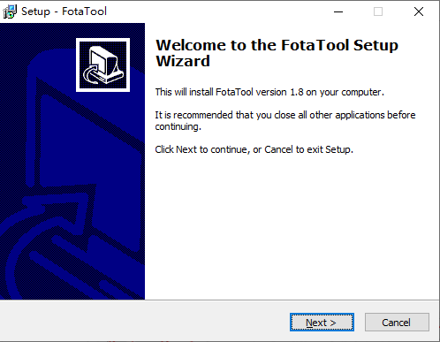

2.  弹出FotaTool安装路径选择界面，如[图2](#zh-cn_topic_0000001980146089_fig1816518507509)所示，选择好安装路径后，勾选红框提示，单击“Next”按钮。

    **图 2**  FotaTool安装路径选择界面<a name="zh-cn_topic_0000001980146089_fig1816518507509"></a>  
    
    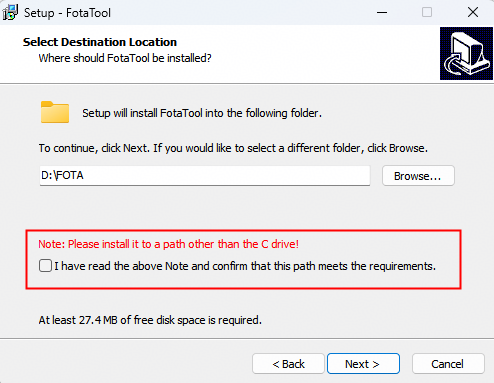

3.  弹出FotaTool菜单文件夹选择界面，如[图3](#zh-cn_topic_0000001980146089_fig1861623251713)所示。用户可以自定义修改文件夹名或使用默认文件夹名，然后单击“Next”按钮。

    **图 3**  FotaTool安装菜单文件夹选择界面<a name="zh-cn_topic_0000001980146089_fig1861623251713"></a>  
    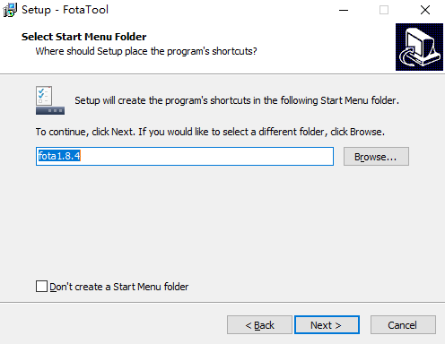

4.  弹出FotaTool额外任务选择界面，如[图4](#zh-cn_topic_0000001980146089_fig11907244191718)所示。选择是否创建桌面图标，并单击“Next”按钮。

    **图 4**  FotaTool额外任务选择界面<a name="zh-cn_topic_0000001980146089_fig11907244191718"></a>  
    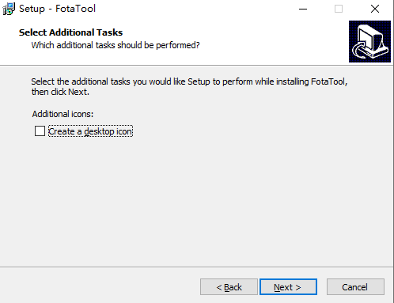

5.  弹出FotaTool准备安装界面，如[图5](#zh-cn_topic_0000001980146089_fig241134719513)所示，单击“Install”按钮进行安装。

    **图 5**  FotaTool安装界面<a name="zh-cn_topic_0000001980146089_fig241134719513"></a>  
    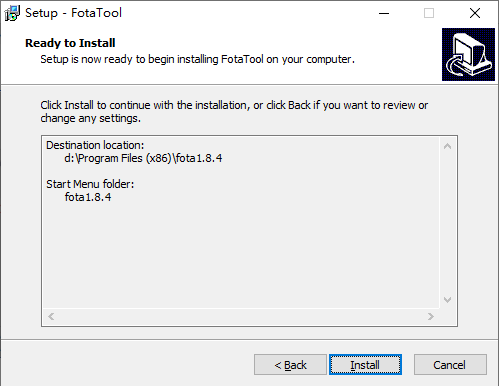

6.  弹出FotaTool正在安装界面，请等待直至安装完成。
7.  弹出FotaTool安装完成界面，如[图6](#zh-cn_topic_0000001980146089_fig1037412119526)所示，单击“Finish”按钮退出安装。

    **图 6**  FotaTool安装完成界面<a name="zh-cn_topic_0000001980146089_fig1037412119526"></a>  
    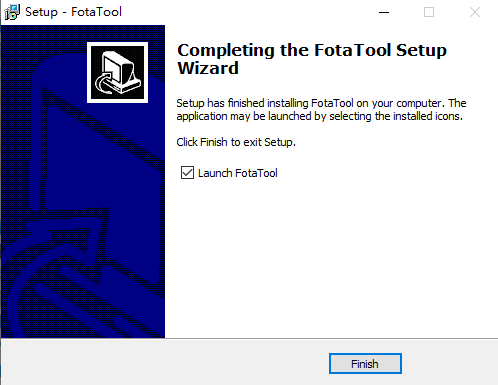

# 界面综述<a name="ZH-CN_TOPIC_0000002441424756"></a>

首次运行FotaTool应用程序，打开后的工具界面如[图1](#zh-cn_topic_0000001980146093_fig552635819104)所示。成功创建或测试FOTA升级包文件后，用户选择的文件路径会自动保存。即下次打开时，文件路径依然为上次选择的路径。

**图 1**  FotaTool界面示意图<a name="zh-cn_topic_0000001980146093_fig552635819104"></a>  
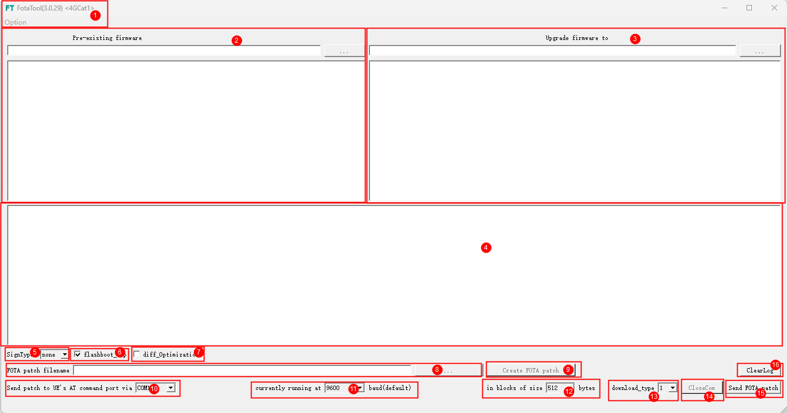

**表 1**  FotaTool界面说明

<a name="zh-cn_topic_0000001980146093_zh-cn_topic_0279549098_table156913141826"></a>
<table><thead align="left"><tr id="zh-cn_topic_0000001980146093_zh-cn_topic_0279549098_row0695148215"><th class="cellrowborder" valign="top" width="13.74%" id="mcps1.2.3.1.1"><p id="zh-cn_topic_0000001980146093_zh-cn_topic_0279549098_p5455981"><a name="zh-cn_topic_0000001980146093_zh-cn_topic_0279549098_p5455981"></a><a name="zh-cn_topic_0000001980146093_zh-cn_topic_0279549098_p5455981"></a>区域</p>
</th>
<th class="cellrowborder" valign="top" width="86.26%" id="mcps1.2.3.1.2"><p id="zh-cn_topic_0000001980146093_zh-cn_topic_0279549098_p39281331"><a name="zh-cn_topic_0000001980146093_zh-cn_topic_0279549098_p39281331"></a><a name="zh-cn_topic_0000001980146093_zh-cn_topic_0279549098_p39281331"></a>说明</p>
</th>
</tr>
</thead>
<tbody><tr id="zh-cn_topic_0000001980146093_row916312415714"><td class="cellrowborder" valign="top" width="13.74%" headers="mcps1.2.3.1.1 "><p id="zh-cn_topic_0000001980146093_zh-cn_topic_0279549098_p47714657"><a name="zh-cn_topic_0000001980146093_zh-cn_topic_0279549098_p47714657"></a><a name="zh-cn_topic_0000001980146093_zh-cn_topic_0279549098_p47714657"></a>1</p>
</td>
<td class="cellrowborder" valign="top" width="86.26%" headers="mcps1.2.3.1.2 "><p id="zh-cn_topic_0000001980146093_p51641242716"><a name="zh-cn_topic_0000001980146093_p51641242716"></a><a name="zh-cn_topic_0000001980146093_p51641242716"></a>Option：选择芯片类型，更换工具对应的版本并在版本号后面显示。</p>
</td>
</tr>
<tr id="zh-cn_topic_0000001980146093_zh-cn_topic_0279549098_row10707148214"><td class="cellrowborder" valign="top" width="13.74%" headers="mcps1.2.3.1.1 "><p id="zh-cn_topic_0000001980146093_zh-cn_topic_0279549098_p63739165"><a name="zh-cn_topic_0000001980146093_zh-cn_topic_0279549098_p63739165"></a><a name="zh-cn_topic_0000001980146093_zh-cn_topic_0279549098_p63739165"></a>2</p>
</td>
<td class="cellrowborder" valign="top" width="86.26%" headers="mcps1.2.3.1.2 "><p id="zh-cn_topic_0000001980146093_p8412125041810"><a name="zh-cn_topic_0000001980146093_p8412125041810"></a><a name="zh-cn_topic_0000001980146093_p8412125041810"></a>选择old fwpkg文件，并在加载后显示其对应路径及解析文件列表。</p>
</td>
</tr>
<tr id="zh-cn_topic_0000001980146093_zh-cn_topic_0279549098_row7702141527"><td class="cellrowborder" valign="top" width="13.74%" headers="mcps1.2.3.1.1 "><p id="zh-cn_topic_0000001980146093_zh-cn_topic_0279549098_p4179377"><a name="zh-cn_topic_0000001980146093_zh-cn_topic_0279549098_p4179377"></a><a name="zh-cn_topic_0000001980146093_zh-cn_topic_0279549098_p4179377"></a>3</p>
</td>
<td class="cellrowborder" valign="top" width="86.26%" headers="mcps1.2.3.1.2 "><p id="zh-cn_topic_0000001980146093_p8208825111919"><a name="zh-cn_topic_0000001980146093_p8208825111919"></a><a name="zh-cn_topic_0000001980146093_p8208825111919"></a>选择new fwpkg文件，并在加载后显示其对应路径及解析文件列表。</p>
</td>
</tr>
<tr id="zh-cn_topic_0000001980146093_zh-cn_topic_0279549098_row107011141123"><td class="cellrowborder" valign="top" width="13.74%" headers="mcps1.2.3.1.1 "><p id="zh-cn_topic_0000001980146093_zh-cn_topic_0279549098_p57396781"><a name="zh-cn_topic_0000001980146093_zh-cn_topic_0279549098_p57396781"></a><a name="zh-cn_topic_0000001980146093_zh-cn_topic_0279549098_p57396781"></a>4</p>
</td>
<td class="cellrowborder" valign="top" width="86.26%" headers="mcps1.2.3.1.2 "><p id="zh-cn_topic_0000001980146093_p1919114017199"><a name="zh-cn_topic_0000001980146093_p1919114017199"></a><a name="zh-cn_topic_0000001980146093_p1919114017199"></a>日志信息显示（包括生成升级包过程及近端升级过程中的日志信息）。</p>
</td>
</tr>
<tr id="zh-cn_topic_0000001980146093_zh-cn_topic_0279549098_row1770214822"><td class="cellrowborder" valign="top" width="13.74%" headers="mcps1.2.3.1.1 "><p id="zh-cn_topic_0000001980146093_zh-cn_topic_0279549098_p23568328"><a name="zh-cn_topic_0000001980146093_zh-cn_topic_0279549098_p23568328"></a><a name="zh-cn_topic_0000001980146093_zh-cn_topic_0279549098_p23568328"></a>5</p>
</td>
<td class="cellrowborder" valign="top" width="86.26%" headers="mcps1.2.3.1.2 "><p id="zh-cn_topic_0000001980146093_p198838415247"><a name="zh-cn_topic_0000001980146093_p198838415247"></a><a name="zh-cn_topic_0000001980146093_p198838415247"></a>签名方式选择（ecc/none）。</p>
</td>
</tr>
<tr id="zh-cn_topic_0000001980146093_row18773181195318"><td class="cellrowborder" valign="top" width="13.74%" headers="mcps1.2.3.1.1 "><p id="zh-cn_topic_0000001980146093_p7773131195310"><a name="zh-cn_topic_0000001980146093_p7773131195310"></a><a name="zh-cn_topic_0000001980146093_p7773131195310"></a>6</p>
</td>
<td class="cellrowborder" valign="top" width="86.26%" headers="mcps1.2.3.1.2 "><p id="zh-cn_topic_0000001980146093_p1977318118534"><a name="zh-cn_topic_0000001980146093_p1977318118534"></a><a name="zh-cn_topic_0000001980146093_p1977318118534"></a>是否执行flashboot_otp差分制作。</p>
</td>
</tr>
<tr id="zh-cn_topic_0000001980146093_row1626185310305"><td class="cellrowborder" valign="top" width="13.74%" headers="mcps1.2.3.1.1 "><p id="zh-cn_topic_0000001980146093_p96265538305"><a name="zh-cn_topic_0000001980146093_p96265538305"></a><a name="zh-cn_topic_0000001980146093_p96265538305"></a>7</p>
</td>
<td class="cellrowborder" valign="top" width="86.26%" headers="mcps1.2.3.1.2 "><p id="zh-cn_topic_0000001980146093_p16271536302"><a name="zh-cn_topic_0000001980146093_p16271536302"></a><a name="zh-cn_topic_0000001980146093_p16271536302"></a>是否执行优化算法，默认不勾选。（勾选后制作差分包时长会增加）</p>
</td>
</tr>
<tr id="zh-cn_topic_0000001980146093_zh-cn_topic_0279549098_row14707149214"><td class="cellrowborder" valign="top" width="13.74%" headers="mcps1.2.3.1.1 "><p id="zh-cn_topic_0000001980146093_zh-cn_topic_0279549098_p49697568"><a name="zh-cn_topic_0000001980146093_zh-cn_topic_0279549098_p49697568"></a><a name="zh-cn_topic_0000001980146093_zh-cn_topic_0279549098_p49697568"></a>8</p>
</td>
<td class="cellrowborder" valign="top" width="86.26%" headers="mcps1.2.3.1.2 "><p id="zh-cn_topic_0000001980146093_p1261322192415"><a name="zh-cn_topic_0000001980146093_p1261322192415"></a><a name="zh-cn_topic_0000001980146093_p1261322192415"></a>选择升级包文件的生成路径和文件名。如果此文件已存在，则在生成升级包文件时将覆盖原文件。</p>
</td>
</tr>
<tr id="zh-cn_topic_0000001980146093_zh-cn_topic_0279549098_row37018141229"><td class="cellrowborder" valign="top" width="13.74%" headers="mcps1.2.3.1.1 "><p id="zh-cn_topic_0000001980146093_zh-cn_topic_0279549098_p55310098"><a name="zh-cn_topic_0000001980146093_zh-cn_topic_0279549098_p55310098"></a><a name="zh-cn_topic_0000001980146093_zh-cn_topic_0279549098_p55310098"></a>9</p>
</td>
<td class="cellrowborder" valign="top" width="86.26%" headers="mcps1.2.3.1.2 "><p id="zh-cn_topic_0000001980146093_p1748935102819"><a name="zh-cn_topic_0000001980146093_p1748935102819"></a><a name="zh-cn_topic_0000001980146093_p1748935102819"></a>生成升级包文件。</p>
</td>
</tr>
<tr id="zh-cn_topic_0000001980146093_zh-cn_topic_0279549098_row1388672115219"><td class="cellrowborder" valign="top" width="13.74%" headers="mcps1.2.3.1.1 "><p id="zh-cn_topic_0000001980146093_zh-cn_topic_0279549098_p36189605"><a name="zh-cn_topic_0000001980146093_zh-cn_topic_0279549098_p36189605"></a><a name="zh-cn_topic_0000001980146093_zh-cn_topic_0279549098_p36189605"></a>10</p>
</td>
<td class="cellrowborder" valign="top" width="86.26%" headers="mcps1.2.3.1.2 "><p id="zh-cn_topic_0000001980146093_p1680227102815"><a name="zh-cn_topic_0000001980146093_p1680227102815"></a><a name="zh-cn_topic_0000001980146093_p1680227102815"></a>选择近端升级所需连接的串口端口号。</p>
</td>
</tr>
<tr id="zh-cn_topic_0000001980146093_zh-cn_topic_0279549098_row288620211526"><td class="cellrowborder" valign="top" width="13.74%" headers="mcps1.2.3.1.1 "><p id="zh-cn_topic_0000001980146093_zh-cn_topic_0279549098_p1139015311202"><a name="zh-cn_topic_0000001980146093_zh-cn_topic_0279549098_p1139015311202"></a><a name="zh-cn_topic_0000001980146093_zh-cn_topic_0279549098_p1139015311202"></a>11</p>
</td>
<td class="cellrowborder" valign="top" width="86.26%" headers="mcps1.2.3.1.2 "><p id="zh-cn_topic_0000001980146093_zh-cn_topic_0279549098_p31461811102010"><a name="zh-cn_topic_0000001980146093_zh-cn_topic_0279549098_p31461811102010"></a><a name="zh-cn_topic_0000001980146093_zh-cn_topic_0279549098_p31461811102010"></a>连接串口所需的波特率。</p>
</td>
</tr>
<tr id="zh-cn_topic_0000001980146093_zh-cn_topic_0279549098_row1539045322012"><td class="cellrowborder" valign="top" width="13.74%" headers="mcps1.2.3.1.1 "><p id="zh-cn_topic_0000001980146093_zh-cn_topic_0279549098_p1479220277536"><a name="zh-cn_topic_0000001980146093_zh-cn_topic_0279549098_p1479220277536"></a><a name="zh-cn_topic_0000001980146093_zh-cn_topic_0279549098_p1479220277536"></a>12</p>
</td>
<td class="cellrowborder" valign="top" width="86.26%" headers="mcps1.2.3.1.2 "><p id="zh-cn_topic_0000001980146093_p174939114304"><a name="zh-cn_topic_0000001980146093_p174939114304"></a><a name="zh-cn_topic_0000001980146093_p174939114304"></a>选择每次发送的数据块的大小。</p>
</td>
</tr>
<tr id="zh-cn_topic_0000001980146093_row612624485"><td class="cellrowborder" valign="top" width="13.74%" headers="mcps1.2.3.1.1 "><p id="zh-cn_topic_0000001980146093_p812162134811"><a name="zh-cn_topic_0000001980146093_p812162134811"></a><a name="zh-cn_topic_0000001980146093_p812162134811"></a>13</p>
</td>
<td class="cellrowborder" valign="top" width="86.26%" headers="mcps1.2.3.1.2 "><p id="zh-cn_topic_0000001980146093_p4120117319"><a name="zh-cn_topic_0000001980146093_p4120117319"></a><a name="zh-cn_topic_0000001980146093_p4120117319"></a>升级文件存储位置。</p>
<p id="zh-cn_topic_0000001980146093_p145317583113"><a name="zh-cn_topic_0000001980146093_p145317583113"></a><a name="zh-cn_topic_0000001980146093_p145317583113"></a>0：直接存储在flash中，目前不支持；</p>
<p id="zh-cn_topic_0000001980146093_p61213211480"><a name="zh-cn_topic_0000001980146093_p61213211480"></a><a name="zh-cn_topic_0000001980146093_p61213211480"></a>1：存储在文件系统中。</p>
</td>
</tr>
<tr id="zh-cn_topic_0000001980146093_zh-cn_topic_0279549098_row579172745311"><td class="cellrowborder" valign="top" width="13.74%" headers="mcps1.2.3.1.1 "><p id="zh-cn_topic_0000001980146093_zh-cn_topic_0279549098_p13499164652019"><a name="zh-cn_topic_0000001980146093_zh-cn_topic_0279549098_p13499164652019"></a><a name="zh-cn_topic_0000001980146093_zh-cn_topic_0279549098_p13499164652019"></a>14</p>
</td>
<td class="cellrowborder" valign="top" width="86.26%" headers="mcps1.2.3.1.2 "><p id="zh-cn_topic_0000001980146093_p1873824202913"><a name="zh-cn_topic_0000001980146093_p1873824202913"></a><a name="zh-cn_topic_0000001980146093_p1873824202913"></a>关闭串口。</p>
</td>
</tr>
<tr id="zh-cn_topic_0000001980146093_zh-cn_topic_0279549098_row649954692020"><td class="cellrowborder" valign="top" width="13.74%" headers="mcps1.2.3.1.1 "><p id="zh-cn_topic_0000001980146093_zh-cn_topic_0279549098_p41303584"><a name="zh-cn_topic_0000001980146093_zh-cn_topic_0279549098_p41303584"></a><a name="zh-cn_topic_0000001980146093_zh-cn_topic_0279549098_p41303584"></a>15</p>
</td>
<td class="cellrowborder" valign="top" width="86.26%" headers="mcps1.2.3.1.2 "><p id="zh-cn_topic_0000001980146093_p13293203563017"><a name="zh-cn_topic_0000001980146093_p13293203563017"></a><a name="zh-cn_topic_0000001980146093_p13293203563017"></a>发送升级包文件，开始近端升级。</p>
</td>
</tr>
<tr id="zh-cn_topic_0000001980146093_zh-cn_topic_0279549098_row1588515211226"><td class="cellrowborder" valign="top" width="13.74%" headers="mcps1.2.3.1.1 "><p id="zh-cn_topic_0000001980146093_p93041630576"><a name="zh-cn_topic_0000001980146093_p93041630576"></a><a name="zh-cn_topic_0000001980146093_p93041630576"></a>16</p>
</td>
<td class="cellrowborder" valign="top" width="86.26%" headers="mcps1.2.3.1.2 "><p id="zh-cn_topic_0000001980146093_p1417719412301"><a name="zh-cn_topic_0000001980146093_p1417719412301"></a><a name="zh-cn_topic_0000001980146093_p1417719412301"></a>清空日志栏。</p>
</td>
</tr>
</tbody>
</table>

# 操作步骤<a name="ZH-CN_TOPIC_0000002441584616"></a>

-   **[配置文件的修改](#ZH-CN_TOPIC_0000002474824549)**  

-   **[选择新旧两个固件包](#ZH-CN_TOPIC_0000002474904765)**  

-   **[选择签名方式](#ZH-CN_TOPIC_0000002441424764)**  

-   **[生成FOTA升级包文件](#ZH-CN_TOPIC_0000002474904769)**  

-   **[命令行方式生成FOTA升级包文件](#ZH-CN_TOPIC_0000002501251770)**  

-   **[通过串口发送FOTA升级包并完成近端升级](#ZH-CN_TOPIC_0000002441424772)**  

-   **[命令行通过串口发送FOTA升级包并完成近端升级](#ZH-CN_TOPIC_0000002501411618)**  

## 配置文件的修改<a name="ZH-CN_TOPIC_0000002474824549"></a>

打开安装路径下的配置文件“FotaToolCfg.ini”，文件内容如下：

```
[filePath]
IsCustomMode=1
IsCsType=1
IsCheckACore=1
[fotaHeader]
MSID=0x00000000
MSID_Mask=0x00000000
```

上述配置项的具体含义如[表1](#zh-cn_topic_0000001980225961_table136455612819)所示。

**表 1**  配置项说明

<a name="zh-cn_topic_0000001980225961_table136455612819"></a>
<table><thead align="left"><tr id="zh-cn_topic_0000001980225961_row1936412561986"><th class="cellrowborder" valign="top" width="19.37%" id="mcps1.2.4.1.1"><p id="zh-cn_topic_0000001980225961_p83659561386"><a name="zh-cn_topic_0000001980225961_p83659561386"></a><a name="zh-cn_topic_0000001980225961_p83659561386"></a>配置项</p>
</th>
<th class="cellrowborder" valign="top" width="18.43%" id="mcps1.2.4.1.2"><p id="zh-cn_topic_0000001980225961_p138321320132820"><a name="zh-cn_topic_0000001980225961_p138321320132820"></a><a name="zh-cn_topic_0000001980225961_p138321320132820"></a>默认值</p>
</th>
<th class="cellrowborder" valign="top" width="62.2%" id="mcps1.2.4.1.3"><p id="zh-cn_topic_0000001980225961_p18365165615813"><a name="zh-cn_topic_0000001980225961_p18365165615813"></a><a name="zh-cn_topic_0000001980225961_p18365165615813"></a>说明</p>
</th>
</tr>
</thead>
<tbody><tr id="zh-cn_topic_0000001980225961_row6365256588"><td class="cellrowborder" valign="top" width="19.37%" headers="mcps1.2.4.1.1 "><p id="zh-cn_topic_0000001980225961_p19365175610816"><a name="zh-cn_topic_0000001980225961_p19365175610816"></a><a name="zh-cn_topic_0000001980225961_p19365175610816"></a>IsCustomMode</p>
</td>
<td class="cellrowborder" valign="top" width="18.43%" headers="mcps1.2.4.1.2 "><p id="zh-cn_topic_0000001980225961_p3832152014285"><a name="zh-cn_topic_0000001980225961_p3832152014285"></a><a name="zh-cn_topic_0000001980225961_p3832152014285"></a>1</p>
</td>
<td class="cellrowborder" valign="top" width="62.2%" headers="mcps1.2.4.1.3 "><p id="zh-cn_topic_0000001980225961_p193651156489"><a name="zh-cn_topic_0000001980225961_p193651156489"></a><a name="zh-cn_topic_0000001980225961_p193651156489"></a>工具使用模式（用户模式和研发模式）。用户无需修改，保持默认值即可。</p>
</td>
</tr>
<tr id="zh-cn_topic_0000001980225961_row144053296111"><td class="cellrowborder" valign="top" width="19.37%" headers="mcps1.2.4.1.1 "><p id="zh-cn_topic_0000001980225961_p54051129191112"><a name="zh-cn_topic_0000001980225961_p54051129191112"></a><a name="zh-cn_topic_0000001980225961_p54051129191112"></a>IsCsType</p>
</td>
<td class="cellrowborder" valign="top" width="18.43%" headers="mcps1.2.4.1.2 "><p id="zh-cn_topic_0000001980225961_p11405192914119"><a name="zh-cn_topic_0000001980225961_p11405192914119"></a><a name="zh-cn_topic_0000001980225961_p11405192914119"></a>1</p>
</td>
<td class="cellrowborder" valign="top" width="62.2%" headers="mcps1.2.4.1.3 "><p id="zh-cn_topic_0000001980225961_p13405112917114"><a name="zh-cn_topic_0000001980225961_p13405112917114"></a><a name="zh-cn_topic_0000001980225961_p13405112917114"></a>-</p>
</td>
</tr>
<tr id="zh-cn_topic_0000001980225961_row120183541918"><td class="cellrowborder" valign="top" width="19.37%" headers="mcps1.2.4.1.1 "><p id="zh-cn_topic_0000001980225961_p1301835101910"><a name="zh-cn_topic_0000001980225961_p1301835101910"></a><a name="zh-cn_topic_0000001980225961_p1301835101910"></a>IsCheckACore</p>
</td>
<td class="cellrowborder" valign="top" width="18.43%" headers="mcps1.2.4.1.2 "><p id="zh-cn_topic_0000001980225961_p1711335101910"><a name="zh-cn_topic_0000001980225961_p1711335101910"></a><a name="zh-cn_topic_0000001980225961_p1711335101910"></a>1</p>
</td>
<td class="cellrowborder" valign="top" width="62.2%" headers="mcps1.2.4.1.3 "><p id="zh-cn_topic_0000001980225961_p18281795272"><a name="zh-cn_topic_0000001980225961_p18281795272"></a><a name="zh-cn_topic_0000001980225961_p18281795272"></a>A核文件系统分区大小做比较。</p>
<p id="zh-cn_topic_0000001980225961_p13240101119278"><a name="zh-cn_topic_0000001980225961_p13240101119278"></a><a name="zh-cn_topic_0000001980225961_p13240101119278"></a>0：不做比较；</p>
<p id="zh-cn_topic_0000001980225961_p2312141213276"><a name="zh-cn_topic_0000001980225961_p2312141213276"></a><a name="zh-cn_topic_0000001980225961_p2312141213276"></a>1：做比较。</p>
<p id="zh-cn_topic_0000001980225961_p112357197"><a name="zh-cn_topic_0000001980225961_p112357197"></a><a name="zh-cn_topic_0000001980225961_p112357197"></a>其余值会默认为1，做比较。</p>
</td>
</tr>
<tr id="zh-cn_topic_0000001980225961_row143655561089"><td class="cellrowborder" valign="top" width="19.37%" headers="mcps1.2.4.1.1 "><p id="zh-cn_topic_0000001980225961_p53652564814"><a name="zh-cn_topic_0000001980225961_p53652564814"></a><a name="zh-cn_topic_0000001980225961_p53652564814"></a>MSID</p>
</td>
<td class="cellrowborder" valign="top" width="18.43%" headers="mcps1.2.4.1.2 "><p id="zh-cn_topic_0000001980225961_p19832152017281"><a name="zh-cn_topic_0000001980225961_p19832152017281"></a><a name="zh-cn_topic_0000001980225961_p19832152017281"></a>0x00000000</p>
</td>
<td class="cellrowborder" valign="top" width="62.2%" headers="mcps1.2.4.1.3 "><p id="zh-cn_topic_0000001980225961_p859511911207"><a name="zh-cn_topic_0000001980225961_p859511911207"></a><a name="zh-cn_topic_0000001980225961_p859511911207"></a>MSID（Market Segment ID，市场区域ID）与MSID_Mask同时起作用，MSID（升级文件里）&MSID_Mask的值必须与应用核镜像中的MSID（OTP）&MSID_Mask的值相同。</p>
</td>
</tr>
<tr id="zh-cn_topic_0000001980225961_row37191028892"><td class="cellrowborder" valign="top" width="19.37%" headers="mcps1.2.4.1.1 "><p id="zh-cn_topic_0000001980225961_p67201728995"><a name="zh-cn_topic_0000001980225961_p67201728995"></a><a name="zh-cn_topic_0000001980225961_p67201728995"></a>MSID_Mask</p>
</td>
<td class="cellrowborder" valign="top" width="18.43%" headers="mcps1.2.4.1.2 "><p id="zh-cn_topic_0000001980225961_p583272082818"><a name="zh-cn_topic_0000001980225961_p583272082818"></a><a name="zh-cn_topic_0000001980225961_p583272082818"></a>0x00000000</p>
</td>
<td class="cellrowborder" valign="top" width="62.2%" headers="mcps1.2.4.1.3 "><p id="zh-cn_topic_0000001980225961_p07203285913"><a name="zh-cn_topic_0000001980225961_p07203285913"></a><a name="zh-cn_topic_0000001980225961_p07203285913"></a>市场区域ID掩码。MSID与MSID_Mask同时起作用，MSID（升级文件里）&MSID_Mask的值必须与应用核镜像中的MSID（OTP）&MSID_Mask的值相同。</p>
</td>
</tr>
</tbody>
</table>

> **说明：** 
>用户修改配置文件后，需要重启FotaTool才能生效。

## 选择新旧两个固件包<a name="ZH-CN_TOPIC_0000002474904765"></a>

启动FotaTool工具，如[图1](#zh-cn_topic_0000001980146085_fig4595655192420)所示。单击左侧“...”按钮，打开文件加载对话框，选择需要升级的源固件包；同样单击右侧“...”按钮，选择目标固件包。

固件包都是“.fwpkg”格式的文件，FotaTool会对这两个固件包通过差分算法生成升级包文件。

**图 1**  选择固件包<a name="zh-cn_topic_0000001980146085_fig4595655192420"></a>  


如[图2](#zh-cn_topic_0000001980146085_fig69751347141115)所示，固件包文件加载后，会显示固件包内包含的镜像文件列表。如果没有显示镜像文件列表或者出现错误信息，请检查固件包文件是否正确。

**图 2**  固件信息<a name="zh-cn_topic_0000001980146085_fig69751347141115"></a>  
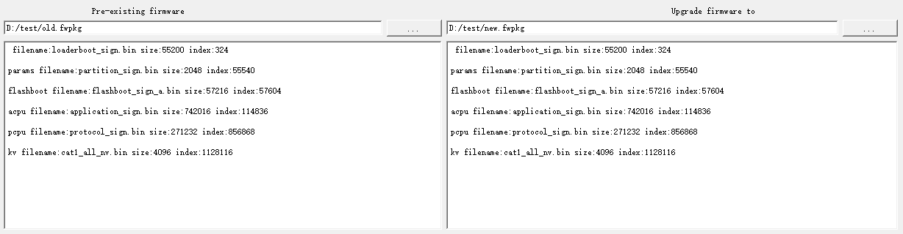

> **说明：** 
>Hi2131采用差分升级。因此生成升级包所用的旧固件包必须与当前在UE上运行的固件程序一致才能使用生成的升级包进行升级。

## 选择签名方式<a name="ZH-CN_TOPIC_0000002441424764"></a>

-   **[界面操作](#ZH-CN_TOPIC_0000002441584624)**  

-   **[签名密钥配置](#ZH-CN_TOPIC_0000002474824565)**  

### 界面操作<a name="ZH-CN_TOPIC_0000002441584624"></a>

如[图1](#zh-cn_topic_0000001980146097_fig19187220173613)所示，用户需要选择签名方式（ECC/none）。可选项包括ECC、none，分别表示采用ECC算法签名和不签名。

**图 1**  界面设置<a name="zh-cn_topic_0000001980146097_fig19187220173613"></a>  


> **说明：** 
>用户在此选择的签名方式必须与当前在UE上运行的固件中镜像的签名方式一致。

### 签名密钥配置<a name="ZH-CN_TOPIC_0000002474824565"></a>

-   FotaTool工具签名所用的签名配置文件和密钥文件存放在FotaTool工具的安装目录下。例如：“C:\\Program Files \(x86\)\\FotaTool\\CASignTool\_4GCat1\\”。
-   签名配置文件为：acpu\_3rd\_sign\_ecc.cfg，对应ECC签名。用户可以修改这个文件，但文件名不允许修改。
-   FotaTool工具安装后默认没有包含签名密钥文件，需要用户自行添加。签名密钥文件采用pem格式。
-   用户生成签名密钥文件后，需要拷贝至FotaTool工具的安装目录下（例如：“C:\\Program Files \(x86\)\\FotaTool\\CASignTool\_4GCat1\\”），并修改对应算法的cfg文件，在cfg文件中指定签名密钥文件的路径和文件名。（cfg文件中相对路径的“./”是指“FotaTool.exe”的当前路径，工具中自带的cfg文件中的路径文件是示例，具体路径和文件名称需要根据安装后的路径和生成的文件名来确定。）
-   FOTA升级包签名使用的密钥为了防止泄漏，强烈建议只有相关安全专员能访问使用。

## 生成FOTA升级包文件<a name="ZH-CN_TOPIC_0000002474904769"></a>

如[图1](#zh-cn_topic_0000001949706530_fig22681613259)所示，选择FOTA升级包文件的路径和名称。

**图 1**  选择升级包文件<a name="zh-cn_topic_0000001949706530_fig22681613259"></a>  
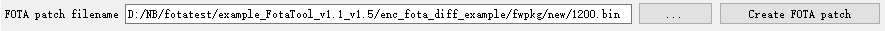

单击启用状态的“Create FOTA patch”按钮，将开始生成升级包文件。

升级包文件生成成功后，在信息栏中会生成如[图2](#zh-cn_topic_0000001949706530_fig12205330144512)所示的打印信息。

**图 2**  升级包文件生成成功示意图<a name="zh-cn_topic_0000001949706530_fig12205330144512"></a>  
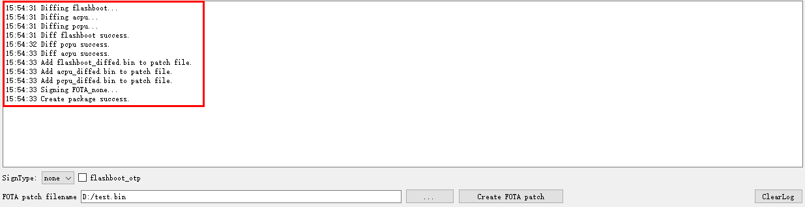

## 命令行方式生成FOTA升级包文件<a name="ZH-CN_TOPIC_0000002501251770"></a>

FOTA工具支持命令行方式调用生成升级包文件。步骤如下：

1.  在FotaTool.exe的路径下打开命令行窗口。
2.  输入参数，然后回车开始执行。示例如下，具体参数如[表1](#zh-cn_topic_0000002474823420_table192341333419)所示。

    示例：

    ```
    FotaTool.exe 1 1 0 D:\file\v1.fwpkg D:\file\v2.fwpkg D:\file\v1_v2.bin 4GCat1 -console 
    ```

    或者

    ```
    FotaTool.exe 1 1 0 D:\file\v1.fwpkg D:\file\v2.fwpkg D:\file\v1_v2.bin 4GCat1
    ```

    **表 1**  命令行参数说明

    <a name="zh-cn_topic_0000002474823420_table192341333419"></a>
    <table><thead align="left"><tr id="zh-cn_topic_0000002474823420_row1223143314110"><th class="cellrowborder" valign="top" width="10.14%" id="mcps1.2.4.1.1"><p id="zh-cn_topic_0000002474823420_p1223118338412"><a name="zh-cn_topic_0000002474823420_p1223118338412"></a><a name="zh-cn_topic_0000002474823420_p1223118338412"></a>参数位置</p>
    </th>
    <th class="cellrowborder" valign="top" width="18.96%" id="mcps1.2.4.1.2"><p id="zh-cn_topic_0000002474823420_p5231183314412"><a name="zh-cn_topic_0000002474823420_p5231183314412"></a><a name="zh-cn_topic_0000002474823420_p5231183314412"></a>参数格式</p>
    </th>
    <th class="cellrowborder" valign="top" width="70.89999999999999%" id="mcps1.2.4.1.3"><p id="zh-cn_topic_0000002474823420_p182315335419"><a name="zh-cn_topic_0000002474823420_p182315335419"></a><a name="zh-cn_topic_0000002474823420_p182315335419"></a>参数说明</p>
    </th>
    </tr>
    </thead>
    <tbody><tr id="zh-cn_topic_0000002474823420_row2231933184120"><td class="cellrowborder" valign="top" width="10.14%" headers="mcps1.2.4.1.1 "><p id="zh-cn_topic_0000002474823420_p1423113319415"><a name="zh-cn_topic_0000002474823420_p1423113319415"></a><a name="zh-cn_topic_0000002474823420_p1423113319415"></a>1</p>
    </td>
    <td class="cellrowborder" valign="top" width="18.96%" headers="mcps1.2.4.1.2 "><p id="zh-cn_topic_0000002474823420_p423120337419"><a name="zh-cn_topic_0000002474823420_p423120337419"></a><a name="zh-cn_topic_0000002474823420_p423120337419"></a>FotaTool.exe</p>
    </td>
    <td class="cellrowborder" valign="top" width="70.89999999999999%" headers="mcps1.2.4.1.3 "><p id="zh-cn_topic_0000002474823420_p523143314118"><a name="zh-cn_topic_0000002474823420_p523143314118"></a><a name="zh-cn_topic_0000002474823420_p523143314118"></a>工具的执行文件的相对路径或者绝对路径。</p>
    </td>
    </tr>
    <tr id="zh-cn_topic_0000002474823420_row7231143314115"><td class="cellrowborder" valign="top" width="10.14%" headers="mcps1.2.4.1.1 "><p id="zh-cn_topic_0000002474823420_p1023143312415"><a name="zh-cn_topic_0000002474823420_p1023143312415"></a><a name="zh-cn_topic_0000002474823420_p1023143312415"></a>2</p>
    </td>
    <td class="cellrowborder" valign="top" width="18.96%" headers="mcps1.2.4.1.2 "><p id="zh-cn_topic_0000002474823420_p123120332419"><a name="zh-cn_topic_0000002474823420_p123120332419"></a><a name="zh-cn_topic_0000002474823420_p123120332419"></a>1</p>
    </td>
    <td class="cellrowborder" valign="top" width="70.89999999999999%" headers="mcps1.2.4.1.3 "><p id="zh-cn_topic_0000002474823420_p623113364113"><a name="zh-cn_topic_0000002474823420_p623113364113"></a><a name="zh-cn_topic_0000002474823420_p623113364113"></a>选择的签名方式，默认值为1。</p>
    <p id="zh-cn_topic_0000002474823420_p1572151194113"><a name="zh-cn_topic_0000002474823420_p1572151194113"></a><a name="zh-cn_topic_0000002474823420_p1572151194113"></a>0：ecc；</p>
    <p id="zh-cn_topic_0000002474823420_p67437567417"><a name="zh-cn_topic_0000002474823420_p67437567417"></a><a name="zh-cn_topic_0000002474823420_p67437567417"></a>1：none。</p>
    </td>
    </tr>
    <tr id="zh-cn_topic_0000002474823420_row11232933164111"><td class="cellrowborder" valign="top" width="10.14%" headers="mcps1.2.4.1.1 "><p id="zh-cn_topic_0000002474823420_p20231333134120"><a name="zh-cn_topic_0000002474823420_p20231333134120"></a><a name="zh-cn_topic_0000002474823420_p20231333134120"></a>3</p>
    </td>
    <td class="cellrowborder" valign="top" width="18.96%" headers="mcps1.2.4.1.2 "><p id="zh-cn_topic_0000002474823420_p14231183314115"><a name="zh-cn_topic_0000002474823420_p14231183314115"></a><a name="zh-cn_topic_0000002474823420_p14231183314115"></a>1</p>
    </td>
    <td class="cellrowborder" valign="top" width="70.89999999999999%" headers="mcps1.2.4.1.3 "><p id="zh-cn_topic_0000002474823420_p1523183354114"><a name="zh-cn_topic_0000002474823420_p1523183354114"></a><a name="zh-cn_topic_0000002474823420_p1523183354114"></a>是否执行flashboot_otp差分制作，默认值为1。</p>
    <p id="zh-cn_topic_0000002474823420_p61568884214"><a name="zh-cn_topic_0000002474823420_p61568884214"></a><a name="zh-cn_topic_0000002474823420_p61568884214"></a>0：不执行；</p>
    <p id="zh-cn_topic_0000002474823420_p1649331494215"><a name="zh-cn_topic_0000002474823420_p1649331494215"></a><a name="zh-cn_topic_0000002474823420_p1649331494215"></a>1：执行。</p>
    </td>
    </tr>
    <tr id="zh-cn_topic_0000002474823420_row52331733114111"><td class="cellrowborder" valign="top" width="10.14%" headers="mcps1.2.4.1.1 "><p id="zh-cn_topic_0000002474823420_p1123233311417"><a name="zh-cn_topic_0000002474823420_p1123233311417"></a><a name="zh-cn_topic_0000002474823420_p1123233311417"></a>4</p>
    </td>
    <td class="cellrowborder" valign="top" width="18.96%" headers="mcps1.2.4.1.2 "><p id="zh-cn_topic_0000002474823420_p17232173324115"><a name="zh-cn_topic_0000002474823420_p17232173324115"></a><a name="zh-cn_topic_0000002474823420_p17232173324115"></a>0</p>
    </td>
    <td class="cellrowborder" valign="top" width="70.89999999999999%" headers="mcps1.2.4.1.3 "><p id="zh-cn_topic_0000002474823420_p223253315412"><a name="zh-cn_topic_0000002474823420_p223253315412"></a><a name="zh-cn_topic_0000002474823420_p223253315412"></a>是否执行优化算法，默认值为0。</p>
    <p id="zh-cn_topic_0000002474823420_p16291242423"><a name="zh-cn_topic_0000002474823420_p16291242423"></a><a name="zh-cn_topic_0000002474823420_p16291242423"></a>0：不执行；</p>
    <p id="zh-cn_topic_0000002474823420_p9235729184210"><a name="zh-cn_topic_0000002474823420_p9235729184210"></a><a name="zh-cn_topic_0000002474823420_p9235729184210"></a>1：执行。</p>
    </td>
    </tr>
    <tr id="zh-cn_topic_0000002474823420_row023314332415"><td class="cellrowborder" valign="top" width="10.14%" headers="mcps1.2.4.1.1 "><p id="zh-cn_topic_0000002474823420_p1923393310411"><a name="zh-cn_topic_0000002474823420_p1923393310411"></a><a name="zh-cn_topic_0000002474823420_p1923393310411"></a>5</p>
    </td>
    <td class="cellrowborder" valign="top" width="18.96%" headers="mcps1.2.4.1.2 "><p id="zh-cn_topic_0000002474823420_p1233133312416"><a name="zh-cn_topic_0000002474823420_p1233133312416"></a><a name="zh-cn_topic_0000002474823420_p1233133312416"></a>v1.fwpkg</p>
    </td>
    <td class="cellrowborder" valign="top" width="70.89999999999999%" headers="mcps1.2.4.1.3 "><p id="zh-cn_topic_0000002474823420_p6233933174111"><a name="zh-cn_topic_0000002474823420_p6233933174111"></a><a name="zh-cn_topic_0000002474823420_p6233933174111"></a>制作升级包的旧镜像文件（*.fwpkg）的相对路径或者绝对路径。</p>
    </td>
    </tr>
    <tr id="zh-cn_topic_0000002474823420_row223393317413"><td class="cellrowborder" valign="top" width="10.14%" headers="mcps1.2.4.1.1 "><p id="zh-cn_topic_0000002474823420_p202331333104117"><a name="zh-cn_topic_0000002474823420_p202331333104117"></a><a name="zh-cn_topic_0000002474823420_p202331333104117"></a>6</p>
    </td>
    <td class="cellrowborder" valign="top" width="18.96%" headers="mcps1.2.4.1.2 "><p id="zh-cn_topic_0000002474823420_p1233633134117"><a name="zh-cn_topic_0000002474823420_p1233633134117"></a><a name="zh-cn_topic_0000002474823420_p1233633134117"></a>v2.fwpkg</p>
    </td>
    <td class="cellrowborder" valign="top" width="70.89999999999999%" headers="mcps1.2.4.1.3 "><p id="zh-cn_topic_0000002474823420_p1823353324110"><a name="zh-cn_topic_0000002474823420_p1823353324110"></a><a name="zh-cn_topic_0000002474823420_p1823353324110"></a>制作升级包的新镜像文件（*.fwpkg）的相对路径或者绝对路径。</p>
    </td>
    </tr>
    <tr id="zh-cn_topic_0000002474823420_row12234733134111"><td class="cellrowborder" valign="top" width="10.14%" headers="mcps1.2.4.1.1 "><p id="zh-cn_topic_0000002474823420_p1123343315411"><a name="zh-cn_topic_0000002474823420_p1123343315411"></a><a name="zh-cn_topic_0000002474823420_p1123343315411"></a>7</p>
    </td>
    <td class="cellrowborder" valign="top" width="18.96%" headers="mcps1.2.4.1.2 "><p id="zh-cn_topic_0000002474823420_p12234153318414"><a name="zh-cn_topic_0000002474823420_p12234153318414"></a><a name="zh-cn_topic_0000002474823420_p12234153318414"></a>v1_v2.bin</p>
    </td>
    <td class="cellrowborder" valign="top" width="70.89999999999999%" headers="mcps1.2.4.1.3 "><p id="zh-cn_topic_0000002474823420_p10234143312414"><a name="zh-cn_topic_0000002474823420_p10234143312414"></a><a name="zh-cn_topic_0000002474823420_p10234143312414"></a>生成的升级包（*.bin）的相对路径或者绝对路径。</p>
    </td>
    </tr>
    <tr id="zh-cn_topic_0000002474823420_row4234113374113"><td class="cellrowborder" valign="top" width="10.14%" headers="mcps1.2.4.1.1 "><p id="zh-cn_topic_0000002474823420_p18234113374118"><a name="zh-cn_topic_0000002474823420_p18234113374118"></a><a name="zh-cn_topic_0000002474823420_p18234113374118"></a>8</p>
    </td>
    <td class="cellrowborder" valign="top" width="18.96%" headers="mcps1.2.4.1.2 "><p id="zh-cn_topic_0000002474823420_p9234103312417"><a name="zh-cn_topic_0000002474823420_p9234103312417"></a><a name="zh-cn_topic_0000002474823420_p9234103312417"></a>4GCat1</p>
    </td>
    <td class="cellrowborder" valign="top" width="70.89999999999999%" headers="mcps1.2.4.1.3 "><p id="zh-cn_topic_0000002474823420_p423415335413"><a name="zh-cn_topic_0000002474823420_p423415335413"></a><a name="zh-cn_topic_0000002474823420_p423415335413"></a>工具版本的选择。</p>
    </td>
    </tr>
    <tr id="zh-cn_topic_0000002474823420_row274519475145"><td class="cellrowborder" valign="top" width="10.14%" headers="mcps1.2.4.1.1 "><p id="zh-cn_topic_0000002474823420_p97464472143"><a name="zh-cn_topic_0000002474823420_p97464472143"></a><a name="zh-cn_topic_0000002474823420_p97464472143"></a>9</p>
    </td>
    <td class="cellrowborder" valign="top" width="18.96%" headers="mcps1.2.4.1.2 "><p id="zh-cn_topic_0000002474823420_p167469479145"><a name="zh-cn_topic_0000002474823420_p167469479145"></a><a name="zh-cn_topic_0000002474823420_p167469479145"></a>-console （可选参数）</p>
    </td>
    <td class="cellrowborder" valign="top" width="70.89999999999999%" headers="mcps1.2.4.1.3 "><p id="zh-cn_topic_0000002474823420_p14746174791412"><a name="zh-cn_topic_0000002474823420_p14746174791412"></a><a name="zh-cn_topic_0000002474823420_p14746174791412"></a>使用标准输入输出，为重定向做准备。</p>
    </td>
    </tr>
    </tbody>
    </table>

3.  执行结果，如[图1](#zh-cn_topic_0000002474823420_fig86011481144)所示。

    **图 1**  命令行生成升级包<a name="zh-cn_topic_0000002474823420_fig86011481144"></a>  
    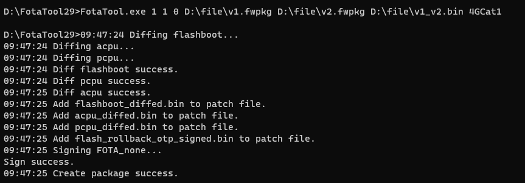

> **须知：** 
>涉及路径的操作不支持中文路径。

## 通过串口发送FOTA升级包并完成近端升级<a name="ZH-CN_TOPIC_0000002441424772"></a>

成功生成FOTA升级包之后，用户可以通过串口，将FOTA升级包发送到UE并完成FOTA近端升级，此操作可验证生成的差分包是否正确。

如[图1](#zh-cn_topic_0000001949706526_fig1476218367250)所示，用户需要选择如下参数：

-   与UE连接的串口端口号（FOTA近端升级通过AT串口实现）。
-   需要使用的波特率：115200是常见的默认值，UE可能支持不同的波特率，用户需要根据实际情况配置，配置UART/LP\_UART使用的波特率保持一致即可。
-   发送升级包时使用的数据块大小（每一次发送的分包大小，单位：Byte，支持的数值为：32、64、128、256、512）。

**图 1**  参数选择<a name="zh-cn_topic_0000001949706526_fig1476218367250"></a>  


如果升级包文件存在，且选择了正确的串口号，用户可通过单击“Send FOTA patch ”按钮，启动FOTA近端（串口）升级。

如[图2](#zh-cn_topic_0000001949706526_fig1753345014253)所示，界面下方显示升级进度。

**图 2**  升级进度<a name="zh-cn_topic_0000001949706526_fig1753345014253"></a>  
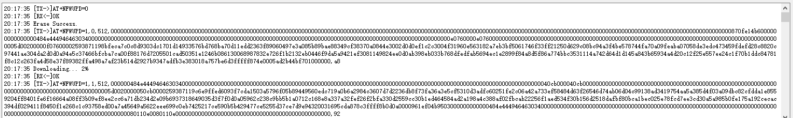

当升级包全部发送完成后，日志信息中会出现“Apply Over”，但这并不代表FOTA升级包升级成功，而是代表UE已经接收到FOTA升级包。

随后，UE会重启，并开始对FOTA升级包进行验证以及通过差分算法对固件进行更新的操作。完成后，UE会再次重启，FotaTool会自动发送AT命令来查询升级结果和新固件版本号，并在日志信息栏显示。

> **说明：** 
>UE收到升级包，并开始验证和更新操作后，需要一段时间用来完成整个固件的更新，更新过程中不受任何AT命令响应（时间大概1～2分钟左右，时间长短与升级包大小有关）。

如果升级过程中报告错误，则可能的原因和应对措施如[表1](#zh-cn_topic_0000001949706526_table181318478528)所示。

**表 1**  错误原因和应对措施

<a name="zh-cn_topic_0000001949706526_table181318478528"></a>
<table><thead align="left"><tr id="zh-cn_topic_0000001949706526_row2013194775210"><th class="cellrowborder" valign="top" width="43.97%" id="mcps1.2.3.1.1"><p id="zh-cn_topic_0000001949706526_p101311247125219"><a name="zh-cn_topic_0000001949706526_p101311247125219"></a><a name="zh-cn_topic_0000001949706526_p101311247125219"></a>可能原因</p>
</th>
<th class="cellrowborder" valign="top" width="56.03%" id="mcps1.2.3.1.2"><p id="zh-cn_topic_0000001949706526_p20131124718521"><a name="zh-cn_topic_0000001949706526_p20131124718521"></a><a name="zh-cn_topic_0000001949706526_p20131124718521"></a>应对措施</p>
</th>
</tr>
</thead>
<tbody><tr id="zh-cn_topic_0000001949706526_row0131134775219"><td class="cellrowborder" valign="top" width="43.97%" headers="mcps1.2.3.1.1 "><p id="zh-cn_topic_0000001949706526_p1213144713526"><a name="zh-cn_topic_0000001949706526_p1213144713526"></a><a name="zh-cn_topic_0000001949706526_p1213144713526"></a>串口端口选择错误，未选择AT使用的端口。</p>
</td>
<td class="cellrowborder" valign="top" width="56.03%" headers="mcps1.2.3.1.2 "><p id="zh-cn_topic_0000001949706526_p1813112477521"><a name="zh-cn_topic_0000001949706526_p1813112477521"></a><a name="zh-cn_topic_0000001949706526_p1813112477521"></a>选择正确的串口端口。</p>
</td>
</tr>
<tr id="zh-cn_topic_0000001949706526_row2131144765214"><td class="cellrowborder" valign="top" width="43.97%" headers="mcps1.2.3.1.1 "><p id="zh-cn_topic_0000001949706526_p1513194715524"><a name="zh-cn_topic_0000001949706526_p1513194715524"></a><a name="zh-cn_topic_0000001949706526_p1513194715524"></a>串口端口被输入AT命令的串口工具占用。</p>
</td>
<td class="cellrowborder" valign="top" width="56.03%" headers="mcps1.2.3.1.2 "><p id="zh-cn_topic_0000001949706526_p141311647165215"><a name="zh-cn_topic_0000001949706526_p141311647165215"></a><a name="zh-cn_topic_0000001949706526_p141311647165215"></a>关闭其他串口工具对该端口的占用。</p>
</td>
</tr>
<tr id="zh-cn_topic_0000001949706526_row1313114472526"><td class="cellrowborder" valign="top" width="43.97%" headers="mcps1.2.3.1.1 "><p id="zh-cn_topic_0000001949706526_p1913118475528"><a name="zh-cn_topic_0000001949706526_p1913118475528"></a><a name="zh-cn_topic_0000001949706526_p1913118475528"></a>UE中当前的固件程序不支持通过AT命令接收FOTA升级包。</p>
</td>
<td class="cellrowborder" valign="top" width="56.03%" headers="mcps1.2.3.1.2 "><p id="zh-cn_topic_0000001949706526_p213104713522"><a name="zh-cn_topic_0000001949706526_p213104713522"></a><a name="zh-cn_topic_0000001949706526_p213104713522"></a>使用空中升级的方式升级。</p>
</td>
</tr>
<tr id="zh-cn_topic_0000001949706526_row15131747135215"><td class="cellrowborder" valign="top" width="43.97%" headers="mcps1.2.3.1.1 "><p id="zh-cn_topic_0000001949706526_p8131144718522"><a name="zh-cn_topic_0000001949706526_p8131144718522"></a><a name="zh-cn_topic_0000001949706526_p8131144718522"></a>UE要求的数据发送速率与FotaTool设置的发送速率不匹配。</p>
</td>
<td class="cellrowborder" valign="top" width="56.03%" headers="mcps1.2.3.1.2 "><p id="zh-cn_topic_0000001949706526_p12131204710524"><a name="zh-cn_topic_0000001949706526_p12131204710524"></a><a name="zh-cn_topic_0000001949706526_p12131204710524"></a>使用与UE匹配的AT命令端口速率。</p>
</td>
</tr>
<tr id="zh-cn_topic_0000001949706526_row1213116478523"><td class="cellrowborder" valign="top" width="43.97%" headers="mcps1.2.3.1.1 "><p id="zh-cn_topic_0000001949706526_p013174795210"><a name="zh-cn_topic_0000001949706526_p013174795210"></a><a name="zh-cn_topic_0000001949706526_p013174795210"></a>升级包的大小超过可支持的最大规格，为350KB（2M Flash) 或 1200KB（4M Flash）。</p>
</td>
<td class="cellrowborder" valign="top" width="56.03%" headers="mcps1.2.3.1.2 "><p id="zh-cn_topic_0000001949706526_p20131447155213"><a name="zh-cn_topic_0000001949706526_p20131447155213"></a><a name="zh-cn_topic_0000001949706526_p20131447155213"></a>尽量减小升级包大小。可通过以下两种方式进行：</p>
<a name="zh-cn_topic_0000001949706526_ul9844410183110"></a><a name="zh-cn_topic_0000001949706526_ul9844410183110"></a><ul id="zh-cn_topic_0000001949706526_ul9844410183110"><li>将多个特性的更新分成两次升级，减少每次升级修改的代码量。</li><li>如果此次升级包含多个核镜像的升级，考虑分多次升级进行。例如先升级协议核，再升级应用核。这种情况需要保证不同核之间的修改没有相互依赖，保证单次升级后UE正常运行，不影响后续的升级功能。</li></ul>
</td>
</tr>
</tbody>
</table>

> **说明：** 
>升级后的固件必须能够正常运行，才能再次继续升级。因此强烈建议用户在进行UE的固件升级之前，进行彻底的测试和验证，确保升级后UE的行为符合预期。

## 命令行通过串口发送FOTA升级包并完成近端升级<a name="ZH-CN_TOPIC_0000002501411618"></a>

FOTA工具支持命令行方式通过串口，将FOTA升级包发送到UE并完成FOTA近端升级，此操作可验证生成的差分包是否正确。步骤如下：

1.  在FotaTool.exe的路径下打开命令行窗口。
2.  输入参数，然后回车开始执行。示例如下，具体参数如[表1](#zh-cn_topic_0000002474891526_table1647822122518)所示。

    示例：

    ```
    FotaTool.exe 5 9600 512 D:\file\v1_v2.bin -console
    ```

    或者

    ```
    FotaTool.exe 5 9600 512 D:\file\v1_v2.bin
    ```

    **表 1**  命令行参数说明

    <a name="zh-cn_topic_0000002474891526_table1647822122518"></a>
    <table><thead align="left"><tr id="zh-cn_topic_0000002474891526_row2478202102511"><th class="cellrowborder" valign="top" width="10.71107110711071%" id="mcps1.2.4.1.1"><p id="zh-cn_topic_0000002474891526_p1147914212512"><a name="zh-cn_topic_0000002474891526_p1147914212512"></a><a name="zh-cn_topic_0000002474891526_p1147914212512"></a>参数位置</p>
    </th>
    <th class="cellrowborder" valign="top" width="23.812381238123812%" id="mcps1.2.4.1.2"><p id="zh-cn_topic_0000002474891526_p154791321251"><a name="zh-cn_topic_0000002474891526_p154791321251"></a><a name="zh-cn_topic_0000002474891526_p154791321251"></a>参数格式</p>
    </th>
    <th class="cellrowborder" valign="top" width="65.47654765476547%" id="mcps1.2.4.1.3"><p id="zh-cn_topic_0000002474891526_p247918252520"><a name="zh-cn_topic_0000002474891526_p247918252520"></a><a name="zh-cn_topic_0000002474891526_p247918252520"></a>参数说明</p>
    </th>
    </tr>
    </thead>
    <tbody><tr id="zh-cn_topic_0000002474891526_row1947916219258"><td class="cellrowborder" valign="top" width="10.71107110711071%" headers="mcps1.2.4.1.1 "><p id="zh-cn_topic_0000002474891526_p747920252511"><a name="zh-cn_topic_0000002474891526_p747920252511"></a><a name="zh-cn_topic_0000002474891526_p747920252511"></a>1</p>
    </td>
    <td class="cellrowborder" valign="top" width="23.812381238123812%" headers="mcps1.2.4.1.2 "><p id="zh-cn_topic_0000002474891526_p747982142515"><a name="zh-cn_topic_0000002474891526_p747982142515"></a><a name="zh-cn_topic_0000002474891526_p747982142515"></a>FotaTool.exe</p>
    </td>
    <td class="cellrowborder" valign="top" width="65.47654765476547%" headers="mcps1.2.4.1.3 "><p id="zh-cn_topic_0000002474891526_p14791723253"><a name="zh-cn_topic_0000002474891526_p14791723253"></a><a name="zh-cn_topic_0000002474891526_p14791723253"></a>工具的执行文件的相对路径或者绝对路径。</p>
    </td>
    </tr>
    <tr id="zh-cn_topic_0000002474891526_row1347920222517"><td class="cellrowborder" valign="top" width="10.71107110711071%" headers="mcps1.2.4.1.1 "><p id="zh-cn_topic_0000002474891526_p44796282516"><a name="zh-cn_topic_0000002474891526_p44796282516"></a><a name="zh-cn_topic_0000002474891526_p44796282516"></a>2</p>
    </td>
    <td class="cellrowborder" valign="top" width="23.812381238123812%" headers="mcps1.2.4.1.2 "><p id="zh-cn_topic_0000002474891526_p1747913220256"><a name="zh-cn_topic_0000002474891526_p1747913220256"></a><a name="zh-cn_topic_0000002474891526_p1747913220256"></a>5</p>
    </td>
    <td class="cellrowborder" valign="top" width="65.47654765476547%" headers="mcps1.2.4.1.3 "><p id="zh-cn_topic_0000002474891526_p747919216258"><a name="zh-cn_topic_0000002474891526_p747919216258"></a><a name="zh-cn_topic_0000002474891526_p747919216258"></a>与UE连接的串口端口号（FOTA近端升级通过AT串口实现）。</p>
    </td>
    </tr>
    <tr id="zh-cn_topic_0000002474891526_row5479122142513"><td class="cellrowborder" valign="top" width="10.71107110711071%" headers="mcps1.2.4.1.1 "><p id="zh-cn_topic_0000002474891526_p74791826254"><a name="zh-cn_topic_0000002474891526_p74791826254"></a><a name="zh-cn_topic_0000002474891526_p74791826254"></a>3</p>
    </td>
    <td class="cellrowborder" valign="top" width="23.812381238123812%" headers="mcps1.2.4.1.2 "><p id="zh-cn_topic_0000002474891526_p14479122259"><a name="zh-cn_topic_0000002474891526_p14479122259"></a><a name="zh-cn_topic_0000002474891526_p14479122259"></a>9600</p>
    </td>
    <td class="cellrowborder" valign="top" width="65.47654765476547%" headers="mcps1.2.4.1.3 "><p id="zh-cn_topic_0000002474891526_p114799213257"><a name="zh-cn_topic_0000002474891526_p114799213257"></a><a name="zh-cn_topic_0000002474891526_p114799213257"></a>需要使用的波特率：9600是常见的默认值，UE可能支持不同的波特率，用户需要根据实际情况配置，配置UART/LP_UART使用的波特率保持一致即可。</p>
    </td>
    </tr>
    <tr id="zh-cn_topic_0000002474891526_row547922152518"><td class="cellrowborder" valign="top" width="10.71107110711071%" headers="mcps1.2.4.1.1 "><p id="zh-cn_topic_0000002474891526_p124799212515"><a name="zh-cn_topic_0000002474891526_p124799212515"></a><a name="zh-cn_topic_0000002474891526_p124799212515"></a>4</p>
    </td>
    <td class="cellrowborder" valign="top" width="23.812381238123812%" headers="mcps1.2.4.1.2 "><p id="zh-cn_topic_0000002474891526_p14791626259"><a name="zh-cn_topic_0000002474891526_p14791626259"></a><a name="zh-cn_topic_0000002474891526_p14791626259"></a>512</p>
    </td>
    <td class="cellrowborder" valign="top" width="65.47654765476547%" headers="mcps1.2.4.1.3 "><p id="zh-cn_topic_0000002474891526_p947912192519"><a name="zh-cn_topic_0000002474891526_p947912192519"></a><a name="zh-cn_topic_0000002474891526_p947912192519"></a>发送升级包时使用的数据块大小（每一次发送的分包大小，单位：Byte，支持的数值为：32、64、128、256、512）。</p>
    </td>
    </tr>
    <tr id="zh-cn_topic_0000002474891526_row124799214250"><td class="cellrowborder" valign="top" width="10.71107110711071%" headers="mcps1.2.4.1.1 "><p id="zh-cn_topic_0000002474891526_p194791826251"><a name="zh-cn_topic_0000002474891526_p194791826251"></a><a name="zh-cn_topic_0000002474891526_p194791826251"></a>5</p>
    </td>
    <td class="cellrowborder" valign="top" width="23.812381238123812%" headers="mcps1.2.4.1.2 "><p id="zh-cn_topic_0000002474891526_p134805210258"><a name="zh-cn_topic_0000002474891526_p134805210258"></a><a name="zh-cn_topic_0000002474891526_p134805210258"></a>D:\file\v1_v2.bin</p>
    </td>
    <td class="cellrowborder" valign="top" width="65.47654765476547%" headers="mcps1.2.4.1.3 "><p id="zh-cn_topic_0000002474891526_p7480142182512"><a name="zh-cn_topic_0000002474891526_p7480142182512"></a><a name="zh-cn_topic_0000002474891526_p7480142182512"></a>升级包文件的绝对路径或者相对路径。</p>
    </td>
    </tr>
    <tr id="zh-cn_topic_0000002474891526_row12769925151611"><td class="cellrowborder" valign="top" width="10.71107110711071%" headers="mcps1.2.4.1.1 "><p id="zh-cn_topic_0000002474891526_p476913254166"><a name="zh-cn_topic_0000002474891526_p476913254166"></a><a name="zh-cn_topic_0000002474891526_p476913254166"></a>6</p>
    </td>
    <td class="cellrowborder" valign="top" width="23.812381238123812%" headers="mcps1.2.4.1.2 "><p id="zh-cn_topic_0000002474891526_p97699254164"><a name="zh-cn_topic_0000002474891526_p97699254164"></a><a name="zh-cn_topic_0000002474891526_p97699254164"></a>-console （可选参数）</p>
    </td>
    <td class="cellrowborder" valign="top" width="65.47654765476547%" headers="mcps1.2.4.1.3 "><p id="zh-cn_topic_0000002474891526_p9770132515161"><a name="zh-cn_topic_0000002474891526_p9770132515161"></a><a name="zh-cn_topic_0000002474891526_p9770132515161"></a>使用标准输入输出，为重定向做准备。</p>
    </td>
    </tr>
    </tbody>
    </table>

3.  执行结果，如图[图1](#zh-cn_topic_0000002474891526_fig55264733217)所示。

    **图 1**  升级完成<a name="zh-cn_topic_0000002474891526_fig55264733217"></a>  
    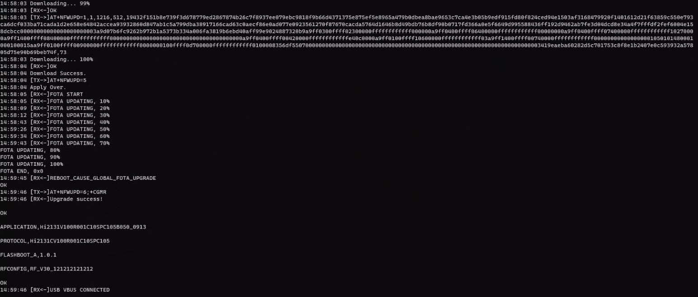

> **须知：** 
>涉及路径的操作不支持中文路径。

# 缩略语<a name="ZH-CN_TOPIC_0000002441584632"></a>

<a name="zh-cn_topic_0000001980225957_table1561138173011"></a>
<table><tbody><tr id="zh-cn_topic_0000001980225957_row466659173010"><td class="nocellnorowborder" style="border:none" valign="top" width="21.89%"><p id="zh-cn_topic_0000001980225957_p966619918305"><a name="zh-cn_topic_0000001980225957_p966619918305"></a><a name="zh-cn_topic_0000001980225957_p966619918305"></a><strong id="zh-cn_topic_0000001980225957_b115188282099"><a name="zh-cn_topic_0000001980225957_b115188282099"></a><a name="zh-cn_topic_0000001980225957_b115188282099"></a>F</strong></p>
</td>
<td class="nocellnorowborder" style="border:none" valign="top" width="45.04%">&nbsp;&nbsp;</td>
<td class="cell-norowborder" style="border:none" valign="top" width="33.07%">&nbsp;&nbsp;</td>
</tr>
<tr id="zh-cn_topic_0000001980225957_row367018919307"><td class="nocellnorowborder" style="border:none" valign="top" width="21.89%"><p id="zh-cn_topic_0000001980225957_p1967018943015"><a name="zh-cn_topic_0000001980225957_p1967018943015"></a><a name="zh-cn_topic_0000001980225957_p1967018943015"></a><strong id="zh-cn_topic_0000001980225957_b7479143105711"><a name="zh-cn_topic_0000001980225957_b7479143105711"></a><a name="zh-cn_topic_0000001980225957_b7479143105711"></a>FOTA</strong></p>
</td>
<td class="nocellnorowborder" style="border:none" valign="top" width="45.04%"><p id="zh-cn_topic_0000001980225957_p167099163018"><a name="zh-cn_topic_0000001980225957_p167099163018"></a><a name="zh-cn_topic_0000001980225957_p167099163018"></a>Firmware Over The Air</p>
</td>
<td class="cell-norowborder" style="border:none" valign="top" width="33.07%"><p id="zh-cn_topic_0000001980225957_p116706915305"><a name="zh-cn_topic_0000001980225957_p116706915305"></a><a name="zh-cn_topic_0000001980225957_p116706915305"></a>固件空中升级</p>
</td>
</tr>
<tr id="zh-cn_topic_0000001980225957_row1591355135811"><td class="cellrowborder" style="border:none" valign="top" width="21.89%">&nbsp;&nbsp;</td>
<td class="cellrowborder" style="border:none" valign="top" width="45.04%">&nbsp;&nbsp;</td>
<td class="cellrowborder" style="border:none" valign="top" width="33.07%">&nbsp;&nbsp;</td>
</tr>
<tr id="zh-cn_topic_0000001980225957_row1885402722012"><td class="cellrowborder" style="border:none" valign="top" width="21.89%"><p id="zh-cn_topic_0000001980225957_p20854152713205"><a name="zh-cn_topic_0000001980225957_p20854152713205"></a><a name="zh-cn_topic_0000001980225957_p20854152713205"></a><strong id="zh-cn_topic_0000001980225957_b208195985215"><a name="zh-cn_topic_0000001980225957_b208195985215"></a><a name="zh-cn_topic_0000001980225957_b208195985215"></a>M</strong></p>
</td>
<td class="cellrowborder" style="border:none" valign="top" width="45.04%">&nbsp;&nbsp;</td>
<td class="cellrowborder" style="border:none" valign="top" width="33.07%">&nbsp;&nbsp;</td>
</tr>
<tr id="zh-cn_topic_0000001980225957_row6781112619200"><td class="cellrowborder" style="border:none" valign="top" width="21.89%"><p id="zh-cn_topic_0000001980225957_p12781112614203"><a name="zh-cn_topic_0000001980225957_p12781112614203"></a><a name="zh-cn_topic_0000001980225957_p12781112614203"></a><strong id="zh-cn_topic_0000001980225957_b119415912526"><a name="zh-cn_topic_0000001980225957_b119415912526"></a><a name="zh-cn_topic_0000001980225957_b119415912526"></a>MSID</strong></p>
</td>
<td class="cellrowborder" style="border:none" valign="top" width="45.04%"><p id="zh-cn_topic_0000001980225957_p1378112622013"><a name="zh-cn_topic_0000001980225957_p1378112622013"></a><a name="zh-cn_topic_0000001980225957_p1378112622013"></a>Market Segment ID</p>
</td>
<td class="cellrowborder" style="border:none" valign="top" width="33.07%"><p id="zh-cn_topic_0000001980225957_p1478114269206"><a name="zh-cn_topic_0000001980225957_p1478114269206"></a><a name="zh-cn_topic_0000001980225957_p1478114269206"></a>市场区域ID</p>
</td>
</tr>
<tr id="zh-cn_topic_0000001980225957_row1255015263203"><td class="cellrowborder" style="border:none" valign="top" width="21.89%">&nbsp;&nbsp;</td>
<td class="cellrowborder" style="border:none" valign="top" width="45.04%">&nbsp;&nbsp;</td>
<td class="cellrowborder" style="border:none" valign="top" width="33.07%">&nbsp;&nbsp;</td>
</tr>
<tr id="zh-cn_topic_0000001980225957_row71881758205817"><td class="cellrowborder" style="border:none" valign="top" width="21.89%"><p id="zh-cn_topic_0000001980225957_p15188175845817"><a name="zh-cn_topic_0000001980225957_p15188175845817"></a><a name="zh-cn_topic_0000001980225957_p15188175845817"></a><strong id="zh-cn_topic_0000001980225957_b87126119531"><a name="zh-cn_topic_0000001980225957_b87126119531"></a><a name="zh-cn_topic_0000001980225957_b87126119531"></a>U</strong></p>
</td>
<td class="cellrowborder" style="border:none" valign="top" width="45.04%">&nbsp;&nbsp;</td>
<td class="cellrowborder" style="border:none" valign="top" width="33.07%">&nbsp;&nbsp;</td>
</tr>
<tr id="zh-cn_topic_0000001980225957_row1482113011596"><td class="cellrowborder" style="border:none" valign="top" width="21.89%"><p id="zh-cn_topic_0000001980225957_p2082110018593"><a name="zh-cn_topic_0000001980225957_p2082110018593"></a><a name="zh-cn_topic_0000001980225957_p2082110018593"></a><strong id="zh-cn_topic_0000001980225957_b117135195315"><a name="zh-cn_topic_0000001980225957_b117135195315"></a><a name="zh-cn_topic_0000001980225957_b117135195315"></a>UE</strong></p>
</td>
<td class="cellrowborder" style="border:none" valign="top" width="45.04%"><p id="zh-cn_topic_0000001980225957_p208211809591"><a name="zh-cn_topic_0000001980225957_p208211809591"></a><a name="zh-cn_topic_0000001980225957_p208211809591"></a>User Equipment</p>
</td>
<td class="cellrowborder" style="border:none" valign="top" width="33.07%"><p id="zh-cn_topic_0000001980225957_p1582119065911"><a name="zh-cn_topic_0000001980225957_p1582119065911"></a><a name="zh-cn_topic_0000001980225957_p1582119065911"></a>用户设备</p>
</td>
</tr>
</tbody>
</table>

