# 前言<a name="ZH-CN_TOPIC_0000002499582997"></a>

**概述<a name="zh-cn_topic_0000002455953125_section4537382116410"></a>**

本文档主要介绍BurnTool的使用方法。用于指导工程人员快速使用BurnTool工具进行镜像烧写。

**读者对象<a name="zh-cn_topic_0000002455953125_section4378592816410"></a>**

本文档主要适用于以下工程师：

-   技术支持工程师
-   软件工程师
-   硬件工程师

**符号约定<a name="zh-cn_topic_0000002455953125_section133020216410"></a>**

在本文中可能出现下列标志，它们所代表的含义如下。

<a name="zh-cn_topic_0000002455953125_table2622507016410"></a>
<table><thead align="left"><tr id="zh-cn_topic_0000002455953125_row1530720816410"><th class="cellrowborder" valign="top" width="20.580000000000002%" id="mcps1.1.3.1.1"><p id="zh-cn_topic_0000002455953125_p6450074116410"><a name="zh-cn_topic_0000002455953125_p6450074116410"></a><a name="zh-cn_topic_0000002455953125_p6450074116410"></a><strong id="zh-cn_topic_0000002455953125_b2136615816410"><a name="zh-cn_topic_0000002455953125_b2136615816410"></a><a name="zh-cn_topic_0000002455953125_b2136615816410"></a>符号</strong></p>
</th>
<th class="cellrowborder" valign="top" width="79.42%" id="mcps1.1.3.1.2"><p id="zh-cn_topic_0000002455953125_p5435366816410"><a name="zh-cn_topic_0000002455953125_p5435366816410"></a><a name="zh-cn_topic_0000002455953125_p5435366816410"></a><strong id="zh-cn_topic_0000002455953125_b5941558116410"><a name="zh-cn_topic_0000002455953125_b5941558116410"></a><a name="zh-cn_topic_0000002455953125_b5941558116410"></a>说明</strong></p>
</th>
</tr>
</thead>
<tbody><tr id="zh-cn_topic_0000002455953125_row1372280416410"><td class="cellrowborder" valign="top" width="20.580000000000002%" headers="mcps1.1.3.1.1 "><p id="zh-cn_topic_0000002455953125_p3734547016410"><a name="zh-cn_topic_0000002455953125_p3734547016410"></a><a name="zh-cn_topic_0000002455953125_p3734547016410"></a><a name="zh-cn_topic_0000002455953125_image2670064316410"></a><a name="zh-cn_topic_0000002455953125_image2670064316410"></a><span></span></p>
</td>
<td class="cellrowborder" valign="top" width="79.42%" headers="mcps1.1.3.1.2 "><p id="zh-cn_topic_0000002455953125_p1757432116410"><a name="zh-cn_topic_0000002455953125_p1757432116410"></a><a name="zh-cn_topic_0000002455953125_p1757432116410"></a>表示如不避免则将会导致死亡或严重伤害的具有高等级风险的危害。</p>
</td>
</tr>
<tr id="zh-cn_topic_0000002455953125_row466863216410"><td class="cellrowborder" valign="top" width="20.580000000000002%" headers="mcps1.1.3.1.1 "><p id="zh-cn_topic_0000002455953125_p1432579516410"><a name="zh-cn_topic_0000002455953125_p1432579516410"></a><a name="zh-cn_topic_0000002455953125_p1432579516410"></a><a name="zh-cn_topic_0000002455953125_image4895582316410"></a><a name="zh-cn_topic_0000002455953125_image4895582316410"></a><span></span></p>
</td>
<td class="cellrowborder" valign="top" width="79.42%" headers="mcps1.1.3.1.2 "><p id="zh-cn_topic_0000002455953125_p959197916410"><a name="zh-cn_topic_0000002455953125_p959197916410"></a><a name="zh-cn_topic_0000002455953125_p959197916410"></a>表示如不避免则可能导致死亡或严重伤害的具有中等级风险的危害。</p>
</td>
</tr>
<tr id="zh-cn_topic_0000002455953125_row123863216410"><td class="cellrowborder" valign="top" width="20.580000000000002%" headers="mcps1.1.3.1.1 "><p id="zh-cn_topic_0000002455953125_p1232579516410"><a name="zh-cn_topic_0000002455953125_p1232579516410"></a><a name="zh-cn_topic_0000002455953125_p1232579516410"></a><a name="zh-cn_topic_0000002455953125_image1235582316410"></a><a name="zh-cn_topic_0000002455953125_image1235582316410"></a><span></span></p>
</td>
<td class="cellrowborder" valign="top" width="79.42%" headers="mcps1.1.3.1.2 "><p id="zh-cn_topic_0000002455953125_p123197916410"><a name="zh-cn_topic_0000002455953125_p123197916410"></a><a name="zh-cn_topic_0000002455953125_p123197916410"></a>表示如不避免则可能导致轻微或中度伤害的具有低等级风险的危害。</p>
</td>
</tr>
<tr id="zh-cn_topic_0000002455953125_row5786682116410"><td class="cellrowborder" valign="top" width="20.580000000000002%" headers="mcps1.1.3.1.1 "><p id="zh-cn_topic_0000002455953125_p2204984716410"><a name="zh-cn_topic_0000002455953125_p2204984716410"></a><a name="zh-cn_topic_0000002455953125_p2204984716410"></a><a name="zh-cn_topic_0000002455953125_image4504446716410"></a><a name="zh-cn_topic_0000002455953125_image4504446716410"></a><span></span></p>
</td>
<td class="cellrowborder" valign="top" width="79.42%" headers="mcps1.1.3.1.2 "><p id="zh-cn_topic_0000002455953125_p4388861916410"><a name="zh-cn_topic_0000002455953125_p4388861916410"></a><a name="zh-cn_topic_0000002455953125_p4388861916410"></a>用于传递设备或环境安全警示信息。如不避免则可能会导致设备损坏、数据丢失、设备性能降低或其它不可预知的结果。</p>
<p id="zh-cn_topic_0000002455953125_p1238861916410"><a name="zh-cn_topic_0000002455953125_p1238861916410"></a><a name="zh-cn_topic_0000002455953125_p1238861916410"></a>“须知”不涉及人身伤害。</p>
</td>
</tr>
<tr id="zh-cn_topic_0000002455953125_row2856923116410"><td class="cellrowborder" valign="top" width="20.580000000000002%" headers="mcps1.1.3.1.1 "><p id="zh-cn_topic_0000002455953125_p5555360116410"><a name="zh-cn_topic_0000002455953125_p5555360116410"></a><a name="zh-cn_topic_0000002455953125_p5555360116410"></a><a name="zh-cn_topic_0000002455953125_image799324016410"></a><a name="zh-cn_topic_0000002455953125_image799324016410"></a><span></span></p>
</td>
<td class="cellrowborder" valign="top" width="79.42%" headers="mcps1.1.3.1.2 "><p id="zh-cn_topic_0000002455953125_p4612588116410"><a name="zh-cn_topic_0000002455953125_p4612588116410"></a><a name="zh-cn_topic_0000002455953125_p4612588116410"></a>对正文中重点信息的补充说明。</p>
<p id="zh-cn_topic_0000002455953125_p1232588116410"><a name="zh-cn_topic_0000002455953125_p1232588116410"></a><a name="zh-cn_topic_0000002455953125_p1232588116410"></a>“说明”不是安全警示信息，不涉及人身、设备及环境伤害信息。</p>
</td>
</tr>
</tbody>
</table>

# 产品安装<a name="ZH-CN_TOPIC_0000002608401107"></a>

BurnTool安装程序的安装步骤如下：

1.  打开BurnTool安装程序“BurnTool.exe”。
2.  弹出BurnTool安装路径选择界面，如[图1](#zh-cn_topic_0000002607834039_zh-cn_topic_0000002510835592_fig183951846738)所示，选择好安装路径后单击“Next”按钮。若安装路径选择为C盘“Program Files”需要在运行时使用管理员权限。

    **图 1**  BurnTool安装界面<a name="zh-cn_topic_0000002607834039_zh-cn_topic_0000002510835592_fig183951846738"></a>  
    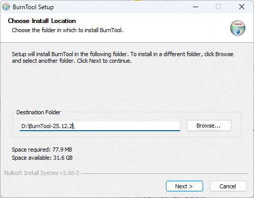

3.  弹出BurnTool选择协议界面，如[图2](#zh-cn_topic_0000002607834039_zh-cn_topic_0000002510835592_fig310025311224)所示，选择对应的产品，单击“Next”按钮。

    **图 2**  BurnTool选择协议界面<a name="zh-cn_topic_0000002607834039_zh-cn_topic_0000002510835592_fig310025311224"></a>  
    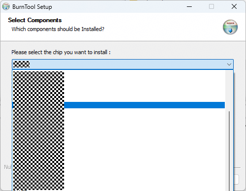

4.  弹出BurnTool额外任务选择界面，如[图3](#zh-cn_topic_0000002607834039_zh-cn_topic_0000002510835592_fig7113204711510)所示，单击“Next”按钮。

    **图 3**  BurnTool额外任务选择界面<a name="zh-cn_topic_0000002607834039_zh-cn_topic_0000002510835592_fig7113204711510"></a>  
    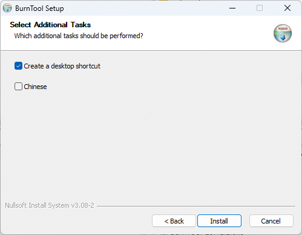

5.  弹出BurnTool正在安装界面，请等待，直至安装完成。
6.  弹出BurnTool安装完成界面，如[图4](#zh-cn_topic_0000002607834039_zh-cn_topic_0000002510835592_fig1786441312496)所示，单击“Finish”按钮退出安装。

    **图 4**  BurnTool安装完成界面<a name="zh-cn_topic_0000002607834039_zh-cn_topic_0000002510835592_fig1786441312496"></a>  
    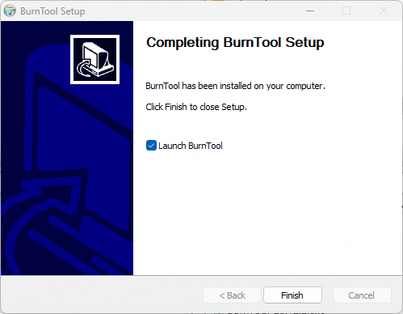

# BurnTool工具简介<a name="ZH-CN_TOPIC_0000002466384000"></a>

-   **[功能说明](#ZH-CN_TOPIC_0000002466543640)**  

-   **[应用场景](#ZH-CN_TOPIC_0000002466543628)**  

-   **[界面说明](#ZH-CN_TOPIC_0000002466384004)**  

## 功能说明<a name="ZH-CN_TOPIC_0000002466543640"></a>

BurnTool是芯片配套的烧写工具，通过打断程序启动的方式，对单板烧写镜像文件。

## 应用场景<a name="ZH-CN_TOPIC_0000002466543628"></a>

BurnTool主要适用于以下场景：

-   镜像烧写
-   导出镜像

## 界面说明<a name="ZH-CN_TOPIC_0000002466384004"></a>

-   **[选择Chip](#ZH-CN_TOPIC_0000002466543648)**  

-   **[BurnTool](#ZH-CN_TOPIC_0000002466384008)**  

-   **[BurnTool-USB](#ZH-CN_TOPIC_0000002466383996)**  

-   **[工厂烧写](#ZH-CN_TOPIC_0000002466543632)**  

-   **[设置界面](#ZH-CN_TOPIC_0000002499582993)**  

### 选择Chip<a name="ZH-CN_TOPIC_0000002466543648"></a>

通过“Option”-“Change chip”打开芯片选择框，用于选择与单板匹配的芯片类型，部分芯片还可选择需要的烧写方式，界面如[图1](#zh-cn_topic_0000002340706433_zh-cn_topic_0000001906927033_fig131614316534)所示。

**图 1**  选择Chip界面示意图<a name="zh-cn_topic_0000002340706433_zh-cn_topic_0000001906927033_fig131614316534"></a>  
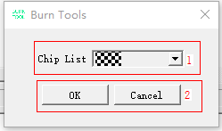

**表 1**  选择Chip界面说明

<a name="zh-cn_topic_0000002340706433_zh-cn_topic_0000001906927033_table1923619111210"></a>
<table><thead align="left"><tr id="zh-cn_topic_0000002340706433_zh-cn_topic_0000001906927033_row8232019141213"><th class="cellrowborder" valign="top" width="13.66%" id="mcps1.2.3.1.1"><p id="zh-cn_topic_0000002340706433_zh-cn_topic_0000001906927033_p12351913126"><a name="zh-cn_topic_0000002340706433_zh-cn_topic_0000001906927033_p12351913126"></a><a name="zh-cn_topic_0000002340706433_zh-cn_topic_0000001906927033_p12351913126"></a>区域</p>
</th>
<th class="cellrowborder" valign="top" width="86.33999999999999%" id="mcps1.2.3.1.2"><p id="zh-cn_topic_0000002340706433_zh-cn_topic_0000001906927033_p9232199124"><a name="zh-cn_topic_0000002340706433_zh-cn_topic_0000001906927033_p9232199124"></a><a name="zh-cn_topic_0000002340706433_zh-cn_topic_0000001906927033_p9232199124"></a>说明</p>
</th>
</tr>
</thead>
<tbody><tr id="zh-cn_topic_0000002340706433_zh-cn_topic_0000001906927033_row1623119111212"><td class="cellrowborder" valign="top" width="13.66%" headers="mcps1.2.3.1.1 "><p id="zh-cn_topic_0000002340706433_zh-cn_topic_0000001906927033_p1723219201211"><a name="zh-cn_topic_0000002340706433_zh-cn_topic_0000001906927033_p1723219201211"></a><a name="zh-cn_topic_0000002340706433_zh-cn_topic_0000001906927033_p1723219201211"></a>1</p>
</td>
<td class="cellrowborder" valign="top" width="86.33999999999999%" headers="mcps1.2.3.1.2 "><a name="zh-cn_topic_0000002340706433_zh-cn_topic_0000001906927033_ul15231719181215"></a><a name="zh-cn_topic_0000002340706433_zh-cn_topic_0000001906927033_ul15231719181215"></a><ul id="zh-cn_topic_0000002340706433_zh-cn_topic_0000001906927033_ul15231719181215"><li>Chip List：可选芯片列表。</li></ul>
</td>
</tr>
<tr id="zh-cn_topic_0000002340706433_zh-cn_topic_0000001906927033_row3237195120"><td class="cellrowborder" valign="top" width="13.66%" headers="mcps1.2.3.1.1 "><p id="zh-cn_topic_0000002340706433_zh-cn_topic_0000001906927033_p2023219131213"><a name="zh-cn_topic_0000002340706433_zh-cn_topic_0000001906927033_p2023219131213"></a><a name="zh-cn_topic_0000002340706433_zh-cn_topic_0000001906927033_p2023219131213"></a>2</p>
</td>
<td class="cellrowborder" valign="top" width="86.33999999999999%" headers="mcps1.2.3.1.2 "><a name="zh-cn_topic_0000002340706433_zh-cn_topic_0000001906927033_ul1231919191217"></a><a name="zh-cn_topic_0000002340706433_zh-cn_topic_0000001906927033_ul1231919191217"></a><ul id="zh-cn_topic_0000002340706433_zh-cn_topic_0000001906927033_ul1231919191217"><li>OK：确定选择按钮。</li><li>Cancel：取消选择按钮。</li></ul>
</td>
</tr>
</tbody>
</table>

### BurnTool<a name="ZH-CN_TOPIC_0000002466384008"></a>

BurnTool界面如[图1](#zh-cn_topic_0000002306907006_zh-cn_topic_0000001207721967_fig18251152003119)所示。

**图 1**  BurnTool界面示意图<a name="zh-cn_topic_0000002306907006_zh-cn_topic_0000001207721967_fig18251152003119"></a>  
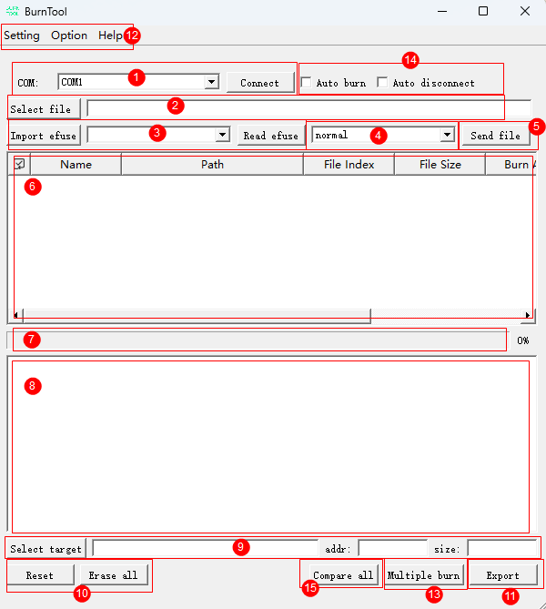

**表 1**  BurnTool界面说明

<a name="zh-cn_topic_0000002306907006_zh-cn_topic_0000001207721967_zh-cn_topic_0279549098_table156913141826"></a>
<table><thead align="left"><tr id="zh-cn_topic_0000002306907006_zh-cn_topic_0000001207721967_zh-cn_topic_0279549098_row0695148215"><th class="cellrowborder" valign="top" width="13.669999999999998%" id="mcps1.2.3.1.1"><p id="zh-cn_topic_0000002306907006_zh-cn_topic_0000001207721967_zh-cn_topic_0279549098_p5455981"><a name="zh-cn_topic_0000002306907006_zh-cn_topic_0000001207721967_zh-cn_topic_0279549098_p5455981"></a><a name="zh-cn_topic_0000002306907006_zh-cn_topic_0000001207721967_zh-cn_topic_0279549098_p5455981"></a>区域</p>
</th>
<th class="cellrowborder" valign="top" width="86.33%" id="mcps1.2.3.1.2"><p id="zh-cn_topic_0000002306907006_zh-cn_topic_0000001207721967_zh-cn_topic_0279549098_p39281331"><a name="zh-cn_topic_0000002306907006_zh-cn_topic_0000001207721967_zh-cn_topic_0279549098_p39281331"></a><a name="zh-cn_topic_0000002306907006_zh-cn_topic_0000001207721967_zh-cn_topic_0279549098_p39281331"></a>说明</p>
</th>
</tr>
</thead>
<tbody><tr id="zh-cn_topic_0000002306907006_zh-cn_topic_0000001207721967_zh-cn_topic_0279549098_row10707148214"><td class="cellrowborder" valign="top" width="13.669999999999998%" headers="mcps1.2.3.1.1 "><p id="zh-cn_topic_0000002306907006_zh-cn_topic_0000001207721967_zh-cn_topic_0279549098_p47714657"><a name="zh-cn_topic_0000002306907006_zh-cn_topic_0000001207721967_zh-cn_topic_0279549098_p47714657"></a><a name="zh-cn_topic_0000002306907006_zh-cn_topic_0000001207721967_zh-cn_topic_0279549098_p47714657"></a>1</p>
</td>
<td class="cellrowborder" valign="top" width="86.33%" headers="mcps1.2.3.1.2 "><a name="zh-cn_topic_0000002306907006_zh-cn_topic_0000001207721967_zh-cn_topic_0279549098_ul85142597204"></a><a name="zh-cn_topic_0000002306907006_zh-cn_topic_0000001207721967_zh-cn_topic_0279549098_ul85142597204"></a><ul id="zh-cn_topic_0000002306907006_zh-cn_topic_0000001207721967_zh-cn_topic_0279549098_ul85142597204"><li>Connect：打开串口并发送打断报文。</li><li>COM：串口号列表，显示当前可用串口号。</li></ul>
</td>
</tr>
<tr id="zh-cn_topic_0000002306907006_zh-cn_topic_0000001207721967_zh-cn_topic_0279549098_row7702141527"><td class="cellrowborder" valign="top" width="13.669999999999998%" headers="mcps1.2.3.1.1 "><p id="zh-cn_topic_0000002306907006_zh-cn_topic_0000001207721967_zh-cn_topic_0279549098_p63739165"><a name="zh-cn_topic_0000002306907006_zh-cn_topic_0000001207721967_zh-cn_topic_0279549098_p63739165"></a><a name="zh-cn_topic_0000002306907006_zh-cn_topic_0000001207721967_zh-cn_topic_0279549098_p63739165"></a>2</p>
</td>
<td class="cellrowborder" valign="top" width="86.33%" headers="mcps1.2.3.1.2 "><p id="zh-cn_topic_0000002306907006_zh-cn_topic_0000001207721967_p159272473478"><a name="zh-cn_topic_0000002306907006_zh-cn_topic_0000001207721967_p159272473478"></a><a name="zh-cn_topic_0000002306907006_zh-cn_topic_0000001207721967_p159272473478"></a>Select file：选择烧写镜像。</p>
</td>
</tr>
<tr id="zh-cn_topic_0000002306907006_zh-cn_topic_0000001207721967_zh-cn_topic_0279549098_row107011141123"><td class="cellrowborder" valign="top" width="13.669999999999998%" headers="mcps1.2.3.1.1 "><p id="zh-cn_topic_0000002306907006_zh-cn_topic_0000001207721967_zh-cn_topic_0279549098_p4179377"><a name="zh-cn_topic_0000002306907006_zh-cn_topic_0000001207721967_zh-cn_topic_0279549098_p4179377"></a><a name="zh-cn_topic_0000002306907006_zh-cn_topic_0000001207721967_zh-cn_topic_0279549098_p4179377"></a>3</p>
</td>
<td class="cellrowborder" valign="top" width="86.33%" headers="mcps1.2.3.1.2 "><a name="zh-cn_topic_0000002306907006_zh-cn_topic_0000001207721967_zh-cn_topic_0279549098_ul121341840460"></a><a name="zh-cn_topic_0000002306907006_zh-cn_topic_0000001207721967_zh-cn_topic_0279549098_ul121341840460"></a><ul id="zh-cn_topic_0000002306907006_zh-cn_topic_0000001207721967_zh-cn_topic_0279549098_ul121341840460"><li>Import Efuse：导入eFuse配置文件。</li><li>Efuse列表：显示当前可读取的eFuse名称。</li><li>Read Efuse：根据选中的eFuse下发读取报文。</li></ul>
</td>
</tr>
<tr id="zh-cn_topic_0000002306907006_zh-cn_topic_0000001207721967_zh-cn_topic_0279549098_row1770214822"><td class="cellrowborder" valign="top" width="13.669999999999998%" headers="mcps1.2.3.1.1 "><p id="zh-cn_topic_0000002306907006_zh-cn_topic_0000001207721967_zh-cn_topic_0279549098_p57396781"><a name="zh-cn_topic_0000002306907006_zh-cn_topic_0000001207721967_zh-cn_topic_0279549098_p57396781"></a><a name="zh-cn_topic_0000002306907006_zh-cn_topic_0000001207721967_zh-cn_topic_0279549098_p57396781"></a>4</p>
</td>
<td class="cellrowborder" valign="top" width="86.33%" headers="mcps1.2.3.1.2 "><a name="zh-cn_topic_0000002306907006_zh-cn_topic_0000001207721967_zh-cn_topic_0279549098_ul33174514213"></a><a name="zh-cn_topic_0000002306907006_zh-cn_topic_0000001207721967_zh-cn_topic_0279549098_ul33174514213"></a><ul id="zh-cn_topic_0000002306907006_zh-cn_topic_0000001207721967_zh-cn_topic_0279549098_ul33174514213"><li>Erase Mode：选择擦除模式。<a name="zh-cn_topic_0000002306907006_zh-cn_topic_0000001207721967_zh-cn_topic_0279549098_ul11788427400"></a><a name="zh-cn_topic_0000002306907006_zh-cn_topic_0000001207721967_zh-cn_topic_0279549098_ul11788427400"></a><ul id="zh-cn_topic_0000002306907006_zh-cn_topic_0000001207721967_zh-cn_topic_0279549098_ul11788427400"><li>normal：按照固件包中的参数进行擦除操作。</li><li>erase all：第一个烧写项烧写前进行全片擦除，剩余烧写项烧写时不再进行擦除操作。</li><li>no erase：不进行擦除操作。注意，该方式需要保证flash为空片或已进行全片擦除。</li></ul>
</li></ul>
</td>
</tr>
<tr id="zh-cn_topic_0000002306907006_zh-cn_topic_0000001207721967_zh-cn_topic_0279549098_row14707149214"><td class="cellrowborder" valign="top" width="13.669999999999998%" headers="mcps1.2.3.1.1 "><p id="zh-cn_topic_0000002306907006_zh-cn_topic_0000001207721967_zh-cn_topic_0279549098_p23568328"><a name="zh-cn_topic_0000002306907006_zh-cn_topic_0000001207721967_zh-cn_topic_0279549098_p23568328"></a><a name="zh-cn_topic_0000002306907006_zh-cn_topic_0000001207721967_zh-cn_topic_0279549098_p23568328"></a>5</p>
</td>
<td class="cellrowborder" valign="top" width="86.33%" headers="mcps1.2.3.1.2 "><p id="zh-cn_topic_0000002306907006_zh-cn_topic_0000001207721967_zh-cn_topic_0279549098_p543412584714"><a name="zh-cn_topic_0000002306907006_zh-cn_topic_0000001207721967_zh-cn_topic_0279549098_p543412584714"></a><a name="zh-cn_topic_0000002306907006_zh-cn_topic_0000001207721967_zh-cn_topic_0279549098_p543412584714"></a>Send file：按照表格选中信息依次烧写镜像。</p>
</td>
</tr>
<tr id="zh-cn_topic_0000002306907006_zh-cn_topic_0000001207721967_zh-cn_topic_0279549098_row37018141229"><td class="cellrowborder" valign="top" width="13.669999999999998%" headers="mcps1.2.3.1.1 "><p id="zh-cn_topic_0000002306907006_zh-cn_topic_0000001207721967_zh-cn_topic_0279549098_p49697568"><a name="zh-cn_topic_0000002306907006_zh-cn_topic_0000001207721967_zh-cn_topic_0279549098_p49697568"></a><a name="zh-cn_topic_0000002306907006_zh-cn_topic_0000001207721967_zh-cn_topic_0279549098_p49697568"></a>6</p>
</td>
<td class="cellrowborder" valign="top" width="86.33%" headers="mcps1.2.3.1.2 "><p id="zh-cn_topic_0000002306907006_zh-cn_topic_0000001207721967_zh-cn_topic_0279549098_p9951144310910"><a name="zh-cn_topic_0000002306907006_zh-cn_topic_0000001207721967_zh-cn_topic_0279549098_p9951144310910"></a><a name="zh-cn_topic_0000002306907006_zh-cn_topic_0000001207721967_zh-cn_topic_0279549098_p9951144310910"></a>镜像表格：显示可被烧写的镜像信息。各列含义为：</p>
<a name="zh-cn_topic_0000002306907006_zh-cn_topic_0000001207721967_zh-cn_topic_0279549098_ul1989564910910"></a><a name="zh-cn_topic_0000002306907006_zh-cn_topic_0000001207721967_zh-cn_topic_0279549098_ul1989564910910"></a><ul id="zh-cn_topic_0000002306907006_zh-cn_topic_0000001207721967_zh-cn_topic_0279549098_ul1989564910910"><li>Name：名称。</li><li>Path：路径。</li><li>File Index：镜像在文件中的起始索引。</li><li>File Size：镜像大小。</li><li>Burn Addr：烧写的Flash起始地址。</li><li>Burn Size：擦除的Flash大小。</li><li>Type：通用类型，包括：<a name="zh-cn_topic_0000002306907006_zh-cn_topic_0000001207721967_zh-cn_topic_0279549098_ul885418294117"></a><a name="zh-cn_topic_0000002306907006_zh-cn_topic_0000001207721967_zh-cn_topic_0279549098_ul885418294117"></a><ul id="zh-cn_topic_0000002306907006_zh-cn_topic_0000001207721967_zh-cn_topic_0279549098_ul885418294117"><li>0：Loader。</li><li>1：一般镜像文件。</li><li>2：参数文件。</li><li>3：eFuse文件。</li></ul>
<p id="zh-cn_topic_0000002306907006_zh-cn_topic_0000001207721967_zh-cn_topic_0279549098_p14365142618416"><a name="zh-cn_topic_0000002306907006_zh-cn_topic_0000001207721967_zh-cn_topic_0279549098_p14365142618416"></a><a name="zh-cn_topic_0000002306907006_zh-cn_topic_0000001207721967_zh-cn_topic_0279549098_p14365142618416"></a>其他的数字由各产品定义，不一一列举。</p>
</li></ul>
</td>
</tr>
<tr id="zh-cn_topic_0000002306907006_zh-cn_topic_0000001207721967_zh-cn_topic_0279549098_row1388672115219"><td class="cellrowborder" valign="top" width="13.669999999999998%" headers="mcps1.2.3.1.1 "><p id="zh-cn_topic_0000002306907006_zh-cn_topic_0000001207721967_zh-cn_topic_0279549098_p55310098"><a name="zh-cn_topic_0000002306907006_zh-cn_topic_0000001207721967_zh-cn_topic_0279549098_p55310098"></a><a name="zh-cn_topic_0000002306907006_zh-cn_topic_0000001207721967_zh-cn_topic_0279549098_p55310098"></a>7</p>
</td>
<td class="cellrowborder" valign="top" width="86.33%" headers="mcps1.2.3.1.2 "><p id="zh-cn_topic_0000002306907006_zh-cn_topic_0000001207721967_zh-cn_topic_0279549098_p1612521515910"><a name="zh-cn_topic_0000002306907006_zh-cn_topic_0000001207721967_zh-cn_topic_0279549098_p1612521515910"></a><a name="zh-cn_topic_0000002306907006_zh-cn_topic_0000001207721967_zh-cn_topic_0279549098_p1612521515910"></a>烧写进度。</p>
</td>
</tr>
<tr id="zh-cn_topic_0000002306907006_zh-cn_topic_0000001207721967_zh-cn_topic_0279549098_row288620211526"><td class="cellrowborder" valign="top" width="13.669999999999998%" headers="mcps1.2.3.1.1 "><p id="zh-cn_topic_0000002306907006_zh-cn_topic_0000001207721967_zh-cn_topic_0279549098_p36189605"><a name="zh-cn_topic_0000002306907006_zh-cn_topic_0000001207721967_zh-cn_topic_0279549098_p36189605"></a><a name="zh-cn_topic_0000002306907006_zh-cn_topic_0000001207721967_zh-cn_topic_0279549098_p36189605"></a>8</p>
</td>
<td class="cellrowborder" valign="top" width="86.33%" headers="mcps1.2.3.1.2 "><p id="zh-cn_topic_0000002306907006_zh-cn_topic_0000001207721967_zh-cn_topic_0279549098_p31461811102010"><a name="zh-cn_topic_0000002306907006_zh-cn_topic_0000001207721967_zh-cn_topic_0279549098_p31461811102010"></a><a name="zh-cn_topic_0000002306907006_zh-cn_topic_0000001207721967_zh-cn_topic_0279549098_p31461811102010"></a>回显视图：显示打断之后单板上报的数据。</p>
</td>
</tr>
<tr id="zh-cn_topic_0000002306907006_zh-cn_topic_0000001207721967_zh-cn_topic_0279549098_row1539045322012"><td class="cellrowborder" valign="top" width="13.669999999999998%" headers="mcps1.2.3.1.1 "><p id="zh-cn_topic_0000002306907006_zh-cn_topic_0000001207721967_zh-cn_topic_0279549098_p1139015311202"><a name="zh-cn_topic_0000002306907006_zh-cn_topic_0000001207721967_zh-cn_topic_0279549098_p1139015311202"></a><a name="zh-cn_topic_0000002306907006_zh-cn_topic_0000001207721967_zh-cn_topic_0279549098_p1139015311202"></a>9</p>
</td>
<td class="cellrowborder" valign="top" width="86.33%" headers="mcps1.2.3.1.2 "><a name="zh-cn_topic_0000002306907006_zh-cn_topic_0000001207721967_zh-cn_topic_0279549098_ul113165792216"></a><a name="zh-cn_topic_0000002306907006_zh-cn_topic_0000001207721967_zh-cn_topic_0279549098_ul113165792216"></a><ul id="zh-cn_topic_0000002306907006_zh-cn_topic_0000001207721967_zh-cn_topic_0279549098_ul113165792216"><li>Select target：选择导出镜像位置。</li><li>addr：输入要导出的Flash起始地址。</li><li>size：输入要导出的Flash大小。</li></ul>
</td>
</tr>
<tr id="zh-cn_topic_0000002306907006_zh-cn_topic_0000001207721967_zh-cn_topic_0279549098_row579172745311"><td class="cellrowborder" valign="top" width="13.669999999999998%" headers="mcps1.2.3.1.1 "><p id="zh-cn_topic_0000002306907006_zh-cn_topic_0000001207721967_zh-cn_topic_0279549098_p1479220277536"><a name="zh-cn_topic_0000002306907006_zh-cn_topic_0000001207721967_zh-cn_topic_0279549098_p1479220277536"></a><a name="zh-cn_topic_0000002306907006_zh-cn_topic_0000001207721967_zh-cn_topic_0279549098_p1479220277536"></a>10</p>
</td>
<td class="cellrowborder" valign="top" width="86.33%" headers="mcps1.2.3.1.2 "><p id="zh-cn_topic_0000002306907006_zh-cn_topic_0000001207721967_zh-cn_topic_0279549098_p13684748173011"><a name="zh-cn_topic_0000002306907006_zh-cn_topic_0000001207721967_zh-cn_topic_0279549098_p13684748173011"></a><a name="zh-cn_topic_0000002306907006_zh-cn_topic_0000001207721967_zh-cn_topic_0279549098_p13684748173011"></a>Reset：重启单板。(本功能仅在烧写loader之后生效)</p>
<p id="zh-cn_topic_0000002306907006_zh-cn_topic_0000001207721967_zh-cn_topic_0279549098_p025717111612"><a name="zh-cn_topic_0000002306907006_zh-cn_topic_0000001207721967_zh-cn_topic_0279549098_p025717111612"></a><a name="zh-cn_topic_0000002306907006_zh-cn_topic_0000001207721967_zh-cn_topic_0279549098_p025717111612"></a>Erase all：全片擦除。(本功能仅在烧写loader之后生效)</p>
</td>
</tr>
<tr id="zh-cn_topic_0000002306907006_zh-cn_topic_0000001207721967_zh-cn_topic_0279549098_row649954692020"><td class="cellrowborder" valign="top" width="13.669999999999998%" headers="mcps1.2.3.1.1 "><p id="zh-cn_topic_0000002306907006_zh-cn_topic_0000001207721967_zh-cn_topic_0279549098_p13499164652019"><a name="zh-cn_topic_0000002306907006_zh-cn_topic_0000001207721967_zh-cn_topic_0279549098_p13499164652019"></a><a name="zh-cn_topic_0000002306907006_zh-cn_topic_0000001207721967_zh-cn_topic_0279549098_p13499164652019"></a>11</p>
</td>
<td class="cellrowborder" valign="top" width="86.33%" headers="mcps1.2.3.1.2 "><p id="zh-cn_topic_0000002306907006_zh-cn_topic_0000001207721967_zh-cn_topic_0279549098_p10745162311459"><a name="zh-cn_topic_0000002306907006_zh-cn_topic_0000001207721967_zh-cn_topic_0279549098_p10745162311459"></a><a name="zh-cn_topic_0000002306907006_zh-cn_topic_0000001207721967_zh-cn_topic_0279549098_p10745162311459"></a>Export：导出镜像。(本功能仅在烧写loader之后生效)</p>
</td>
</tr>
<tr id="zh-cn_topic_0000002306907006_zh-cn_topic_0000001207721967_zh-cn_topic_0279549098_row1588515211226"><td class="cellrowborder" valign="top" width="13.669999999999998%" headers="mcps1.2.3.1.1 "><p id="zh-cn_topic_0000002306907006_zh-cn_topic_0000001207721967_zh-cn_topic_0279549098_p41303584"><a name="zh-cn_topic_0000002306907006_zh-cn_topic_0000001207721967_zh-cn_topic_0279549098_p41303584"></a><a name="zh-cn_topic_0000002306907006_zh-cn_topic_0000001207721967_zh-cn_topic_0279549098_p41303584"></a>12</p>
</td>
<td class="cellrowborder" valign="top" width="86.33%" headers="mcps1.2.3.1.2 "><a name="zh-cn_topic_0000002306907006_zh-cn_topic_0000001207721967_zh-cn_topic_0279549098_ul218617351719"></a><a name="zh-cn_topic_0000002306907006_zh-cn_topic_0000001207721967_zh-cn_topic_0279549098_ul218617351719"></a><ul id="zh-cn_topic_0000002306907006_zh-cn_topic_0000001207721967_zh-cn_topic_0279549098_ul218617351719"><li>Setting：包括以下菜单：<a name="zh-cn_topic_0000002306907006_zh-cn_topic_0000001207721967_zh-cn_topic_0279549098_ul15707193414267"></a><a name="zh-cn_topic_0000002306907006_zh-cn_topic_0000001207721967_zh-cn_topic_0279549098_ul15707193414267"></a><ul id="zh-cn_topic_0000002306907006_zh-cn_topic_0000001207721967_zh-cn_topic_0279549098_ul15707193414267"><li>Settings：设置串口参数。</li><li>Burn interval：设置打断间隔（选中2表示打断时以2ms间隔发送打断报文，10同理），可输入值，范围为1～30。</li><li>Import config：导入配置文件。</li><li>Save config：保存配置文件。</li><li>Language：修改语言。</li></ul>
</li><li>Option：包含以下菜单<a name="zh-cn_topic_0000002306907006_zh-cn_topic_0000001207721967_ul14619118971"></a><a name="zh-cn_topic_0000002306907006_zh-cn_topic_0000001207721967_ul14619118971"></a><ul id="zh-cn_topic_0000002306907006_zh-cn_topic_0000001207721967_ul14619118971"><li>Change chip：切换芯片。</li></ul>
</li><li>Help：显示版本号。</li></ul>
</td>
</tr>
<tr id="zh-cn_topic_0000002306907006_zh-cn_topic_0000001207721967_zh-cn_topic_0279549098_row925116613581"><td class="cellrowborder" valign="top" width="13.669999999999998%" headers="mcps1.2.3.1.1 "><p id="zh-cn_topic_0000002306907006_zh-cn_topic_0000001207721967_zh-cn_topic_0279549098_p225114685817"><a name="zh-cn_topic_0000002306907006_zh-cn_topic_0000001207721967_zh-cn_topic_0279549098_p225114685817"></a><a name="zh-cn_topic_0000002306907006_zh-cn_topic_0000001207721967_zh-cn_topic_0279549098_p225114685817"></a>13</p>
</td>
<td class="cellrowborder" valign="top" width="86.33%" headers="mcps1.2.3.1.2 "><p id="zh-cn_topic_0000002306907006_zh-cn_topic_0000001207721967_zh-cn_topic_0279549098_p5251156195814"><a name="zh-cn_topic_0000002306907006_zh-cn_topic_0000001207721967_zh-cn_topic_0279549098_p5251156195814"></a><a name="zh-cn_topic_0000002306907006_zh-cn_topic_0000001207721967_zh-cn_topic_0279549098_p5251156195814"></a>Multiple burn：进入工厂烧写界面。</p>
</td>
</tr>
<tr id="zh-cn_topic_0000002306907006_zh-cn_topic_0000001207721967_zh-cn_topic_0279549098_row161301845171317"><td class="cellrowborder" valign="top" width="13.669999999999998%" headers="mcps1.2.3.1.1 "><p id="zh-cn_topic_0000002306907006_zh-cn_topic_0000001207721967_zh-cn_topic_0279549098_p613164517135"><a name="zh-cn_topic_0000002306907006_zh-cn_topic_0000001207721967_zh-cn_topic_0279549098_p613164517135"></a><a name="zh-cn_topic_0000002306907006_zh-cn_topic_0000001207721967_zh-cn_topic_0279549098_p613164517135"></a>14</p>
</td>
<td class="cellrowborder" valign="top" width="86.33%" headers="mcps1.2.3.1.2 "><a name="zh-cn_topic_0000002306907006_zh-cn_topic_0000001207721967_zh-cn_topic_0279549098_ul11104195221319"></a><a name="zh-cn_topic_0000002306907006_zh-cn_topic_0000001207721967_zh-cn_topic_0279549098_ul11104195221319"></a><ul id="zh-cn_topic_0000002306907006_zh-cn_topic_0000001207721967_zh-cn_topic_0279549098_ul11104195221319"><li>Auto burn：打断成功后无需单击“Send file”按钮。工具将按照表格选中的信息依次烧写镜像。<p id="zh-cn_topic_0000002306907006_zh-cn_topic_0000001207721967_p6318450978"><a name="zh-cn_topic_0000002306907006_zh-cn_topic_0000001207721967_p6318450978"></a><a name="zh-cn_topic_0000002306907006_zh-cn_topic_0000001207721967_p6318450978"></a>注意：该功能仅用于烧写，若需要导出镜像或读efuse则不可勾选。</p>
</li><li>Auto disconnect: 在程序烧写完成后自动断开连接。</li></ul>
</td>
</tr>
<tr id="zh-cn_topic_0000002306907006_zh-cn_topic_0000001207721967_row3787102920181"><td class="cellrowborder" valign="top" width="13.669999999999998%" headers="mcps1.2.3.1.1 "><p id="zh-cn_topic_0000002306907006_zh-cn_topic_0000001207721967_p15787629101811"><a name="zh-cn_topic_0000002306907006_zh-cn_topic_0000001207721967_p15787629101811"></a><a name="zh-cn_topic_0000002306907006_zh-cn_topic_0000001207721967_p15787629101811"></a>15</p>
</td>
<td class="cellrowborder" valign="top" width="86.33%" headers="mcps1.2.3.1.2 "><p id="zh-cn_topic_0000002306907006_zh-cn_topic_0000001207721967_p16788202915187"><a name="zh-cn_topic_0000002306907006_zh-cn_topic_0000001207721967_p16788202915187"></a><a name="zh-cn_topic_0000002306907006_zh-cn_topic_0000001207721967_p16788202915187"></a>Compare All：比较全部文件，当前只有ws63支持。</p>
</td>
</tr>
</tbody>
</table>

### BurnTool-USB<a name="ZH-CN_TOPIC_0000002466383996"></a>

USB升级界面如[图1](#zh-cn_topic_0000002433479842_zh-cn_topic_0000002310895974_fig67031058134814)所示。

**图 1**  USB升级界面<a name="zh-cn_topic_0000002433479842_zh-cn_topic_0000002310895974_fig67031058134814"></a>  
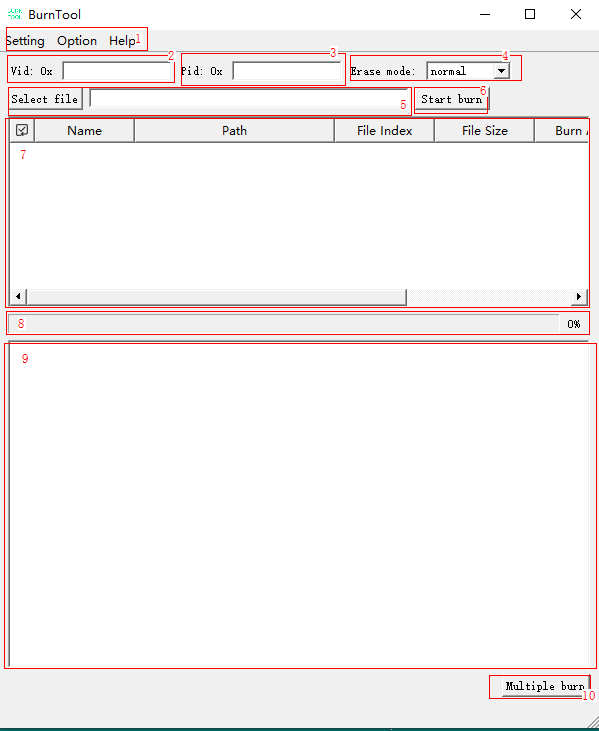

**表 1**  Dfu烧写界面说明

<a name="zh-cn_topic_0000002433479842_zh-cn_topic_0000002310895974_table1923619111210"></a>
<table><thead align="left"><tr id="zh-cn_topic_0000002433479842_zh-cn_topic_0000002310895974_row8232019141213"><th class="cellrowborder" valign="top" width="13.65%" id="mcps1.2.3.1.1"><p id="zh-cn_topic_0000002433479842_zh-cn_topic_0000002310895974_p12351913126"><a name="zh-cn_topic_0000002433479842_zh-cn_topic_0000002310895974_p12351913126"></a><a name="zh-cn_topic_0000002433479842_zh-cn_topic_0000002310895974_p12351913126"></a>区域</p>
</th>
<th class="cellrowborder" valign="top" width="86.35000000000001%" id="mcps1.2.3.1.2"><p id="zh-cn_topic_0000002433479842_zh-cn_topic_0000002310895974_p9232199124"><a name="zh-cn_topic_0000002433479842_zh-cn_topic_0000002310895974_p9232199124"></a><a name="zh-cn_topic_0000002433479842_zh-cn_topic_0000002310895974_p9232199124"></a>说明</p>
</th>
</tr>
</thead>
<tbody><tr id="zh-cn_topic_0000002433479842_zh-cn_topic_0000002310895974_row1623119111212"><td class="cellrowborder" valign="top" width="13.65%" headers="mcps1.2.3.1.1 "><p id="zh-cn_topic_0000002433479842_zh-cn_topic_0000002310895974_p1723219201211"><a name="zh-cn_topic_0000002433479842_zh-cn_topic_0000002310895974_p1723219201211"></a><a name="zh-cn_topic_0000002433479842_zh-cn_topic_0000002310895974_p1723219201211"></a>1</p>
</td>
<td class="cellrowborder" valign="top" width="86.35000000000001%" headers="mcps1.2.3.1.2 "><a name="zh-cn_topic_0000002433479842_zh-cn_topic_0000002310895974_ul179231849192920"></a><a name="zh-cn_topic_0000002433479842_zh-cn_topic_0000002310895974_ul179231849192920"></a><ul id="zh-cn_topic_0000002433479842_zh-cn_topic_0000002310895974_ul179231849192920"><li>Setting：包括以下菜单：<a name="zh-cn_topic_0000002433479842_zh-cn_topic_0000002310895974_ul1612815653017"></a><a name="zh-cn_topic_0000002433479842_zh-cn_topic_0000002310895974_ul1612815653017"></a><ul id="zh-cn_topic_0000002433479842_zh-cn_topic_0000002310895974_ul1612815653017"><li>USB Setting：设置USB配置信息。</li><li>Language：修改语言。</li></ul>
</li></ul>
<a name="zh-cn_topic_0000002433479842_zh-cn_topic_0000002310895974_ul15231719181215"></a><a name="zh-cn_topic_0000002433479842_zh-cn_topic_0000002310895974_ul15231719181215"></a><ul id="zh-cn_topic_0000002433479842_zh-cn_topic_0000002310895974_ul15231719181215"><li>Option：包括以下菜单：<p id="zh-cn_topic_0000002433479842_zh-cn_topic_0000002310895974_p448684352113"><a name="zh-cn_topic_0000002433479842_zh-cn_topic_0000002310895974_p448684352113"></a><a name="zh-cn_topic_0000002433479842_zh-cn_topic_0000002310895974_p448684352113"></a>Change Chip：修改产品。</p>
</li><li>Help：包括以下菜单：<p id="zh-cn_topic_0000002433479842_zh-cn_topic_0000002310895974_p10342244192110"><a name="zh-cn_topic_0000002433479842_zh-cn_topic_0000002310895974_p10342244192110"></a><a name="zh-cn_topic_0000002433479842_zh-cn_topic_0000002310895974_p10342244192110"></a>About：显示版本信息。</p>
</li></ul>
</td>
</tr>
<tr id="zh-cn_topic_0000002433479842_zh-cn_topic_0000002310895974_row8226123835212"><td class="cellrowborder" valign="top" width="13.65%" headers="mcps1.2.3.1.1 "><p id="zh-cn_topic_0000002433479842_zh-cn_topic_0000002310895974_p19226143818521"><a name="zh-cn_topic_0000002433479842_zh-cn_topic_0000002310895974_p19226143818521"></a><a name="zh-cn_topic_0000002433479842_zh-cn_topic_0000002310895974_p19226143818521"></a>2</p>
</td>
<td class="cellrowborder" valign="top" width="86.35000000000001%" headers="mcps1.2.3.1.2 "><p id="zh-cn_topic_0000002433479842_zh-cn_topic_0000002310895974_p12795162162110"><a name="zh-cn_topic_0000002433479842_zh-cn_topic_0000002310895974_p12795162162110"></a><a name="zh-cn_topic_0000002433479842_zh-cn_topic_0000002310895974_p12795162162110"></a>Vid：设备的Vendor ID。</p>
</td>
</tr>
<tr id="zh-cn_topic_0000002433479842_zh-cn_topic_0000002310895974_row3237195120"><td class="cellrowborder" valign="top" width="13.65%" headers="mcps1.2.3.1.1 "><p id="zh-cn_topic_0000002433479842_zh-cn_topic_0000002310895974_p2023219131213"><a name="zh-cn_topic_0000002433479842_zh-cn_topic_0000002310895974_p2023219131213"></a><a name="zh-cn_topic_0000002433479842_zh-cn_topic_0000002310895974_p2023219131213"></a>3</p>
</td>
<td class="cellrowborder" valign="top" width="86.35000000000001%" headers="mcps1.2.3.1.2 "><p id="zh-cn_topic_0000002433479842_zh-cn_topic_0000002310895974_p1572614222213"><a name="zh-cn_topic_0000002433479842_zh-cn_topic_0000002310895974_p1572614222213"></a><a name="zh-cn_topic_0000002433479842_zh-cn_topic_0000002310895974_p1572614222213"></a>Pid：设备的Product ID。</p>
</td>
</tr>
<tr id="zh-cn_topic_0000002433479842_zh-cn_topic_0000002310895974_row723919141213"><td class="cellrowborder" valign="top" width="13.65%" headers="mcps1.2.3.1.1 "><p id="zh-cn_topic_0000002433479842_zh-cn_topic_0000002310895974_p1623141971211"><a name="zh-cn_topic_0000002433479842_zh-cn_topic_0000002310895974_p1623141971211"></a><a name="zh-cn_topic_0000002433479842_zh-cn_topic_0000002310895974_p1623141971211"></a>4</p>
</td>
<td class="cellrowborder" valign="top" width="86.35000000000001%" headers="mcps1.2.3.1.2 "><div class="p" id="zh-cn_topic_0000002433479842_zh-cn_topic_0000002310895974_p1044102319211"><a name="zh-cn_topic_0000002433479842_zh-cn_topic_0000002310895974_p1044102319211"></a><a name="zh-cn_topic_0000002433479842_zh-cn_topic_0000002310895974_p1044102319211"></a>Erase Mode：选择擦除模式。<a name="zh-cn_topic_0000002433479842_zh-cn_topic_0000002310895974_ul2711213143516"></a><a name="zh-cn_topic_0000002433479842_zh-cn_topic_0000002310895974_ul2711213143516"></a><ul id="zh-cn_topic_0000002433479842_zh-cn_topic_0000002310895974_ul2711213143516"><li>normal：按照固件包中的参数进行擦除操作。</li><li>erase all：第一个烧写项进行全片擦除，剩余烧写项不再进行擦除操作。</li><li>no erase：不进行擦除操作。注意：该方式需要保证flash为空片或已进行全片擦除。</li></ul>
</div>
</td>
</tr>
<tr id="zh-cn_topic_0000002433479842_zh-cn_topic_0000002310895974_row19231319171216"><td class="cellrowborder" valign="top" width="13.65%" headers="mcps1.2.3.1.1 "><p id="zh-cn_topic_0000002433479842_zh-cn_topic_0000002310895974_p17231219121216"><a name="zh-cn_topic_0000002433479842_zh-cn_topic_0000002310895974_p17231219121216"></a><a name="zh-cn_topic_0000002433479842_zh-cn_topic_0000002310895974_p17231219121216"></a>5</p>
</td>
<td class="cellrowborder" valign="top" width="86.35000000000001%" headers="mcps1.2.3.1.2 "><p id="zh-cn_topic_0000002433479842_zh-cn_topic_0000002310895974_p101153260212"><a name="zh-cn_topic_0000002433479842_zh-cn_topic_0000002310895974_p101153260212"></a><a name="zh-cn_topic_0000002433479842_zh-cn_topic_0000002310895974_p101153260212"></a>Select file：选择格式为fwpkg的烧写镜像，并显示烧写镜像路径。</p>
</td>
</tr>
<tr id="zh-cn_topic_0000002433479842_zh-cn_topic_0000002310895974_row112481931213"><td class="cellrowborder" valign="top" width="13.65%" headers="mcps1.2.3.1.1 "><p id="zh-cn_topic_0000002433479842_zh-cn_topic_0000002310895974_p1324219121220"><a name="zh-cn_topic_0000002433479842_zh-cn_topic_0000002310895974_p1324219121220"></a><a name="zh-cn_topic_0000002433479842_zh-cn_topic_0000002310895974_p1324219121220"></a>6</p>
</td>
<td class="cellrowborder" valign="top" width="86.35000000000001%" headers="mcps1.2.3.1.2 "><p id="zh-cn_topic_0000002433479842_zh-cn_topic_0000002310895974_p1555442652114"><a name="zh-cn_topic_0000002433479842_zh-cn_topic_0000002310895974_p1555442652114"></a><a name="zh-cn_topic_0000002433479842_zh-cn_topic_0000002310895974_p1555442652114"></a>Start burn：按照表格选中信息依次烧写镜像。</p>
</td>
</tr>
<tr id="zh-cn_topic_0000002433479842_zh-cn_topic_0000002310895974_row824119151216"><td class="cellrowborder" valign="top" width="13.65%" headers="mcps1.2.3.1.1 "><p id="zh-cn_topic_0000002433479842_zh-cn_topic_0000002310895974_p1024719131211"><a name="zh-cn_topic_0000002433479842_zh-cn_topic_0000002310895974_p1024719131211"></a><a name="zh-cn_topic_0000002433479842_zh-cn_topic_0000002310895974_p1024719131211"></a>7</p>
</td>
<td class="cellrowborder" valign="top" width="86.35000000000001%" headers="mcps1.2.3.1.2 "><p id="zh-cn_topic_0000002433479842_zh-cn_topic_0000002310895974_p208311208366"><a name="zh-cn_topic_0000002433479842_zh-cn_topic_0000002310895974_p208311208366"></a><a name="zh-cn_topic_0000002433479842_zh-cn_topic_0000002310895974_p208311208366"></a>镜像表格：显示可被烧写的镜像信息。各列含义为：</p>
<a name="zh-cn_topic_0000002433479842_zh-cn_topic_0000002310895974_ul18831520113615"></a><a name="zh-cn_topic_0000002433479842_zh-cn_topic_0000002310895974_ul18831520113615"></a><ul id="zh-cn_topic_0000002433479842_zh-cn_topic_0000002310895974_ul18831520113615"><li>Name：名称。</li><li>Path：路径。</li><li>File Index：镜像在文件中的起始索引。</li><li>File Size：镜像大小。</li><li>Burn Addr：烧写的Flash起始地址。</li><li>Burn Size：擦除的Flash大小。</li><li>Type：通用类型，包括：<a name="zh-cn_topic_0000002433479842_zh-cn_topic_0000002310895974_ul148313204368"></a><a name="zh-cn_topic_0000002433479842_zh-cn_topic_0000002310895974_ul148313204368"></a><ul id="zh-cn_topic_0000002433479842_zh-cn_topic_0000002310895974_ul148313204368"><li>0：Loader。</li><li>1：一般镜像文件。</li><li>2：参数文件。</li><li>3：eFuse文件。</li></ul>
<a name="zh-cn_topic_0000002433479842_zh-cn_topic_0000002310895974_ul583420163619"></a><a name="zh-cn_topic_0000002433479842_zh-cn_topic_0000002310895974_ul583420163619"></a><ul id="zh-cn_topic_0000002433479842_zh-cn_topic_0000002310895974_ul583420163619"><li>32：fota文件。</li></ul>
</li></ul>
</td>
</tr>
<tr id="zh-cn_topic_0000002433479842_zh-cn_topic_0000002310895974_row2024101919122"><td class="cellrowborder" valign="top" width="13.65%" headers="mcps1.2.3.1.1 "><p id="zh-cn_topic_0000002433479842_zh-cn_topic_0000002310895974_p82411911120"><a name="zh-cn_topic_0000002433479842_zh-cn_topic_0000002310895974_p82411911120"></a><a name="zh-cn_topic_0000002433479842_zh-cn_topic_0000002310895974_p82411911120"></a>8</p>
</td>
<td class="cellrowborder" valign="top" width="86.35000000000001%" headers="mcps1.2.3.1.2 "><p id="zh-cn_topic_0000002433479842_zh-cn_topic_0000002310895974_p2044192962115"><a name="zh-cn_topic_0000002433479842_zh-cn_topic_0000002310895974_p2044192962115"></a><a name="zh-cn_topic_0000002433479842_zh-cn_topic_0000002310895974_p2044192962115"></a>烧写进度。</p>
</td>
</tr>
<tr id="zh-cn_topic_0000002433479842_zh-cn_topic_0000002310895974_row2842044193219"><td class="cellrowborder" valign="top" width="13.65%" headers="mcps1.2.3.1.1 "><p id="zh-cn_topic_0000002433479842_zh-cn_topic_0000002310895974_p14842124413213"><a name="zh-cn_topic_0000002433479842_zh-cn_topic_0000002310895974_p14842124413213"></a><a name="zh-cn_topic_0000002433479842_zh-cn_topic_0000002310895974_p14842124413213"></a>9</p>
</td>
<td class="cellrowborder" valign="top" width="86.35000000000001%" headers="mcps1.2.3.1.2 "><p id="zh-cn_topic_0000002433479842_zh-cn_topic_0000002310895974_p18536162992112"><a name="zh-cn_topic_0000002433479842_zh-cn_topic_0000002310895974_p18536162992112"></a><a name="zh-cn_topic_0000002433479842_zh-cn_topic_0000002310895974_p18536162992112"></a>日志视图：显示烧写过程中单板上报的日志及工具打印的日志。</p>
</td>
</tr>
<tr id="zh-cn_topic_0000002433479842_zh-cn_topic_0000002310895974_row5572238203214"><td class="cellrowborder" valign="top" width="13.65%" headers="mcps1.2.3.1.1 "><p id="zh-cn_topic_0000002433479842_zh-cn_topic_0000002310895974_p1257363817326"><a name="zh-cn_topic_0000002433479842_zh-cn_topic_0000002310895974_p1257363817326"></a><a name="zh-cn_topic_0000002433479842_zh-cn_topic_0000002310895974_p1257363817326"></a>10</p>
</td>
<td class="cellrowborder" valign="top" width="86.35000000000001%" headers="mcps1.2.3.1.2 "><p id="zh-cn_topic_0000002433479842_zh-cn_topic_0000002310895974_p2482143016218"><a name="zh-cn_topic_0000002433479842_zh-cn_topic_0000002310895974_p2482143016218"></a><a name="zh-cn_topic_0000002433479842_zh-cn_topic_0000002310895974_p2482143016218"></a>Multiple burn：进入工厂烧写界面。</p>
</td>
</tr>
</tbody>
</table>

### 工厂烧写<a name="ZH-CN_TOPIC_0000002466543632"></a>

工厂烧写功能用于大批量烧写场景。在打断之后根据表格中的选中顺序发送文件。工厂烧写界面如[图1](#zh-cn_topic_0000002306747310_zh-cn_topic_0000001162441960_zh-cn_topic_0281207084_fig24712267)所示。

**图 1**  工厂烧写界面示意图<a name="zh-cn_topic_0000002306747310_zh-cn_topic_0000001162441960_zh-cn_topic_0281207084_fig24712267"></a>  
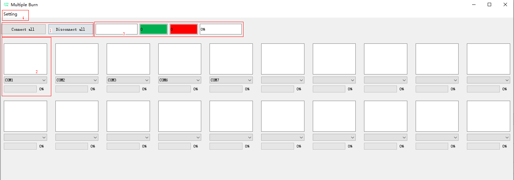

**表 1**  工厂烧写界面说明

<a name="zh-cn_topic_0000002306747310_zh-cn_topic_0000001162441960_zh-cn_topic_0281207084_table1435556181"></a>
<table><thead align="left"><tr id="zh-cn_topic_0000002306747310_zh-cn_topic_0000001162441960_zh-cn_topic_0281207084_row1835656183"><th class="cellrowborder" valign="top" width="17.77%" id="mcps1.2.3.1.1"><p id="zh-cn_topic_0000002306747310_zh-cn_topic_0000001162441960_zh-cn_topic_0281207084_p115311511086"><a name="zh-cn_topic_0000002306747310_zh-cn_topic_0000001162441960_zh-cn_topic_0281207084_p115311511086"></a><a name="zh-cn_topic_0000002306747310_zh-cn_topic_0000001162441960_zh-cn_topic_0281207084_p115311511086"></a>区域</p>
</th>
<th class="cellrowborder" valign="top" width="82.23%" id="mcps1.2.3.1.2"><p id="zh-cn_topic_0000002306747310_zh-cn_topic_0000001162441960_zh-cn_topic_0281207084_p5531145116817"><a name="zh-cn_topic_0000002306747310_zh-cn_topic_0000001162441960_zh-cn_topic_0281207084_p5531145116817"></a><a name="zh-cn_topic_0000002306747310_zh-cn_topic_0000001162441960_zh-cn_topic_0281207084_p5531145116817"></a>说明</p>
</th>
</tr>
</thead>
<tbody><tr id="zh-cn_topic_0000002306747310_zh-cn_topic_0000001162441960_zh-cn_topic_0281207084_row1778202182511"><td class="cellrowborder" valign="top" width="17.77%" headers="mcps1.2.3.1.1 "><p id="zh-cn_topic_0000002306747310_zh-cn_topic_0000001162441960_zh-cn_topic_0281207084_p1978218222513"><a name="zh-cn_topic_0000002306747310_zh-cn_topic_0000001162441960_zh-cn_topic_0281207084_p1978218222513"></a><a name="zh-cn_topic_0000002306747310_zh-cn_topic_0000001162441960_zh-cn_topic_0281207084_p1978218222513"></a>1</p>
</td>
<td class="cellrowborder" valign="top" width="82.23%" headers="mcps1.2.3.1.2 "><a name="zh-cn_topic_0000002306747310_zh-cn_topic_0000001162441960_zh-cn_topic_0281207084_ul137862022513"></a><a name="zh-cn_topic_0000002306747310_zh-cn_topic_0000001162441960_zh-cn_topic_0281207084_ul137862022513"></a><ul id="zh-cn_topic_0000002306747310_zh-cn_topic_0000001162441960_zh-cn_topic_0281207084_ul137862022513"><li>Connect all：连接所有串口。</li><li>Disconnect all：断开所有已打开的串口。</li></ul>
</td>
</tr>
<tr id="zh-cn_topic_0000002306747310_zh-cn_topic_0000001162441960_zh-cn_topic_0281207084_row1235619611820"><td class="cellrowborder" valign="top" width="17.77%" headers="mcps1.2.3.1.1 "><p id="zh-cn_topic_0000002306747310_zh-cn_topic_0000001162441960_zh-cn_topic_0281207084_p195316518818"><a name="zh-cn_topic_0000002306747310_zh-cn_topic_0000001162441960_zh-cn_topic_0281207084_p195316518818"></a><a name="zh-cn_topic_0000002306747310_zh-cn_topic_0000001162441960_zh-cn_topic_0281207084_p195316518818"></a>2</p>
</td>
<td class="cellrowborder" valign="top" width="82.23%" headers="mcps1.2.3.1.2 "><a name="zh-cn_topic_0000002306747310_zh-cn_topic_0000001162441960_zh-cn_topic_0281207084_ul05676417267"></a><a name="zh-cn_topic_0000002306747310_zh-cn_topic_0000001162441960_zh-cn_topic_0281207084_ul05676417267"></a><ul id="zh-cn_topic_0000002306747310_zh-cn_topic_0000001162441960_zh-cn_topic_0281207084_ul05676417267"><li>回显视图：显示单板烧写状态“Doing”、“Pass”、“Fail”、“Waiting”。</li><li>串口号列表：显示当前可用的串口号。</li></ul>
</td>
</tr>
<tr id="zh-cn_topic_0000002306747310_zh-cn_topic_0000001162441960_zh-cn_topic_0281207084_row735616614819"><td class="cellrowborder" valign="top" width="17.77%" headers="mcps1.2.3.1.1 "><p id="zh-cn_topic_0000002306747310_zh-cn_topic_0000001162441960_zh-cn_topic_0281207084_p15531251083"><a name="zh-cn_topic_0000002306747310_zh-cn_topic_0000001162441960_zh-cn_topic_0281207084_p15531251083"></a><a name="zh-cn_topic_0000002306747310_zh-cn_topic_0000001162441960_zh-cn_topic_0281207084_p15531251083"></a>3</p>
</td>
<td class="cellrowborder" valign="top" width="82.23%" headers="mcps1.2.3.1.2 "><p id="zh-cn_topic_0000002306747310_zh-cn_topic_0000001162441960_zh-cn_topic_0281207084_p193431818246"><a name="zh-cn_topic_0000002306747310_zh-cn_topic_0000001162441960_zh-cn_topic_0281207084_p193431818246"></a><a name="zh-cn_topic_0000002306747310_zh-cn_topic_0000001162441960_zh-cn_topic_0281207084_p193431818246"></a>烧写结果统计：成功数，失败数，成功率，本次烧写时间。</p>
</td>
</tr>
<tr id="zh-cn_topic_0000002306747310_zh-cn_topic_0000001162441960_row7993754201618"><td class="cellrowborder" valign="top" width="17.77%" headers="mcps1.2.3.1.1 "><p id="zh-cn_topic_0000002306747310_zh-cn_topic_0000001162441960_p17993185418160"><a name="zh-cn_topic_0000002306747310_zh-cn_topic_0000001162441960_p17993185418160"></a><a name="zh-cn_topic_0000002306747310_zh-cn_topic_0000001162441960_p17993185418160"></a>4</p>
</td>
<td class="cellrowborder" valign="top" width="82.23%" headers="mcps1.2.3.1.2 "><div class="p" id="zh-cn_topic_0000002306747310_zh-cn_topic_0000001162441960_p1799395471615"><a name="zh-cn_topic_0000002306747310_zh-cn_topic_0000001162441960_p1799395471615"></a><a name="zh-cn_topic_0000002306747310_zh-cn_topic_0000001162441960_p1799395471615"></a>Setting：包括以下菜单<a name="zh-cn_topic_0000002306747310_zh-cn_topic_0000001162441960_ul1077410220134"></a><a name="zh-cn_topic_0000002306747310_zh-cn_topic_0000001162441960_ul1077410220134"></a><ul id="zh-cn_topic_0000002306747310_zh-cn_topic_0000001162441960_ul1077410220134"><li>Save config：包含以下菜单。</li><li>check COM：串口检查，根据单板返回的位置信息，把单板对应的串口排到界面对应位置，注意该功能需单板镜像支持。</li><li>Robotic Arm Com Setting：机械臂串口配置，配置后烧写单板后，会向选择的串口发送成功和失败信息。</li></ul>
</div>
</td>
</tr>
</tbody>
</table>

**图 2**  机械臂串口设置界面<a name="zh-cn_topic_0000002306747310_zh-cn_topic_0000001162441960_fig912992718270"></a>  
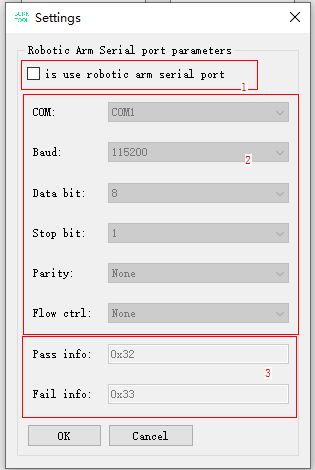

<a name="zh-cn_topic_0000002306747310_zh-cn_topic_0000001162441960_table149798213285"></a>
<table><thead align="left"><tr id="zh-cn_topic_0000002306747310_zh-cn_topic_0000001162441960_row1497972162819"><th class="cellrowborder" valign="top" width="17.77%" id="mcps1.1.3.1.1"><p id="zh-cn_topic_0000002306747310_zh-cn_topic_0000001162441960_p897932115284"><a name="zh-cn_topic_0000002306747310_zh-cn_topic_0000001162441960_p897932115284"></a><a name="zh-cn_topic_0000002306747310_zh-cn_topic_0000001162441960_p897932115284"></a>区域</p>
</th>
<th class="cellrowborder" valign="top" width="82.23%" id="mcps1.1.3.1.2"><p id="zh-cn_topic_0000002306747310_zh-cn_topic_0000001162441960_p1097952112817"><a name="zh-cn_topic_0000002306747310_zh-cn_topic_0000001162441960_p1097952112817"></a><a name="zh-cn_topic_0000002306747310_zh-cn_topic_0000001162441960_p1097952112817"></a>说明</p>
</th>
</tr>
</thead>
<tbody><tr id="zh-cn_topic_0000002306747310_zh-cn_topic_0000001162441960_row179791521162817"><td class="cellrowborder" valign="top" width="17.77%" headers="mcps1.1.3.1.1 "><p id="zh-cn_topic_0000002306747310_zh-cn_topic_0000001162441960_p14979121162814"><a name="zh-cn_topic_0000002306747310_zh-cn_topic_0000001162441960_p14979121162814"></a><a name="zh-cn_topic_0000002306747310_zh-cn_topic_0000001162441960_p14979121162814"></a>1</p>
</td>
<td class="cellrowborder" valign="top" width="82.23%" headers="mcps1.1.3.1.2 "><p id="zh-cn_topic_0000002306747310_zh-cn_topic_0000001162441960_p3158163315282"><a name="zh-cn_topic_0000002306747310_zh-cn_topic_0000001162441960_p3158163315282"></a><a name="zh-cn_topic_0000002306747310_zh-cn_topic_0000001162441960_p3158163315282"></a>选择是否启用机械臂串口，勾选之后，以下参数才可以配置。</p>
</td>
</tr>
<tr id="zh-cn_topic_0000002306747310_zh-cn_topic_0000001162441960_row1497902117288"><td class="cellrowborder" valign="top" width="17.77%" headers="mcps1.1.3.1.1 "><p id="zh-cn_topic_0000002306747310_zh-cn_topic_0000001162441960_p7979132116282"><a name="zh-cn_topic_0000002306747310_zh-cn_topic_0000001162441960_p7979132116282"></a><a name="zh-cn_topic_0000002306747310_zh-cn_topic_0000001162441960_p7979132116282"></a>2</p>
</td>
<td class="cellrowborder" valign="top" width="82.23%" headers="mcps1.1.3.1.2 "><a name="zh-cn_topic_0000002306747310_zh-cn_topic_0000001162441960_zh-cn_topic_0000001138051779_ul137862022513"></a><a name="zh-cn_topic_0000002306747310_zh-cn_topic_0000001162441960_zh-cn_topic_0000001138051779_ul137862022513"></a><ul id="zh-cn_topic_0000002306747310_zh-cn_topic_0000001162441960_zh-cn_topic_0000001138051779_ul137862022513"><li>COM：串口</li><li>Baud：波特率</li><li>Data Bit：数据位</li><li>Stop Bit：停止位</li><li>Parity：校验位</li><li>Flow ctrl：流控</li></ul>
</td>
</tr>
<tr id="zh-cn_topic_0000002306747310_zh-cn_topic_0000001162441960_row14979721142814"><td class="cellrowborder" valign="top" width="17.77%" headers="mcps1.1.3.1.1 "><p id="zh-cn_topic_0000002306747310_zh-cn_topic_0000001162441960_p39791621172817"><a name="zh-cn_topic_0000002306747310_zh-cn_topic_0000001162441960_p39791621172817"></a><a name="zh-cn_topic_0000002306747310_zh-cn_topic_0000001162441960_p39791621172817"></a>3</p>
</td>
<td class="cellrowborder" valign="top" width="82.23%" headers="mcps1.1.3.1.2 "><a name="zh-cn_topic_0000002306747310_zh-cn_topic_0000001162441960_ul3287204162911"></a><a name="zh-cn_topic_0000002306747310_zh-cn_topic_0000001162441960_ul3287204162911"></a><ul id="zh-cn_topic_0000002306747310_zh-cn_topic_0000001162441960_ul3287204162911"><li>Pass info：烧写成功发送的信息，输入格式为0x32或者2。</li><li>Fail info：烧写失败发送的信息，输入格式为0x33或者3。</li></ul>
</td>
</tr>
</tbody>
</table>

### 设置界面<a name="ZH-CN_TOPIC_0000002499582993"></a>

设置界面主要用于设置串口参数，设置界面如[图1](#zh-cn_topic_0000002340706437_zh-cn_topic_0000001161963482_fig392365342019)所示。

**图 1**  设置界面示意图<a name="zh-cn_topic_0000002340706437_zh-cn_topic_0000001161963482_fig392365342019"></a>  
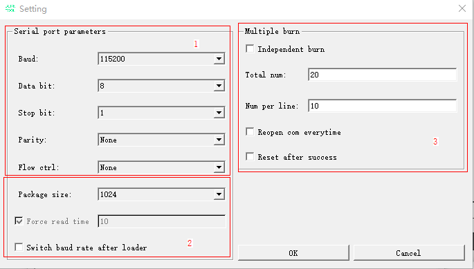

**表 1**  设置界面说明

<a name="zh-cn_topic_0000002340706437_zh-cn_topic_0000001161963482_zh-cn_topic_0000001138051779_table1435556181"></a>
<table><thead align="left"><tr id="zh-cn_topic_0000002340706437_zh-cn_topic_0000001161963482_zh-cn_topic_0000001138051779_row1835656183"><th class="cellrowborder" valign="top" width="17.77%" id="mcps1.2.3.1.1"><p id="zh-cn_topic_0000002340706437_zh-cn_topic_0000001161963482_zh-cn_topic_0000001138051779_p115311511086"><a name="zh-cn_topic_0000002340706437_zh-cn_topic_0000001161963482_zh-cn_topic_0000001138051779_p115311511086"></a><a name="zh-cn_topic_0000002340706437_zh-cn_topic_0000001161963482_zh-cn_topic_0000001138051779_p115311511086"></a>区域</p>
</th>
<th class="cellrowborder" valign="top" width="82.23%" id="mcps1.2.3.1.2"><p id="zh-cn_topic_0000002340706437_zh-cn_topic_0000001161963482_zh-cn_topic_0000001138051779_p5531145116817"><a name="zh-cn_topic_0000002340706437_zh-cn_topic_0000001161963482_zh-cn_topic_0000001138051779_p5531145116817"></a><a name="zh-cn_topic_0000002340706437_zh-cn_topic_0000001161963482_zh-cn_topic_0000001138051779_p5531145116817"></a>说明</p>
</th>
</tr>
</thead>
<tbody><tr id="zh-cn_topic_0000002340706437_zh-cn_topic_0000001161963482_zh-cn_topic_0000001138051779_row1778202182511"><td class="cellrowborder" valign="top" width="17.77%" headers="mcps1.2.3.1.1 "><p id="zh-cn_topic_0000002340706437_zh-cn_topic_0000001161963482_zh-cn_topic_0000001138051779_p1978218222513"><a name="zh-cn_topic_0000002340706437_zh-cn_topic_0000001161963482_zh-cn_topic_0000001138051779_p1978218222513"></a><a name="zh-cn_topic_0000002340706437_zh-cn_topic_0000001161963482_zh-cn_topic_0000001138051779_p1978218222513"></a>1</p>
</td>
<td class="cellrowborder" valign="top" width="82.23%" headers="mcps1.2.3.1.2 "><a name="zh-cn_topic_0000002340706437_zh-cn_topic_0000001161963482_zh-cn_topic_0000001138051779_ul137862022513"></a><a name="zh-cn_topic_0000002340706437_zh-cn_topic_0000001161963482_zh-cn_topic_0000001138051779_ul137862022513"></a><ul id="zh-cn_topic_0000002340706437_zh-cn_topic_0000001161963482_zh-cn_topic_0000001138051779_ul137862022513"><li>Baud：波特率。各产品可支持的波特率范围不同，工具仅列出所有常用波特率，是否可正常使用以产品约束为准，一般波特率越高速度越快，但对硬件要求越高。</li><li>Data Bit：数据位。</li><li>Stop Bit：停止位。</li><li>Parity：校验位。</li><li>Flow ctrl：流控。</li></ul>
</td>
</tr>
<tr id="zh-cn_topic_0000002340706437_zh-cn_topic_0000001161963482_zh-cn_topic_0000001138051779_row1235619611820"><td class="cellrowborder" valign="top" width="17.77%" headers="mcps1.2.3.1.1 "><p id="zh-cn_topic_0000002340706437_zh-cn_topic_0000001161963482_zh-cn_topic_0000001138051779_p195316518818"><a name="zh-cn_topic_0000002340706437_zh-cn_topic_0000001161963482_zh-cn_topic_0000001138051779_p195316518818"></a><a name="zh-cn_topic_0000002340706437_zh-cn_topic_0000001161963482_zh-cn_topic_0000001138051779_p195316518818"></a>2</p>
</td>
<td class="cellrowborder" valign="top" width="82.23%" headers="mcps1.2.3.1.2 "><a name="zh-cn_topic_0000002340706437_zh-cn_topic_0000001161963482_zh-cn_topic_0000001138051779_ul05676417267"></a><a name="zh-cn_topic_0000002340706437_zh-cn_topic_0000001161963482_zh-cn_topic_0000001138051779_ul05676417267"></a><ul id="zh-cn_topic_0000002340706437_zh-cn_topic_0000001161963482_zh-cn_topic_0000001138051779_ul05676417267"><li>Package size：数据传输每包大小，一般只支持1024字节，除非产品有特殊支持，否则不应该修改。</li><li>Force Read Time：串口定时读时间间隔，表示串口两次接收的时间间隔至少为N ms，默认为勾选且时间间隔为10ms（在4.4版本之后，默认强制勾选且无法修改）。默认为勾选可以防止出现如下场景：<a name="zh-cn_topic_0000002340706437_zh-cn_topic_0000001161963482_ul121434109233"></a><a name="zh-cn_topic_0000002340706437_zh-cn_topic_0000001161963482_ul121434109233"></a><ul id="zh-cn_topic_0000002340706437_zh-cn_topic_0000001161963482_ul121434109233"><li>在某些PC环境下BurnTool无法正常使用。</li><li>在一拖多场景下CPU占用率过高。</li></ul>
</li><li>Switch baud rate after loader：在烧写完loader后切换所设置的波特率。loader在高波特率下无法烧写并且其他文件在此波特率下可以烧写时勾选其可以提升烧写速度。</li></ul>
</td>
</tr>
<tr id="zh-cn_topic_0000002340706437_zh-cn_topic_0000001161963482_zh-cn_topic_0000001138051779_row829518303389"><td class="cellrowborder" valign="top" width="17.77%" headers="mcps1.2.3.1.1 "><p id="zh-cn_topic_0000002340706437_zh-cn_topic_0000001161963482_zh-cn_topic_0000001138051779_p229616307382"><a name="zh-cn_topic_0000002340706437_zh-cn_topic_0000001161963482_zh-cn_topic_0000001138051779_p229616307382"></a><a name="zh-cn_topic_0000002340706437_zh-cn_topic_0000001161963482_zh-cn_topic_0000001138051779_p229616307382"></a>3</p>
</td>
<td class="cellrowborder" valign="top" width="82.23%" headers="mcps1.2.3.1.2 "><a name="zh-cn_topic_0000002340706437_zh-cn_topic_0000001161963482_zh-cn_topic_0000001138051779_ul12554334173812"></a><a name="zh-cn_topic_0000002340706437_zh-cn_topic_0000001161963482_zh-cn_topic_0000001138051779_ul12554334173812"></a><ul id="zh-cn_topic_0000002340706437_zh-cn_topic_0000001161963482_zh-cn_topic_0000001138051779_ul12554334173812"><li>Independent Burn：独立烧写。勾选后工厂界面所有串口将完全独立，不做整体流程控制，不计算总烧写时间，适用于夹具为单独烧写的工厂；不勾选则工厂界面所有串口会统筹管理，烧写完成后将一起判断夹具抬起操作。</li><li>Total num：工厂界面窗口总个数。</li><li>Num per line：工厂界面每行窗口个数。</li><li>Reopen Com Everytime：勾选后在工厂烧写界面每次烧写完成后，下次开始烧写之前会重新打开串口。</li><li>Reset after success：勾选后在工厂烧写界面每次烧写完成后，会重启单板。</li></ul>
</td>
</tr>
</tbody>
</table>

# 操作指南<a name="ZH-CN_TOPIC_0000002499502949"></a>

-   **[手动烧写](#ZH-CN_TOPIC_0000002499582989)**  

-   **[工厂烧写](#ZH-CN_TOPIC_0000002499502961)**  

-   **[工厂烧写-USB](#ZH-CN_TOPIC_0000002535835423)**  

-   **[命令行烧写](#ZH-CN_TOPIC_0000002499502957)**  

-   **[导出镜像](#ZH-CN_TOPIC_0000002499582985)**  

-   **[命令行导出](#ZH-CN_TOPIC_0000002499582977)**  

-   **[全部擦除](#ZH-CN_TOPIC_0000002499502945)**  

-   **[CAT1 USB烧写](#ZH-CN_TOPIC_0000002510278808)**  

## 手动烧写<a name="ZH-CN_TOPIC_0000002499582989"></a>

-   **[串口烧写](#ZH-CN_TOPIC_0000002466543636)**  

-   **[USB烧写](#ZH-CN_TOPIC_0000002499502953)**  

### 串口烧写<a name="ZH-CN_TOPIC_0000002466543636"></a>

1.  在BurnTool界面中单击“Select file”按钮，选择各产品编译生成的固件包，并单击“OK”。
2.  在表格中选中需要烧写的文件（请参考各产品文档中关于烧写的部分）。
3.  选择“Setting”→“Settings”，配置串口参数，默认配置如[图1](#zh-cn_topic_0000002306747314_zh-cn_topic_0000001860836886_fig323525813325)所示。

    > **说明：** 
    >Force Read Time：定时读取的时间，以毫秒为单位。勾选时为定时读取串口，不勾选时为事件触发读取串口。适用于不勾选该选项无法正常烧录的场景。

    **图 1**  串口设置示例<a name="zh-cn_topic_0000002306747314_zh-cn_topic_0000001860836886_fig323525813325"></a>  
    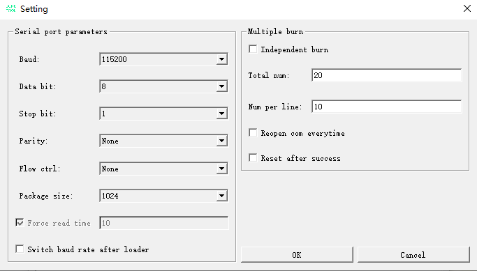

4.  选择目标串口号并单击“Connect”按钮（单击后“Connect”变为“Disconnect”），复位单板。打断后效果如[图2](#zh-cn_topic_0000002306747314_zh-cn_topic_0000001860836886_zh-cn_topic_0279549073_fig1957511242357)所示。

    **图 2**  打断效果示意图<a name="zh-cn_topic_0000002306747314_zh-cn_topic_0000001860836886_zh-cn_topic_0279549073_fig1957511242357"></a>  
    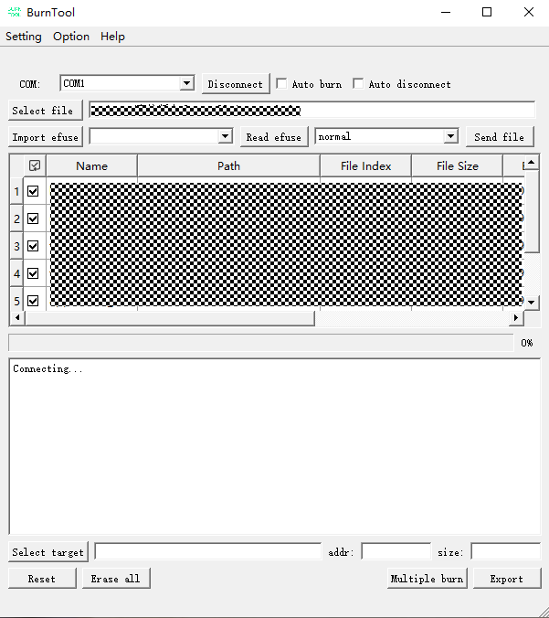

5.  当界面显示字符串“CCC”时，单击“Send file”按钮。不同产品“CCC”上方的字符串可能不同。
6.  等待传输完成后结束烧写，烧写完成会出现“All images burn successfully”。烧写完成效果如[图3](#zh-cn_topic_0000002306747314_zh-cn_topic_0000001860836886_zh-cn_topic_0279549073_fig11410377529)所示。

    **图 3**  烧写完成示意图<a name="zh-cn_topic_0000002306747314_zh-cn_topic_0000001860836886_zh-cn_topic_0279549073_fig11410377529"></a>  
    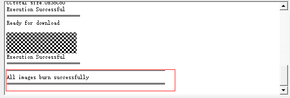

> **说明：** 
>若镜像在服务器上，并多次出现烧写镜像失败的情况，请拷贝至本地烧写

### USB烧写<a name="ZH-CN_TOPIC_0000002499502953"></a>

> **须知：** 
>USB烧录前应强制烧录管脚（smgpio18）管脚接地，烧录结束后去掉接地。

1.  在BurnTool界面中正确填写USB设备的Vid和Pid信息，单击“Select file”按钮，如[图1](#zh-cn_topic_0000002449532781_zh-cn_topic_0000002311057342_fig174621210163718)所示，选择各产品编译生成的固件包，并单击“打开”。

    **图 1**  单击“Select file”按钮<a name="zh-cn_topic_0000002449532781_zh-cn_topic_0000002311057342_fig174621210163718"></a>  
    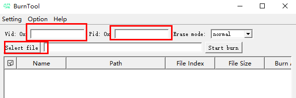

2.  在表格中选中需要烧写的文件（请参考各产品文档中关于烧写的部分），如[图2](#zh-cn_topic_0000002449532781_zh-cn_topic_0000002311057342_fig4262172193911)所示。

    **图 2**  烧写文件表格<a name="zh-cn_topic_0000002449532781_zh-cn_topic_0000002311057342_fig4262172193911"></a>  
    

3.  单击“Start burn”按钮，待日志窗口出现“Reset the device...”如[图3](#zh-cn_topic_0000002449532781_zh-cn_topic_0000002311057342_fig1133854119489)所示，此时按下单板的复位键。工具等待单板复位超时默认为10s，如果超时时间内未检测到单板复位日志窗口会打印“Driver may not be installed. Open the device manager to confirm.No DFU capable USB device available.”，如[图4](#zh-cn_topic_0000002449532781_zh-cn_topic_0000002311057342_fig10735114165612)所示。

    **图 3**  等待单板复位<a name="zh-cn_topic_0000002449532781_zh-cn_topic_0000002311057342_fig1133854119489"></a>  
    

    **图 4**  检测单板复位超时<a name="zh-cn_topic_0000002449532781_zh-cn_topic_0000002311057342_fig10735114165612"></a>  
    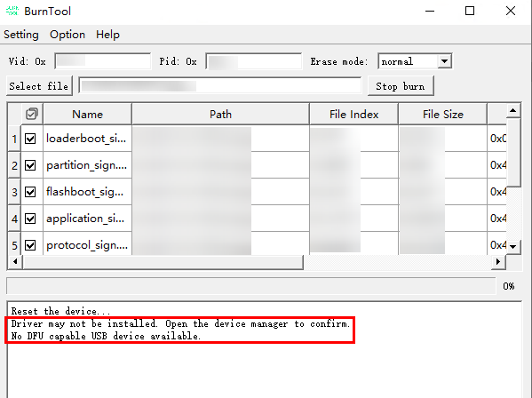

4.  等待传输完成后结束烧写，烧写完成会出现“All images burnt successfully”。烧写完成效果如[图5](#zh-cn_topic_0000002449532781_zh-cn_topic_0000002311057342_fig2320156175918)所示。

    **图 5**  烧写完成示意图<a name="zh-cn_topic_0000002449532781_zh-cn_topic_0000002311057342_fig2320156175918"></a>  
    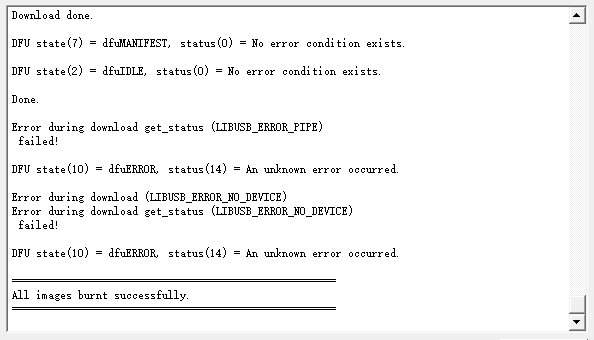

## 工厂烧写<a name="ZH-CN_TOPIC_0000002499502961"></a>

1.  在BurnTool界面中单击“Select file”按钮，选择各产品编译生成的固件包，并单击“OK”。
2.  在表格中选中需要烧写的文件。
3.  选择“Setting”→“Settings”，配置串口参数，默认配置如[图1](#zh-cn_topic_0000002340706445_zh-cn_topic_0000001162441958_zh-cn_topic_0281207485_fig12141552194715)所示。

    **图 1**  串口设置示例<a name="zh-cn_topic_0000002340706445_zh-cn_topic_0000001162441958_zh-cn_topic_0281207485_fig12141552194715"></a>  
    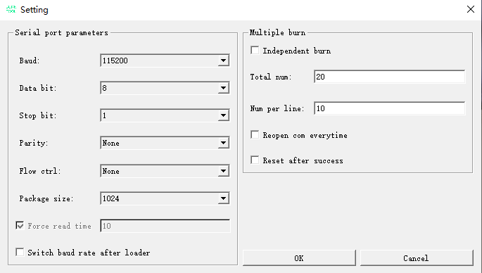

    > **说明：** 
    >Total num在研发测试中最大已压测个数为20，实际烧录最大个数上限理论不限制，一般与电脑性能、夹具、接线稳定性有关。

4.  单击“Multiple burn”按钮，打开工厂烧写窗口，若已有配置会自动读取。若无配置手动选择串口后，可以选择“Setting”→“Save config”生成配置。
5.  单击“Connect all”按钮，并复位所有单板。
6.  等待所有回显视图都显示绿色“PASS”或红色“Fail”。

    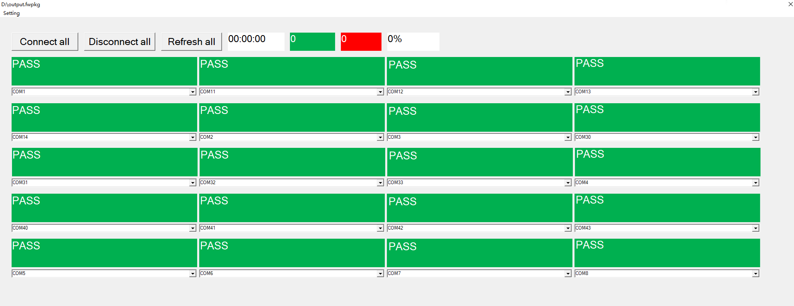

## 工厂烧写-USB<a name="ZH-CN_TOPIC_0000002535835423"></a>

1.  执行“[USB烧写](#ZH-CN_TOPIC_0000002499502953)”章节的[步骤1](#zh-cn_topic_0000002449532781_zh-cn_topic_0000002311057342_p556mcpsimp)。
2.  打开软件安装路径下的“configure\\config\_dfu”文件夹中的“config.ini”文件（以软件安装路径“D:\\BurnTool”为例），如[图1](#zh-cn_topic_0000002520938983_zh-cn_topic_0000002488739022_fig4944237174018)所示。

    **图 1**  config.ini文件路径<a name="zh-cn_topic_0000002520938983_zh-cn_topic_0000002488739022_fig4944237174018"></a>  
    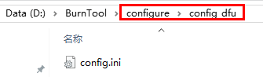

3.  <a name="zh-cn_topic_0000002520938983_zh-cn_topic_0000002488739022_li1064142019409"></a>在设备管理器的“通用串行总线控制器”中找到连接的单板的位置信息（例如Port\_\#0006.Hub\_\#0001），如[图2](#zh-cn_topic_0000002520938983_zh-cn_topic_0000002488739022_fig1950975854616)所示。

    **图 2**  单板位置信息<a name="zh-cn_topic_0000002520938983_zh-cn_topic_0000002488739022_fig1950975854616"></a>  
    

4.  <a name="zh-cn_topic_0000002520938983_zh-cn_topic_0000002488739022_li12486145715458"></a>将[3](#zh-cn_topic_0000002520938983_zh-cn_topic_0000002488739022_li1064142019409)中找到的单板位置信息（以Port\_\#0006.Hub\_\#0001为例），保存在“config.ini”中的LOCATION1属性中，如[图3](#zh-cn_topic_0000002520938983_zh-cn_topic_0000002488739022_fig592582045215)所示。

    **图 3**  LOCATION1位置信息<a name="zh-cn_topic_0000002520938983_zh-cn_topic_0000002488739022_fig592582045215"></a>  
    

5.  重复执行[3](#zh-cn_topic_0000002520938983_zh-cn_topic_0000002488739022_li1064142019409)和[4](#zh-cn_topic_0000002520938983_zh-cn_topic_0000002488739022_li12486145715458)直到将需要烧写的单板的位置信息按序填写在“config.ini”中。

    > **说明：** 
    >-   如果需要同时烧写2块单板，则需要配置这2块单板的位置信息到LOCATION1和LOCATION2属性中。
    >-   如果需要同时烧写20块单板，则需要配置这20块单板的位置信息到LOCATION1到LOCATION20属性中。
    >客户实际使用过程中，可以找20块单板（非空片），全部将其接到HUB中。然后分别给每一块单板上电，一个一个找到每一块单板的位置信息，填充到“config.ini”中。

6.  打开工具界面，执行“[USB烧写](#ZH-CN_TOPIC_0000002499502953)”章节的[步骤2](#zh-cn_topic_0000002449532781_zh-cn_topic_0000002311057342_li4130163719327)。
7.  选择“Setting”→“USB Settings”，配置工厂烧写相关参数，默认配置如[图4](#zh-cn_topic_0000002520938983_zh-cn_topic_0000002488739022_fig136217583413)所示。

    **图 4**  工厂烧写默认参数<a name="zh-cn_topic_0000002520938983_zh-cn_topic_0000002488739022_fig136217583413"></a>  
    

    -   Total num：工厂界面窗口总个数（窗口总个数最大值为20，最小值为1）。
    -   Num per line：工厂界面每行窗口个数（每行窗口个数最大值为8，最小值为4）。

    > **说明：** 
    >Total num的配置个数应与实际烧写的单板个数保持一致。例如如果实际要同时烧写2块单板，则Total num应该配置成2，如果实际要同时烧写20块单板，则Total num应该配置成20。

8.  单击“Multiple burn”按钮，打开工厂烧写窗口。
9.  单击“Connect all”按钮并复位所有单板。
10. 等待所有单板烧写完成（以连接一个单板为例），如[图5](#zh-cn_topic_0000002520938983_zh-cn_topic_0000002488739022_fig23011151698)所示。

    **图 5**  工厂烧写结束示意图<a name="zh-cn_topic_0000002520938983_zh-cn_topic_0000002488739022_fig23011151698"></a>  
    

    **表 1**  工厂烧写界面说明

    <a name="zh-cn_topic_0000002520938983_zh-cn_topic_0000002488739022_table1026339102319"></a>
    <table><thead align="left"><tr id="zh-cn_topic_0000002520938983_zh-cn_topic_0000002488739022_row1326311919237"><th class="cellrowborder" valign="top" width="10.16%" id="mcps1.2.3.1.1"><p id="zh-cn_topic_0000002520938983_zh-cn_topic_0000002488739022_p526315911234"><a name="zh-cn_topic_0000002520938983_zh-cn_topic_0000002488739022_p526315911234"></a><a name="zh-cn_topic_0000002520938983_zh-cn_topic_0000002488739022_p526315911234"></a>区域</p>
    </th>
    <th class="cellrowborder" valign="top" width="89.84%" id="mcps1.2.3.1.2"><p id="zh-cn_topic_0000002520938983_zh-cn_topic_0000002488739022_p32637942313"><a name="zh-cn_topic_0000002520938983_zh-cn_topic_0000002488739022_p32637942313"></a><a name="zh-cn_topic_0000002520938983_zh-cn_topic_0000002488739022_p32637942313"></a>说明</p>
    </th>
    </tr>
    </thead>
    <tbody><tr id="zh-cn_topic_0000002520938983_zh-cn_topic_0000002488739022_row1126319982316"><td class="cellrowborder" valign="top" width="10.16%" headers="mcps1.2.3.1.1 "><p id="zh-cn_topic_0000002520938983_zh-cn_topic_0000002488739022_p92641962320"><a name="zh-cn_topic_0000002520938983_zh-cn_topic_0000002488739022_p92641962320"></a><a name="zh-cn_topic_0000002520938983_zh-cn_topic_0000002488739022_p92641962320"></a>1</p>
    </td>
    <td class="cellrowborder" valign="top" width="89.84%" headers="mcps1.2.3.1.2 "><a name="zh-cn_topic_0000002520938983_zh-cn_topic_0000002488739022_ul6715427202514"></a><a name="zh-cn_topic_0000002520938983_zh-cn_topic_0000002488739022_ul6715427202514"></a><ul id="zh-cn_topic_0000002520938983_zh-cn_topic_0000002488739022_ul6715427202514"><li>Connect all：开始检查插入的USB设备。</li><li>Disconnect all：待所有USB设备烧写完成后，手动退出本次烧写。</li></ul>
    </td>
    </tr>
    <tr id="zh-cn_topic_0000002520938983_zh-cn_topic_0000002488739022_row62642913231"><td class="cellrowborder" valign="top" width="10.16%" headers="mcps1.2.3.1.1 "><p id="zh-cn_topic_0000002520938983_zh-cn_topic_0000002488739022_p2264189182314"><a name="zh-cn_topic_0000002520938983_zh-cn_topic_0000002488739022_p2264189182314"></a><a name="zh-cn_topic_0000002520938983_zh-cn_topic_0000002488739022_p2264189182314"></a>2</p>
    </td>
    <td class="cellrowborder" valign="top" width="89.84%" headers="mcps1.2.3.1.2 "><p id="zh-cn_topic_0000002520938983_zh-cn_topic_0000002488739022_p74561861857"><a name="zh-cn_topic_0000002520938983_zh-cn_topic_0000002488739022_p74561861857"></a><a name="zh-cn_topic_0000002520938983_zh-cn_topic_0000002488739022_p74561861857"></a>烧写结果统计：成功数、失败数、成功率、本次烧写时间。</p>
    </td>
    </tr>
    <tr id="zh-cn_topic_0000002520938983_zh-cn_topic_0000002488739022_row926459162319"><td class="cellrowborder" valign="top" width="10.16%" headers="mcps1.2.3.1.1 "><p id="zh-cn_topic_0000002520938983_zh-cn_topic_0000002488739022_p3264397231"><a name="zh-cn_topic_0000002520938983_zh-cn_topic_0000002488739022_p3264397231"></a><a name="zh-cn_topic_0000002520938983_zh-cn_topic_0000002488739022_p3264397231"></a>3</p>
    </td>
    <td class="cellrowborder" valign="top" width="89.84%" headers="mcps1.2.3.1.2 "><a name="zh-cn_topic_0000002520938983_zh-cn_topic_0000002488739022_ul956350162813"></a><a name="zh-cn_topic_0000002520938983_zh-cn_topic_0000002488739022_ul956350162813"></a><ul id="zh-cn_topic_0000002520938983_zh-cn_topic_0000002488739022_ul956350162813"><li>回显视图：显示单板烧写状态“Doing”、“PASS”、“Fail”、“Connecting”、“Stop”。</li><li>序列号：显示当前视图检测到的USB序列号。</li></ul>
    </td>
    </tr>
    </tbody>
    </table>

## 命令行烧写<a name="ZH-CN_TOPIC_0000002499502957"></a>

-   **[串口烧写](#ZH-CN_TOPIC_0000002499502941)**  

-   **[USB烧写](#ZH-CN_TOPIC_0000002466543644)**  

### 串口烧写<a name="ZH-CN_TOPIC_0000002499502941"></a>

在Windows环境下，BurnTool.exe支持以命令行的方式调用，可用于集成到用户已有的工厂产线烧写程序中，调用命令如下：

```
BurnTool.exe params
```

命令之间用空格隔开，如果命令带有参数，命令与参数之间用冒号隔开，最简示例如下：

```
BurnTool.exe -com:1 -bin:C:\test_bin\xxx.fwpkg -signalbaud:921600 -chiptype:XXXX
```

BurnTool.exe烧写命令可以配置的params参数如[表1](#zh-cn_topic_0000002340826277_zh-cn_topic_0000001906960121_zh-cn_topic_0279549078_table51147202142)所示。

**表 1**  BurnTool.exe烧写命令参数表

<a name="zh-cn_topic_0000002340826277_zh-cn_topic_0000001906960121_zh-cn_topic_0279549078_table51147202142"></a>
<table><thead align="left"><tr id="zh-cn_topic_0000002340826277_zh-cn_topic_0000001906960121_zh-cn_topic_0279549078_row111472021414"><th class="cellrowborder" valign="top" width="19.16191619161916%" id="mcps1.2.4.1.1"><p id="zh-cn_topic_0000002340826277_zh-cn_topic_0000001906960121_zh-cn_topic_0279549078_p1782320288143"><a name="zh-cn_topic_0000002340826277_zh-cn_topic_0000001906960121_zh-cn_topic_0279549078_p1782320288143"></a><a name="zh-cn_topic_0000002340826277_zh-cn_topic_0000001906960121_zh-cn_topic_0279549078_p1782320288143"></a>命令</p>
</th>
<th class="cellrowborder" valign="top" width="17.781778177817785%" id="mcps1.2.4.1.2"><p id="zh-cn_topic_0000002340826277_zh-cn_topic_0000001906960121_zh-cn_topic_0279549078_p4823202816141"><a name="zh-cn_topic_0000002340826277_zh-cn_topic_0000001906960121_zh-cn_topic_0279549078_p4823202816141"></a><a name="zh-cn_topic_0000002340826277_zh-cn_topic_0000001906960121_zh-cn_topic_0279549078_p4823202816141"></a>参数</p>
</th>
<th class="cellrowborder" valign="top" width="63.056305630563045%" id="mcps1.2.4.1.3"><p id="zh-cn_topic_0000002340826277_zh-cn_topic_0000001906960121_zh-cn_topic_0279549078_p782372815142"><a name="zh-cn_topic_0000002340826277_zh-cn_topic_0000001906960121_zh-cn_topic_0279549078_p782372815142"></a><a name="zh-cn_topic_0000002340826277_zh-cn_topic_0000001906960121_zh-cn_topic_0279549078_p782372815142"></a>说明</p>
</th>
</tr>
</thead>
<tbody><tr id="zh-cn_topic_0000002340826277_zh-cn_topic_0000001906960121_zh-cn_topic_0279549078_row4114220111417"><td class="cellrowborder" valign="top" width="19.16191619161916%" headers="mcps1.2.4.1.1 "><p id="zh-cn_topic_0000002340826277_zh-cn_topic_0000001906960121_zh-cn_topic_0279549078_p6464935131411"><a name="zh-cn_topic_0000002340826277_zh-cn_topic_0000001906960121_zh-cn_topic_0279549078_p6464935131411"></a><a name="zh-cn_topic_0000002340826277_zh-cn_topic_0000001906960121_zh-cn_topic_0279549078_p6464935131411"></a>-com:</p>
</td>
<td class="cellrowborder" valign="top" width="17.781778177817785%" headers="mcps1.2.4.1.2 "><p id="zh-cn_topic_0000002340826277_zh-cn_topic_0000001906960121_zh-cn_topic_0279549078_p146415352140"><a name="zh-cn_topic_0000002340826277_zh-cn_topic_0000001906960121_zh-cn_topic_0279549078_p146415352140"></a><a name="zh-cn_topic_0000002340826277_zh-cn_topic_0000001906960121_zh-cn_topic_0279549078_p146415352140"></a>x</p>
</td>
<td class="cellrowborder" valign="top" width="63.056305630563045%" headers="mcps1.2.4.1.3 "><p id="zh-cn_topic_0000002340826277_zh-cn_topic_0000001906960121_zh-cn_topic_0279549078_p846410354145"><a name="zh-cn_topic_0000002340826277_zh-cn_topic_0000001906960121_zh-cn_topic_0279549078_p846410354145"></a><a name="zh-cn_topic_0000002340826277_zh-cn_topic_0000001906960121_zh-cn_topic_0279549078_p846410354145"></a>PC端的串口号（例如：1）。</p>
</td>
</tr>
<tr id="zh-cn_topic_0000002340826277_zh-cn_topic_0000001906960121_zh-cn_topic_0279549078_row211482013145"><td class="cellrowborder" valign="top" width="19.16191619161916%" headers="mcps1.2.4.1.1 "><p id="zh-cn_topic_0000002340826277_zh-cn_topic_0000001906960121_zh-cn_topic_0279549078_p10464135131419"><a name="zh-cn_topic_0000002340826277_zh-cn_topic_0000001906960121_zh-cn_topic_0279549078_p10464135131419"></a><a name="zh-cn_topic_0000002340826277_zh-cn_topic_0000001906960121_zh-cn_topic_0279549078_p10464135131419"></a>-bin:</p>
</td>
<td class="cellrowborder" valign="top" width="17.781778177817785%" headers="mcps1.2.4.1.2 "><p id="zh-cn_topic_0000002340826277_zh-cn_topic_0000001906960121_zh-cn_topic_0279549078_p3464163511416"><a name="zh-cn_topic_0000002340826277_zh-cn_topic_0000001906960121_zh-cn_topic_0279549078_p3464163511416"></a><a name="zh-cn_topic_0000002340826277_zh-cn_topic_0000001906960121_zh-cn_topic_0279549078_p3464163511416"></a>path\xxx.bin</p>
</td>
<td class="cellrowborder" valign="top" width="63.056305630563045%" headers="mcps1.2.4.1.3 "><p id="zh-cn_topic_0000002340826277_zh-cn_topic_0000001906960121_zh-cn_topic_0279549078_p9464133571410"><a name="zh-cn_topic_0000002340826277_zh-cn_topic_0000001906960121_zh-cn_topic_0279549078_p9464133571410"></a><a name="zh-cn_topic_0000002340826277_zh-cn_topic_0000001906960121_zh-cn_topic_0279549078_p9464133571410"></a>固件包xxx.bin的绝对路径。固件包的名称和文件类型根据各产品实际情况可能有所不同。（路径不能存在空格字符）</p>
</td>
</tr>
<tr id="zh-cn_topic_0000002340826277_zh-cn_topic_0000001906960121_row5600171875019"><td class="cellrowborder" valign="top" width="19.16191619161916%" headers="mcps1.2.4.1.1 "><p id="zh-cn_topic_0000002340826277_zh-cn_topic_0000001906960121_p1584418119154"><a name="zh-cn_topic_0000002340826277_zh-cn_topic_0000001906960121_p1584418119154"></a><a name="zh-cn_topic_0000002340826277_zh-cn_topic_0000001906960121_p1584418119154"></a>-chiptype:</p>
</td>
<td class="cellrowborder" valign="top" width="17.781778177817785%" headers="mcps1.2.4.1.2 "><p id="zh-cn_topic_0000002340826277_zh-cn_topic_0000001906960121_p10464113013156"><a name="zh-cn_topic_0000002340826277_zh-cn_topic_0000001906960121_p10464113013156"></a><a name="zh-cn_topic_0000002340826277_zh-cn_topic_0000001906960121_p10464113013156"></a>xxxx</p>
</td>
<td class="cellrowborder" valign="top" width="63.056305630563045%" headers="mcps1.2.4.1.3 "><p id="zh-cn_topic_0000002340826277_zh-cn_topic_0000001906960121_p97041741131416"><a name="zh-cn_topic_0000002340826277_zh-cn_topic_0000001906960121_p97041741131416"></a><a name="zh-cn_topic_0000002340826277_zh-cn_topic_0000001906960121_p97041741131416"></a>芯片类型。</p>
</td>
</tr>
<tr id="zh-cn_topic_0000002340826277_zh-cn_topic_0000001906960121_zh-cn_topic_0279549078_row2114162071419"><td class="cellrowborder" valign="top" width="19.16191619161916%" headers="mcps1.2.4.1.1 "><p id="zh-cn_topic_0000002340826277_zh-cn_topic_0000001906960121_zh-cn_topic_0279549078_p146433513144"><a name="zh-cn_topic_0000002340826277_zh-cn_topic_0000001906960121_zh-cn_topic_0279549078_p146433513144"></a><a name="zh-cn_topic_0000002340826277_zh-cn_topic_0000001906960121_zh-cn_topic_0279549078_p146433513144"></a>-signalbaud:</p>
</td>
<td class="cellrowborder" valign="top" width="17.781778177817785%" headers="mcps1.2.4.1.2 "><p id="zh-cn_topic_0000002340826277_zh-cn_topic_0000001906960121_zh-cn_topic_0279549078_p19464193571410"><a name="zh-cn_topic_0000002340826277_zh-cn_topic_0000001906960121_zh-cn_topic_0279549078_p19464193571410"></a><a name="zh-cn_topic_0000002340826277_zh-cn_topic_0000001906960121_zh-cn_topic_0279549078_p19464193571410"></a>115200</p>
</td>
<td class="cellrowborder" valign="top" width="63.056305630563045%" headers="mcps1.2.4.1.3 "><p id="zh-cn_topic_0000002340826277_zh-cn_topic_0000001906960121_zh-cn_topic_0279549078_p54641835181410"><a name="zh-cn_topic_0000002340826277_zh-cn_topic_0000001906960121_zh-cn_topic_0279549078_p54641835181410"></a><a name="zh-cn_topic_0000002340826277_zh-cn_topic_0000001906960121_zh-cn_topic_0279549078_p54641835181410"></a>RomBoot下传输固件包时的串口波特率，默认为115200bit/s。建议根据硬件支持情况，配置成921600bit/s或更高波特率，以提升烧写效率。</p>
</td>
</tr>
<tr id="zh-cn_topic_0000002340826277_zh-cn_topic_0000001906960121_zh-cn_topic_0279549078_row2646161518281"><td class="cellrowborder" valign="top" width="19.16191619161916%" headers="mcps1.2.4.1.1 "><p id="zh-cn_topic_0000002340826277_zh-cn_topic_0000001906960121_zh-cn_topic_0279549078_p1564761512282"><a name="zh-cn_topic_0000002340826277_zh-cn_topic_0000001906960121_zh-cn_topic_0279549078_p1564761512282"></a><a name="zh-cn_topic_0000002340826277_zh-cn_topic_0000001906960121_zh-cn_topic_0279549078_p1564761512282"></a>-burninterval:</p>
</td>
<td class="cellrowborder" valign="top" width="17.781778177817785%" headers="mcps1.2.4.1.2 "><p id="zh-cn_topic_0000002340826277_zh-cn_topic_0000001906960121_zh-cn_topic_0279549078_p12647715112818"><a name="zh-cn_topic_0000002340826277_zh-cn_topic_0000001906960121_zh-cn_topic_0279549078_p12647715112818"></a><a name="zh-cn_topic_0000002340826277_zh-cn_topic_0000001906960121_zh-cn_topic_0279549078_p12647715112818"></a>x</p>
</td>
<td class="cellrowborder" valign="top" width="63.056305630563045%" headers="mcps1.2.4.1.3 "><p id="zh-cn_topic_0000002340826277_zh-cn_topic_0000001906960121_zh-cn_topic_0279549078_p86472156282"><a name="zh-cn_topic_0000002340826277_zh-cn_topic_0000001906960121_zh-cn_topic_0279549078_p86472156282"></a><a name="zh-cn_topic_0000002340826277_zh-cn_topic_0000001906960121_zh-cn_topic_0279549078_p86472156282"></a>使用xms间隔发送打断报文，常用于快速启动场景。不包含此参数时，间隔则为10ms。</p>
</td>
</tr>
<tr id="zh-cn_topic_0000002340826277_zh-cn_topic_0000001906960121_zh-cn_topic_0279549078_row1715818567399"><td class="cellrowborder" valign="top" width="19.16191619161916%" headers="mcps1.2.4.1.1 "><p id="zh-cn_topic_0000002340826277_zh-cn_topic_0000001906960121_zh-cn_topic_0279549078_p51584560397"><a name="zh-cn_topic_0000002340826277_zh-cn_topic_0000001906960121_zh-cn_topic_0279549078_p51584560397"></a><a name="zh-cn_topic_0000002340826277_zh-cn_topic_0000001906960121_zh-cn_topic_0279549078_p51584560397"></a>-forceread:</p>
</td>
<td class="cellrowborder" valign="top" width="17.781778177817785%" headers="mcps1.2.4.1.2 "><p id="zh-cn_topic_0000002340826277_zh-cn_topic_0000001906960121_zh-cn_topic_0279549078_p915875623915"><a name="zh-cn_topic_0000002340826277_zh-cn_topic_0000001906960121_zh-cn_topic_0279549078_p915875623915"></a><a name="zh-cn_topic_0000002340826277_zh-cn_topic_0000001906960121_zh-cn_topic_0279549078_p915875623915"></a>10</p>
</td>
<td class="cellrowborder" valign="top" width="63.056305630563045%" headers="mcps1.2.4.1.3 "><p id="zh-cn_topic_0000002340826277_zh-cn_topic_0000001906960121_zh-cn_topic_0279549078_p17683185835817"><a name="zh-cn_topic_0000002340826277_zh-cn_topic_0000001906960121_zh-cn_topic_0279549078_p17683185835817"></a><a name="zh-cn_topic_0000002340826277_zh-cn_topic_0000001906960121_zh-cn_topic_0279549078_p17683185835817"></a>包含此参数表示打开串口定时读功能，读数据间隔为10ms。</p>
<p id="zh-cn_topic_0000002340826277_zh-cn_topic_0000001906960121_zh-cn_topic_0279549078_p6501124013157"><a name="zh-cn_topic_0000002340826277_zh-cn_topic_0000001906960121_zh-cn_topic_0279549078_p6501124013157"></a><a name="zh-cn_topic_0000002340826277_zh-cn_topic_0000001906960121_zh-cn_topic_0279549078_p6501124013157"></a>一般无需打开，在如下场景可考虑打开：</p>
<a name="zh-cn_topic_0000002340826277_zh-cn_topic_0000001906960121_zh-cn_topic_0279549078_ul54691647111514"></a><a name="zh-cn_topic_0000002340826277_zh-cn_topic_0000001906960121_zh-cn_topic_0279549078_ul54691647111514"></a><ul id="zh-cn_topic_0000002340826277_zh-cn_topic_0000001906960121_zh-cn_topic_0279549078_ul54691647111514"><li>在某些PC环境下BurnTool无法正常使用。</li><li>在一拖多场景下CPU占用率过高。</li></ul>
</td>
</tr>
<tr id="zh-cn_topic_0000002340826277_zh-cn_topic_0000001906960121_zh-cn_topic_0279549078_row164607487544"><td class="cellrowborder" valign="top" width="19.16191619161916%" headers="mcps1.2.4.1.1 "><p id="zh-cn_topic_0000002340826277_zh-cn_topic_0000001906960121_zh-cn_topic_0279549078_p16460174814546"><a name="zh-cn_topic_0000002340826277_zh-cn_topic_0000001906960121_zh-cn_topic_0279549078_p16460174814546"></a><a name="zh-cn_topic_0000002340826277_zh-cn_topic_0000001906960121_zh-cn_topic_0279549078_p16460174814546"></a>-erasemode:</p>
</td>
<td class="cellrowborder" valign="top" width="17.781778177817785%" headers="mcps1.2.4.1.2 "><p id="zh-cn_topic_0000002340826277_zh-cn_topic_0000001906960121_zh-cn_topic_0279549078_p346034875416"><a name="zh-cn_topic_0000002340826277_zh-cn_topic_0000001906960121_zh-cn_topic_0279549078_p346034875416"></a><a name="zh-cn_topic_0000002340826277_zh-cn_topic_0000001906960121_zh-cn_topic_0279549078_p346034875416"></a>x</p>
</td>
<td class="cellrowborder" valign="top" width="63.056305630563045%" headers="mcps1.2.4.1.3 "><p id="zh-cn_topic_0000002340826277_zh-cn_topic_0000001906960121_zh-cn_topic_0279549078_p57861027194111"><a name="zh-cn_topic_0000002340826277_zh-cn_topic_0000001906960121_zh-cn_topic_0279549078_p57861027194111"></a><a name="zh-cn_topic_0000002340826277_zh-cn_topic_0000001906960121_zh-cn_topic_0279549078_p57861027194111"></a>擦除模式。其中：</p>
<a name="zh-cn_topic_0000002340826277_zh-cn_topic_0000001906960121_zh-cn_topic_0279549078_ul209361847134110"></a><a name="zh-cn_topic_0000002340826277_zh-cn_topic_0000001906960121_zh-cn_topic_0279549078_ul209361847134110"></a><ul id="zh-cn_topic_0000002340826277_zh-cn_topic_0000001906960121_zh-cn_topic_0279549078_ul209361847134110"><li>0：正常擦除</li><li>1：全片擦除</li><li>2：不擦除</li></ul>
</td>
</tr>
<tr id="zh-cn_topic_0000002340826277_zh-cn_topic_0000001906960121_zh-cn_topic_0279549078_row114172595516"><td class="cellrowborder" valign="top" width="19.16191619161916%" headers="mcps1.2.4.1.1 "><p id="zh-cn_topic_0000002340826277_zh-cn_topic_0000001906960121_zh-cn_topic_0279549078_p13410258557"><a name="zh-cn_topic_0000002340826277_zh-cn_topic_0000001906960121_zh-cn_topic_0279549078_p13410258557"></a><a name="zh-cn_topic_0000002340826277_zh-cn_topic_0000001906960121_zh-cn_topic_0279549078_p13410258557"></a>-timeout:</p>
</td>
<td class="cellrowborder" valign="top" width="17.781778177817785%" headers="mcps1.2.4.1.2 "><p id="zh-cn_topic_0000002340826277_zh-cn_topic_0000001906960121_zh-cn_topic_0279549078_p74114253559"><a name="zh-cn_topic_0000002340826277_zh-cn_topic_0000001906960121_zh-cn_topic_0279549078_p74114253559"></a><a name="zh-cn_topic_0000002340826277_zh-cn_topic_0000001906960121_zh-cn_topic_0279549078_p74114253559"></a>x</p>
</td>
<td class="cellrowborder" valign="top" width="63.056305630563045%" headers="mcps1.2.4.1.3 "><p id="zh-cn_topic_0000002340826277_zh-cn_topic_0000001906960121_zh-cn_topic_0279549078_p134162513558"><a name="zh-cn_topic_0000002340826277_zh-cn_topic_0000001906960121_zh-cn_topic_0279549078_p134162513558"></a><a name="zh-cn_topic_0000002340826277_zh-cn_topic_0000001906960121_zh-cn_topic_0279549078_p134162513558"></a>打断的超时时间，单位ms。</p>
</td>
</tr>
<tr id="zh-cn_topic_0000002340826277_zh-cn_topic_0000001906960121_zh-cn_topic_0279549078_row684720710565"><td class="cellrowborder" valign="top" width="19.16191619161916%" headers="mcps1.2.4.1.1 "><p id="zh-cn_topic_0000002340826277_zh-cn_topic_0000001906960121_zh-cn_topic_0279549078_p1484718711568"><a name="zh-cn_topic_0000002340826277_zh-cn_topic_0000001906960121_zh-cn_topic_0279549078_p1484718711568"></a><a name="zh-cn_topic_0000002340826277_zh-cn_topic_0000001906960121_zh-cn_topic_0279549078_p1484718711568"></a>-console</p>
</td>
<td class="cellrowborder" valign="top" width="17.781778177817785%" headers="mcps1.2.4.1.2 "><p id="zh-cn_topic_0000002340826277_zh-cn_topic_0000001906960121_zh-cn_topic_0279549078_p88479725614"><a name="zh-cn_topic_0000002340826277_zh-cn_topic_0000001906960121_zh-cn_topic_0279549078_p88479725614"></a><a name="zh-cn_topic_0000002340826277_zh-cn_topic_0000001906960121_zh-cn_topic_0279549078_p88479725614"></a>无</p>
</td>
<td class="cellrowborder" valign="top" width="63.056305630563045%" headers="mcps1.2.4.1.3 "><p id="zh-cn_topic_0000002340826277_zh-cn_topic_0000001906960121_zh-cn_topic_0279549078_p284777145614"><a name="zh-cn_topic_0000002340826277_zh-cn_topic_0000001906960121_zh-cn_topic_0279549078_p284777145614"></a><a name="zh-cn_topic_0000002340826277_zh-cn_topic_0000001906960121_zh-cn_topic_0279549078_p284777145614"></a>使用标准输入输出，为重定向做准备。</p>
</td>
</tr>
<tr id="zh-cn_topic_0000002340826277_zh-cn_topic_0000001906960121_zh-cn_topic_0279549078_row22810183011"><td class="cellrowborder" valign="top" width="19.16191619161916%" headers="mcps1.2.4.1.1 "><p id="zh-cn_topic_0000002340826277_zh-cn_topic_0000001906960121_zh-cn_topic_0279549078_p122121053012"><a name="zh-cn_topic_0000002340826277_zh-cn_topic_0000001906960121_zh-cn_topic_0279549078_p122121053012"></a><a name="zh-cn_topic_0000002340826277_zh-cn_topic_0000001906960121_zh-cn_topic_0279549078_p122121053012"></a>-clearlog</p>
</td>
<td class="cellrowborder" valign="top" width="17.781778177817785%" headers="mcps1.2.4.1.2 "><p id="zh-cn_topic_0000002340826277_zh-cn_topic_0000001906960121_zh-cn_topic_0279549078_p7217100308"><a name="zh-cn_topic_0000002340826277_zh-cn_topic_0000001906960121_zh-cn_topic_0279549078_p7217100308"></a><a name="zh-cn_topic_0000002340826277_zh-cn_topic_0000001906960121_zh-cn_topic_0279549078_p7217100308"></a>无</p>
</td>
<td class="cellrowborder" valign="top" width="63.056305630563045%" headers="mcps1.2.4.1.3 "><p id="zh-cn_topic_0000002340826277_zh-cn_topic_0000001906960121_zh-cn_topic_0279549078_p132101073010"><a name="zh-cn_topic_0000002340826277_zh-cn_topic_0000001906960121_zh-cn_topic_0279549078_p132101073010"></a><a name="zh-cn_topic_0000002340826277_zh-cn_topic_0000001906960121_zh-cn_topic_0279549078_p132101073010"></a>屏蔽单板打印的日志。</p>
</td>
</tr>
<tr id="zh-cn_topic_0000002340826277_zh-cn_topic_0000001906960121_zh-cn_topic_0279549078_row1349413213114"><td class="cellrowborder" valign="top" width="19.16191619161916%" headers="mcps1.2.4.1.1 "><p id="zh-cn_topic_0000002340826277_zh-cn_topic_0000001906960121_zh-cn_topic_0279549078_p174941321818"><a name="zh-cn_topic_0000002340826277_zh-cn_topic_0000001906960121_zh-cn_topic_0279549078_p174941321818"></a><a name="zh-cn_topic_0000002340826277_zh-cn_topic_0000001906960121_zh-cn_topic_0279549078_p174941321818"></a>-onlyeraseall</p>
</td>
<td class="cellrowborder" valign="top" width="17.781778177817785%" headers="mcps1.2.4.1.2 "><p id="zh-cn_topic_0000002340826277_zh-cn_topic_0000001906960121_zh-cn_topic_0279549078_p1494221212"><a name="zh-cn_topic_0000002340826277_zh-cn_topic_0000001906960121_zh-cn_topic_0279549078_p1494221212"></a><a name="zh-cn_topic_0000002340826277_zh-cn_topic_0000001906960121_zh-cn_topic_0279549078_p1494221212"></a>无</p>
</td>
<td class="cellrowborder" valign="top" width="63.056305630563045%" headers="mcps1.2.4.1.3 "><p id="zh-cn_topic_0000002340826277_zh-cn_topic_0000001906960121_zh-cn_topic_0279549078_p149452120110"><a name="zh-cn_topic_0000002340826277_zh-cn_topic_0000001906960121_zh-cn_topic_0279549078_p149452120110"></a><a name="zh-cn_topic_0000002340826277_zh-cn_topic_0000001906960121_zh-cn_topic_0279549078_p149452120110"></a>仅进行全片擦除</p>
</td>
</tr>
<tr id="zh-cn_topic_0000002340826277_zh-cn_topic_0000001906960121_zh-cn_topic_0279549078_row596472420110"><td class="cellrowborder" valign="top" width="19.16191619161916%" headers="mcps1.2.4.1.1 "><p id="zh-cn_topic_0000002340826277_zh-cn_topic_0000001906960121_zh-cn_topic_0279549078_p19964132412117"><a name="zh-cn_topic_0000002340826277_zh-cn_topic_0000001906960121_zh-cn_topic_0279549078_p19964132412117"></a><a name="zh-cn_topic_0000002340826277_zh-cn_topic_0000001906960121_zh-cn_topic_0279549078_p19964132412117"></a>-onlyburn:</p>
</td>
<td class="cellrowborder" valign="top" width="17.781778177817785%" headers="mcps1.2.4.1.2 "><p id="zh-cn_topic_0000002340826277_zh-cn_topic_0000001906960121_zh-cn_topic_0279549078_p1696419248120"><a name="zh-cn_topic_0000002340826277_zh-cn_topic_0000001906960121_zh-cn_topic_0279549078_p1696419248120"></a><a name="zh-cn_topic_0000002340826277_zh-cn_topic_0000001906960121_zh-cn_topic_0279549078_p1696419248120"></a>name</p>
</td>
<td class="cellrowborder" valign="top" width="63.056305630563045%" headers="mcps1.2.4.1.3 "><p id="zh-cn_topic_0000002340826277_zh-cn_topic_0000001906960121_zh-cn_topic_0279549078_p7964152410112"><a name="zh-cn_topic_0000002340826277_zh-cn_topic_0000001906960121_zh-cn_topic_0279549078_p7964152410112"></a><a name="zh-cn_topic_0000002340826277_zh-cn_topic_0000001906960121_zh-cn_topic_0279549078_p7964152410112"></a>指定烧写对应名字的文件，可重复传参，效果累加。</p>
</td>
</tr>
<tr id="zh-cn_topic_0000002340826277_zh-cn_topic_0000001906960121_zh-cn_topic_0279549078_row778594311418"><td class="cellrowborder" valign="top" width="19.16191619161916%" headers="mcps1.2.4.1.1 "><p id="zh-cn_topic_0000002340826277_zh-cn_topic_0000001906960121_zh-cn_topic_0279549078_p17861143101412"><a name="zh-cn_topic_0000002340826277_zh-cn_topic_0000001906960121_zh-cn_topic_0279549078_p17861143101412"></a><a name="zh-cn_topic_0000002340826277_zh-cn_topic_0000001906960121_zh-cn_topic_0279549078_p17861143101412"></a>-reset</p>
</td>
<td class="cellrowborder" valign="top" width="17.781778177817785%" headers="mcps1.2.4.1.2 "><p id="zh-cn_topic_0000002340826277_zh-cn_topic_0000001906960121_zh-cn_topic_0279549078_p878694313143"><a name="zh-cn_topic_0000002340826277_zh-cn_topic_0000001906960121_zh-cn_topic_0279549078_p878694313143"></a><a name="zh-cn_topic_0000002340826277_zh-cn_topic_0000001906960121_zh-cn_topic_0279549078_p878694313143"></a>无</p>
</td>
<td class="cellrowborder" valign="top" width="63.056305630563045%" headers="mcps1.2.4.1.3 "><p id="zh-cn_topic_0000002340826277_zh-cn_topic_0000001906960121_zh-cn_topic_0279549078_p87869435143"><a name="zh-cn_topic_0000002340826277_zh-cn_topic_0000001906960121_zh-cn_topic_0279549078_p87869435143"></a><a name="zh-cn_topic_0000002340826277_zh-cn_topic_0000001906960121_zh-cn_topic_0279549078_p87869435143"></a>烧写完成后自动重启设备。</p>
</td>
</tr>
<tr id="zh-cn_topic_0000002340826277_zh-cn_topic_0000001906960121_row391712289530"><td class="cellrowborder" valign="top" width="19.16191619161916%" headers="mcps1.2.4.1.1 "><p id="zh-cn_topic_0000002340826277_zh-cn_topic_0000001906960121_p169181028125315"><a name="zh-cn_topic_0000002340826277_zh-cn_topic_0000001906960121_p169181028125315"></a><a name="zh-cn_topic_0000002340826277_zh-cn_topic_0000001906960121_p169181028125315"></a>-packagesize:</p>
</td>
<td class="cellrowborder" valign="top" width="17.781778177817785%" headers="mcps1.2.4.1.2 "><p id="zh-cn_topic_0000002340826277_zh-cn_topic_0000001906960121_p69181628165310"><a name="zh-cn_topic_0000002340826277_zh-cn_topic_0000001906960121_p69181628165310"></a><a name="zh-cn_topic_0000002340826277_zh-cn_topic_0000001906960121_p69181628165310"></a>x</p>
</td>
<td class="cellrowborder" valign="top" width="63.056305630563045%" headers="mcps1.2.4.1.3 "><p id="zh-cn_topic_0000002340826277_zh-cn_topic_0000001906960121_p0918172819535"><a name="zh-cn_topic_0000002340826277_zh-cn_topic_0000001906960121_p0918172819535"></a><a name="zh-cn_topic_0000002340826277_zh-cn_topic_0000001906960121_p0918172819535"></a>每次传输的包大小，当前支持1024，2048，4096，8192</p>
</td>
</tr>
<tr id="zh-cn_topic_0000002340826277_zh-cn_topic_0000001906960121_row5728175013533"><td class="cellrowborder" valign="top" width="19.16191619161916%" headers="mcps1.2.4.1.1 "><p id="zh-cn_topic_0000002340826277_zh-cn_topic_0000001906960121_p16728450185313"><a name="zh-cn_topic_0000002340826277_zh-cn_topic_0000001906960121_p16728450185313"></a><a name="zh-cn_topic_0000002340826277_zh-cn_topic_0000001906960121_p16728450185313"></a>-switchafterloader</p>
</td>
<td class="cellrowborder" valign="top" width="17.781778177817785%" headers="mcps1.2.4.1.2 "><p id="zh-cn_topic_0000002340826277_zh-cn_topic_0000001906960121_p7728450105310"><a name="zh-cn_topic_0000002340826277_zh-cn_topic_0000001906960121_p7728450105310"></a><a name="zh-cn_topic_0000002340826277_zh-cn_topic_0000001906960121_p7728450105310"></a>无</p>
</td>
<td class="cellrowborder" valign="top" width="63.056305630563045%" headers="mcps1.2.4.1.3 "><p id="zh-cn_topic_0000002340826277_zh-cn_topic_0000001906960121_p97283501536"><a name="zh-cn_topic_0000002340826277_zh-cn_topic_0000001906960121_p97283501536"></a><a name="zh-cn_topic_0000002340826277_zh-cn_topic_0000001906960121_p97283501536"></a>在加载loader完成后再切换波特率。</p>
</td>
</tr>
<tr id="zh-cn_topic_0000002340826277_zh-cn_topic_0000001906960121_row251629155517"><td class="cellrowborder" valign="top" width="19.16191619161916%" headers="mcps1.2.4.1.1 "><p id="zh-cn_topic_0000002340826277_zh-cn_topic_0000001906960121_p175213294553"><a name="zh-cn_topic_0000002340826277_zh-cn_topic_0000001906960121_p175213294553"></a><a name="zh-cn_topic_0000002340826277_zh-cn_topic_0000001906960121_p175213294553"></a>-beforereset</p>
</td>
<td class="cellrowborder" valign="top" width="17.781778177817785%" headers="mcps1.2.4.1.2 "><p id="zh-cn_topic_0000002340826277_zh-cn_topic_0000001906960121_p1520296558"><a name="zh-cn_topic_0000002340826277_zh-cn_topic_0000001906960121_p1520296558"></a><a name="zh-cn_topic_0000002340826277_zh-cn_topic_0000001906960121_p1520296558"></a>无</p>
</td>
<td class="cellrowborder" valign="top" width="63.056305630563045%" headers="mcps1.2.4.1.3 "><p id="zh-cn_topic_0000002340826277_zh-cn_topic_0000001906960121_p125218296556"><a name="zh-cn_topic_0000002340826277_zh-cn_topic_0000001906960121_p125218296556"></a><a name="zh-cn_topic_0000002340826277_zh-cn_topic_0000001906960121_p125218296556"></a>在发送打断报文后，发送at重启命令，复位单板。</p>
</td>
</tr>
</tbody>
</table>

**其他典型场景<a name="zh-cn_topic_0000002340826277_zh-cn_topic_0000001906960121_section173263145463"></a>**

-   如果需要使用标准输入输出获取烧写过程的打印，命令如下：

    ```
    BurnTool.exe -com:1 -bin:C:\test_bin\xxx.fwpkg -signalbaud:921600 -chiptype:XXXX -console 
    ```

-   如果需要指定烧写一个烧录包中的其中两个bin文件，命令如下：

    ```
    BurnTool.exe -com:1 -bin:C:\test_bin\xxx.fwpkg -signalbaud:921600 -chiptype:XXXX -onlyburn:a.bin -onlyburn:b.bin
    ```

-   如果需要使用全片擦除且烧写完之后自动复位单板，命令如下：

    ```
    BurnTool.exe -com:1 -bin:C:\test_bin\xxx.fwpkg -signalbaud:921600 -chiptype:XXXX -erasemode:1 -reset
    ```

### USB烧写<a name="ZH-CN_TOPIC_0000002466543644"></a>

在Windows环境下，BurnTool.exe支持以命令行的方式调用，可用于集成到用户已有的工厂产线烧写程序中，调用命令如下：

```
BurnTool.exe params
```

命令之间用空格隔开，如果命令带有参数，命令与参数之间用冒号隔开，最简示例如下：

```
BurnTool.exe -chiptype:Hi3322-USB -autodfu -pid:0xxxxx -vid:0xxxxx -bin:xxx.fwpkg
```

BurnTool.exe烧写命令可以配置的params参数如[表1](#zh-cn_topic_0000002415893796_zh-cn_topic_0000002344936389_table7703164131411)所示。

**表 1**  BurnTool.exe烧写命令参数表

<a name="zh-cn_topic_0000002415893796_zh-cn_topic_0000002344936389_table7703164131411"></a>
<table><thead align="left"><tr id="zh-cn_topic_0000002415893796_zh-cn_topic_0000002344936389_row37041841151418"><th class="cellrowborder" valign="top" width="19.901990199019902%" id="mcps1.2.4.1.1"><p id="zh-cn_topic_0000002415893796_zh-cn_topic_0000002344936389_p1170454112147"><a name="zh-cn_topic_0000002415893796_zh-cn_topic_0000002344936389_p1170454112147"></a><a name="zh-cn_topic_0000002415893796_zh-cn_topic_0000002344936389_p1170454112147"></a>命令</p>
</th>
<th class="cellrowborder" valign="top" width="19.351935193519353%" id="mcps1.2.4.1.2"><p id="zh-cn_topic_0000002415893796_zh-cn_topic_0000002344936389_p670414116148"><a name="zh-cn_topic_0000002415893796_zh-cn_topic_0000002344936389_p670414116148"></a><a name="zh-cn_topic_0000002415893796_zh-cn_topic_0000002344936389_p670414116148"></a>参数</p>
</th>
<th class="cellrowborder" valign="top" width="60.746074607460756%" id="mcps1.2.4.1.3"><p id="zh-cn_topic_0000002415893796_zh-cn_topic_0000002344936389_p1670464191413"><a name="zh-cn_topic_0000002415893796_zh-cn_topic_0000002344936389_p1670464191413"></a><a name="zh-cn_topic_0000002415893796_zh-cn_topic_0000002344936389_p1670464191413"></a>说明</p>
</th>
</tr>
</thead>
<tbody><tr id="zh-cn_topic_0000002415893796_zh-cn_topic_0000002344936389_row970484119147"><td class="cellrowborder" valign="top" width="19.901990199019902%" headers="mcps1.2.4.1.1 "><p id="zh-cn_topic_0000002415893796_zh-cn_topic_0000002344936389_p1584418119154"><a name="zh-cn_topic_0000002415893796_zh-cn_topic_0000002344936389_p1584418119154"></a><a name="zh-cn_topic_0000002415893796_zh-cn_topic_0000002344936389_p1584418119154"></a>-chiptype:（必选）</p>
</td>
<td class="cellrowborder" valign="top" width="19.351935193519353%" headers="mcps1.2.4.1.2 "><p id="zh-cn_topic_0000002415893796_zh-cn_topic_0000002344936389_p10464113013156"><a name="zh-cn_topic_0000002415893796_zh-cn_topic_0000002344936389_p10464113013156"></a><a name="zh-cn_topic_0000002415893796_zh-cn_topic_0000002344936389_p10464113013156"></a>xxxx</p>
</td>
<td class="cellrowborder" valign="top" width="60.746074607460756%" headers="mcps1.2.4.1.3 "><p id="zh-cn_topic_0000002415893796_zh-cn_topic_0000002344936389_p97041741131416"><a name="zh-cn_topic_0000002415893796_zh-cn_topic_0000002344936389_p97041741131416"></a><a name="zh-cn_topic_0000002415893796_zh-cn_topic_0000002344936389_p97041741131416"></a>芯片类型。</p>
</td>
</tr>
<tr id="zh-cn_topic_0000002415893796_zh-cn_topic_0000002344936389_row13704141111410"><td class="cellrowborder" valign="top" width="19.901990199019902%" headers="mcps1.2.4.1.1 "><p id="zh-cn_topic_0000002415893796_zh-cn_topic_0000002344936389_p2752956181520"><a name="zh-cn_topic_0000002415893796_zh-cn_topic_0000002344936389_p2752956181520"></a><a name="zh-cn_topic_0000002415893796_zh-cn_topic_0000002344936389_p2752956181520"></a>-autodfu（必选）</p>
</td>
<td class="cellrowborder" valign="top" width="19.351935193519353%" headers="mcps1.2.4.1.2 "><p id="zh-cn_topic_0000002415893796_zh-cn_topic_0000002344936389_p137041941171417"><a name="zh-cn_topic_0000002415893796_zh-cn_topic_0000002344936389_p137041941171417"></a><a name="zh-cn_topic_0000002415893796_zh-cn_topic_0000002344936389_p137041941171417"></a>无</p>
</td>
<td class="cellrowborder" valign="top" width="60.746074607460756%" headers="mcps1.2.4.1.3 "><p id="zh-cn_topic_0000002415893796_zh-cn_topic_0000002344936389_p15704741161415"><a name="zh-cn_topic_0000002415893796_zh-cn_topic_0000002344936389_p15704741161415"></a><a name="zh-cn_topic_0000002415893796_zh-cn_topic_0000002344936389_p15704741161415"></a>USB烧写模式。</p>
</td>
</tr>
<tr id="zh-cn_topic_0000002415893796_zh-cn_topic_0000002344936389_row15704941191413"><td class="cellrowborder" valign="top" width="19.901990199019902%" headers="mcps1.2.4.1.1 "><p id="zh-cn_topic_0000002415893796_zh-cn_topic_0000002344936389_p153911249111617"><a name="zh-cn_topic_0000002415893796_zh-cn_topic_0000002344936389_p153911249111617"></a><a name="zh-cn_topic_0000002415893796_zh-cn_topic_0000002344936389_p153911249111617"></a>-pid:（必选）</p>
</td>
<td class="cellrowborder" valign="top" width="19.351935193519353%" headers="mcps1.2.4.1.2 "><p id="zh-cn_topic_0000002415893796_zh-cn_topic_0000002344936389_p18704941171412"><a name="zh-cn_topic_0000002415893796_zh-cn_topic_0000002344936389_p18704941171412"></a><a name="zh-cn_topic_0000002415893796_zh-cn_topic_0000002344936389_p18704941171412"></a>xxxx</p>
</td>
<td class="cellrowborder" valign="top" width="60.746074607460756%" headers="mcps1.2.4.1.3 "><p id="zh-cn_topic_0000002415893796_zh-cn_topic_0000002344936389_p670484171412"><a name="zh-cn_topic_0000002415893796_zh-cn_topic_0000002344936389_p670484171412"></a><a name="zh-cn_topic_0000002415893796_zh-cn_topic_0000002344936389_p670484171412"></a>USB设备的PID（16进制格式）。</p>
</td>
</tr>
<tr id="zh-cn_topic_0000002415893796_zh-cn_topic_0000002344936389_row1857179124312"><td class="cellrowborder" valign="top" width="19.901990199019902%" headers="mcps1.2.4.1.1 "><p id="zh-cn_topic_0000002415893796_zh-cn_topic_0000002344936389_p1357209204317"><a name="zh-cn_topic_0000002415893796_zh-cn_topic_0000002344936389_p1357209204317"></a><a name="zh-cn_topic_0000002415893796_zh-cn_topic_0000002344936389_p1357209204317"></a>-devicepathid:</p>
</td>
<td class="cellrowborder" valign="top" width="19.351935193519353%" headers="mcps1.2.4.1.2 "><p id="zh-cn_topic_0000002415893796_zh-cn_topic_0000002344936389_p2572917434"><a name="zh-cn_topic_0000002415893796_zh-cn_topic_0000002344936389_p2572917434"></a><a name="zh-cn_topic_0000002415893796_zh-cn_topic_0000002344936389_p2572917434"></a>xxxx</p>
</td>
<td class="cellrowborder" valign="top" width="60.746074607460756%" headers="mcps1.2.4.1.3 "><p id="zh-cn_topic_0000002415893796_zh-cn_topic_0000002344936389_p1458399439"><a name="zh-cn_topic_0000002415893796_zh-cn_topic_0000002344936389_p1458399439"></a><a name="zh-cn_topic_0000002415893796_zh-cn_topic_0000002344936389_p1458399439"></a>USB设备实例路径。</p>
</td>
</tr>
<tr id="zh-cn_topic_0000002415893796_zh-cn_topic_0000002344936389_row16268116132711"><td class="cellrowborder" valign="top" width="19.901990199019902%" headers="mcps1.2.4.1.1 "><p id="zh-cn_topic_0000002415893796_zh-cn_topic_0000002344936389_p22691632719"><a name="zh-cn_topic_0000002415893796_zh-cn_topic_0000002344936389_p22691632719"></a><a name="zh-cn_topic_0000002415893796_zh-cn_topic_0000002344936389_p22691632719"></a>-usblocation:（必选）</p>
</td>
<td class="cellrowborder" valign="top" width="19.351935193519353%" headers="mcps1.2.4.1.2 "><p id="zh-cn_topic_0000002415893796_zh-cn_topic_0000002344936389_p1126912618271"><a name="zh-cn_topic_0000002415893796_zh-cn_topic_0000002344936389_p1126912618271"></a><a name="zh-cn_topic_0000002415893796_zh-cn_topic_0000002344936389_p1126912618271"></a>xxxx</p>
</td>
<td class="cellrowborder" valign="top" width="60.746074607460756%" headers="mcps1.2.4.1.3 "><p id="zh-cn_topic_0000002415893796_zh-cn_topic_0000002344936389_p1226936102716"><a name="zh-cn_topic_0000002415893796_zh-cn_topic_0000002344936389_p1226936102716"></a><a name="zh-cn_topic_0000002415893796_zh-cn_topic_0000002344936389_p1226936102716"></a>USB设备位置信息。（例如：Port_#0011.Hub_#0001）</p>
</td>
</tr>
<tr id="zh-cn_topic_0000002415893796_zh-cn_topic_0000002344936389_row177041641151410"><td class="cellrowborder" valign="top" width="19.901990199019902%" headers="mcps1.2.4.1.1 "><p id="zh-cn_topic_0000002415893796_zh-cn_topic_0000002344936389_p15704124112146"><a name="zh-cn_topic_0000002415893796_zh-cn_topic_0000002344936389_p15704124112146"></a><a name="zh-cn_topic_0000002415893796_zh-cn_topic_0000002344936389_p15704124112146"></a>-vid:（必选）</p>
</td>
<td class="cellrowborder" valign="top" width="19.351935193519353%" headers="mcps1.2.4.1.2 "><p id="zh-cn_topic_0000002415893796_zh-cn_topic_0000002344936389_p1070494114147"><a name="zh-cn_topic_0000002415893796_zh-cn_topic_0000002344936389_p1070494114147"></a><a name="zh-cn_topic_0000002415893796_zh-cn_topic_0000002344936389_p1070494114147"></a>xxxx</p>
</td>
<td class="cellrowborder" valign="top" width="60.746074607460756%" headers="mcps1.2.4.1.3 "><p id="zh-cn_topic_0000002415893796_zh-cn_topic_0000002344936389_p370416414143"><a name="zh-cn_topic_0000002415893796_zh-cn_topic_0000002344936389_p370416414143"></a><a name="zh-cn_topic_0000002415893796_zh-cn_topic_0000002344936389_p370416414143"></a>USB设备的VID（16进制格式）。</p>
</td>
</tr>
<tr id="zh-cn_topic_0000002415893796_zh-cn_topic_0000002344936389_row75639481157"><td class="cellrowborder" valign="top" width="19.901990199019902%" headers="mcps1.2.4.1.1 "><p id="zh-cn_topic_0000002415893796_zh-cn_topic_0000002344936389_p256304819156"><a name="zh-cn_topic_0000002415893796_zh-cn_topic_0000002344936389_p256304819156"></a><a name="zh-cn_topic_0000002415893796_zh-cn_topic_0000002344936389_p256304819156"></a>-bin:（必选）</p>
</td>
<td class="cellrowborder" valign="top" width="19.351935193519353%" headers="mcps1.2.4.1.2 "><p id="zh-cn_topic_0000002415893796_zh-cn_topic_0000002344936389_p1256314481157"><a name="zh-cn_topic_0000002415893796_zh-cn_topic_0000002344936389_p1256314481157"></a><a name="zh-cn_topic_0000002415893796_zh-cn_topic_0000002344936389_p1256314481157"></a>path\xxx.fwpkg</p>
</td>
<td class="cellrowborder" valign="top" width="60.746074607460756%" headers="mcps1.2.4.1.3 "><p id="zh-cn_topic_0000002415893796_zh-cn_topic_0000002344936389_p456318487151"><a name="zh-cn_topic_0000002415893796_zh-cn_topic_0000002344936389_p456318487151"></a><a name="zh-cn_topic_0000002415893796_zh-cn_topic_0000002344936389_p456318487151"></a>固件包xxx.bin的绝对路径。固件包的名称和文件类型根据各产品实际情况可能有所不同。</p>
</td>
</tr>
<tr id="zh-cn_topic_0000002415893796_zh-cn_topic_0000002344936389_row1781916422819"><td class="cellrowborder" valign="top" width="19.901990199019902%" headers="mcps1.2.4.1.1 "><p id="zh-cn_topic_0000002415893796_zh-cn_topic_0000002344936389_p4820164215816"><a name="zh-cn_topic_0000002415893796_zh-cn_topic_0000002344936389_p4820164215816"></a><a name="zh-cn_topic_0000002415893796_zh-cn_topic_0000002344936389_p4820164215816"></a>-erasemode:</p>
</td>
<td class="cellrowborder" valign="top" width="19.351935193519353%" headers="mcps1.2.4.1.2 "><p id="zh-cn_topic_0000002415893796_zh-cn_topic_0000002344936389_p18203424816"><a name="zh-cn_topic_0000002415893796_zh-cn_topic_0000002344936389_p18203424816"></a><a name="zh-cn_topic_0000002415893796_zh-cn_topic_0000002344936389_p18203424816"></a>x</p>
</td>
<td class="cellrowborder" valign="top" width="60.746074607460756%" headers="mcps1.2.4.1.3 "><p id="zh-cn_topic_0000002415893796_zh-cn_topic_0000002344936389_p650mcpsimp"><a name="zh-cn_topic_0000002415893796_zh-cn_topic_0000002344936389_p650mcpsimp"></a><a name="zh-cn_topic_0000002415893796_zh-cn_topic_0000002344936389_p650mcpsimp"></a>擦除模式。其中：</p>
<a name="zh-cn_topic_0000002415893796_zh-cn_topic_0000002344936389_ul651mcpsimp"></a><a name="zh-cn_topic_0000002415893796_zh-cn_topic_0000002344936389_ul651mcpsimp"></a><ul id="zh-cn_topic_0000002415893796_zh-cn_topic_0000002344936389_ul651mcpsimp"><li>0：正常擦除。</li><li>1：全片擦除。</li></ul>
</td>
</tr>
<tr id="zh-cn_topic_0000002415893796_zh-cn_topic_0000002344936389_row15665561699"><td class="cellrowborder" valign="top" width="19.901990199019902%" headers="mcps1.2.4.1.1 "><p id="zh-cn_topic_0000002415893796_zh-cn_topic_0000002344936389_zh-cn_topic_0279549078_p1484718711568"><a name="zh-cn_topic_0000002415893796_zh-cn_topic_0000002344936389_zh-cn_topic_0279549078_p1484718711568"></a><a name="zh-cn_topic_0000002415893796_zh-cn_topic_0000002344936389_zh-cn_topic_0279549078_p1484718711568"></a>-console</p>
</td>
<td class="cellrowborder" valign="top" width="19.351935193519353%" headers="mcps1.2.4.1.2 "><p id="zh-cn_topic_0000002415893796_zh-cn_topic_0000002344936389_p38973481107"><a name="zh-cn_topic_0000002415893796_zh-cn_topic_0000002344936389_p38973481107"></a><a name="zh-cn_topic_0000002415893796_zh-cn_topic_0000002344936389_p38973481107"></a>无</p>
</td>
<td class="cellrowborder" valign="top" width="60.746074607460756%" headers="mcps1.2.4.1.3 "><p id="zh-cn_topic_0000002415893796_zh-cn_topic_0000002344936389_p889794816010"><a name="zh-cn_topic_0000002415893796_zh-cn_topic_0000002344936389_p889794816010"></a><a name="zh-cn_topic_0000002415893796_zh-cn_topic_0000002344936389_p889794816010"></a>使用标准输入输出，为重定向做准备。</p>
</td>
</tr>
</tbody>
</table>

## 导出镜像<a name="ZH-CN_TOPIC_0000002499582985"></a>

1.  不要勾选“Auto burn”和“Auto disconnect”，如[图1](#zh-cn_topic_0000002340826281_zh-cn_topic_0000001162282012_fig4992836163810)所示，按照“[串口烧写](#ZH-CN_TOPIC_0000002466543636)”烧写完成loader文件。

    **图 1**  去勾选Auto burn和Auto disconnect<a name="zh-cn_topic_0000002340826281_zh-cn_topic_0000001162282012_fig4992836163810"></a>  
    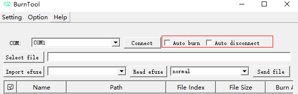

2.  单击“Select target”按钮，选择导出文件的存放位置。
3.  在“addr”编辑框中输入读取的Flash起始地址，在“size”编辑框中输入读取的Flash大小。
4.  单击“Export”按钮开始导出。
5.  等待导出完成，如[图2](#zh-cn_topic_0000002340826281_zh-cn_topic_0000001162282012_zh-cn_topic_0279549096_fig1371821614187)所示。

    **图 2**  导出文件结束示例<a name="zh-cn_topic_0000002340826281_zh-cn_topic_0000001162282012_zh-cn_topic_0279549096_fig1371821614187"></a>  
    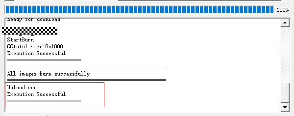

## 命令行导出<a name="ZH-CN_TOPIC_0000002499582977"></a>

BurnTool.exe支持不打开界面，直接通过命令行进行Flash导出操作，调用命令如下：

```
BurnTool.exe params
```

命令之间用空格隔开，如果命令带有参数，命令与参数之间用冒号隔开，最简示例如下：

```
BurnTool.exe -export -com:1 -signalbaud:115200 -bin:C:\test_bin\xxx.fwpkg -onlyburn:loader.bin -target:C:\test_bin\xxx.bin -addr:0x... -size:0x... -chiptype:XXXX
```

其中“loader.bin”为fwpkg中type为0的文件的名称，此处为举例，可能与实际情况不同。BurnTool.exe Flash导出命令可以配置的params参数如[表1](#zh-cn_topic_0000002306747330_zh-cn_topic_0000002335981193_zh-cn_topic_0279549078_table51147202142)所示。

**表 1**  BurnTool.exe flash导出命令参数表

<a name="zh-cn_topic_0000002306747330_zh-cn_topic_0000002335981193_zh-cn_topic_0279549078_table51147202142"></a>
<table><thead align="left"><tr id="zh-cn_topic_0000002306747330_zh-cn_topic_0000002335981193_zh-cn_topic_0279549078_row111472021414"><th class="cellrowborder" valign="top" width="17.931793179317932%" id="mcps1.2.4.1.1"><p id="zh-cn_topic_0000002306747330_zh-cn_topic_0000002335981193_zh-cn_topic_0279549078_p1782320288143"><a name="zh-cn_topic_0000002306747330_zh-cn_topic_0000002335981193_zh-cn_topic_0279549078_p1782320288143"></a><a name="zh-cn_topic_0000002306747330_zh-cn_topic_0000002335981193_zh-cn_topic_0279549078_p1782320288143"></a>命令</p>
</th>
<th class="cellrowborder" valign="top" width="18.051805180518052%" id="mcps1.2.4.1.2"><p id="zh-cn_topic_0000002306747330_zh-cn_topic_0000002335981193_zh-cn_topic_0279549078_p4823202816141"><a name="zh-cn_topic_0000002306747330_zh-cn_topic_0000002335981193_zh-cn_topic_0279549078_p4823202816141"></a><a name="zh-cn_topic_0000002306747330_zh-cn_topic_0000002335981193_zh-cn_topic_0279549078_p4823202816141"></a>参数</p>
</th>
<th class="cellrowborder" valign="top" width="64.016401640164%" id="mcps1.2.4.1.3"><p id="zh-cn_topic_0000002306747330_zh-cn_topic_0000002335981193_zh-cn_topic_0279549078_p782372815142"><a name="zh-cn_topic_0000002306747330_zh-cn_topic_0000002335981193_zh-cn_topic_0279549078_p782372815142"></a><a name="zh-cn_topic_0000002306747330_zh-cn_topic_0000002335981193_zh-cn_topic_0279549078_p782372815142"></a>说明</p>
</th>
</tr>
</thead>
<tbody><tr id="zh-cn_topic_0000002306747330_zh-cn_topic_0000002335981193_zh-cn_topic_0279549078_row4114220111417"><td class="cellrowborder" valign="top" width="17.931793179317932%" headers="mcps1.2.4.1.1 "><p id="zh-cn_topic_0000002306747330_zh-cn_topic_0000002335981193_p92205141189"><a name="zh-cn_topic_0000002306747330_zh-cn_topic_0000002335981193_p92205141189"></a><a name="zh-cn_topic_0000002306747330_zh-cn_topic_0000002335981193_p92205141189"></a>-export</p>
</td>
<td class="cellrowborder" valign="top" width="18.051805180518052%" headers="mcps1.2.4.1.2 "><p id="zh-cn_topic_0000002306747330_zh-cn_topic_0000002335981193_p1921881710193"><a name="zh-cn_topic_0000002306747330_zh-cn_topic_0000002335981193_p1921881710193"></a><a name="zh-cn_topic_0000002306747330_zh-cn_topic_0000002335981193_p1921881710193"></a>无</p>
</td>
<td class="cellrowborder" valign="top" width="64.016401640164%" headers="mcps1.2.4.1.3 "><p id="zh-cn_topic_0000002306747330_zh-cn_topic_0000002335981193_p1922015147189"><a name="zh-cn_topic_0000002306747330_zh-cn_topic_0000002335981193_p1922015147189"></a><a name="zh-cn_topic_0000002306747330_zh-cn_topic_0000002335981193_p1922015147189"></a>Flash导出操作。</p>
</td>
</tr>
<tr id="zh-cn_topic_0000002306747330_zh-cn_topic_0000002335981193_row743443621920"><td class="cellrowborder" valign="top" width="17.931793179317932%" headers="mcps1.2.4.1.1 "><p id="zh-cn_topic_0000002306747330_zh-cn_topic_0000002335981193_zh-cn_topic_0279549078_p10464135131419"><a name="zh-cn_topic_0000002306747330_zh-cn_topic_0000002335981193_zh-cn_topic_0279549078_p10464135131419"></a><a name="zh-cn_topic_0000002306747330_zh-cn_topic_0000002335981193_zh-cn_topic_0279549078_p10464135131419"></a>-bin:</p>
</td>
<td class="cellrowborder" valign="top" width="18.051805180518052%" headers="mcps1.2.4.1.2 "><p id="zh-cn_topic_0000002306747330_zh-cn_topic_0000002335981193_p514212617273"><a name="zh-cn_topic_0000002306747330_zh-cn_topic_0000002335981193_p514212617273"></a><a name="zh-cn_topic_0000002306747330_zh-cn_topic_0000002335981193_p514212617273"></a>path\xxx.bin</p>
</td>
<td class="cellrowborder" valign="top" width="64.016401640164%" headers="mcps1.2.4.1.3 "><p id="zh-cn_topic_0000002306747330_zh-cn_topic_0000002335981193_zh-cn_topic_0279549078_p9464133571410"><a name="zh-cn_topic_0000002306747330_zh-cn_topic_0000002335981193_zh-cn_topic_0279549078_p9464133571410"></a><a name="zh-cn_topic_0000002306747330_zh-cn_topic_0000002335981193_zh-cn_topic_0279549078_p9464133571410"></a>固件包xxx.bin的绝对路径。固件包的名称和文件类型根据各产品实际情况可能有所不同。需要烧写其中的loader文件（路径不能存在空格字符）。</p>
</td>
</tr>
<tr id="zh-cn_topic_0000002306747330_zh-cn_topic_0000002335981193_row847012614188"><td class="cellrowborder" valign="top" width="17.931793179317932%" headers="mcps1.2.4.1.1 "><p id="zh-cn_topic_0000002306747330_zh-cn_topic_0000002335981193_p18482961818"><a name="zh-cn_topic_0000002306747330_zh-cn_topic_0000002335981193_p18482961818"></a><a name="zh-cn_topic_0000002306747330_zh-cn_topic_0000002335981193_p18482961818"></a>-com:</p>
</td>
<td class="cellrowborder" valign="top" width="18.051805180518052%" headers="mcps1.2.4.1.2 "><p id="zh-cn_topic_0000002306747330_zh-cn_topic_0000002335981193_p984899111820"><a name="zh-cn_topic_0000002306747330_zh-cn_topic_0000002335981193_p984899111820"></a><a name="zh-cn_topic_0000002306747330_zh-cn_topic_0000002335981193_p984899111820"></a>x</p>
</td>
<td class="cellrowborder" valign="top" width="64.016401640164%" headers="mcps1.2.4.1.3 "><p id="zh-cn_topic_0000002306747330_zh-cn_topic_0000002335981193_p1484859161812"><a name="zh-cn_topic_0000002306747330_zh-cn_topic_0000002335981193_p1484859161812"></a><a name="zh-cn_topic_0000002306747330_zh-cn_topic_0000002335981193_p1484859161812"></a>PC端的串口号。</p>
<div class="note" id="zh-cn_topic_0000002306747330_zh-cn_topic_0000002335981193_note5848189131814"><a name="zh-cn_topic_0000002306747330_zh-cn_topic_0000002335981193_note5848189131814"></a><a name="zh-cn_topic_0000002306747330_zh-cn_topic_0000002335981193_note5848189131814"></a><span class="notetitle"> 说明： </span><div class="notebody"><p id="zh-cn_topic_0000002306747330_zh-cn_topic_0000002335981193_p28481598181"><a name="zh-cn_topic_0000002306747330_zh-cn_topic_0000002335981193_p28481598181"></a><a name="zh-cn_topic_0000002306747330_zh-cn_topic_0000002335981193_p28481598181"></a>参数为10进制数字。</p>
</div></div>
</td>
</tr>
<tr id="zh-cn_topic_0000002306747330_zh-cn_topic_0000002335981193_zh-cn_topic_0279549078_row2114162071419"><td class="cellrowborder" valign="top" width="17.931793179317932%" headers="mcps1.2.4.1.1 "><p id="zh-cn_topic_0000002306747330_zh-cn_topic_0000002335981193_zh-cn_topic_0279549078_p146433513144"><a name="zh-cn_topic_0000002306747330_zh-cn_topic_0000002335981193_zh-cn_topic_0279549078_p146433513144"></a><a name="zh-cn_topic_0000002306747330_zh-cn_topic_0000002335981193_zh-cn_topic_0279549078_p146433513144"></a>-signalbaud:</p>
</td>
<td class="cellrowborder" valign="top" width="18.051805180518052%" headers="mcps1.2.4.1.2 "><p id="zh-cn_topic_0000002306747330_zh-cn_topic_0000002335981193_zh-cn_topic_0279549078_p19464193571410"><a name="zh-cn_topic_0000002306747330_zh-cn_topic_0000002335981193_zh-cn_topic_0279549078_p19464193571410"></a><a name="zh-cn_topic_0000002306747330_zh-cn_topic_0000002335981193_zh-cn_topic_0279549078_p19464193571410"></a>115200</p>
</td>
<td class="cellrowborder" valign="top" width="64.016401640164%" headers="mcps1.2.4.1.3 "><p id="zh-cn_topic_0000002306747330_zh-cn_topic_0000002335981193_zh-cn_topic_0279549078_p54641835181410"><a name="zh-cn_topic_0000002306747330_zh-cn_topic_0000002335981193_zh-cn_topic_0279549078_p54641835181410"></a><a name="zh-cn_topic_0000002306747330_zh-cn_topic_0000002335981193_zh-cn_topic_0279549078_p54641835181410"></a>传输固件包时的串口波特率，默认为115200bit/s。</p>
<div class="note" id="zh-cn_topic_0000002306747330_zh-cn_topic_0000002335981193_note993072585219"><a name="zh-cn_topic_0000002306747330_zh-cn_topic_0000002335981193_note993072585219"></a><a name="zh-cn_topic_0000002306747330_zh-cn_topic_0000002335981193_note993072585219"></a><span class="notetitle"> 说明： </span><div class="notebody"><p id="zh-cn_topic_0000002306747330_zh-cn_topic_0000002335981193_p34064714513"><a name="zh-cn_topic_0000002306747330_zh-cn_topic_0000002335981193_p34064714513"></a><a name="zh-cn_topic_0000002306747330_zh-cn_topic_0000002335981193_p34064714513"></a>参数为10进制数字。</p>
<p id="zh-cn_topic_0000002306747330_zh-cn_topic_0000002335981193_p1248553118143"><a name="zh-cn_topic_0000002306747330_zh-cn_topic_0000002335981193_p1248553118143"></a><a name="zh-cn_topic_0000002306747330_zh-cn_topic_0000002335981193_p1248553118143"></a>建议根据产品形态，硬件支持情况，实际使用情况设置合适的波特率。</p>
</div></div>
</td>
</tr>
<tr id="zh-cn_topic_0000002306747330_zh-cn_topic_0000002335981193_zh-cn_topic_0279549078_row684720710565"><td class="cellrowborder" valign="top" width="17.931793179317932%" headers="mcps1.2.4.1.1 "><p id="zh-cn_topic_0000002306747330_zh-cn_topic_0000002335981193_zh-cn_topic_0279549078_p1484718711568"><a name="zh-cn_topic_0000002306747330_zh-cn_topic_0000002335981193_zh-cn_topic_0279549078_p1484718711568"></a><a name="zh-cn_topic_0000002306747330_zh-cn_topic_0000002335981193_zh-cn_topic_0279549078_p1484718711568"></a>-target:</p>
</td>
<td class="cellrowborder" valign="top" width="18.051805180518052%" headers="mcps1.2.4.1.2 "><p id="zh-cn_topic_0000002306747330_zh-cn_topic_0000002335981193_zh-cn_topic_0279549078_p3464163511416"><a name="zh-cn_topic_0000002306747330_zh-cn_topic_0000002335981193_zh-cn_topic_0279549078_p3464163511416"></a><a name="zh-cn_topic_0000002306747330_zh-cn_topic_0000002335981193_zh-cn_topic_0279549078_p3464163511416"></a>path\xxx.bin</p>
</td>
<td class="cellrowborder" valign="top" width="64.016401640164%" headers="mcps1.2.4.1.3 "><p id="zh-cn_topic_0000002306747330_zh-cn_topic_0000002335981193_p913314555204"><a name="zh-cn_topic_0000002306747330_zh-cn_topic_0000002335981193_p913314555204"></a><a name="zh-cn_topic_0000002306747330_zh-cn_topic_0000002335981193_p913314555204"></a>导出到本地路径。</p>
</td>
</tr>
<tr id="zh-cn_topic_0000002306747330_zh-cn_topic_0000002335981193_row13736412142110"><td class="cellrowborder" valign="top" width="17.931793179317932%" headers="mcps1.2.4.1.1 "><p id="zh-cn_topic_0000002306747330_zh-cn_topic_0000002335981193_p1973711124219"><a name="zh-cn_topic_0000002306747330_zh-cn_topic_0000002335981193_p1973711124219"></a><a name="zh-cn_topic_0000002306747330_zh-cn_topic_0000002335981193_p1973711124219"></a>-addr:</p>
</td>
<td class="cellrowborder" valign="top" width="18.051805180518052%" headers="mcps1.2.4.1.2 "><p id="zh-cn_topic_0000002306747330_zh-cn_topic_0000002335981193_p573719123215"><a name="zh-cn_topic_0000002306747330_zh-cn_topic_0000002335981193_p573719123215"></a><a name="zh-cn_topic_0000002306747330_zh-cn_topic_0000002335981193_p573719123215"></a>0x....</p>
</td>
<td class="cellrowborder" valign="top" width="64.016401640164%" headers="mcps1.2.4.1.3 "><p id="zh-cn_topic_0000002306747330_zh-cn_topic_0000002335981193_p7737101212211"><a name="zh-cn_topic_0000002306747330_zh-cn_topic_0000002335981193_p7737101212211"></a><a name="zh-cn_topic_0000002306747330_zh-cn_topic_0000002335981193_p7737101212211"></a>导出Flash地址。</p>
<div class="note" id="zh-cn_topic_0000002306747330_zh-cn_topic_0000002335981193_note99981652112119"><a name="zh-cn_topic_0000002306747330_zh-cn_topic_0000002335981193_note99981652112119"></a><a name="zh-cn_topic_0000002306747330_zh-cn_topic_0000002335981193_note99981652112119"></a><span class="notetitle"> 说明： </span><div class="notebody"><p id="zh-cn_topic_0000002306747330_zh-cn_topic_0000002335981193_p19998352202113"><a name="zh-cn_topic_0000002306747330_zh-cn_topic_0000002335981193_p19998352202113"></a><a name="zh-cn_topic_0000002306747330_zh-cn_topic_0000002335981193_p19998352202113"></a>带有0x为16进制输入，不带0x为10进制输入。</p>
</div></div>
</td>
</tr>
<tr id="zh-cn_topic_0000002306747330_zh-cn_topic_0000002335981193_row13157287227"><td class="cellrowborder" valign="top" width="17.931793179317932%" headers="mcps1.2.4.1.1 "><p id="zh-cn_topic_0000002306747330_zh-cn_topic_0000002335981193_p8152288226"><a name="zh-cn_topic_0000002306747330_zh-cn_topic_0000002335981193_p8152288226"></a><a name="zh-cn_topic_0000002306747330_zh-cn_topic_0000002335981193_p8152288226"></a>-size:</p>
</td>
<td class="cellrowborder" valign="top" width="18.051805180518052%" headers="mcps1.2.4.1.2 "><p id="zh-cn_topic_0000002306747330_zh-cn_topic_0000002335981193_p112451954192210"><a name="zh-cn_topic_0000002306747330_zh-cn_topic_0000002335981193_p112451954192210"></a><a name="zh-cn_topic_0000002306747330_zh-cn_topic_0000002335981193_p112451954192210"></a>0x....</p>
</td>
<td class="cellrowborder" valign="top" width="64.016401640164%" headers="mcps1.2.4.1.3 "><p id="zh-cn_topic_0000002306747330_zh-cn_topic_0000002335981193_p785815618226"><a name="zh-cn_topic_0000002306747330_zh-cn_topic_0000002335981193_p785815618226"></a><a name="zh-cn_topic_0000002306747330_zh-cn_topic_0000002335981193_p785815618226"></a>导出Flash大小。</p>
<div class="note" id="zh-cn_topic_0000002306747330_zh-cn_topic_0000002335981193_note58581556182216"><a name="zh-cn_topic_0000002306747330_zh-cn_topic_0000002335981193_note58581556182216"></a><a name="zh-cn_topic_0000002306747330_zh-cn_topic_0000002335981193_note58581556182216"></a><span class="notetitle"> 说明： </span><div class="notebody"><p id="zh-cn_topic_0000002306747330_zh-cn_topic_0000002335981193_p18858105615228"><a name="zh-cn_topic_0000002306747330_zh-cn_topic_0000002335981193_p18858105615228"></a><a name="zh-cn_topic_0000002306747330_zh-cn_topic_0000002335981193_p18858105615228"></a>带有0x为16进制输入，不带0x为10进制输入。</p>
</div></div>
</td>
</tr>
<tr id="zh-cn_topic_0000002306747330_zh-cn_topic_0000002335981193_row1371373342817"><td class="cellrowborder" valign="top" width="17.931793179317932%" headers="mcps1.2.4.1.1 "><p id="zh-cn_topic_0000002306747330_zh-cn_topic_0000002335981193_p159671534102816"><a name="zh-cn_topic_0000002306747330_zh-cn_topic_0000002335981193_p159671534102816"></a><a name="zh-cn_topic_0000002306747330_zh-cn_topic_0000002335981193_p159671534102816"></a>-console</p>
</td>
<td class="cellrowborder" valign="top" width="18.051805180518052%" headers="mcps1.2.4.1.2 "><p id="zh-cn_topic_0000002306747330_zh-cn_topic_0000002335981193_zh-cn_topic_0279549078_p88479725614"><a name="zh-cn_topic_0000002306747330_zh-cn_topic_0000002335981193_zh-cn_topic_0279549078_p88479725614"></a><a name="zh-cn_topic_0000002306747330_zh-cn_topic_0000002335981193_zh-cn_topic_0279549078_p88479725614"></a>无</p>
</td>
<td class="cellrowborder" valign="top" width="64.016401640164%" headers="mcps1.2.4.1.3 "><p id="zh-cn_topic_0000002306747330_zh-cn_topic_0000002335981193_zh-cn_topic_0279549078_p284777145614"><a name="zh-cn_topic_0000002306747330_zh-cn_topic_0000002335981193_zh-cn_topic_0279549078_p284777145614"></a><a name="zh-cn_topic_0000002306747330_zh-cn_topic_0000002335981193_zh-cn_topic_0279549078_p284777145614"></a>使用标准输入输出，为重定向做准备。</p>
</td>
</tr>
<tr id="zh-cn_topic_0000002306747330_zh-cn_topic_0000002335981193_row162351145143114"><td class="cellrowborder" valign="top" width="17.931793179317932%" headers="mcps1.2.4.1.1 "><p id="zh-cn_topic_0000002306747330_zh-cn_topic_0000002335981193_p1923510452311"><a name="zh-cn_topic_0000002306747330_zh-cn_topic_0000002335981193_p1923510452311"></a><a name="zh-cn_topic_0000002306747330_zh-cn_topic_0000002335981193_p1923510452311"></a>-onlyburn:</p>
</td>
<td class="cellrowborder" valign="top" width="18.051805180518052%" headers="mcps1.2.4.1.2 "><p id="zh-cn_topic_0000002306747330_zh-cn_topic_0000002335981193_zh-cn_topic_0279549078_p1696419248120"><a name="zh-cn_topic_0000002306747330_zh-cn_topic_0000002335981193_zh-cn_topic_0279549078_p1696419248120"></a><a name="zh-cn_topic_0000002306747330_zh-cn_topic_0000002335981193_zh-cn_topic_0279549078_p1696419248120"></a>name</p>
</td>
<td class="cellrowborder" valign="top" width="64.016401640164%" headers="mcps1.2.4.1.3 "><p id="zh-cn_topic_0000002306747330_zh-cn_topic_0000002335981193_zh-cn_topic_0279549078_p7964152410112"><a name="zh-cn_topic_0000002306747330_zh-cn_topic_0000002335981193_zh-cn_topic_0279549078_p7964152410112"></a><a name="zh-cn_topic_0000002306747330_zh-cn_topic_0000002335981193_zh-cn_topic_0279549078_p7964152410112"></a>指定烧写对应名字的文件，可重复传参，效果累加。</p>
</td>
</tr>
<tr id="zh-cn_topic_0000002306747330_zh-cn_topic_0000002335981193_row3891028135717"><td class="cellrowborder" valign="top" width="17.931793179317932%" headers="mcps1.2.4.1.1 "><p id="zh-cn_topic_0000002306747330_zh-cn_topic_0000002335981193_p178914280579"><a name="zh-cn_topic_0000002306747330_zh-cn_topic_0000002335981193_p178914280579"></a><a name="zh-cn_topic_0000002306747330_zh-cn_topic_0000002335981193_p178914280579"></a>-beforereset</p>
</td>
<td class="cellrowborder" valign="top" width="18.051805180518052%" headers="mcps1.2.4.1.2 "><p id="zh-cn_topic_0000002306747330_zh-cn_topic_0000002335981193_p48962815713"><a name="zh-cn_topic_0000002306747330_zh-cn_topic_0000002335981193_p48962815713"></a><a name="zh-cn_topic_0000002306747330_zh-cn_topic_0000002335981193_p48962815713"></a>无</p>
</td>
<td class="cellrowborder" valign="top" width="64.016401640164%" headers="mcps1.2.4.1.3 "><p id="zh-cn_topic_0000002306747330_zh-cn_topic_0000002335981193_p6898286578"><a name="zh-cn_topic_0000002306747330_zh-cn_topic_0000002335981193_p6898286578"></a><a name="zh-cn_topic_0000002306747330_zh-cn_topic_0000002335981193_p6898286578"></a>在发送打断报文后，发送at重启命令，复位单板。</p>
</td>
</tr>
</tbody>
</table>

**其他典型场景<a name="zh-cn_topic_0000002306747330_zh-cn_topic_0000002335981193_section173263145463"></a>**

如果需要使用标准输入输出获取烧写过程的打印，命令如下：

```
BurnTool.exe -export -com:1 -signalbaud:115200 -bin:C:\test_bin\xxx.fwpkg -target:C:\test_bin\xxx.bin -addr:0x... -size:0x... -console
```

如果需要先烧写全量镜像再导出，命令如下：

```
BurnTool.exe -export -com:1 -signalbaud:115200 -bin:C:\test_bin\xxx.fwpkg -target:C:\test_bin\xxx.bin -addr:0x... -size:0x...
```

## 全部擦除<a name="ZH-CN_TOPIC_0000002499502945"></a>

1.  不要勾选“Auto burn“和“Auto disconnect”，如[图1](#zh-cn_topic_0000002306747366_zh-cn_topic_0000002335766225_fig1592535424516)所示，按照“[串口烧写](#ZH-CN_TOPIC_0000002466543636)”烧写完成loader文件。

    **图 1**  去勾选Auto burn和Auto disconnect<a name="zh-cn_topic_0000002306747366_zh-cn_topic_0000002335766225_fig1592535424516"></a>  
    

2.  点击“Erase all”开始擦除，如[图2](#zh-cn_topic_0000002306747366_zh-cn_topic_0000002335766225_fig44101741484)所示。

    **图 2**  Erase all按钮<a name="zh-cn_topic_0000002306747366_zh-cn_topic_0000002335766225_fig44101741484"></a>  
    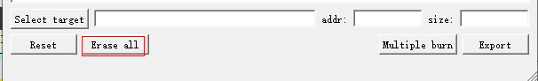

3.  等待擦除成功。

## CAT1 USB烧写<a name="ZH-CN_TOPIC_0000002510278808"></a>

> **须知：** 
>版本烧录时不能勾选“RadioConfig.tlv”文件。

使用USB烧写模式时，需要将芯片类型切换为“4GCat1-USB”类型。若安装时选择的芯片类型与需求不匹配或需要修改芯片类型以满足不同的烧写场景时，进行如下操作：

1.  单击“[BurnTool](#ZH-CN_TOPIC_0000002466384008)”区域12的“Option”按钮选择“Change chip”。如[图1](#fig1626011409019)所示。

    **图 1**  选择芯片类型<a name="fig1626011409019"></a>  
    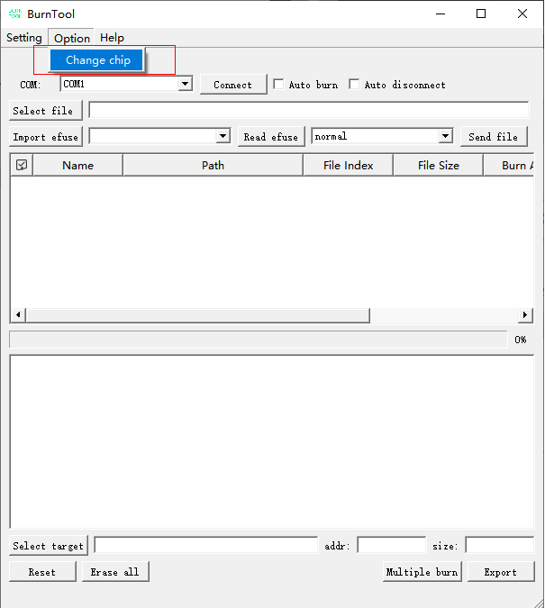

2.  通过“Change chip”选项打开芯片类型选择界面，选择所需要的芯片类型并单击“OK”确认更换所选芯片类型。例：选择“4GCat1-USB”，如[图2](#fig169715461306)所示。

    **图 2**  确认芯片类型<a name="fig169715461306"></a>  
    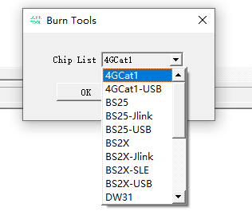

> **须知：** 
>使用USB烧写时需要将USB\_BOOT引脚拉低。

-   **[手动烧写](#ZH-CN_TOPIC_0000002541878783)**  

-   **[工厂烧写](#ZH-CN_TOPIC_0000002510438796)**  

-   **[命令行烧写](#ZH-CN_TOPIC_0000002541958787)**  

### 手动烧写<a name="ZH-CN_TOPIC_0000002541878783"></a>

1.  驱动安装，在交付件“.../Tools/usb”目录下获取DFU驱动配置文件，64位系统选择“cat1\_dfu\_x64.inf”，单击右键，选择“安装”，无错误提示表示安装成功（若提示不包含签名信息错误时，商用场景下，请先进行数字签名；实验室调测场景，可先禁止驱动签名再进行安装，禁止方法参见“[USB驱动签名禁止方法](#ZH-CN_TOPIC_0000002510278812)”）。
2.  在BurnTool界面中正确填写USB设备的Vid和Pid信息，单击“Select file”按钮，如[图1](#zh-cn_topic_0000002108041414_fig174621210163718)所示，选择各产品编译生成的固件包，并单击“打开”。

    **图 1**  单击“Select file”按钮<a name="zh-cn_topic_0000002108041414_fig174621210163718"></a>  
    

3.  在表格中选中需要烧写的文件（请参考各产品文档中关于烧写的部分），如[图2](#zh-cn_topic_0000002108041414_fig4262172193911)所示。

    **图 2**  烧写文件表格<a name="zh-cn_topic_0000002108041414_fig4262172193911"></a>  
    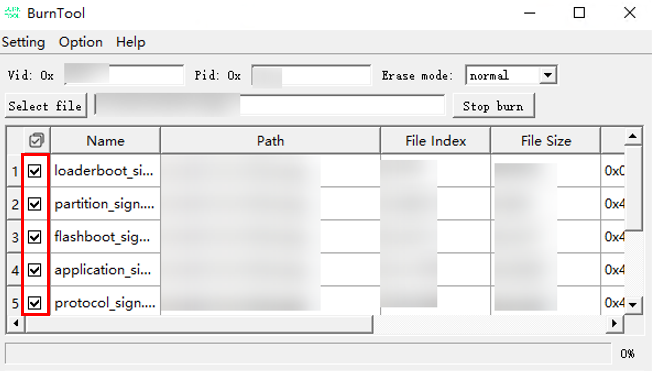

4.  单击“Start burn”按钮，待日志窗口出现“Reset the device...”如[图3](#zh-cn_topic_0000002108041414_fig1133854119489)所示，此时按下单板的复位键。工具等待单板复位超时默认为10s，如果超时时间内未检测到单板复位日志窗口会打印“Driver may not be installed. Open the device manager to confirm.No DFU capable USB device available.”，如[图4](#zh-cn_topic_0000002108041414_fig10735114165612)所示。

    **图 3**  等待单板复位<a name="zh-cn_topic_0000002108041414_fig1133854119489"></a>  
    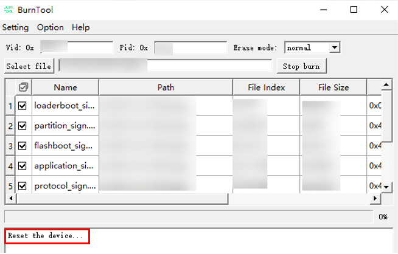

    **图 4**  检测单板复位超时<a name="zh-cn_topic_0000002108041414_fig10735114165612"></a>  
    

5.  等待传输完成后结束烧写，烧写完成会出现“All images burnt successfully”。烧写完成效果如[图5](#zh-cn_topic_0000002108041414_fig2320156175918)所示。

    **图 5**  烧写完成示意图<a name="zh-cn_topic_0000002108041414_fig2320156175918"></a>  
    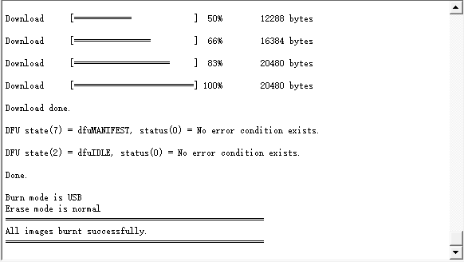

> **说明：** 
>镜像表格、擦除模式选项、镜像文件路径默认不灰化，如果需要灰化，打开软件安装路径下的configure文件夹下config\_4GCat1-USB文件夹中的“config\_setting.ini”文件，将“EDITABLE=1”字段改为“EDITABLE=0”。

### 工厂烧写<a name="ZH-CN_TOPIC_0000002510438796"></a>

1.  执行“[手动烧写](#ZH-CN_TOPIC_0000002541878783)”章节的[2](#zh-cn_topic_0000002108041414_p556mcpsimp)。
2.  <a name="zh-cn_topic_0000002143840017_li6112204820357"></a>打开软件安装路径下的“configure\\config\_dfu”文件夹中的“config.ini”文件（以软件安装路径D:\\BurnTool为例），如[图1](#zh-cn_topic_0000002143840017_fig4944237174018)所示。

    **图 1**  config.ini文件路径<a name="zh-cn_topic_0000002143840017_fig4944237174018"></a>  
    

3.  <a name="zh-cn_topic_0000002143840017_li1064142019409"></a>在设备管理器的“通用串行总线控制器”中找到连接的单板的位置信息（例如Port\_\#0006.Hub\_\#0001），如[图2](#zh-cn_topic_0000002143840017_fig1950975854616)所示。

    **图 2**  单板位置信息<a name="zh-cn_topic_0000002143840017_fig1950975854616"></a>  
    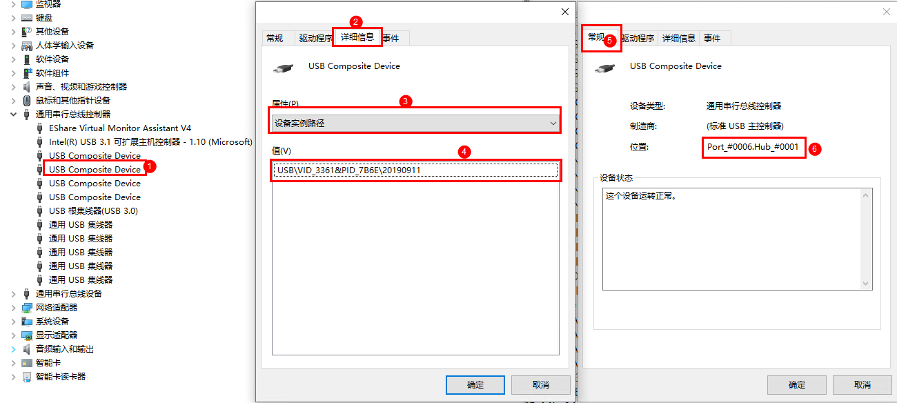

4.  <a name="zh-cn_topic_0000002143840017_li12486145715458"></a>将[3](#zh-cn_topic_0000002143840017_li1064142019409)中找到的单板位置信息（以Port\_\#0006.Hub\_\#0001为例），保存在config.ini中的LOCATION1属性中，如[图3](#zh-cn_topic_0000002143840017_fig592582045215)所示。

    **图 3**  LOCATION1位置信息<a name="zh-cn_topic_0000002143840017_fig592582045215"></a>  
    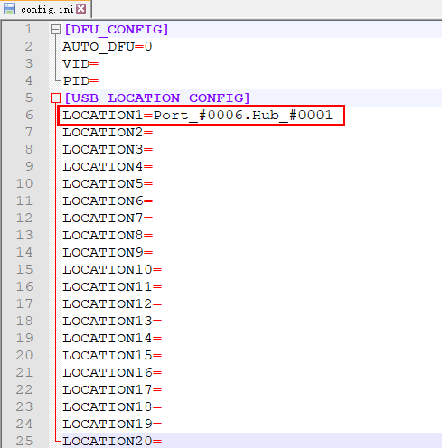

5.  重复执行[3](#zh-cn_topic_0000002143840017_li1064142019409)和[4](#zh-cn_topic_0000002143840017_li12486145715458)直到将需要烧写的单板的位置信息按序填写在config.ini中。

    > **说明：** 
    >-   如果需要同时烧写2块单板，则需要配置这2块单板的位置信息到LOCATION1和LOCATION2属性中。
    >-   如果需要同时烧写20块单板，则需要配置这20块单板的位置信息到LOCATION1到LOCATION20属性中。
    >客户实际使用过程中，可以找20块单板（非空片），全部将其接到HUB中。然后分别给每一块单板上电，一个一个找到每一块单板的位置信息，填充到config.ini中。

6.  打开工具界面，执行“[手动烧写](#ZH-CN_TOPIC_0000002541878783)”章节的[2](#zh-cn_topic_0000002143840017_li6112204820357)。
7.  选择“Setting”→“USB Settings”，配置工厂烧写相关参数，默认配置如[图4](#zh-cn_topic_0000002143840017_fig136217583413)所示。

    **图 4**  工厂烧写默认参数<a name="zh-cn_topic_0000002143840017_fig136217583413"></a>  
    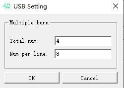

    -   Total num：工厂界面窗口总个数（窗口总个数最大值为20，最小值为1）。
    -   Num per line：工厂界面每行窗口个数（每行窗口个数最大值为8，最小值为4）。

    > **说明：** 
    >Total num的配置个数应与实际烧写的单板个数保持一致。例如如果实际要同时烧写2块单板，则Total num应该配置成2，如果实际要同时烧写20块单板，则Total num应该配置成20。

8.  单击“Multiple burn”按钮，打开工厂烧写窗口。
9.  单击“Connect all”按钮并复位所有单板。
10. 等待所有单板烧写完成（以连接一个单板为例），如[图5](#zh-cn_topic_0000002143840017_fig23011151698)所示。

    **图 5**  工厂烧写结束示意图<a name="zh-cn_topic_0000002143840017_fig23011151698"></a>  
    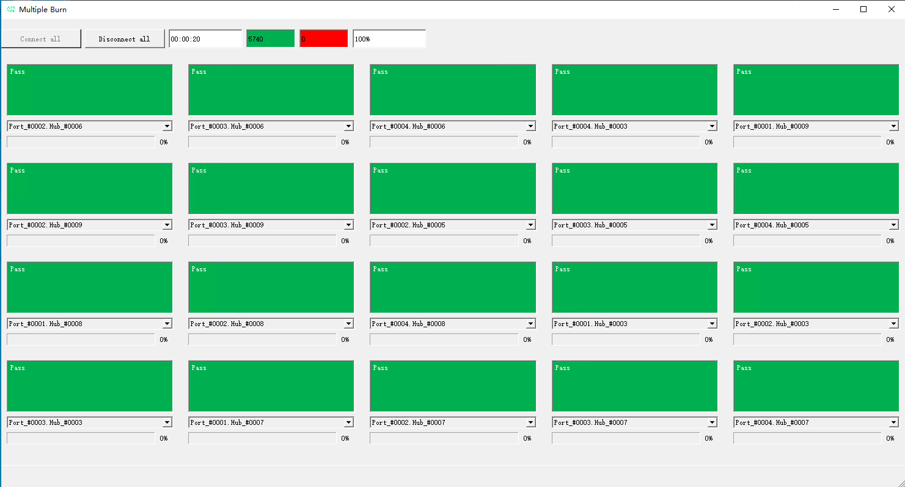

    **表 1**  工厂烧写界面说明

    <a name="zh-cn_topic_0000002143840017_table1026339102319"></a>
    <table><thead align="left"><tr id="zh-cn_topic_0000002143840017_row1326311919237"><th class="cellrowborder" valign="top" width="10.16%" id="mcps1.2.3.1.1"><p id="zh-cn_topic_0000002143840017_p526315911234"><a name="zh-cn_topic_0000002143840017_p526315911234"></a><a name="zh-cn_topic_0000002143840017_p526315911234"></a>区域</p>
    </th>
    <th class="cellrowborder" valign="top" width="89.84%" id="mcps1.2.3.1.2"><p id="zh-cn_topic_0000002143840017_p32637942313"><a name="zh-cn_topic_0000002143840017_p32637942313"></a><a name="zh-cn_topic_0000002143840017_p32637942313"></a>说明</p>
    </th>
    </tr>
    </thead>
    <tbody><tr id="zh-cn_topic_0000002143840017_row1126319982316"><td class="cellrowborder" valign="top" width="10.16%" headers="mcps1.2.3.1.1 "><p id="zh-cn_topic_0000002143840017_p92641962320"><a name="zh-cn_topic_0000002143840017_p92641962320"></a><a name="zh-cn_topic_0000002143840017_p92641962320"></a>1</p>
    </td>
    <td class="cellrowborder" valign="top" width="89.84%" headers="mcps1.2.3.1.2 "><a name="zh-cn_topic_0000002143840017_ul6715427202514"></a><a name="zh-cn_topic_0000002143840017_ul6715427202514"></a><ul id="zh-cn_topic_0000002143840017_ul6715427202514"><li>Connect all：开始检查插入的USB设备。</li><li>Disconnect all：待所有USB设备烧写完成后，手动退出本次烧写。</li></ul>
    </td>
    </tr>
    <tr id="zh-cn_topic_0000002143840017_row62642913231"><td class="cellrowborder" valign="top" width="10.16%" headers="mcps1.2.3.1.1 "><p id="zh-cn_topic_0000002143840017_p2264189182314"><a name="zh-cn_topic_0000002143840017_p2264189182314"></a><a name="zh-cn_topic_0000002143840017_p2264189182314"></a>2</p>
    </td>
    <td class="cellrowborder" valign="top" width="89.84%" headers="mcps1.2.3.1.2 "><p id="zh-cn_topic_0000002143840017_p74561861857"><a name="zh-cn_topic_0000002143840017_p74561861857"></a><a name="zh-cn_topic_0000002143840017_p74561861857"></a>烧写结果统计：成功数、失败数、成功率、本次烧写时间。</p>
    </td>
    </tr>
    <tr id="zh-cn_topic_0000002143840017_row926459162319"><td class="cellrowborder" valign="top" width="10.16%" headers="mcps1.2.3.1.1 "><p id="zh-cn_topic_0000002143840017_p3264397231"><a name="zh-cn_topic_0000002143840017_p3264397231"></a><a name="zh-cn_topic_0000002143840017_p3264397231"></a>3</p>
    </td>
    <td class="cellrowborder" valign="top" width="89.84%" headers="mcps1.2.3.1.2 "><a name="zh-cn_topic_0000002143840017_ul956350162813"></a><a name="zh-cn_topic_0000002143840017_ul956350162813"></a><ul id="zh-cn_topic_0000002143840017_ul956350162813"><li>回显视图：显示单板烧写状态“Doing”、“PASS”、“Fail”、“Connecting”、“Stop”。</li><li>序列号：显示当前视图检测到的USB序列号。</li></ul>
    </td>
    </tr>
    </tbody>
    </table>

### 命令行烧写<a name="ZH-CN_TOPIC_0000002541958787"></a>

在Windows环境下，BurnTool.exe支持以命令行的方式调用，可用于集成到用户已有的工厂产线烧写程序中，调用命令如下：

```
BurnTool.exe params
```

命令之间用空格隔开，如果命令带有参数，命令与参数之间用冒号隔开，最简示例如下：

```
BurnTool.exe -chiptype:4GCAT1-USB -autodfu -usblocation:xxxx -pid:0xxxxx -vid:0xxxxx -bin:xxx.fwpkg
```

BurnTool.exe烧写命令可以配置的params参数如[表1](#zh-cn_topic_0000002108201186_table7703164131411)所示。

**表 1**  BurnTool.exe烧写命令参数表

<a name="zh-cn_topic_0000002108201186_table7703164131411"></a>
<table><thead align="left"><tr id="zh-cn_topic_0000002108201186_row37041841151418"><th class="cellrowborder" valign="top" width="19.901990199019902%" id="mcps1.2.4.1.1"><p id="zh-cn_topic_0000002108201186_p1170454112147"><a name="zh-cn_topic_0000002108201186_p1170454112147"></a><a name="zh-cn_topic_0000002108201186_p1170454112147"></a>命令</p>
</th>
<th class="cellrowborder" valign="top" width="19.351935193519353%" id="mcps1.2.4.1.2"><p id="zh-cn_topic_0000002108201186_p670414116148"><a name="zh-cn_topic_0000002108201186_p670414116148"></a><a name="zh-cn_topic_0000002108201186_p670414116148"></a>参数</p>
</th>
<th class="cellrowborder" valign="top" width="60.746074607460756%" id="mcps1.2.4.1.3"><p id="zh-cn_topic_0000002108201186_p1670464191413"><a name="zh-cn_topic_0000002108201186_p1670464191413"></a><a name="zh-cn_topic_0000002108201186_p1670464191413"></a>说明</p>
</th>
</tr>
</thead>
<tbody><tr id="zh-cn_topic_0000002108201186_row970484119147"><td class="cellrowborder" valign="top" width="19.901990199019902%" headers="mcps1.2.4.1.1 "><p id="zh-cn_topic_0000002108201186_p1584418119154"><a name="zh-cn_topic_0000002108201186_p1584418119154"></a><a name="zh-cn_topic_0000002108201186_p1584418119154"></a>-chiptype:（必选）</p>
</td>
<td class="cellrowborder" valign="top" width="19.351935193519353%" headers="mcps1.2.4.1.2 "><p id="zh-cn_topic_0000002108201186_p10464113013156"><a name="zh-cn_topic_0000002108201186_p10464113013156"></a><a name="zh-cn_topic_0000002108201186_p10464113013156"></a>4GCAT1-USB</p>
</td>
<td class="cellrowborder" valign="top" width="60.746074607460756%" headers="mcps1.2.4.1.3 "><p id="zh-cn_topic_0000002108201186_p97041741131416"><a name="zh-cn_topic_0000002108201186_p97041741131416"></a><a name="zh-cn_topic_0000002108201186_p97041741131416"></a>芯片类型。</p>
</td>
</tr>
<tr id="zh-cn_topic_0000002108201186_row13704141111410"><td class="cellrowborder" valign="top" width="19.901990199019902%" headers="mcps1.2.4.1.1 "><p id="zh-cn_topic_0000002108201186_p2752956181520"><a name="zh-cn_topic_0000002108201186_p2752956181520"></a><a name="zh-cn_topic_0000002108201186_p2752956181520"></a>-autodfu（必选）</p>
</td>
<td class="cellrowborder" valign="top" width="19.351935193519353%" headers="mcps1.2.4.1.2 "><p id="zh-cn_topic_0000002108201186_p137041941171417"><a name="zh-cn_topic_0000002108201186_p137041941171417"></a><a name="zh-cn_topic_0000002108201186_p137041941171417"></a>无</p>
</td>
<td class="cellrowborder" valign="top" width="60.746074607460756%" headers="mcps1.2.4.1.3 "><p id="zh-cn_topic_0000002108201186_p15704741161415"><a name="zh-cn_topic_0000002108201186_p15704741161415"></a><a name="zh-cn_topic_0000002108201186_p15704741161415"></a>USB烧写模式。</p>
</td>
</tr>
<tr id="zh-cn_topic_0000002108201186_row15704941191413"><td class="cellrowborder" valign="top" width="19.901990199019902%" headers="mcps1.2.4.1.1 "><p id="zh-cn_topic_0000002108201186_p153911249111617"><a name="zh-cn_topic_0000002108201186_p153911249111617"></a><a name="zh-cn_topic_0000002108201186_p153911249111617"></a>-pid:（必选）</p>
</td>
<td class="cellrowborder" valign="top" width="19.351935193519353%" headers="mcps1.2.4.1.2 "><p id="zh-cn_topic_0000002108201186_p18704941171412"><a name="zh-cn_topic_0000002108201186_p18704941171412"></a><a name="zh-cn_topic_0000002108201186_p18704941171412"></a>xxxx</p>
</td>
<td class="cellrowborder" valign="top" width="60.746074607460756%" headers="mcps1.2.4.1.3 "><p id="zh-cn_topic_0000002108201186_p670484171412"><a name="zh-cn_topic_0000002108201186_p670484171412"></a><a name="zh-cn_topic_0000002108201186_p670484171412"></a>USB设备的PID（16进制格式）。</p>
</td>
</tr>
<tr id="zh-cn_topic_0000002108201186_row1857179124312"><td class="cellrowborder" valign="top" width="19.901990199019902%" headers="mcps1.2.4.1.1 "><p id="zh-cn_topic_0000002108201186_p1357209204317"><a name="zh-cn_topic_0000002108201186_p1357209204317"></a><a name="zh-cn_topic_0000002108201186_p1357209204317"></a>-devicepathid:</p>
</td>
<td class="cellrowborder" valign="top" width="19.351935193519353%" headers="mcps1.2.4.1.2 "><p id="zh-cn_topic_0000002108201186_p2572917434"><a name="zh-cn_topic_0000002108201186_p2572917434"></a><a name="zh-cn_topic_0000002108201186_p2572917434"></a>xxxx</p>
</td>
<td class="cellrowborder" valign="top" width="60.746074607460756%" headers="mcps1.2.4.1.3 "><p id="zh-cn_topic_0000002108201186_p1458399439"><a name="zh-cn_topic_0000002108201186_p1458399439"></a><a name="zh-cn_topic_0000002108201186_p1458399439"></a>USB设备实例路径。</p>
</td>
</tr>
<tr id="zh-cn_topic_0000002108201186_row16268116132711"><td class="cellrowborder" valign="top" width="19.901990199019902%" headers="mcps1.2.4.1.1 "><p id="zh-cn_topic_0000002108201186_p22691632719"><a name="zh-cn_topic_0000002108201186_p22691632719"></a><a name="zh-cn_topic_0000002108201186_p22691632719"></a>-usblocation:（必选）</p>
</td>
<td class="cellrowborder" valign="top" width="19.351935193519353%" headers="mcps1.2.4.1.2 "><p id="zh-cn_topic_0000002108201186_p1126912618271"><a name="zh-cn_topic_0000002108201186_p1126912618271"></a><a name="zh-cn_topic_0000002108201186_p1126912618271"></a>xxxx</p>
</td>
<td class="cellrowborder" valign="top" width="60.746074607460756%" headers="mcps1.2.4.1.3 "><p id="zh-cn_topic_0000002108201186_p1226936102716"><a name="zh-cn_topic_0000002108201186_p1226936102716"></a><a name="zh-cn_topic_0000002108201186_p1226936102716"></a>USB设备位置信息。（例如：Port_#0011.Hub_#0001）</p>
</td>
</tr>
<tr id="zh-cn_topic_0000002108201186_row177041641151410"><td class="cellrowborder" valign="top" width="19.901990199019902%" headers="mcps1.2.4.1.1 "><p id="zh-cn_topic_0000002108201186_p15704124112146"><a name="zh-cn_topic_0000002108201186_p15704124112146"></a><a name="zh-cn_topic_0000002108201186_p15704124112146"></a>-vid:（必选）</p>
</td>
<td class="cellrowborder" valign="top" width="19.351935193519353%" headers="mcps1.2.4.1.2 "><p id="zh-cn_topic_0000002108201186_p1070494114147"><a name="zh-cn_topic_0000002108201186_p1070494114147"></a><a name="zh-cn_topic_0000002108201186_p1070494114147"></a>xxxx</p>
</td>
<td class="cellrowborder" valign="top" width="60.746074607460756%" headers="mcps1.2.4.1.3 "><p id="zh-cn_topic_0000002108201186_p370416414143"><a name="zh-cn_topic_0000002108201186_p370416414143"></a><a name="zh-cn_topic_0000002108201186_p370416414143"></a>USB设备的VID（16进制格式）。</p>
</td>
</tr>
<tr id="zh-cn_topic_0000002108201186_row75639481157"><td class="cellrowborder" valign="top" width="19.901990199019902%" headers="mcps1.2.4.1.1 "><p id="zh-cn_topic_0000002108201186_p256304819156"><a name="zh-cn_topic_0000002108201186_p256304819156"></a><a name="zh-cn_topic_0000002108201186_p256304819156"></a>-bin:（必选）</p>
</td>
<td class="cellrowborder" valign="top" width="19.351935193519353%" headers="mcps1.2.4.1.2 "><p id="zh-cn_topic_0000002108201186_p1256314481157"><a name="zh-cn_topic_0000002108201186_p1256314481157"></a><a name="zh-cn_topic_0000002108201186_p1256314481157"></a>path\xxx.fwpkg</p>
</td>
<td class="cellrowborder" valign="top" width="60.746074607460756%" headers="mcps1.2.4.1.3 "><p id="zh-cn_topic_0000002108201186_p456318487151"><a name="zh-cn_topic_0000002108201186_p456318487151"></a><a name="zh-cn_topic_0000002108201186_p456318487151"></a>固件包xxx.bin的绝对路径。固件包的名称和文件类型根据各产品实际情况可能有所不同。</p>
</td>
</tr>
<tr id="zh-cn_topic_0000002108201186_row1781916422819"><td class="cellrowborder" valign="top" width="19.901990199019902%" headers="mcps1.2.4.1.1 "><p id="zh-cn_topic_0000002108201186_p4820164215816"><a name="zh-cn_topic_0000002108201186_p4820164215816"></a><a name="zh-cn_topic_0000002108201186_p4820164215816"></a>-erasemode:</p>
</td>
<td class="cellrowborder" valign="top" width="19.351935193519353%" headers="mcps1.2.4.1.2 "><p id="zh-cn_topic_0000002108201186_p18203424816"><a name="zh-cn_topic_0000002108201186_p18203424816"></a><a name="zh-cn_topic_0000002108201186_p18203424816"></a>x</p>
</td>
<td class="cellrowborder" valign="top" width="60.746074607460756%" headers="mcps1.2.4.1.3 "><p id="zh-cn_topic_0000002108201186_p650mcpsimp"><a name="zh-cn_topic_0000002108201186_p650mcpsimp"></a><a name="zh-cn_topic_0000002108201186_p650mcpsimp"></a>擦除模式。其中：</p>
<a name="zh-cn_topic_0000002108201186_ul651mcpsimp"></a><a name="zh-cn_topic_0000002108201186_ul651mcpsimp"></a><ul id="zh-cn_topic_0000002108201186_ul651mcpsimp"><li>0：正常擦除。</li><li>1：全片擦除。</li><li>3：维保模式（该烧写模式下会将NV工作分区和备份区全部擦除，并将烧写前客户已存储的NV项IMEI/IMEI1/SN继承下来）。</li></ul>
</td>
</tr>
<tr id="zh-cn_topic_0000002108201186_row15665561699"><td class="cellrowborder" valign="top" width="19.901990199019902%" headers="mcps1.2.4.1.1 "><p id="zh-cn_topic_0000002108201186_zh-cn_topic_0279549078_p1484718711568"><a name="zh-cn_topic_0000002108201186_zh-cn_topic_0279549078_p1484718711568"></a><a name="zh-cn_topic_0000002108201186_zh-cn_topic_0279549078_p1484718711568"></a>-console</p>
</td>
<td class="cellrowborder" valign="top" width="19.351935193519353%" headers="mcps1.2.4.1.2 "><p id="zh-cn_topic_0000002108201186_p38973481107"><a name="zh-cn_topic_0000002108201186_p38973481107"></a><a name="zh-cn_topic_0000002108201186_p38973481107"></a>无</p>
</td>
<td class="cellrowborder" valign="top" width="60.746074607460756%" headers="mcps1.2.4.1.3 "><p id="zh-cn_topic_0000002108201186_p889794816010"><a name="zh-cn_topic_0000002108201186_p889794816010"></a><a name="zh-cn_topic_0000002108201186_p889794816010"></a>使用标准输入输出，为重定向做准备。</p>
</td>
</tr>
<tr id="zh-cn_topic_0000002108201186_row19267173282012"><td class="cellrowborder" valign="top" width="19.901990199019902%" headers="mcps1.2.4.1.1 "><p id="zh-cn_topic_0000002108201186_p132684325207"><a name="zh-cn_topic_0000002108201186_p132684325207"></a><a name="zh-cn_topic_0000002108201186_p132684325207"></a>-reset:</p>
</td>
<td class="cellrowborder" valign="top" width="19.351935193519353%" headers="mcps1.2.4.1.2 "><p id="zh-cn_topic_0000002108201186_p182681932172018"><a name="zh-cn_topic_0000002108201186_p182681932172018"></a><a name="zh-cn_topic_0000002108201186_p182681932172018"></a>x</p>
</td>
<td class="cellrowborder" valign="top" width="60.746074607460756%" headers="mcps1.2.4.1.3 "><p id="zh-cn_topic_0000002108201186_p1959610401219"><a name="zh-cn_topic_0000002108201186_p1959610401219"></a><a name="zh-cn_topic_0000002108201186_p1959610401219"></a>烧写完成是否复位。其中：</p>
<a name="zh-cn_topic_0000002108201186_ul742554312113"></a><a name="zh-cn_topic_0000002108201186_ul742554312113"></a><ul id="zh-cn_topic_0000002108201186_ul742554312113"><li>0：不复位。</li><li>1：复位。</li></ul>
</td>
</tr>
<tr id="zh-cn_topic_0000002108201186_row128901852183216"><td class="cellrowborder" valign="top" width="19.901990199019902%" headers="mcps1.2.4.1.1 "><p id="zh-cn_topic_0000002108201186_p685mcpsimp"><a name="zh-cn_topic_0000002108201186_p685mcpsimp"></a><a name="zh-cn_topic_0000002108201186_p685mcpsimp"></a>-onlyburn:</p>
</td>
<td class="cellrowborder" valign="top" width="19.351935193519353%" headers="mcps1.2.4.1.2 "><p id="zh-cn_topic_0000002108201186_p107227593310"><a name="zh-cn_topic_0000002108201186_p107227593310"></a><a name="zh-cn_topic_0000002108201186_p107227593310"></a>name</p>
</td>
<td class="cellrowborder" valign="top" width="60.746074607460756%" headers="mcps1.2.4.1.3 "><p id="zh-cn_topic_0000002108201186_p1789115218322"><a name="zh-cn_topic_0000002108201186_p1789115218322"></a><a name="zh-cn_topic_0000002108201186_p1789115218322"></a>指定烧写对应名字的文件，可重复传参，效果累加。</p>
</td>
</tr>
<tr id="zh-cn_topic_0000002108201186_row1889732882617"><td class="cellrowborder" valign="top" width="19.901990199019902%" headers="mcps1.2.4.1.1 "><p id="zh-cn_topic_0000002108201186_p657mcpsimp"><a name="zh-cn_topic_0000002108201186_p657mcpsimp"></a><a name="zh-cn_topic_0000002108201186_p657mcpsimp"></a>-timeout:</p>
</td>
<td class="cellrowborder" valign="top" width="19.351935193519353%" headers="mcps1.2.4.1.2 "><p id="zh-cn_topic_0000002108201186_p659mcpsimp"><a name="zh-cn_topic_0000002108201186_p659mcpsimp"></a><a name="zh-cn_topic_0000002108201186_p659mcpsimp"></a>x</p>
</td>
<td class="cellrowborder" valign="top" width="60.746074607460756%" headers="mcps1.2.4.1.3 "><p id="zh-cn_topic_0000002108201186_p661mcpsimp"><a name="zh-cn_topic_0000002108201186_p661mcpsimp"></a><a name="zh-cn_topic_0000002108201186_p661mcpsimp"></a>检测设备的超时时间，单位：ms。</p>
</td>
</tr>
</tbody>
</table>

**其他典型场景<a name="zh-cn_topic_0000002108201186_section7255152615420"></a>**

-   如果需要指定烧写一个烧录包中的其中两个bin文件，命令如下（指定烧写bin文件时，需要同时添加loader文件）：

    ```
    BurnTool.exe -chiptype:4GCAT1-USB -autodfu -usblocation:xxxx -pid:0xxxxx -vid:0xxxxx -bin:xxx.fwpkg -onlyburn:loader.bin -onlyburn:a.bin -onlyburn:b.bin
    ```

-   如果需要使用标准输入输出获取烧写过程的打印，命令如下：

    ```
    BurnTool.exe -chiptype:4GCAT1-USB -autodfu -usblocation:xxxx -pid:0xxxxx -vid:0xxxxx -bin:xxx.fwpkg -console
    ```

-   如果需要烧写完之后不自动复位单板，命令如下：

    ```
    BurnTool.exe -chiptype:4GCAT1-USB -autodfu -usblocation:xxxx -pid:0xxxxx -vid:0xxxxx -bin:xxx.fwpkg -reset:0
    ```

# FAQ<a name="ZH-CN_TOPIC_0000002510278810"></a>

-   **[工具未进入打断状态](#ZH-CN_TOPIC_0000002541878785)**  

-   **[如何获取符合格式的固件包](#ZH-CN_TOPIC_0000002510438798)**  

-   **[工厂烧写时随机串口无法进入doing状态](#ZH-CN_TOPIC_0000002541958789)**  

-   **[USB驱动签名禁止方法](#ZH-CN_TOPIC_0000002510278812)**  

-   **[如何进入维保烧写模式](#ZH-CN_TOPIC_0000002541878787)**  

## 工具未进入打断状态<a name="ZH-CN_TOPIC_0000002541878785"></a>

**问题描述<a name="zh-cn_topic_0000001949688544_section744mcpsimp"></a>**

单击连接、断电重启后，工具并没有进入打断状态。

**解决办法<a name="zh-cn_topic_0000001949688544_section747mcpsimp"></a>**

-   可能是串口选择错误或没有正常连接串口，请检查串口配置。
-   可能单板设置了1ms快速启动，需要在BurnTool“Setting”→“Burn interval”中选择2ms间隔。

## 如何获取符合格式的固件包<a name="ZH-CN_TOPIC_0000002510438798"></a>

**问题描述<a name="zh-cn_topic_0000001949688524_section754mcpsimp"></a>**

如何获取BurnTool可识别的固件包。

**解决办法<a name="zh-cn_topic_0000001949688524_section757mcpsimp"></a>**

请参见各产品关于编译或固件生成的文档。

## 工厂烧写时随机串口无法进入doing状态<a name="ZH-CN_TOPIC_0000002541958789"></a>

**问题描述<a name="zh-cn_topic_0000001980128081_section768mcpsimp"></a>**

因串口驱动配合问题，在工厂烧写时，可能会出现随机串口无法进入工作（doing）状态的情况。

**解决办法<a name="zh-cn_topic_0000001980128081_section771mcpsimp"></a>**

在“Setting”→“Settings”中查看“Reopen Com Everytime”的勾选状态。

如果未勾选，则尝试勾选并重新开始工厂烧写；如果已勾选，则尝试取消勾选并重新开始工厂烧写。

## USB驱动签名禁止方法<a name="ZH-CN_TOPIC_0000002510278812"></a>

按照下述方法禁止驱动强制签名，重启后生效。

1.  按住shift并重启电脑。
2.  重启后，选择“疑难解答”。

    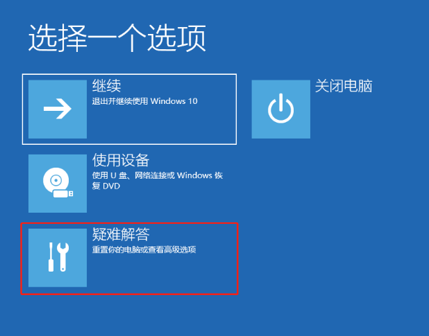

3.  选择“高级选项”。

    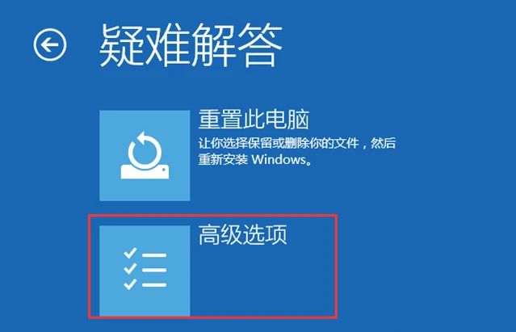

4.  选择“启动设置”。

    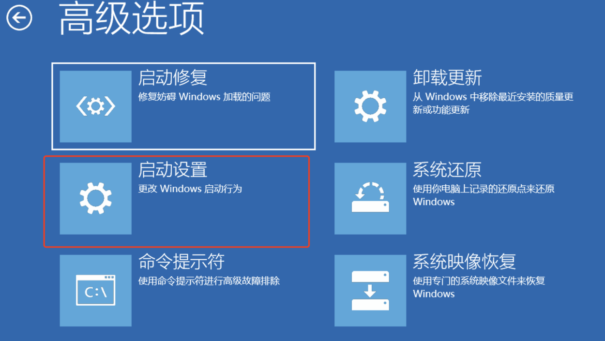

5.  点击“重启”。

    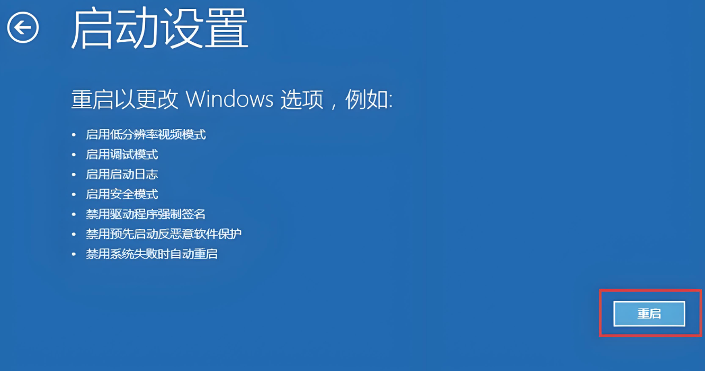

6.  重启后，输入F7选择“禁用驱动程序强制签名”。

    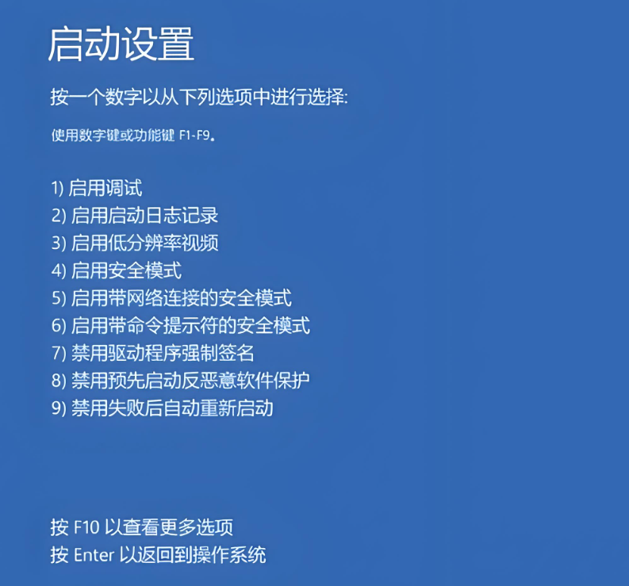

## 如何进入维保烧写模式<a name="ZH-CN_TOPIC_0000002541878787"></a>

**问题描述<a name="zh-cn_topic_0000002404139689_section744mcpsimp"></a>**

BurnTool如何进入维保烧写模式。

**解决办法<a name="zh-cn_topic_0000002404139689_section747mcpsimp"></a>**

按照下述方法开启维保烧写模式后，需要重启BurnTool生效。

1.  打开BurnTool按照路径（以“D:\\BurnTool\\configure”为例）下config\_4GCat1文件夹（UART烧写类型修改此文件）或者config\_4GCat1-USB文件（USB烧写类型修改此文件）中的“config\_setting.ini”文件，如[图 config\_setting.ini文件路径](#zh-cn_topic_0000002404139689_fig114841649152719)所示。

    **图 1**  config\_setting.ini文件路径<a name="zh-cn_topic_0000002404139689_fig114841649152719"></a>  
    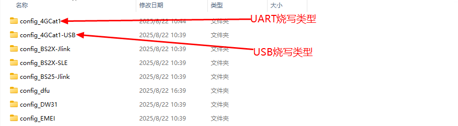

2.  将文件中的MAINTENANCE\_ENABLE值修改为1后保存，如[图 开启维保模式](#zh-cn_topic_0000002404139689_fig18907111717316)所示。

    **图 2**  开启维保模式<a name="zh-cn_topic_0000002404139689_fig18907111717316"></a>  
    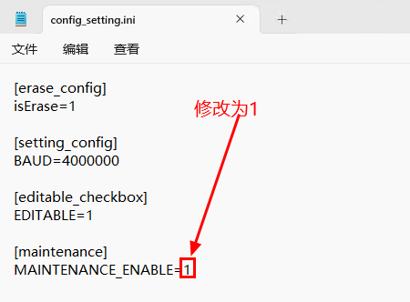

3.  重启BurnTool工具后，即可在界面和命令行模式下使用维保模式进行烧写。

> **说明：** 
>维保模式支持IMEI/IMEI1/SN项/部分客户自定义NV字段保留，客户自定义NV\_ID范围为0xB000～0xB00F。
>-   维保模式下BurnTool烧写过程中单板如果异常断电，可能会导致上述NV项丢失。
>-   维保模式不支持加密NV的保留。
>-   维保模式下若烧写版本中已预置客户自定义NV，烧写完成后对应NV值以预置值为准。

