# 前言<a name="ZH-CN_TOPIC_0000002499501285"></a>

**概述<a name="zh-cn_topic_0000002444726301_section141mcpsimp"></a>**

本文档主要介绍HiDiTing DFX功能及使用指南，包括DIAG维测功能、死机诊断、Last Dump解析、CHR打点功能等，方便用户进行业务维测及死机分析。

**读者对象<a name="zh-cn_topic_0000002444726301_section163mcpsimp"></a>**

本文档主要适用于以下工程师：

-   软件工程师
-   技术支持工程师

**符号约定<a name="zh-cn_topic_0000002444726301_section133020216410"></a>**

在本文中可能出现下列标志，它们所代表的含义如下。

<a name="zh-cn_topic_0000002444726301_table2622507016410"></a>
<table><thead align="left"><tr id="zh-cn_topic_0000002444726301_row1530720816410"><th class="cellrowborder" valign="top" width="20.580000000000002%" id="mcps1.1.3.1.1"><p id="zh-cn_topic_0000002444726301_p6450074116410"><a name="zh-cn_topic_0000002444726301_p6450074116410"></a><a name="zh-cn_topic_0000002444726301_p6450074116410"></a><strong id="zh-cn_topic_0000002444726301_b2136615816410"><a name="zh-cn_topic_0000002444726301_b2136615816410"></a><a name="zh-cn_topic_0000002444726301_b2136615816410"></a>符号</strong></p>
</th>
<th class="cellrowborder" valign="top" width="79.42%" id="mcps1.1.3.1.2"><p id="zh-cn_topic_0000002444726301_p5435366816410"><a name="zh-cn_topic_0000002444726301_p5435366816410"></a><a name="zh-cn_topic_0000002444726301_p5435366816410"></a><strong id="zh-cn_topic_0000002444726301_b5941558116410"><a name="zh-cn_topic_0000002444726301_b5941558116410"></a><a name="zh-cn_topic_0000002444726301_b5941558116410"></a>说明</strong></p>
</th>
</tr>
</thead>
<tbody><tr id="zh-cn_topic_0000002444726301_row1372280416410"><td class="cellrowborder" valign="top" width="20.580000000000002%" headers="mcps1.1.3.1.1 "><p id="zh-cn_topic_0000002444726301_p3734547016410"><a name="zh-cn_topic_0000002444726301_p3734547016410"></a><a name="zh-cn_topic_0000002444726301_p3734547016410"></a><a name="zh-cn_topic_0000002444726301_image2670064316410"></a><a name="zh-cn_topic_0000002444726301_image2670064316410"></a><span></span></p>
</td>
<td class="cellrowborder" valign="top" width="79.42%" headers="mcps1.1.3.1.2 "><p id="zh-cn_topic_0000002444726301_p1757432116410"><a name="zh-cn_topic_0000002444726301_p1757432116410"></a><a name="zh-cn_topic_0000002444726301_p1757432116410"></a>表示如不避免则将会导致死亡或严重伤害的具有高等级风险的危害。</p>
</td>
</tr>
<tr id="zh-cn_topic_0000002444726301_row466863216410"><td class="cellrowborder" valign="top" width="20.580000000000002%" headers="mcps1.1.3.1.1 "><p id="zh-cn_topic_0000002444726301_p1432579516410"><a name="zh-cn_topic_0000002444726301_p1432579516410"></a><a name="zh-cn_topic_0000002444726301_p1432579516410"></a><a name="zh-cn_topic_0000002444726301_image4895582316410"></a><a name="zh-cn_topic_0000002444726301_image4895582316410"></a><span></span></p>
</td>
<td class="cellrowborder" valign="top" width="79.42%" headers="mcps1.1.3.1.2 "><p id="zh-cn_topic_0000002444726301_p959197916410"><a name="zh-cn_topic_0000002444726301_p959197916410"></a><a name="zh-cn_topic_0000002444726301_p959197916410"></a>表示如不避免则可能导致死亡或严重伤害的具有中等级风险的危害。</p>
</td>
</tr>
<tr id="zh-cn_topic_0000002444726301_row123863216410"><td class="cellrowborder" valign="top" width="20.580000000000002%" headers="mcps1.1.3.1.1 "><p id="zh-cn_topic_0000002444726301_p1232579516410"><a name="zh-cn_topic_0000002444726301_p1232579516410"></a><a name="zh-cn_topic_0000002444726301_p1232579516410"></a><a name="zh-cn_topic_0000002444726301_image1235582316410"></a><a name="zh-cn_topic_0000002444726301_image1235582316410"></a><span></span></p>
</td>
<td class="cellrowborder" valign="top" width="79.42%" headers="mcps1.1.3.1.2 "><p id="zh-cn_topic_0000002444726301_p123197916410"><a name="zh-cn_topic_0000002444726301_p123197916410"></a><a name="zh-cn_topic_0000002444726301_p123197916410"></a>表示如不避免则可能导致轻微或中度伤害的具有低等级风险的危害。</p>
</td>
</tr>
<tr id="zh-cn_topic_0000002444726301_row5786682116410"><td class="cellrowborder" valign="top" width="20.580000000000002%" headers="mcps1.1.3.1.1 "><p id="zh-cn_topic_0000002444726301_p2204984716410"><a name="zh-cn_topic_0000002444726301_p2204984716410"></a><a name="zh-cn_topic_0000002444726301_p2204984716410"></a><a name="zh-cn_topic_0000002444726301_image4504446716410"></a><a name="zh-cn_topic_0000002444726301_image4504446716410"></a><span></span></p>
</td>
<td class="cellrowborder" valign="top" width="79.42%" headers="mcps1.1.3.1.2 "><p id="zh-cn_topic_0000002444726301_p4388861916410"><a name="zh-cn_topic_0000002444726301_p4388861916410"></a><a name="zh-cn_topic_0000002444726301_p4388861916410"></a>用于传递设备或环境安全警示信息。如不避免则可能会导致设备损坏、数据丢失、设备性能降低或其它不可预知的结果。</p>
<p id="zh-cn_topic_0000002444726301_p1238861916410"><a name="zh-cn_topic_0000002444726301_p1238861916410"></a><a name="zh-cn_topic_0000002444726301_p1238861916410"></a>“须知”不涉及人身伤害。</p>
</td>
</tr>
<tr id="zh-cn_topic_0000002444726301_row2856923116410"><td class="cellrowborder" valign="top" width="20.580000000000002%" headers="mcps1.1.3.1.1 "><p id="zh-cn_topic_0000002444726301_p5555360116410"><a name="zh-cn_topic_0000002444726301_p5555360116410"></a><a name="zh-cn_topic_0000002444726301_p5555360116410"></a><a name="zh-cn_topic_0000002444726301_image799324016410"></a><a name="zh-cn_topic_0000002444726301_image799324016410"></a><span></span></p>
</td>
<td class="cellrowborder" valign="top" width="79.42%" headers="mcps1.1.3.1.2 "><p id="zh-cn_topic_0000002444726301_p4612588116410"><a name="zh-cn_topic_0000002444726301_p4612588116410"></a><a name="zh-cn_topic_0000002444726301_p4612588116410"></a>对正文中重点信息的补充说明。</p>
<p id="zh-cn_topic_0000002444726301_p1232588116410"><a name="zh-cn_topic_0000002444726301_p1232588116410"></a><a name="zh-cn_topic_0000002444726301_p1232588116410"></a>“说明”不是安全警示信息，不涉及人身、设备及环境伤害信息。</p>
</td>
</tr>
</tbody>
</table>

# DIAG维测功能<a name="ZH-CN_TOPIC_0000002466382432"></a>

-   **[概述](#ZH-CN_TOPIC_0000002466382456)**  

-   **[功能描述](#ZH-CN_TOPIC_0000002466542080)**  

-   **[日志打印功能](#ZH-CN_TOPIC_0000002466382400)**  

-   **[日志离线保存功能](#ZH-CN_TOPIC_0000002466542000)**  

-   **[命令注册功能](#ZH-CN_TOPIC_0000002499501309)**  

-   **[系统维测接口](#ZH-CN_TOPIC_0000002499501413)**  

-   **[CHR打点功能](#ZH-CN_TOPIC_0000002466382448)**  

## 概述<a name="ZH-CN_TOPIC_0000002466382456"></a>

DIAG维测功能基于单板与DebugKits工具的交互，支持单板诊断业务和其他维测相关业务开发。

## 功能描述<a name="ZH-CN_TOPIC_0000002466542080"></a>

DIAG维测功能模块提供以下功能：

-   日志打印。用户可以通过日志打印接口将调试信息打印到DebugKits的Message界面。
-   离线日志保存。在没有串口的场景下，DIAG日志可以保存至NandFlash上，需要时导出至PC上进行解析。
-   命令注册。用户可以注册自定义命令，在DebugKits工具的命令行界面输入命令与单板侧进行交互，执行用户自定义的操作。
-   系统维测信息获取。DIAG支持获取系统统计类信息（如内存使用、任务信息），帮助用户定位问题。

## 日志打印功能<a name="ZH-CN_TOPIC_0000002466382400"></a>

-   **[场景说明](#ZH-CN_TOPIC_0000002466542064)**  

-   **[工作流程](#ZH-CN_TOPIC_0000002466541972)**  

-   **[代码示例](#ZH-CN_TOPIC_0000002499581405)**  

### 场景说明<a name="ZH-CN_TOPIC_0000002466542064"></a>

用户需要增加调试日志定位问题时，可以通过DIAG提供的日志打印接口，将调试信息打印到DebugKits的Message界面上。

### 工作流程<a name="ZH-CN_TOPIC_0000002466541972"></a>

以用户在“application/3322/3322\_app\_standard/main.c”中增加调试日志为例，流程如下：

1.  在“application/3322/3322\_app\_standard/main.c”中调用日志打印接口，输出调试信息。需要包含“diag\_log.h”头文件。

    **表 1**  日志打印接口

    <a name="zh-cn_topic_0000002444646265_table1187512371538"></a>
    <table><thead align="left"><tr id="zh-cn_topic_0000002444646265_row6875437195311"><th class="cellrowborder" valign="top" width="34.47%" id="mcps1.2.3.1.1"><p id="zh-cn_topic_0000002444646265_p88756379537"><a name="zh-cn_topic_0000002444646265_p88756379537"></a><a name="zh-cn_topic_0000002444646265_p88756379537"></a>函数</p>
    </th>
    <th class="cellrowborder" valign="top" width="65.53%" id="mcps1.2.3.1.2"><p id="zh-cn_topic_0000002444646265_p78751337125312"><a name="zh-cn_topic_0000002444646265_p78751337125312"></a><a name="zh-cn_topic_0000002444646265_p78751337125312"></a>说明</p>
    </th>
    </tr>
    </thead>
    <tbody><tr id="zh-cn_topic_0000002444646265_row18456011153916"><td class="cellrowborder" valign="top" width="34.47%" headers="mcps1.2.3.1.1 "><p id="zh-cn_topic_0000002444646265_p2045621153915"><a name="zh-cn_topic_0000002444646265_p2045621153915"></a><a name="zh-cn_topic_0000002444646265_p2045621153915"></a>uapi_diag_error_log</p>
    </td>
    <td class="cellrowborder" valign="top" width="65.53%" headers="mcps1.2.3.1.2 "><p id="zh-cn_topic_0000002444646265_p845671183916"><a name="zh-cn_topic_0000002444646265_p845671183916"></a><a name="zh-cn_topic_0000002444646265_p845671183916"></a>输出ERROR级别的调试日志（可变参数），最多带10个参数。</p>
    </td>
    </tr>
    <tr id="zh-cn_topic_0000002444646265_row1338714163401"><td class="cellrowborder" valign="top" width="34.47%" headers="mcps1.2.3.1.1 "><p id="zh-cn_topic_0000002444646265_p13387216184010"><a name="zh-cn_topic_0000002444646265_p13387216184010"></a><a name="zh-cn_topic_0000002444646265_p13387216184010"></a>uapi_diag_warning_log</p>
    </td>
    <td class="cellrowborder" valign="top" width="65.53%" headers="mcps1.2.3.1.2 "><p id="zh-cn_topic_0000002444646265_p143875168408"><a name="zh-cn_topic_0000002444646265_p143875168408"></a><a name="zh-cn_topic_0000002444646265_p143875168408"></a>输出WARNING级别的调试日志（可变参数），最多带10个参数。</p>
    </td>
    </tr>
    <tr id="zh-cn_topic_0000002444646265_row19855115916408"><td class="cellrowborder" valign="top" width="34.47%" headers="mcps1.2.3.1.1 "><p id="zh-cn_topic_0000002444646265_p1085605994019"><a name="zh-cn_topic_0000002444646265_p1085605994019"></a><a name="zh-cn_topic_0000002444646265_p1085605994019"></a>uapi_diag_info_log</p>
    </td>
    <td class="cellrowborder" valign="top" width="65.53%" headers="mcps1.2.3.1.2 "><p id="zh-cn_topic_0000002444646265_p158561859134012"><a name="zh-cn_topic_0000002444646265_p158561859134012"></a><a name="zh-cn_topic_0000002444646265_p158561859134012"></a>输出INFO级别的调试日志（可变参数），最多带10个参数。</p>
    </td>
    </tr>
    <tr id="zh-cn_topic_0000002444646265_row8502193517414"><td class="cellrowborder" valign="top" width="34.47%" headers="mcps1.2.3.1.1 "><p id="zh-cn_topic_0000002444646265_p15021357416"><a name="zh-cn_topic_0000002444646265_p15021357416"></a><a name="zh-cn_topic_0000002444646265_p15021357416"></a>uapi_diag_debug_log</p>
    </td>
    <td class="cellrowborder" valign="top" width="65.53%" headers="mcps1.2.3.1.2 "><p id="zh-cn_topic_0000002444646265_p195024353411"><a name="zh-cn_topic_0000002444646265_p195024353411"></a><a name="zh-cn_topic_0000002444646265_p195024353411"></a>输出DEBUG级别的调试日志（可变参数），最多带10个参数。</p>
    </td>
    </tr>
    </tbody>
    </table>

2.  用户在使用DIAG日志之前，需要先确认使用的模块。在“application/3322/3322\_app\_standard/main.c”文件中默认使用的是LOG\_PFMODULE模块，模块ID的定义详见“middleware/utils/dfx/log/include/log\_module\_id.h”文件。

    如果用户在自定义的目录，自己的代码中使用日志，需要在该目录或者其子目录下的“CMakeLists.txt”文件中增加如下命令：

    ```
    set(MODULE_NAME "app")
    set(AUTO_DEF_FILE_ID TRUE)
    ```

    其中：“app”为模块名称，表示用户在这个组件中使用app模块（模块ID为LOG\_APPMODULE）的日志。

3.  定义该文件的文件ID，并添加到对应模块的文件ID列表文件中。

    如：

    -   PF模块的ID列表文件：middleware/chips/3322/dfx/include/log\_def\_pf.h
    -   APP模块的ID列表文件：middleware/chips/3322/dfx/include/log\_def\_app.h

    其他模块依次类推。

    文件ID的格式：调用日志接口的文件的文件名大写并加“\_C”后缀，如：MAIN\_C。

4.  编译程序，编译过程中将生成“output/3322/database\_evb”目录。
5.  参照“[DebugKits使用说明](#ZH-CN_TOPIC_0000002499581445)”中[3](#zh-cn_topic_0000002411047144_li18666851174918)，将生成的数据库（database\_evb）更新至DebugKits的数据库中。打开DebugKits的Message界面查看日志信息（详情请参见“[DebugKits使用说明](#ZH-CN_TOPIC_0000002499581445)”中的[4](#zh-cn_topic_0000002411047144_li1351205815014)）。
6.  如要更改默认的日志级别以及打开或关闭某些模块的日志，可通过修改“middleware/chips/3322/dfx/zdiag\_adapt\_sdt.c”文件中的diag\_auto\_log\_report\_enable函数。如[图1](#zh-cn_topic_0000002444646265_fig168942045142915)中的两个数组，分别是默认打开的日志级别和模块。用户可根据实际情况修改。

    **图 1**  打开的日志级别和模块示例<a name="zh-cn_topic_0000002444646265_fig168942045142915"></a>  
    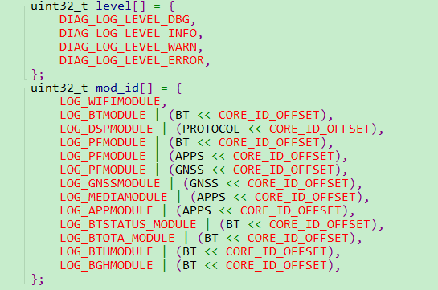

### 代码示例<a name="ZH-CN_TOPIC_0000002499581405"></a>

```
#include "diag_log.h"
int main()
{
    uapi_diag_info_log(0, "test out info log. value = %d", 1);
    uapi_diag_error_log(0, "test out error log. a = %d, b = %d\r\n", 3, 4);
    uapi_diag_warning_log(0, "test out warning log. a = %d, b = %d c= 0x%x\r\n", 3, 4, 5);
}
```

> **说明：** 
>请注意，DIAG日志只能支持长度32位及以下的参数，如："%d"、"%u"、"%x"、"%p"，无法支持长度大于32位的参数，如"%ld"、"%s"，无法支持浮点参数，如"%f"。

## 日志离线保存功能<a name="ZH-CN_TOPIC_0000002466542000"></a>

-   **[场景说明](#ZH-CN_TOPIC_0000002499581373)**  

-   **[工作流程](#ZH-CN_TOPIC_0000002466382376)**  

-   **[代码示例](#ZH-CN_TOPIC_0000002499581453)**  

### 场景说明<a name="ZH-CN_TOPIC_0000002499581373"></a>

如“[日志打印功能](#ZH-CN_TOPIC_0000002466382400)”中说明，DIAG日志可以通过串口发送至DebugKits工具。在整机或户外等没有串口的场景下，可以打开日志离线存储功能，将DIAG日志以文件的形式保存至文件系统中，需要的时候将日志文件导出到PC上，通过DebugKits工具解析。

### 工作流程<a name="ZH-CN_TOPIC_0000002466382376"></a>

1.  打印日志的方法参见“[日志打印功能](#ZH-CN_TOPIC_0000002466382400)”。
2.  打开/关闭离线日志存储功能特性方法：

    特性宏路径：middleware/chips/3322/dfx/include/dfx\_feature\_config.h

    示例如下：

    ```
    /* 特性: 支持日志离线存储到本地 */
    #ifndef CONFIG_DFX_SUPPORT_OFFLINE_LOG_FILE
    #define CONFIG_DFX_SUPPORT_OFFLINE_LOG_FILE         DFX_YES
    #endif
    ```

    在此文件中将“CONFIG\_DFX\_SUPPORT\_OFFLINE\_LOG\_FILE”的值置为“DFX\_YES”离线日志存储功能特性打开；置为“DFX\_NO”，功能特性关闭。

3.  打开/关闭日志离线存储功能的方法如下：

    -   方法一：在代码中调用“uapi\_zdiag\_set\_offline\_log\_enable”函数。
    -   方法二：在DebugKits的命令行界面输入“offline\_log\_cfg”命令：

        offline\_log\_cfg 1：打开日志离线保存功能。

        offline\_log\_cfg 0：关闭日志离线保存功能。

        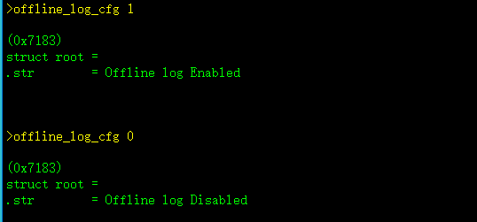

    -   方法三：修改离线日志开关的NV项默认值。

        在NV的预置值配置文件（如：middleware/chips/3322/nv/nv\_config/cfg/acore/app.json）中将离线日志开关的NV项（offline\_enable\_flag）的值改为1。

        ```
                "offline_enable_flag":{
                    "key_id": "0x2002",
                    "key_status": "alive",
                    "structure_type": "uint8_t",
                    "attributions": 1,
                    "value": 1
                },
        ```

    打开日志离线保存功能后，DIAG日志不再输出到串口，而是保存到文件中。

    关闭日志离线保存功能后，DIAG日志直接输出到串口。

    > **说明：** 
    >使用方法一和方法三，每次启动时，离线日志自动生效。方法二，只是临时生效，复位后会恢复。

4.  从“/user/log/”目录导出所有日志文件。其中包含：
    -   一个日志索引文件（log\_file\_diag.bin.idx）
    -   若干个日志数据文件（如log\_file\_diag.bin.0001、log\_file\_diag.bin.0002等）

5.  将日志文件拖入到DebugKits工具，可以查看日志内容（详情请参见《DebugKits工具 使用指南》）。

> **说明：** 
>保存日志的空间有大小限制，目前总大小为20MB，日志保存空间达到最大值后，会覆盖最早的日志继续保存。

### 代码示例<a name="ZH-CN_TOPIC_0000002499581453"></a>

```
#include "diag_log.h"
int main()
{
    uapi_zdiag_set_offline_log_enable(true);
    uapi_diag_info_log(0, "test out value = %d", 1);
    uapi_diag_error_log(0, "test out error a = %d, b = %d\r\n", 3, 4);
}
```

## 命令注册功能<a name="ZH-CN_TOPIC_0000002499501309"></a>

-   **[场景说明](#ZH-CN_TOPIC_0000002466382392)**  

-   **[工作流程](#ZH-CN_TOPIC_0000002499581421)**  

-   **[Database修改](#ZH-CN_TOPIC_0000002466541968)**  

### 场景说明<a name="ZH-CN_TOPIC_0000002466382392"></a>

用户可以注册自定义命令，在DebugKits工具的命令行界面输入命令与单板侧进行交互，执行用户自定义的操作。

### 工作流程<a name="ZH-CN_TOPIC_0000002499581421"></a>

要想实现通过DIAG命令来控制单板的操作，需要DIAG（单板侧）和DebugKits（工具侧）约定命令和应答的ID，以及命令和应答所发送的数据的数据结构。这些约定需通过预先配置的XML文件来定义。

以增加一条“get\_user\_info”命令为例，流程如下：

1.  在“middleware/chips/3322/dfx/include/diag\_cmd\_id.h”文件中定义命令ID。

    用户自定义命令范围0xA0～0xEF，注意不要与已存在的命令ID重复。

    代码示例如下：

    ```
    #define DIAG_CMD_GET_USER_INFO        diag_cmd_id_comb(0xA0)
    ```

2.  <a name="zh-cn_topic_0000002444726297_li6506105619817"></a>调用“uapi\_diag\_register\_cmd”函数，注册该命令的回调函数。

    其中第一个参数“cmd\_tbl”表示注册的命令表格，“cmd\_num”表示命令表格中命令个数。可参考“middleware/chips/3322/dfx/dfx\_system\_init.c”文件中“register\_default\_diag\_cmd”函数的实现。

    代码示例如下：

    ```
    zdiag_cmd_reg_obj_t g_diag_user_cmd_tbl[] = {
        { DIAG_CMD_GET_USER_INFO, DIAG_CMD_GET_USER_INFO, diag_cmd_get_user_info},
    };
    
    static errcode_t register_diag_user_cmd(void)
    {
        return uapi_zdiag_register_cmd(g_diag_user_cmd_tbl,
            sizeof(g_diag_user_cmd_tbl) / sizeof(g_diag_user_cmd_tbl[0]));
    }
    ```

3.  在[2](#zh-cn_topic_0000002444726297_li6506105619817)中注册的回调函数“diag\_cmd\_get\_user\_info”中，实现收到该命令后的操作，如果需要给DebugKits工具应答，则调用“uapi\_diag\_report\_packet”函数上报应答报文。

    代码示例如下：

    ```
    errcode_t diag_cmd_get_mem_info(uint16_t cmd_id, void * cmd_param, uint16_t cmd_param_size, diag_option_t *option)
    {
        errcode_t ret;
        user_info_t info;
    
        uapi_unused(cmd_param);
        uapi_unused(cmd_param_size);
        
        /* 获取用户的数据信息 */
        ret = dfx_mem_get_sys_user_info(&info);
        if (ret != ERRCODE_SUCC) {
            return ret;
        }
    
        /* 将用户的数据信息发送给DebugKits */
        uapi_diag_report_packet(cmd_id, option, (uint8_t *)&info, (uint16_t)sizeof(user_info_t), true);
        return ERRCODE_SUCC;
    }
    ```

4.  在“build/config/target\_config/3322/hdb\_config/database\_template/acore/system/hdbcfg/mss\_cmd\_db.xml”中定义命令。代码示例如下（CMD标签部分为需要新增内容）：

    ```
    <DebugKits>
      <GROUP NAME="FIX" DATA_STRUCT_FILE="..\diag\fix_struct_def.txt" MULTIMODE="Firefly" AUTO_STRUCT="YES" PLUGIN="0x111,0x110(1),0x252">
        <CMD ID="0xA005" NAME="get_user_info" DESCRIPTION="get_user_info" PLUGIN="0x100" TYPE="REQ_IND">
          <REQ STRUCTURE="tool_null_stru" TYPE="Auto" PARAM_VALUE="" />
          <IND STRUCTURE="user_info_t" TYPE="Auto" RESULT_CODE="" />
        </CMD>
      </GROUP>
    </DebugKits>
    ```

5.  编译程序，将编译生成的“output/3322/database\_evb”数据库更新至DebugKits工具数据库中（参照“[DebugKits使用说明](#ZH-CN_TOPIC_0000002499581445)”中的[3](#zh-cn_topic_0000002411047144_li18666851174918)），打开DebugKits命令行界面，即可输入“get\_user\_info”命令，实现获取用户数据信息的功能。

### Database修改<a name="ZH-CN_TOPIC_0000002466541968"></a>

上述工作流程中的“[4](#zh-cn_topic_0000002444726297_li159212322136)”修改的“mss\_cmd\_db.xml”文件，是DIAG与DebugKits约定数据结构的关键。下面对其详细说明：

-   mss\_cmd\_db.xml中分为两层：GROUP和CMD，每个GROUP可以包含多个CMD命令。
-   GROUP中的DATA\_STRUCT\_FILE字段指向的文件名，表示该GROUP下的命令涉及到的数据结构体都保存在这个文件中。
-   CMD中的REQ STRUCTURE字段指向请求命令携带数据对应的结构体，IND STRUCTURE指向应答命令携带的数据对应的结构体。
-   CMD中PLUGIN字段表示该命令在DebugKits生效的界面：
    -   0x100：命令行页面
    -   0x259：system页面
    -   0x110：message页面

-   GROUP中的AUTO\_STRUCT字段用来配置结构体是否自动生成，YES表示构建过程中自动生成database的结构体，否则需要自己手动添加到结构体到DATA\_STRUCT\_FILE字段指向的文件中。例如：

    ```
    /*mss_cmd_db.xml中添加一条get_user_info命令，CMD ID为0xA005*/ 
        <CMD ID="0xA005" NAME="get_user_info" DESCRIPTION="get_user_info" PLUGIN="0x100,0x102" TYPE="REQ_IND">
          <REQ STRUCTURE="tool_null_stru" TYPE="Auto" PARAM_VALUE="" />
          <IND STRUCTURE="user_info_t" TYPE="Auto" RESULT_CODE="" />
        </CMD>
    /*fix_struct_def.txt中添加结构体定义*/
    typedef struct {
        uint32_t user_info1;
        uint32_t user_info2;
        uint32_t user_info3;
        uint32_t user_info4;
        uint32_t user_info5;
        uint32_t user_info6;
    } user_info_t;
    ```

## 系统维测接口<a name="ZH-CN_TOPIC_0000002499501413"></a>

系统维测功能提供了以下接口：

-   内存使用统计接口
-   任务信息统计接口

-   **[内存使用统计](#ZH-CN_TOPIC_0000002466382440)**  

-   **[任务信息统计](#ZH-CN_TOPIC_0000002466542048)**  

### 内存使用统计<a name="ZH-CN_TOPIC_0000002466382440"></a>

**概述<a name="zh-cn_topic_0000002411207060_section1986241031"></a>**

内存使用统计提供内存使用信息查询的接口，可实时获取内存使用大小、峰值占用等信息。

**功能描述<a name="zh-cn_topic_0000002411207060_section147977016413"></a>**

DIAG提供内存使用统计信息查询接口“diag\_cmd\_get\_mem\_info”，调用该接口可获取系统内存池总大小、已用空间、剩余空间、剩余空间节点个数、内存池已经使用的节点个数、内存池剩余空间中最大节点的大小以及内存池使用峰值等信息。以上信息以“mdm\_mem\_info\_t”结构体的格式，发送到DebugKits中显示出来。如[图1](#zh-cn_topic_0000002411207060_fig43121953687)所示。

**图 1**  内存统计使用示例<a name="zh-cn_topic_0000002411207060_fig43121953687"></a>  
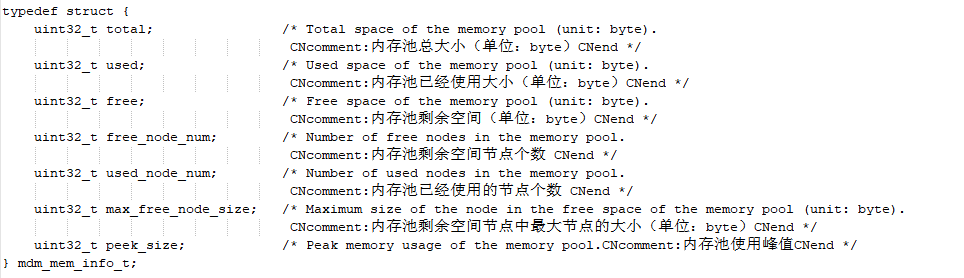

**命令行代码示例<a name="zh-cn_topic_0000002411207060_section1720772918419"></a>**

```
errcode_t diag_cmd_get_mem_info(uint16_t cmd_id, void * cmd_param, uint16_t cmd_param_size, diag_option *option)
{
    errcode_t ret;
    mdm_mem_info_t info;
    uapi_unused(cmd_param);
    uapi_unused(cmd_param_size);
    ret = dfx_mem_get_sys_pool_info(&info);
    if (ret != ERRCODE_SUCC) {
        return ret;
    }
    uapi_diag_report_packet(cmd_id, option, (uint8_t)&info, (uint16_t)sizeof(mdm_mem_info_t), true);
    return ERRCODE_SUCC;
}
```

### 任务信息统计<a name="ZH-CN_TOPIC_0000002466542048"></a>

**概述<a name="zh-cn_topic_0000002411047176_section104838101854"></a>**

任务信息统计功能可查询任务名、任务状态、当前SP、优先级、栈峰值、栈大小等信息。

**功能描述<a name="zh-cn_topic_0000002411047176_section207220286518"></a>**

提供任务统计功能查询接口“diag\_cmd\_get\_task\_info”，调用该接口可实时获取当前系统任务ID、任务状态、任务优先级、信号量、栈峰值、栈大小等信息。上述数据以“task\_info\_t”结构体的格式，发送到DebugKits中显示出来。如[图1](#zh-cn_topic_0000002411047176_fig894881312109)所示。

**图 1**  任务信息统计示例<a name="zh-cn_topic_0000002411047176_fig894881312109"></a>  
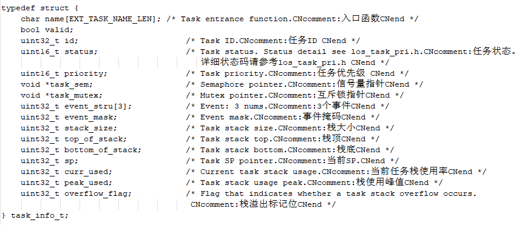

**命令行代码示例<a name="zh-cn_topic_0000002411047176_section88152441754"></a>**

```
errcode_t diag_cmd_get_task_info(uint16_t cmd_id, void * cmd_param, uint16_t cmd_param_size, diag_option *option)
{
    uint32_t task_cnt;
    errcode_t ret;
    task_info_t *infs = NULL;
    uapi_unused(cmd_param);
    uapi_unused(cmd_param_size);
    task_cnt = dfx_os_get_task_cnt();
    if (task_cnt == 0) {
        return ERRCODE_FAIL;
    }
    infs = dfx_malloc(0, task_cnt * sizeof(ext_task_info));
    if (infs == TD_NULL) {
        return ERRCODE_FAIL;
    }
    ret = dfx_os_get_all_task_info(infs, task_cnt);
    if (ret != ERRCODE_SUCC) {
        dfx_free(0, infs);
        return ret;
    }
    for (unsigned i = 0; i < task_cnt; i++) {
        task_info_t *inf = &infs[i];
        if (inf->valid) {
            uapi_diag_report_packet(cmd_id, option, (uint8_t *)inf, (uint16_t)sizeof(task_info_t), true);
        }
    }
    dfx_free(0, infs);
    return ERRCODE_SUCC;
}
```

## CHR打点功能<a name="ZH-CN_TOPIC_0000002466382448"></a>

-   **[场景说明](#ZH-CN_TOPIC_0000002499501373)**  

-   **[工作流程](#ZH-CN_TOPIC_0000002466541982)**  

-   **[代码示例](#ZH-CN_TOPIC_0000002466542008)**  

### 场景说明<a name="ZH-CN_TOPIC_0000002499501373"></a>

在某些行为需要被记录时，可以通过调用CHR打点接口（支持单核或者多核打点）将打点数据保存到文件系统中，在需要的时候将CHR打点文件导出到PC上，通过DebugKits工具进行解析。

### 工作流程<a name="ZH-CN_TOPIC_0000002466541982"></a>

以用户在“application/3322/3322\_app\_standard/thread\_init.c”中增加CHR打点日志为例，流程如下：

1.  在“application/3322/3322\_app\_standard/thread\_init.c”中调用CHR打点接口添加event\_xxx时，输出调试信息。thread\_init.c中需要包含“massdata\_buffer.h”头文件，需要该头文件中的massdata\_event\_id中添加event\_xxx，并且自定义info1/info2/info3事件。

    **表 1**  CHR打点接口

    <a name="zh-cn_topic_0000002468063497_table1187512371538"></a>
    <table><thead align="left"><tr id="zh-cn_topic_0000002468063497_row6875437195311"><th class="cellrowborder" valign="top" width="34.47%" id="mcps1.2.3.1.1"><p id="zh-cn_topic_0000002468063497_p88756379537"><a name="zh-cn_topic_0000002468063497_p88756379537"></a><a name="zh-cn_topic_0000002468063497_p88756379537"></a>函数</p>
    </th>
    <th class="cellrowborder" valign="top" width="65.53%" id="mcps1.2.3.1.2"><p id="zh-cn_topic_0000002468063497_p78751337125312"><a name="zh-cn_topic_0000002468063497_p78751337125312"></a><a name="zh-cn_topic_0000002468063497_p78751337125312"></a>说明</p>
    </th>
    </tr>
    </thead>
    <tbody><tr id="zh-cn_topic_0000002468063497_row18456011153916"><td class="cellrowborder" valign="top" width="34.47%" headers="mcps1.2.3.1.1 "><p id="zh-cn_topic_0000002468063497_p79271213134211"><a name="zh-cn_topic_0000002468063497_p79271213134211"></a><a name="zh-cn_topic_0000002468063497_p79271213134211"></a>uapi_massdata_record_system_event</p>
    </td>
    <td class="cellrowborder" valign="top" width="65.53%" headers="mcps1.2.3.1.2 "><p id="zh-cn_topic_0000002468063497_p845671183916"><a name="zh-cn_topic_0000002468063497_p845671183916"></a><a name="zh-cn_topic_0000002468063497_p845671183916"></a>记录打点事件，最多支持以下四个参数event_id/info1/info2/info3，参数的层级关系如<a href="#zh-cn_topic_0000002468063497_fig11811843173215">图1</a>所示。</p>
    </td>
    </tr>
    <tr id="zh-cn_topic_0000002468063497_row1338714163401"><td class="cellrowborder" valign="top" width="34.47%" headers="mcps1.2.3.1.1 "><p id="zh-cn_topic_0000002468063497_p13387216184010"><a name="zh-cn_topic_0000002468063497_p13387216184010"></a><a name="zh-cn_topic_0000002468063497_p13387216184010"></a>uapi_massdata_record_system_long_event</p>
    </td>
    <td class="cellrowborder" valign="top" width="65.53%" headers="mcps1.2.3.1.2 "><p id="zh-cn_topic_0000002468063497_p143875168408"><a name="zh-cn_topic_0000002468063497_p143875168408"></a><a name="zh-cn_topic_0000002468063497_p143875168408"></a>记录打点事件，最多支持以下四个参数event_id/info1/info2/info3，参数的层级关系如<a href="#zh-cn_topic_0000002468063497_fig11811843173215">图1</a>所示。其中info3支持可变长度的buf，需要在入参中输入info3的长度，最大为128Byte。</p>
    </td>
    </tr>
    </tbody>
    </table>

    **图 1**  打点信息关系示意图<a name="zh-cn_topic_0000002468063497_fig11811843173215"></a>  
    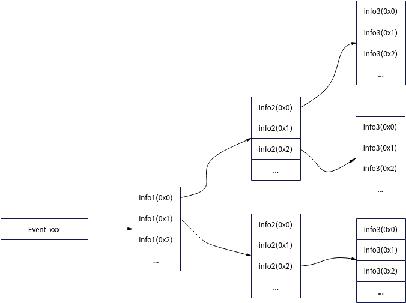

2.  打开/关闭CHR打点功能特性方法：

    特性宏路径：middleware/chips/3322/dfx/include/dfx\_feature\_config.h

    示例如下：

    ```
    /
    /* 特性: 支持大数据打点 */
    #ifndef CONFIG_DFX_SUPPORT_MASSDATA_DOTTING
    #define CONFIG_DFX_SUPPORT_MASSDATA_DOTTING         DFX_YES
    #endif
    
    ```

    在此文件中将“CONFIG\_DFX\_SUPPORT\_MASSDATA\_DOTTING”的值置为“DFX\_YES”离线日志存储功能特性打开；置为“DFX\_NO”，功能特性关闭。

3.  打开/关闭CHR打点功能的方法如下：
    -   方法一：在代码中调用“uapi\_massdata\_set\_state”函数。
    -   方法二：在DebugKits的命令行界面输入“diag\_dfx 9,\[0,2,0\]”命令：

        diag\_dfx 9,\[0,2,0\]：打开CHR打点功能。

        diag\_dfx 9.\[0,0,0\]：关闭CHR打点功能。

        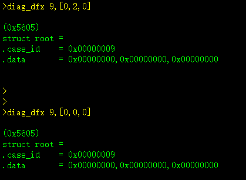

> **说明：** 
>保存日志的空间有大小限制，目前总大小为96KB，日志保存空间达到最大值后，会覆盖最早的日志继续保存。

### 代码示例<a name="ZH-CN_TOPIC_0000002466542008"></a>

```
#include "massdata_buffer.h"
typedef enum {
    MT_CASE1 = 0x0,
    MT_CASE2 = 0x1,
} massdata_xxx_info1;
typedef enum {
    MT_CASE1_STEP1 = 0x0,
    MT_CASE1_STEP2 = 0x1,
} massdata_xxx_CASE1_info2;
int main()
{
    uapi_massdata_record_system_event(event_xxx, MT_CASE1, MT_CASE1_STEP1, 0);
    uapi_massdata_record_system_event(event_xxx, MT_CASE1, MT_CASE1_STEP2, 0);
}
```

# 死机诊断<a name="ZH-CN_TOPIC_0000002466382360"></a>

-   **[简介](#ZH-CN_TOPIC_0000002466382408)**  

-   **[死机信息获取](#ZH-CN_TOPIC_0000002466542056)**  

-   **[死机信息查看](#ZH-CN_TOPIC_0000002499501357)**  

-   **[常见死机问题定位](#ZH-CN_TOPIC_0000002499581389)**  

## 简介<a name="ZH-CN_TOPIC_0000002466382408"></a>

死机诊断是指HiDiTingV100在发生异常时能够记录并输出系统异常信息，后统称死机信息。其中包括死机现场的PC地址、返回地址、栈地址、CPU寄存器信息以及部分内存信息等。用户可根据实际使用场景进行获取并通过分析定位根因，解决死机问题。

HiDiTingV100支持以下[表1](#zh-cn_topic_0000002411207052_table02271831423)所示几种方式记录并输出死机信息。

**表 1**  死机信息类型说明

<a name="zh-cn_topic_0000002411207052_table02271831423"></a>
<table><thead align="left"><tr id="zh-cn_topic_0000002411207052_row222717317219"><th class="cellrowborder" valign="top" width="10.290000000000001%" id="mcps1.2.6.1.1"><p id="zh-cn_topic_0000002411207052_p4227133722"><a name="zh-cn_topic_0000002411207052_p4227133722"></a><a name="zh-cn_topic_0000002411207052_p4227133722"></a>类型</p>
</th>
<th class="cellrowborder" valign="top" width="17.990000000000002%" id="mcps1.2.6.1.2"><p id="zh-cn_topic_0000002411207052_p10913162311010"><a name="zh-cn_topic_0000002411207052_p10913162311010"></a><a name="zh-cn_topic_0000002411207052_p10913162311010"></a>说明</p>
</th>
<th class="cellrowborder" valign="top" width="11.75%" id="mcps1.2.6.1.3"><p id="zh-cn_topic_0000002411207052_p112272031324"><a name="zh-cn_topic_0000002411207052_p112272031324"></a><a name="zh-cn_topic_0000002411207052_p112272031324"></a>依赖</p>
</th>
<th class="cellrowborder" valign="top" width="41.24%" id="mcps1.2.6.1.4"><p id="zh-cn_topic_0000002411207052_p522714310219"><a name="zh-cn_topic_0000002411207052_p522714310219"></a><a name="zh-cn_topic_0000002411207052_p522714310219"></a>适用场景</p>
</th>
<th class="cellrowborder" valign="top" width="18.73%" id="mcps1.2.6.1.5"><p id="zh-cn_topic_0000002411207052_p19227431423"><a name="zh-cn_topic_0000002411207052_p19227431423"></a><a name="zh-cn_topic_0000002411207052_p19227431423"></a>所在章节</p>
</th>
</tr>
</thead>
<tbody><tr id="zh-cn_topic_0000002411207052_row0227631124"><td class="cellrowborder" valign="top" width="10.290000000000001%" headers="mcps1.2.6.1.1 "><p id="zh-cn_topic_0000002411207052_p2227837210"><a name="zh-cn_topic_0000002411207052_p2227837210"></a><a name="zh-cn_topic_0000002411207052_p2227837210"></a>串口死机信息</p>
</td>
<td class="cellrowborder" valign="top" width="17.990000000000002%" headers="mcps1.2.6.1.2 "><p id="zh-cn_topic_0000002411207052_p991362391014"><a name="zh-cn_topic_0000002411207052_p991362391014"></a><a name="zh-cn_topic_0000002411207052_p991362391014"></a>死机时在串口直接输出死机信息</p>
</td>
<td class="cellrowborder" valign="top" width="11.75%" headers="mcps1.2.6.1.3 "><p id="zh-cn_topic_0000002411207052_p112271437212"><a name="zh-cn_topic_0000002411207052_p112271437212"></a><a name="zh-cn_topic_0000002411207052_p112271437212"></a>串口</p>
</td>
<td class="cellrowborder" valign="top" width="41.24%" headers="mcps1.2.6.1.4 "><p id="zh-cn_topic_0000002411207052_p92272316218"><a name="zh-cn_topic_0000002411207052_p92272316218"></a><a name="zh-cn_topic_0000002411207052_p92272316218"></a>适用于未关闭串口的情况。可以获取死机时异常信息、CPU寄存器信息、函数调用栈信息等。</p>
</td>
<td class="cellrowborder" valign="top" width="18.73%" headers="mcps1.2.6.1.5 "><p id="zh-cn_topic_0000002411207052_p1022719312212"><a name="zh-cn_topic_0000002411207052_p1022719312212"></a><a name="zh-cn_topic_0000002411207052_p1022719312212"></a><a href="#ZH-CN_TOPIC_0000002499501389">串口工具界面输出</a>、<a href="#ZH-CN_TOPIC_0000002499501381">串口死机信息查看</a></p>
</td>
</tr>
<tr id="zh-cn_topic_0000002411207052_row72271035211"><td class="cellrowborder" valign="top" width="10.290000000000001%" headers="mcps1.2.6.1.1 "><p id="zh-cn_topic_0000002411207052_p18227637210"><a name="zh-cn_topic_0000002411207052_p18227637210"></a><a name="zh-cn_topic_0000002411207052_p18227637210"></a>Flash死机文件</p>
</td>
<td class="cellrowborder" valign="top" width="17.990000000000002%" headers="mcps1.2.6.1.2 "><p id="zh-cn_topic_0000002411207052_p1991382314102"><a name="zh-cn_topic_0000002411207052_p1991382314102"></a><a name="zh-cn_topic_0000002411207052_p1991382314102"></a>死机时在Flash中保存死机信息</p>
</td>
<td class="cellrowborder" valign="top" width="11.75%" headers="mcps1.2.6.1.3 "><p id="zh-cn_topic_0000002411207052_p2227153928"><a name="zh-cn_topic_0000002411207052_p2227153928"></a><a name="zh-cn_topic_0000002411207052_p2227153928"></a>Flash</p>
</td>
<td class="cellrowborder" valign="top" width="41.24%" headers="mcps1.2.6.1.4 "><p id="zh-cn_topic_0000002411207052_p14227434212"><a name="zh-cn_topic_0000002411207052_p14227434212"></a><a name="zh-cn_topic_0000002411207052_p14227434212"></a>适用于产品阶段，关闭串口输出的情况。可以获取死机时异常信息、CPU寄存器信息、函数调用栈信息等。</p>
</td>
<td class="cellrowborder" valign="top" width="18.73%" headers="mcps1.2.6.1.5 "><p id="zh-cn_topic_0000002411207052_p12271312213"><a name="zh-cn_topic_0000002411207052_p12271312213"></a><a name="zh-cn_topic_0000002411207052_p12271312213"></a><a href="#ZH-CN_TOPIC_0000002466382344">Flash中的死机文件获取</a>、<a href="#ZH-CN_TOPIC_0000002466542088">Flash中的死机文件信息查看</a></p>
</td>
</tr>
<tr id="zh-cn_topic_0000002411207052_row1822716312211"><td class="cellrowborder" valign="top" width="10.290000000000001%" headers="mcps1.2.6.1.1 "><p id="zh-cn_topic_0000002411207052_p13227731211"><a name="zh-cn_topic_0000002411207052_p13227731211"></a><a name="zh-cn_topic_0000002411207052_p13227731211"></a>Last word</p>
</td>
<td class="cellrowborder" valign="top" width="17.990000000000002%" headers="mcps1.2.6.1.2 "><p id="zh-cn_topic_0000002411207052_p119131923131016"><a name="zh-cn_topic_0000002411207052_p119131923131016"></a><a name="zh-cn_topic_0000002411207052_p119131923131016"></a>死机时将死机的临终遗言输出到DebugKits工具</p>
</td>
<td class="cellrowborder" valign="top" width="11.75%" headers="mcps1.2.6.1.3 "><p id="zh-cn_topic_0000002411207052_p82271431023"><a name="zh-cn_topic_0000002411207052_p82271431023"></a><a name="zh-cn_topic_0000002411207052_p82271431023"></a>Debug串口，DebugKits工具</p>
</td>
<td class="cellrowborder" valign="top" width="41.24%" headers="mcps1.2.6.1.4 "><p id="zh-cn_topic_0000002411207052_p172271311217"><a name="zh-cn_topic_0000002411207052_p172271311217"></a><a name="zh-cn_topic_0000002411207052_p172271311217"></a>适用于未关闭Debug串口的情况。可以获取死机时PC地址、返回地址、栈地址、CPU寄存器值等信息。</p>
</td>
<td class="cellrowborder" valign="top" width="18.73%" headers="mcps1.2.6.1.5 "><p id="zh-cn_topic_0000002411207052_p11227153925"><a name="zh-cn_topic_0000002411207052_p11227153925"></a><a name="zh-cn_topic_0000002411207052_p11227153925"></a><a href="#ZH-CN_TOPIC_0000002499581357">获取last word信息</a>、<a href="#ZH-CN_TOPIC_0000002499581381">last word信息查看</a></p>
</td>
</tr>
<tr id="zh-cn_topic_0000002411207052_row152271631020"><td class="cellrowborder" valign="top" width="10.290000000000001%" headers="mcps1.2.6.1.1 "><p id="zh-cn_topic_0000002411207052_p7227183926"><a name="zh-cn_topic_0000002411207052_p7227183926"></a><a name="zh-cn_topic_0000002411207052_p7227183926"></a>Last dump</p>
</td>
<td class="cellrowborder" valign="top" width="17.990000000000002%" headers="mcps1.2.6.1.2 "><p id="zh-cn_topic_0000002411207052_p1391319239102"><a name="zh-cn_topic_0000002411207052_p1391319239102"></a><a name="zh-cn_topic_0000002411207052_p1391319239102"></a>死机时将当时的部分内存和寄存器信息输出到DebugKits工具，并保存到Flash中</p>
</td>
<td class="cellrowborder" valign="top" width="11.75%" headers="mcps1.2.6.1.3 "><p id="zh-cn_topic_0000002411207052_p422710316213"><a name="zh-cn_topic_0000002411207052_p422710316213"></a><a name="zh-cn_topic_0000002411207052_p422710316213"></a>Debug串口，DebugKits工具</p>
</td>
<td class="cellrowborder" valign="top" width="41.24%" headers="mcps1.2.6.1.4 "><p id="zh-cn_topic_0000002411207052_p5227937217"><a name="zh-cn_topic_0000002411207052_p5227937217"></a><a name="zh-cn_topic_0000002411207052_p5227937217"></a>适用于未关闭Debug串口的情况。可以获取到死机时的大部分内存的原始数据，以及部分关键寄存器的信息，现场数据比较丰富，适用于定位一些踩内存等比较难定位的问题。</p>
</td>
<td class="cellrowborder" valign="top" width="18.73%" headers="mcps1.2.6.1.5 "><p id="zh-cn_topic_0000002411207052_p18227733219"><a name="zh-cn_topic_0000002411207052_p18227733219"></a><a name="zh-cn_topic_0000002411207052_p18227733219"></a><a href="#ZH-CN_TOPIC_0000002499581333">获取last dump信息</a>、<a href="#ZH-CN_TOPIC_0000002466382368">last dump信息查看</a></p>
</td>
</tr>
<tr id="zh-cn_topic_0000002411207052_row616610549310"><td class="cellrowborder" valign="top" width="10.290000000000001%" headers="mcps1.2.6.1.1 "><p id="zh-cn_topic_0000002411207052_p916615541134"><a name="zh-cn_topic_0000002411207052_p916615541134"></a><a name="zh-cn_topic_0000002411207052_p916615541134"></a>J-Link调试信息</p>
</td>
<td class="cellrowborder" valign="top" width="17.990000000000002%" headers="mcps1.2.6.1.2 "><p id="zh-cn_topic_0000002411207052_p09131023171016"><a name="zh-cn_topic_0000002411207052_p09131023171016"></a><a name="zh-cn_topic_0000002411207052_p09131023171016"></a>死机时连接J-Link查看现场信息</p>
</td>
<td class="cellrowborder" valign="top" width="11.75%" headers="mcps1.2.6.1.3 "><p id="zh-cn_topic_0000002411207052_p2166105414314"><a name="zh-cn_topic_0000002411207052_p2166105414314"></a><a name="zh-cn_topic_0000002411207052_p2166105414314"></a>J-Link</p>
</td>
<td class="cellrowborder" valign="top" width="41.24%" headers="mcps1.2.6.1.4 "><p id="zh-cn_topic_0000002411207052_p151664541638"><a name="zh-cn_topic_0000002411207052_p151664541638"></a><a name="zh-cn_topic_0000002411207052_p151664541638"></a>适用于开发初期，单板需要能够连接J-Link调试器。可以获取大量现场数据（如内存、寄存器、flash数据等）。</p>
</td>
<td class="cellrowborder" valign="top" width="18.73%" headers="mcps1.2.6.1.5 "><p id="zh-cn_topic_0000002411207052_p10166154532"><a name="zh-cn_topic_0000002411207052_p10166154532"></a><a name="zh-cn_topic_0000002411207052_p10166154532"></a><a href="#ZH-CN_TOPIC_0000002466382384">连接J-Link调试器导出</a>、<a href="#ZH-CN_TOPIC_0000002499581349">连接J-Link调试器查看信息</a></p>
</td>
</tr>
</tbody>
</table>

## 死机信息获取<a name="ZH-CN_TOPIC_0000002466542056"></a>

本节主要介绍“[表1](#zh-cn_topic_0000002411207052_table02271831423)”中的几种死机信息的获取方式：

-   通过串口工具获取死机打印信息。
-   通过保存在Flash中的死机文件获取死机信息。
-   通过DebugKits工具获取死机信息。
-   连接J-Link调试器获取死机信息。

适用场景：

-   在研发调测场景下，上述四种方法均适用。
-   在外网场景下适用通过DebugKits工具或者Flash中的死机文件来获取死机信息。

> **说明：** 
>死机信息通过串口打印，要保证死机时单板已连接串口工具。

-   **[串口工具界面输出](#ZH-CN_TOPIC_0000002499501389)**  

-   **[Flash中的死机文件获取](#ZH-CN_TOPIC_0000002466382344)**  

-   **[通过DebugKits工具获取](#ZH-CN_TOPIC_0000002499501405)**  

-   **[连接J-Link调试器导出](#ZH-CN_TOPIC_0000002466382384)**  

### 串口工具界面输出<a name="ZH-CN_TOPIC_0000002499501389"></a>

单板与PC通过串口连接之后，打开任意串口工具（SSCOM/XSHELL/IPOP/MobaXterm等）界面。选择对应的端口号之后点击打开串口进行连接，波特率选择115200，如[图1](#zh-cn_topic_0000002411207068_fig6889135720320)所示。

**图 1**  串口连接<a name="zh-cn_topic_0000002411207068_fig6889135720320"></a>  
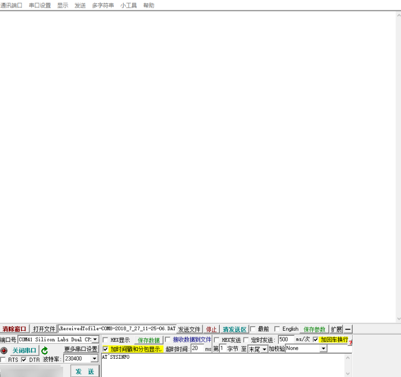

当单板与串口工具处于连接状态时，如果单板发生死机，串口工具能够接收到复位前OS打印的死机信息。如[图2](#zh-cn_topic_0000002411207068_fig18838131174015)所示。

**图 2**  串口工具中捕获的死机信息<a name="zh-cn_topic_0000002411207068_fig18838131174015"></a>  
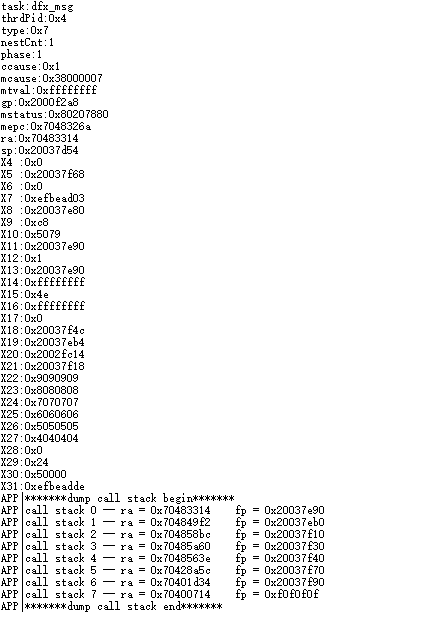

### Flash中的死机文件获取<a name="ZH-CN_TOPIC_0000002466382344"></a>

在发生死机异常时，系统会同时将死机信息以死机文件的形式保存在Flash文件系统中。

-   APP核死机文件路径：/user/exc/app\_exc\_info.bin
-   BT核死机文件路径：/user/exc/bt\_exc\_info.bin

死机文件可使用DebugKits工具导出，步骤如下：

（DebugKits详细操作方法请参见“[DebugKits使用说明](#ZH-CN_TOPIC_0000002499581445)”以及《DebugKits工具 使用指南》）

**图 1**  死机文件导出方法<a name="zh-cn_topic_0000002444646229_fig167033243815"></a>  
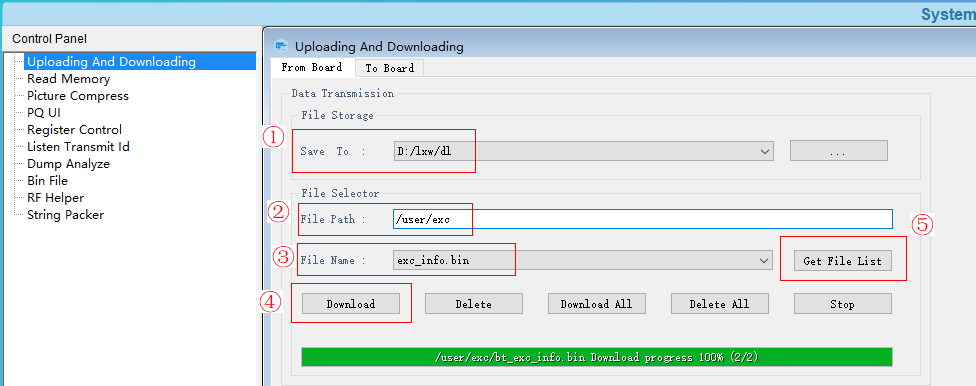

1.  在标注①处选好死机文件导出存放位置。
2.  在标注②处填写“/user/exc”。
3.  在标注⑤处点击“Get File List”按钮获取该目录下所有文件，在标注③处选择需要下载的死机文件。
4.  在标记④处点击“Download”或“Download All”按钮，死机文件将下载至标注①选择的目录位置。

### 通过DebugKits工具获取<a name="ZH-CN_TOPIC_0000002499501405"></a>

在死机故障发生时，如果DebugKits处于连接状态，会获取到两种死机信息：

-   last word信息
-   last dump信息

参照“[DebugKits使用说明](#ZH-CN_TOPIC_0000002499581445)”中的[1](#zh-cn_topic_0000002411047144_li19940753184819)\~[4](#zh-cn_topic_0000002411047144_li1351205815014)，打开DebugKits工具的消息界面，可以实时观测芯片运行时打印的具体信息，如[图1](#zh-cn_topic_0000002411207032_fig1915112116514)所示。

当死机发生时消息界面将会打印出last word以及last dump信息。

**图 1**  DebugKits日志打印<a name="zh-cn_topic_0000002411207032_fig1915112116514"></a>  
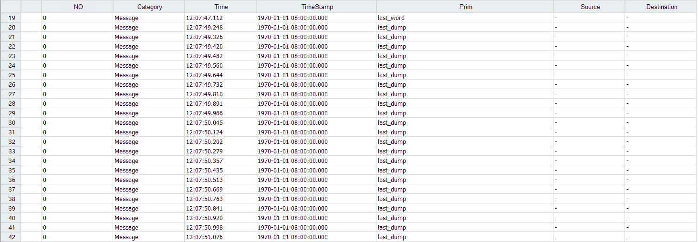

-   **[获取last word信息](#ZH-CN_TOPIC_0000002499581357)**  

-   **[获取last dump信息](#ZH-CN_TOPIC_0000002499581333)**  

#### 获取last word信息<a name="ZH-CN_TOPIC_0000002499581357"></a>

last word信息是死机发生时的临终遗言，其中包括PC地址、返回地址、栈地址、CPU寄存器值等信息。用户可以根据last word的具体信息分析错误类型、定位错误原因。

在DebugKits的Message界面，点击last word那一行，即可查看last word具体信息，其中，A核的last word和BT核的last word有所不同，A核的last word信息如[图1](#zh-cn_topic_0000002411207044_fig09401013124317)所示。BT核last word信息如[图2](#zh-cn_topic_0000002411207044_fig12500112724619)所示。

**图 1**  A核last word信息<a name="zh-cn_topic_0000002411207044_fig09401013124317"></a>  
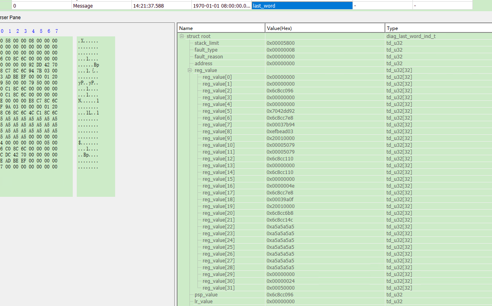

**图 2**  BT核last word信息<a name="zh-cn_topic_0000002411207044_fig12500112724619"></a>  
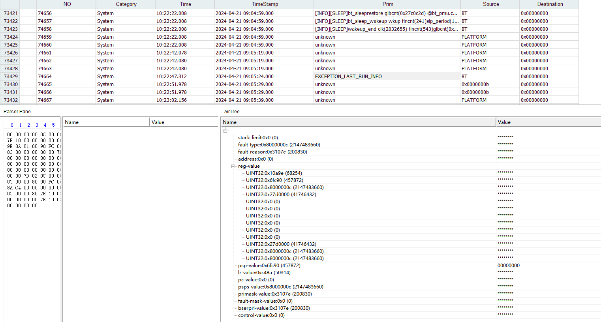

A核和BT核的last word信息差异在于：

-   在message界面中名称不同：A核名称为last\_word，BT核名称为EXCEPTION\_LAST\_RUN\_INFO。
-   内容中reg\_value的个数不同和对应的含义不同：A核reg\_value为32个，BT核reg\_value为13个。其对应的含义详见“[last word信息查看](#ZH-CN_TOPIC_0000002499581381)”章节。

#### 获取last dump信息<a name="ZH-CN_TOPIC_0000002499581333"></a>

-   last dump信息是在死机故障发生时，将单板中的部分内存和寄存器信息通过串口发送到PC端，通过DebugKits工具生成bin文件存储到的安装目录中的DumpInfo子目录之下，具体参考[图1](#zh-cn_topic_0000002444726305_fig1695614017813)。

    用户可以通过解析这些文件来定位死机原因。解析这些文件的方法请参见“[Last Dump解析](#ZH-CN_TOPIC_0000002466542072)”。

    **图 1**  last dump生成文件<a name="zh-cn_topic_0000002444726305_fig1695614017813"></a>  
    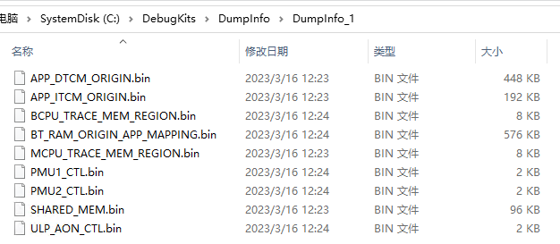

    > **说明：** 
    >将内存dump到DebugKits中需要一定时间（Liteos：1～2 min，FreeRtos：4～5 min），因此如果需要使用last dump分析死机信息，注意不要在发生死机故障后立即复位，否则last dump信息可能无法完整获取。

-   死机故障发生时，如果单板没有连接debugkits，系统会同时将last dump信息以bin文件的形式保存在Flash文件系统中。
    -   APP核死机文件路径：/user/exc/APP\_ITCM\_ORIGIN.bin、/user/exc/APP\_DTCM\_ORIGIN.bin、/user/exc/SHARE\_MEM.bin、/user/exc/MCPU\_TRACE\_MEM\_REGION.bin
    -   BT核死机文件路径：/user/exc/BT\_RAM\_ORIGIN、/user/exc/SHARE\_MEM.bin、/user/exc/BCPU\_TRACE\_MEM\_REGION.bin

### 连接J-Link调试器导出<a name="ZH-CN_TOPIC_0000002466382384"></a>

在允许连接JTAG调试器的场景下，用户可连接劳特巴赫或J-Link仿真器等工具进一步获取死机现场的相关信息。以下主要介绍通过J-Link仿真器获取死机相关信息的过程。

在条件允许的情况下，建议开启死机不复位功能进行死机定位。死机现场时，连接J-Link，可以查看“[串口工具界面输出](#ZH-CN_TOPIC_0000002499501389)”小节所展示的信息，还可查询内存信息、栈信息、外设寄存器、维测变量等更丰富的数据。

使用J-Link仿真器调试需先连接单板的20PIN排针，具体排针位置以实际产品为准。

硬件连接后，双击工具包（sdk\\tools\\bin\\jlink\_tool\\hi3322）中的**Commandline\_hi3322\_mcpu.bat**脚本，脚本将自动进行连接（其他核的连接操作可参照此方法进行）。

**图 1**  J-Link连接MCPU示意图<a name="zh-cn_topic_0000002444726317_fig14167439113313"></a>  
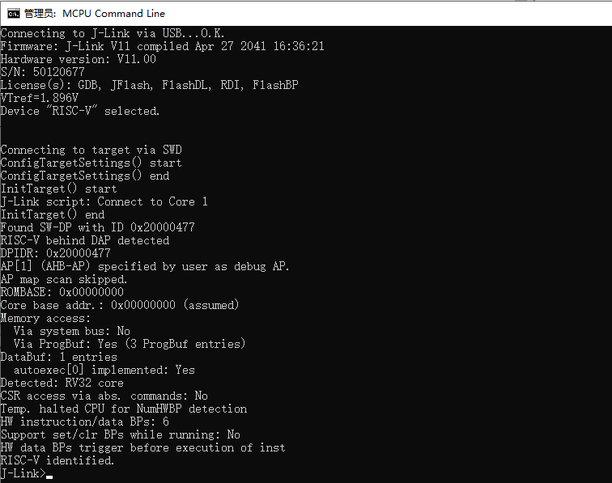

> **须知：** 
>注意RISC-V架构处理器需要使用V10及以上版本的J-Link仿真器。

## 死机信息查看<a name="ZH-CN_TOPIC_0000002499501357"></a>

对于“[死机信息获取](#ZH-CN_TOPIC_0000002466542056)”中描述的几种方式获取的死机信息，本节分别介绍它们的查看方式和定位方法。

-   **[串口死机信息查看](#ZH-CN_TOPIC_0000002499501381)**  

-   **[Flash中的死机文件信息查看](#ZH-CN_TOPIC_0000002466542088)**  

-   **[通过DebugKits获取的死机信息查看](#ZH-CN_TOPIC_0000002466382424)**  

-   **[连接J-Link调试器查看信息](#ZH-CN_TOPIC_0000002499581349)**  

### 串口死机信息查看<a name="ZH-CN_TOPIC_0000002499501381"></a>

在死机故障发生时，一般会在串口输出“[串口工具界面输出](#ZH-CN_TOPIC_0000002499501389)”中描述的死机信息。其中包含几个部分：异常信息汇总、CPU寄存器信息、函数调用栈信息。

-   **[异常信息汇总](#ZH-CN_TOPIC_0000002466382472)**  

-   **[CPU寄存器信息](#ZH-CN_TOPIC_0000002466542024)**  

-   **[函数调用栈信息](#ZH-CN_TOPIC_0000002499581397)**  

#### 异常信息汇总<a name="ZH-CN_TOPIC_0000002466382472"></a>

**表 1**  异常信息汇总

<a name="zh-cn_topic_0000002444726341_table123725012514"></a>
<table><thead align="left"><tr id="zh-cn_topic_0000002444726341_row19376506258"><th class="cellrowborder" valign="top" width="19.439999999999998%" id="mcps1.2.3.1.1"><p id="zh-cn_topic_0000002444726341_p133735018259"><a name="zh-cn_topic_0000002444726341_p133735018259"></a><a name="zh-cn_topic_0000002444726341_p133735018259"></a>成员</p>
</th>
<th class="cellrowborder" valign="top" width="80.56%" id="mcps1.2.3.1.2"><p id="zh-cn_topic_0000002444726341_p1737175052516"><a name="zh-cn_topic_0000002444726341_p1737175052516"></a><a name="zh-cn_topic_0000002444726341_p1737175052516"></a>说明</p>
</th>
</tr>
</thead>
<tbody><tr id="zh-cn_topic_0000002444726341_row037135012253"><td class="cellrowborder" valign="top" width="19.439999999999998%" headers="mcps1.2.3.1.1 "><p id="zh-cn_topic_0000002444726341_p203718501253"><a name="zh-cn_topic_0000002444726341_p203718501253"></a><a name="zh-cn_topic_0000002444726341_p203718501253"></a>task</p>
</td>
<td class="cellrowborder" valign="top" width="80.56%" headers="mcps1.2.3.1.2 "><p id="zh-cn_topic_0000002444726341_p03755010251"><a name="zh-cn_topic_0000002444726341_p03755010251"></a><a name="zh-cn_topic_0000002444726341_p03755010251"></a>死机的任务名称。</p>
</td>
</tr>
<tr id="zh-cn_topic_0000002444726341_row23713503252"><td class="cellrowborder" valign="top" width="19.439999999999998%" headers="mcps1.2.3.1.1 "><p id="zh-cn_topic_0000002444726341_p183712502254"><a name="zh-cn_topic_0000002444726341_p183712502254"></a><a name="zh-cn_topic_0000002444726341_p183712502254"></a>thrdPid</p>
</td>
<td class="cellrowborder" valign="top" width="80.56%" headers="mcps1.2.3.1.2 "><p id="zh-cn_topic_0000002444726341_p17373506254"><a name="zh-cn_topic_0000002444726341_p17373506254"></a><a name="zh-cn_topic_0000002444726341_p17373506254"></a>死机的任务ID。</p>
</td>
</tr>
<tr id="zh-cn_topic_0000002444726341_row123715019250"><td class="cellrowborder" valign="top" width="19.439999999999998%" headers="mcps1.2.3.1.1 "><p id="zh-cn_topic_0000002444726341_p1137250142513"><a name="zh-cn_topic_0000002444726341_p1137250142513"></a><a name="zh-cn_topic_0000002444726341_p1137250142513"></a>type</p>
</td>
<td class="cellrowborder" valign="top" width="80.56%" headers="mcps1.2.3.1.2 "><p id="zh-cn_topic_0000002444726341_p173785013251"><a name="zh-cn_topic_0000002444726341_p173785013251"></a><a name="zh-cn_topic_0000002444726341_p173785013251"></a>死机类型，type = mcause & 0xFFF。</p>
</td>
</tr>
</tbody>
</table>

#### CPU寄存器信息<a name="ZH-CN_TOPIC_0000002466542024"></a>

**表 1**  死机相关CPU寄存器说明

<a name="zh-cn_topic_0000002411207056_table452381744315"></a>
<table><thead align="left"><tr id="zh-cn_topic_0000002411207056_row185241717104310"><th class="cellrowborder" valign="top" width="18.38%" id="mcps1.2.3.1.1"><p id="zh-cn_topic_0000002411207056_p1449123094319"><a name="zh-cn_topic_0000002411207056_p1449123094319"></a><a name="zh-cn_topic_0000002411207056_p1449123094319"></a>成员</p>
</th>
<th class="cellrowborder" valign="top" width="81.62%" id="mcps1.2.3.1.2"><p id="zh-cn_topic_0000002411207056_p135245172436"><a name="zh-cn_topic_0000002411207056_p135245172436"></a><a name="zh-cn_topic_0000002411207056_p135245172436"></a>说明</p>
</th>
</tr>
</thead>
<tbody><tr id="zh-cn_topic_0000002411207056_row18524191734320"><td class="cellrowborder" valign="top" width="18.38%" headers="mcps1.2.3.1.1 "><p id="zh-cn_topic_0000002411207056_p35245177430"><a name="zh-cn_topic_0000002411207056_p35245177430"></a><a name="zh-cn_topic_0000002411207056_p35245177430"></a>mepc</p>
</td>
<td class="cellrowborder" valign="top" width="81.62%" headers="mcps1.2.3.1.2 "><p id="zh-cn_topic_0000002411207056_p7524717164320"><a name="zh-cn_topic_0000002411207056_p7524717164320"></a><a name="zh-cn_topic_0000002411207056_p7524717164320"></a>机器异常程序计数器。当发生异常时，mepc指向导致异常的指令；对于中断，mepc指向中断处理后应该恢复的位置。</p>
</td>
</tr>
<tr id="zh-cn_topic_0000002411207056_row17524121712434"><td class="cellrowborder" valign="top" width="18.38%" headers="mcps1.2.3.1.1 "><p id="zh-cn_topic_0000002411207056_p20524171715438"><a name="zh-cn_topic_0000002411207056_p20524171715438"></a><a name="zh-cn_topic_0000002411207056_p20524171715438"></a>mstatus</p>
</td>
<td class="cellrowborder" valign="top" width="81.62%" headers="mcps1.2.3.1.2 "><p id="zh-cn_topic_0000002411207056_p9524191734312"><a name="zh-cn_topic_0000002411207056_p9524191734312"></a><a name="zh-cn_topic_0000002411207056_p9524191734312"></a>机器状态寄存器。</p>
</td>
</tr>
<tr id="zh-cn_topic_0000002411207056_row11524717104319"><td class="cellrowborder" valign="top" width="18.38%" headers="mcps1.2.3.1.1 "><p id="zh-cn_topic_0000002411207056_p13524171716432"><a name="zh-cn_topic_0000002411207056_p13524171716432"></a><a name="zh-cn_topic_0000002411207056_p13524171716432"></a>mtval</p>
</td>
<td class="cellrowborder" valign="top" width="81.62%" headers="mcps1.2.3.1.2 "><p id="zh-cn_topic_0000002411207056_p5524171715436"><a name="zh-cn_topic_0000002411207056_p5524171715436"></a><a name="zh-cn_topic_0000002411207056_p5524171715436"></a>机器陷入寄存器。保存地址异常中出错的地址或者发生指令异常的指令本身，对于其他错误，其值为零。</p>
</td>
</tr>
<tr id="zh-cn_topic_0000002411207056_row8524151794317"><td class="cellrowborder" valign="top" width="18.38%" headers="mcps1.2.3.1.1 "><p id="zh-cn_topic_0000002411207056_p1952411714436"><a name="zh-cn_topic_0000002411207056_p1952411714436"></a><a name="zh-cn_topic_0000002411207056_p1952411714436"></a>mcause</p>
</td>
<td class="cellrowborder" valign="top" width="81.62%" headers="mcps1.2.3.1.2 "><p id="zh-cn_topic_0000002411207056_p0526121714431"><a name="zh-cn_topic_0000002411207056_p0526121714431"></a><a name="zh-cn_topic_0000002411207056_p0526121714431"></a>机器异常寄存器。保存目前异常或者中断的原因，通过查询<a href="#zh-cn_topic_0000002411207056_table349710585554">表2</a>得到目前异常或者中断的类型。表格中的异常码 = mcause & 0xFFF。</p>
</td>
</tr>
<tr id="zh-cn_topic_0000002411207056_row2526517194317"><td class="cellrowborder" valign="top" width="18.38%" headers="mcps1.2.3.1.1 "><p id="zh-cn_topic_0000002411207056_p852641716436"><a name="zh-cn_topic_0000002411207056_p852641716436"></a><a name="zh-cn_topic_0000002411207056_p852641716436"></a>ccause</p>
</td>
<td class="cellrowborder" valign="top" width="81.62%" headers="mcps1.2.3.1.2 "><p id="zh-cn_topic_0000002411207056_p1352621713435"><a name="zh-cn_topic_0000002411207056_p1352621713435"></a><a name="zh-cn_topic_0000002411207056_p1352621713435"></a>ccause为mcause的补充说明，对于某些异常通过读取ccause寄存器的内容可以进一步明确异常类型。</p>
</td>
</tr>
</tbody>
</table>

**图 1**  死机相关CPU寄存器说明<a name="zh-cn_topic_0000002411207056_fig133838304122"></a>  
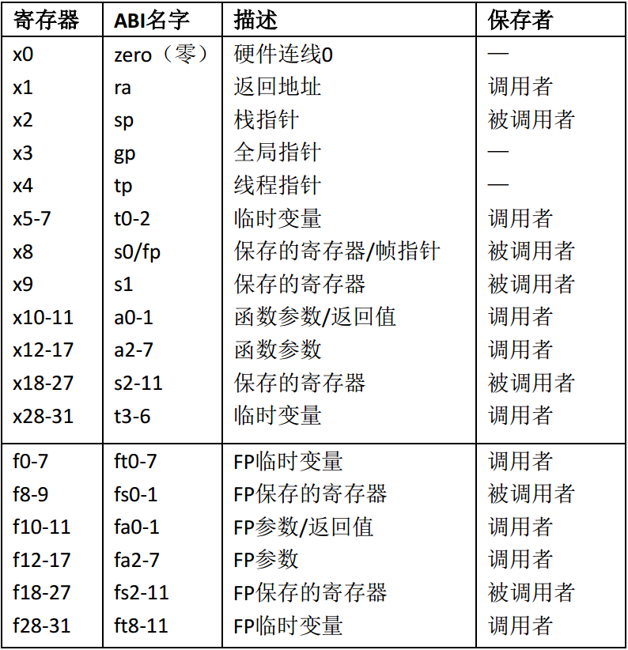

**表 2**  mcause&ccause异常描述表

<a name="zh-cn_topic_0000002411207056_table349710585554"></a>
<table><thead align="left"><tr id="zh-cn_topic_0000002411207056_row6497105820558"><th class="cellrowborder" valign="top" width="15.68%" id="mcps1.2.4.1.1"><p id="zh-cn_topic_0000002411207056_p94972588556"><a name="zh-cn_topic_0000002411207056_p94972588556"></a><a name="zh-cn_topic_0000002411207056_p94972588556"></a>异常码</p>
</th>
<th class="cellrowborder" valign="top" width="44.13%" id="mcps1.2.4.1.2"><p id="zh-cn_topic_0000002411207056_p54971586557"><a name="zh-cn_topic_0000002411207056_p54971586557"></a><a name="zh-cn_topic_0000002411207056_p54971586557"></a>mcause异常描述</p>
</th>
<th class="cellrowborder" valign="top" width="40.19%" id="mcps1.2.4.1.3"><p id="zh-cn_topic_0000002411207056_p04981958155512"><a name="zh-cn_topic_0000002411207056_p04981958155512"></a><a name="zh-cn_topic_0000002411207056_p04981958155512"></a>ccause异常描述</p>
</th>
</tr>
</thead>
<tbody><tr id="zh-cn_topic_0000002411207056_row204988584551"><td class="cellrowborder" valign="top" width="15.68%" headers="mcps1.2.4.1.1 "><p id="zh-cn_topic_0000002411207056_p1949895895513"><a name="zh-cn_topic_0000002411207056_p1949895895513"></a><a name="zh-cn_topic_0000002411207056_p1949895895513"></a>0x0</p>
</td>
<td class="cellrowborder" valign="top" width="44.13%" headers="mcps1.2.4.1.2 "><p id="zh-cn_topic_0000002411207056_p2498105815510"><a name="zh-cn_topic_0000002411207056_p2498105815510"></a><a name="zh-cn_topic_0000002411207056_p2498105815510"></a>Instruction address misaligned</p>
</td>
<td class="cellrowborder" valign="top" width="40.19%" headers="mcps1.2.4.1.3 "><p id="zh-cn_topic_0000002411207056_p0498155810551"><a name="zh-cn_topic_0000002411207056_p0498155810551"></a><a name="zh-cn_topic_0000002411207056_p0498155810551"></a>Not available</p>
</td>
</tr>
<tr id="zh-cn_topic_0000002411207056_row54981582554"><td class="cellrowborder" valign="top" width="15.68%" headers="mcps1.2.4.1.1 "><p id="zh-cn_topic_0000002411207056_p102006432594"><a name="zh-cn_topic_0000002411207056_p102006432594"></a><a name="zh-cn_topic_0000002411207056_p102006432594"></a>0x1</p>
</td>
<td class="cellrowborder" valign="top" width="44.13%" headers="mcps1.2.4.1.2 "><p id="zh-cn_topic_0000002411207056_p12498458105520"><a name="zh-cn_topic_0000002411207056_p12498458105520"></a><a name="zh-cn_topic_0000002411207056_p12498458105520"></a>Instruction access fault</p>
</td>
<td class="cellrowborder" valign="top" width="40.19%" headers="mcps1.2.4.1.3 "><p id="zh-cn_topic_0000002411207056_p64981585551"><a name="zh-cn_topic_0000002411207056_p64981585551"></a><a name="zh-cn_topic_0000002411207056_p64981585551"></a>Memory map region access fault</p>
</td>
</tr>
<tr id="zh-cn_topic_0000002411207056_row1149814587552"><td class="cellrowborder" valign="top" width="15.68%" headers="mcps1.2.4.1.1 "><p id="zh-cn_topic_0000002411207056_p44981358105510"><a name="zh-cn_topic_0000002411207056_p44981358105510"></a><a name="zh-cn_topic_0000002411207056_p44981358105510"></a>0x2</p>
</td>
<td class="cellrowborder" valign="top" width="44.13%" headers="mcps1.2.4.1.2 "><p id="zh-cn_topic_0000002411207056_p849855805510"><a name="zh-cn_topic_0000002411207056_p849855805510"></a><a name="zh-cn_topic_0000002411207056_p849855805510"></a>Illegal instruction</p>
</td>
<td class="cellrowborder" valign="top" width="40.19%" headers="mcps1.2.4.1.3 "><p id="zh-cn_topic_0000002411207056_p1749812588553"><a name="zh-cn_topic_0000002411207056_p1749812588553"></a><a name="zh-cn_topic_0000002411207056_p1749812588553"></a>AXIM error response</p>
</td>
</tr>
<tr id="zh-cn_topic_0000002411207056_row17498175835510"><td class="cellrowborder" valign="top" width="15.68%" headers="mcps1.2.4.1.1 "><p id="zh-cn_topic_0000002411207056_p24981958105516"><a name="zh-cn_topic_0000002411207056_p24981958105516"></a><a name="zh-cn_topic_0000002411207056_p24981958105516"></a>0x3</p>
</td>
<td class="cellrowborder" valign="top" width="44.13%" headers="mcps1.2.4.1.2 "><p id="zh-cn_topic_0000002411207056_p9498125865517"><a name="zh-cn_topic_0000002411207056_p9498125865517"></a><a name="zh-cn_topic_0000002411207056_p9498125865517"></a>Breakpoint</p>
</td>
<td class="cellrowborder" valign="top" width="40.19%" headers="mcps1.2.4.1.3 "><p id="zh-cn_topic_0000002411207056_p1499105814555"><a name="zh-cn_topic_0000002411207056_p1499105814555"></a><a name="zh-cn_topic_0000002411207056_p1499105814555"></a>AHBM error response</p>
</td>
</tr>
<tr id="zh-cn_topic_0000002411207056_row114991558175514"><td class="cellrowborder" valign="top" width="15.68%" headers="mcps1.2.4.1.1 "><p id="zh-cn_topic_0000002411207056_p2499185813555"><a name="zh-cn_topic_0000002411207056_p2499185813555"></a><a name="zh-cn_topic_0000002411207056_p2499185813555"></a>0x4</p>
</td>
<td class="cellrowborder" valign="top" width="44.13%" headers="mcps1.2.4.1.2 "><p id="zh-cn_topic_0000002411207056_p164995588559"><a name="zh-cn_topic_0000002411207056_p164995588559"></a><a name="zh-cn_topic_0000002411207056_p164995588559"></a>Load address misaligned</p>
</td>
<td class="cellrowborder" valign="top" width="40.19%" headers="mcps1.2.4.1.3 "><p id="zh-cn_topic_0000002411207056_p6500758115511"><a name="zh-cn_topic_0000002411207056_p6500758115511"></a><a name="zh-cn_topic_0000002411207056_p6500758115511"></a>Crossing PMP entries</p>
</td>
</tr>
<tr id="zh-cn_topic_0000002411207056_row650018588556"><td class="cellrowborder" valign="top" width="15.68%" headers="mcps1.2.4.1.1 "><p id="zh-cn_topic_0000002411207056_p050065845510"><a name="zh-cn_topic_0000002411207056_p050065845510"></a><a name="zh-cn_topic_0000002411207056_p050065845510"></a>0x5</p>
</td>
<td class="cellrowborder" valign="top" width="44.13%" headers="mcps1.2.4.1.2 "><p id="zh-cn_topic_0000002411207056_p1250055820559"><a name="zh-cn_topic_0000002411207056_p1250055820559"></a><a name="zh-cn_topic_0000002411207056_p1250055820559"></a>Load access fault</p>
</td>
<td class="cellrowborder" valign="top" width="40.19%" headers="mcps1.2.4.1.3 "><p id="zh-cn_topic_0000002411207056_p1250025819557"><a name="zh-cn_topic_0000002411207056_p1250025819557"></a><a name="zh-cn_topic_0000002411207056_p1250025819557"></a>System register access fault</p>
</td>
</tr>
<tr id="zh-cn_topic_0000002411207056_row11501558135518"><td class="cellrowborder" valign="top" width="15.68%" headers="mcps1.2.4.1.1 "><p id="zh-cn_topic_0000002411207056_p16501758125520"><a name="zh-cn_topic_0000002411207056_p16501758125520"></a><a name="zh-cn_topic_0000002411207056_p16501758125520"></a>0x6</p>
</td>
<td class="cellrowborder" valign="top" width="44.13%" headers="mcps1.2.4.1.2 "><p id="zh-cn_topic_0000002411207056_p350175815518"><a name="zh-cn_topic_0000002411207056_p350175815518"></a><a name="zh-cn_topic_0000002411207056_p350175815518"></a>Store/AMO address misaligned</p>
</td>
<td class="cellrowborder" valign="top" width="40.19%" headers="mcps1.2.4.1.3 "><p id="zh-cn_topic_0000002411207056_p13501105865514"><a name="zh-cn_topic_0000002411207056_p13501105865514"></a><a name="zh-cn_topic_0000002411207056_p13501105865514"></a>No PMP entry matched</p>
</td>
</tr>
<tr id="zh-cn_topic_0000002411207056_row85012058175517"><td class="cellrowborder" valign="top" width="15.68%" headers="mcps1.2.4.1.1 "><p id="zh-cn_topic_0000002411207056_p175017585553"><a name="zh-cn_topic_0000002411207056_p175017585553"></a><a name="zh-cn_topic_0000002411207056_p175017585553"></a>0x7</p>
</td>
<td class="cellrowborder" valign="top" width="44.13%" headers="mcps1.2.4.1.2 "><p id="zh-cn_topic_0000002411207056_p105018585556"><a name="zh-cn_topic_0000002411207056_p105018585556"></a><a name="zh-cn_topic_0000002411207056_p105018585556"></a>Store/AMO access fault</p>
</td>
<td class="cellrowborder" valign="top" width="40.19%" headers="mcps1.2.4.1.3 "><p id="zh-cn_topic_0000002411207056_p5501105817553"><a name="zh-cn_topic_0000002411207056_p5501105817553"></a><a name="zh-cn_topic_0000002411207056_p5501105817553"></a>PMP access fault</p>
</td>
</tr>
<tr id="zh-cn_topic_0000002411207056_row1950195816557"><td class="cellrowborder" valign="top" width="15.68%" headers="mcps1.2.4.1.1 "><p id="zh-cn_topic_0000002411207056_p1250120588557"><a name="zh-cn_topic_0000002411207056_p1250120588557"></a><a name="zh-cn_topic_0000002411207056_p1250120588557"></a>0x8</p>
</td>
<td class="cellrowborder" valign="top" width="44.13%" headers="mcps1.2.4.1.2 "><p id="zh-cn_topic_0000002411207056_p1650125813555"><a name="zh-cn_topic_0000002411207056_p1650125813555"></a><a name="zh-cn_topic_0000002411207056_p1650125813555"></a>Environment call from U-mode</p>
</td>
<td class="cellrowborder" valign="top" width="40.19%" headers="mcps1.2.4.1.3 "><p id="zh-cn_topic_0000002411207056_p1950165885513"><a name="zh-cn_topic_0000002411207056_p1950165885513"></a><a name="zh-cn_topic_0000002411207056_p1950165885513"></a>CMO access fault</p>
</td>
</tr>
<tr id="zh-cn_topic_0000002411207056_row10501105875514"><td class="cellrowborder" valign="top" width="15.68%" headers="mcps1.2.4.1.1 "><p id="zh-cn_topic_0000002411207056_p850111588558"><a name="zh-cn_topic_0000002411207056_p850111588558"></a><a name="zh-cn_topic_0000002411207056_p850111588558"></a>0x9</p>
</td>
<td class="cellrowborder" valign="top" width="44.13%" headers="mcps1.2.4.1.2 "><p id="zh-cn_topic_0000002411207056_p7693831744"><a name="zh-cn_topic_0000002411207056_p7693831744"></a><a name="zh-cn_topic_0000002411207056_p7693831744"></a>Environment call from S-mode</p>
</td>
<td class="cellrowborder" valign="top" width="40.19%" headers="mcps1.2.4.1.3 "><p id="zh-cn_topic_0000002411207056_p1250185865514"><a name="zh-cn_topic_0000002411207056_p1250185865514"></a><a name="zh-cn_topic_0000002411207056_p1250185865514"></a>CSR access fault</p>
</td>
</tr>
<tr id="zh-cn_topic_0000002411207056_row175013580553"><td class="cellrowborder" valign="top" width="15.68%" headers="mcps1.2.4.1.1 "><p id="zh-cn_topic_0000002411207056_p17501155813558"><a name="zh-cn_topic_0000002411207056_p17501155813558"></a><a name="zh-cn_topic_0000002411207056_p17501155813558"></a>0xA</p>
</td>
<td class="cellrowborder" valign="top" width="44.13%" headers="mcps1.2.4.1.2 "><p id="zh-cn_topic_0000002411207056_p02523325418"><a name="zh-cn_topic_0000002411207056_p02523325418"></a><a name="zh-cn_topic_0000002411207056_p02523325418"></a>Reserved</p>
</td>
<td class="cellrowborder" valign="top" width="40.19%" headers="mcps1.2.4.1.3 "><p id="zh-cn_topic_0000002411207056_p2050120588551"><a name="zh-cn_topic_0000002411207056_p2050120588551"></a><a name="zh-cn_topic_0000002411207056_p2050120588551"></a>LDM/STMIA instruction</p>
</td>
</tr>
<tr id="zh-cn_topic_0000002411207056_row10501105814557"><td class="cellrowborder" valign="top" width="15.68%" headers="mcps1.2.4.1.1 "><p id="zh-cn_topic_0000002411207056_p15501115819555"><a name="zh-cn_topic_0000002411207056_p15501115819555"></a><a name="zh-cn_topic_0000002411207056_p15501115819555"></a>0xB</p>
</td>
<td class="cellrowborder" valign="top" width="44.13%" headers="mcps1.2.4.1.2 "><p id="zh-cn_topic_0000002411207056_p145011058175510"><a name="zh-cn_topic_0000002411207056_p145011058175510"></a><a name="zh-cn_topic_0000002411207056_p145011058175510"></a>Environment call from M-mode</p>
</td>
<td class="cellrowborder" valign="top" width="40.19%" headers="mcps1.2.4.1.3 "><p id="zh-cn_topic_0000002411207056_p1350165816551"><a name="zh-cn_topic_0000002411207056_p1350165816551"></a><a name="zh-cn_topic_0000002411207056_p1350165816551"></a>ITCM write access fault</p>
</td>
</tr>
<tr id="zh-cn_topic_0000002411207056_row75011581553"><td class="cellrowborder" valign="top" width="15.68%" headers="mcps1.2.4.1.1 "><p id="zh-cn_topic_0000002411207056_p125011558105513"><a name="zh-cn_topic_0000002411207056_p125011558105513"></a><a name="zh-cn_topic_0000002411207056_p125011558105513"></a>0xC</p>
</td>
<td class="cellrowborder" valign="top" width="44.13%" headers="mcps1.2.4.1.2 "><p id="zh-cn_topic_0000002411207056_p15501258135511"><a name="zh-cn_topic_0000002411207056_p15501258135511"></a><a name="zh-cn_topic_0000002411207056_p15501258135511"></a>Instruction page fault</p>
</td>
<td class="cellrowborder" valign="top" width="40.19%" headers="mcps1.2.4.1.3 "><p id="zh-cn_topic_0000002411207056_p145031958105511"><a name="zh-cn_topic_0000002411207056_p145031958105511"></a><a name="zh-cn_topic_0000002411207056_p145031958105511"></a>Not available</p>
</td>
</tr>
<tr id="zh-cn_topic_0000002411207056_row10503125825516"><td class="cellrowborder" valign="top" width="15.68%" headers="mcps1.2.4.1.1 "><p id="zh-cn_topic_0000002411207056_p14503858115514"><a name="zh-cn_topic_0000002411207056_p14503858115514"></a><a name="zh-cn_topic_0000002411207056_p14503858115514"></a>0xD</p>
</td>
<td class="cellrowborder" valign="top" width="44.13%" headers="mcps1.2.4.1.2 "><p id="zh-cn_topic_0000002411207056_p20503125814554"><a name="zh-cn_topic_0000002411207056_p20503125814554"></a><a name="zh-cn_topic_0000002411207056_p20503125814554"></a>Load page fault</p>
</td>
<td class="cellrowborder" valign="top" width="40.19%" headers="mcps1.2.4.1.3 "><p id="zh-cn_topic_0000002411207056_p1250319581557"><a name="zh-cn_topic_0000002411207056_p1250319581557"></a><a name="zh-cn_topic_0000002411207056_p1250319581557"></a>Not available</p>
</td>
</tr>
<tr id="zh-cn_topic_0000002411207056_row850325875515"><td class="cellrowborder" valign="top" width="15.68%" headers="mcps1.2.4.1.1 "><p id="zh-cn_topic_0000002411207056_p1950315865519"><a name="zh-cn_topic_0000002411207056_p1950315865519"></a><a name="zh-cn_topic_0000002411207056_p1950315865519"></a>0xE</p>
</td>
<td class="cellrowborder" valign="top" width="44.13%" headers="mcps1.2.4.1.2 "><p id="zh-cn_topic_0000002411207056_p950318582553"><a name="zh-cn_topic_0000002411207056_p950318582553"></a><a name="zh-cn_topic_0000002411207056_p950318582553"></a>Reserved</p>
</td>
<td class="cellrowborder" valign="top" width="40.19%" headers="mcps1.2.4.1.3 "><p id="zh-cn_topic_0000002411207056_p11503135810550"><a name="zh-cn_topic_0000002411207056_p11503135810550"></a><a name="zh-cn_topic_0000002411207056_p11503135810550"></a>Not available</p>
</td>
</tr>
<tr id="zh-cn_topic_0000002411207056_row195031758175511"><td class="cellrowborder" valign="top" width="15.68%" headers="mcps1.2.4.1.1 "><p id="zh-cn_topic_0000002411207056_p115035586556"><a name="zh-cn_topic_0000002411207056_p115035586556"></a><a name="zh-cn_topic_0000002411207056_p115035586556"></a>0xF</p>
</td>
<td class="cellrowborder" valign="top" width="44.13%" headers="mcps1.2.4.1.2 "><p id="zh-cn_topic_0000002411207056_p165034584555"><a name="zh-cn_topic_0000002411207056_p165034584555"></a><a name="zh-cn_topic_0000002411207056_p165034584555"></a>Store/AMO page fault</p>
</td>
<td class="cellrowborder" valign="top" width="40.19%" headers="mcps1.2.4.1.3 "><p id="zh-cn_topic_0000002411207056_p1250335815514"><a name="zh-cn_topic_0000002411207056_p1250335815514"></a><a name="zh-cn_topic_0000002411207056_p1250335815514"></a>Not available</p>
</td>
</tr>
<tr id="zh-cn_topic_0000002411207056_row850335811557"><td class="cellrowborder" valign="top" width="15.68%" headers="mcps1.2.4.1.1 "><p id="zh-cn_topic_0000002411207056_p4503858195518"><a name="zh-cn_topic_0000002411207056_p4503858195518"></a><a name="zh-cn_topic_0000002411207056_p4503858195518"></a>0xFFF</p>
</td>
<td class="cellrowborder" valign="top" width="44.13%" headers="mcps1.2.4.1.2 "><p id="zh-cn_topic_0000002411207056_p19503135845514"><a name="zh-cn_topic_0000002411207056_p19503135845514"></a><a name="zh-cn_topic_0000002411207056_p19503135845514"></a>NMI interrupt</p>
</td>
<td class="cellrowborder" valign="top" width="40.19%" headers="mcps1.2.4.1.3 "><p id="zh-cn_topic_0000002411207056_p350315585555"><a name="zh-cn_topic_0000002411207056_p350315585555"></a><a name="zh-cn_topic_0000002411207056_p350315585555"></a>Not available</p>
</td>
</tr>
</tbody>
</table>

#### 函数调用栈信息<a name="ZH-CN_TOPIC_0000002499581397"></a>

函数调用栈call stack会显示与异常相关的所有函数调用指令。用户可以根据函数调用栈检查异常发生时函数调用的上下文定位。其中call back 0为栈顶函数，其对应的ra为栈顶函数的地址，以此类推。

用户可以到“output/3322/acore/diting-community/application.lst”中找到对应的函数。

### Flash中的死机文件信息查看<a name="ZH-CN_TOPIC_0000002466542088"></a>

按照“[Flash中的死机文件获取](#ZH-CN_TOPIC_0000002466382344)”中的描述，从Flash中导出的死机文件为二进制文件，需使用死机信息解析脚本（dump\_parser）解析后查看。

死机信息解析脚本支持在Windows和Linux环境下运行，可解析从Flash中读出的A核和BT核死机信息。

-   Linux运行方式：进入脚本目录给予脚本可执行权限并运行下列命令，结果如[图1](#zh-cn_topic_0000002411207076_fig4383165643113)所示。

    chmod +x run\_hi3322.sh

    ./run\_hi3322.sh <死机信息文件路径\> \[lst 文件路径（可选）\]

    **图 1**  Linux环境运行死机脚本工具<a name="zh-cn_topic_0000002411207076_fig4383165643113"></a>  
    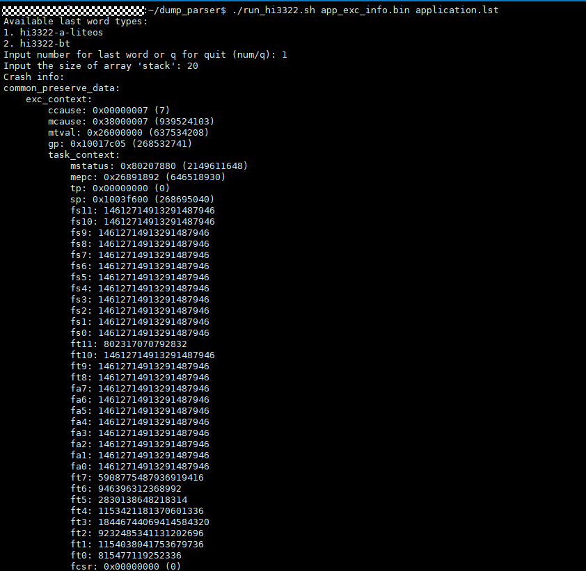

    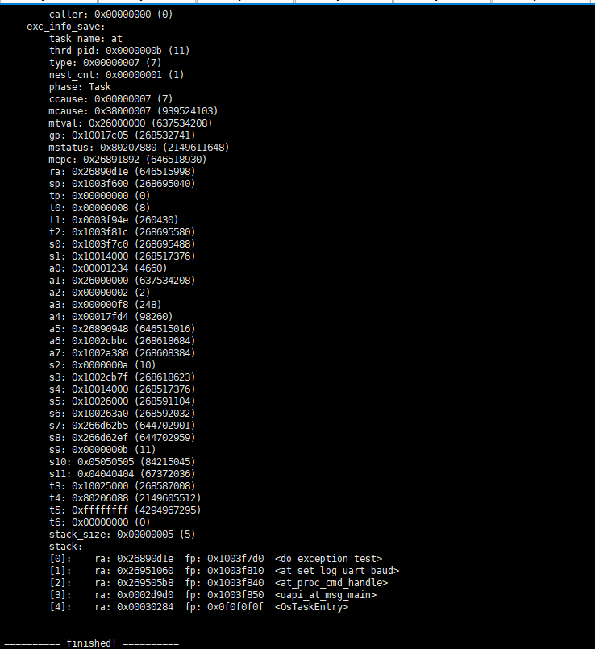

-   Windows运行方式：在脚本目录下打开命令提示符，运行下列命令即可开始解析，结果如[图2](#zh-cn_topic_0000002411207076_fig7783132713319)所示。

    run.bat <死机信息文件路径\> \[lst 文件路径（可选）\]

    **图 2**  Windows环境运行死机脚本工具<a name="zh-cn_topic_0000002411207076_fig7783132713319"></a>  
    
    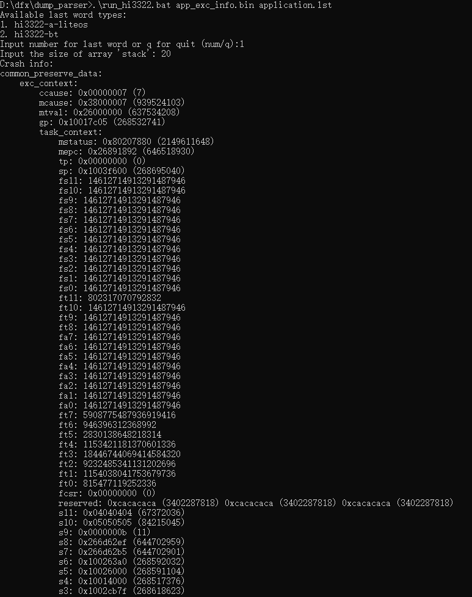

    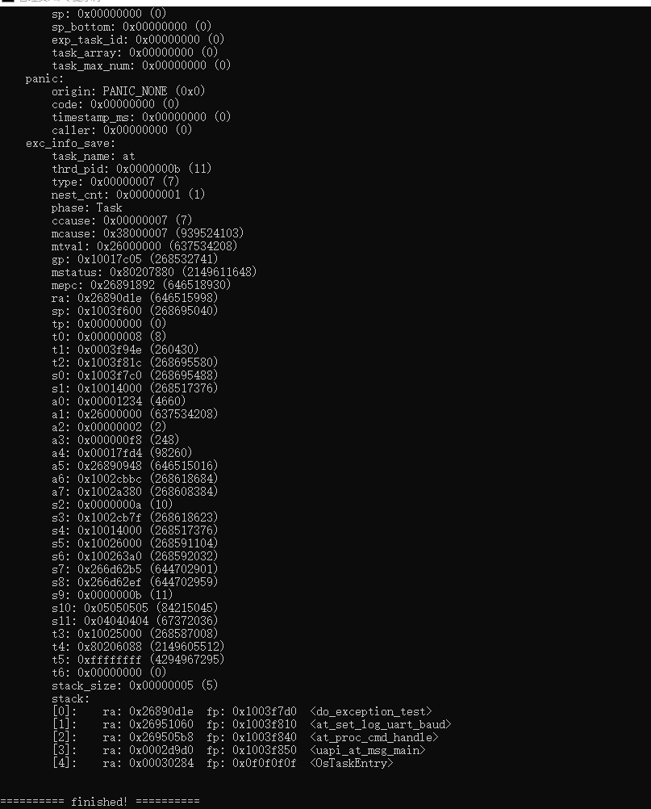

    Flash死机文件解析后的具体内容以及含义，A核的死机信息可参考“[串口死机信息查看](#ZH-CN_TOPIC_0000002499501381)”；BT核的死机信息，可参考“[last word信息查看](#ZH-CN_TOPIC_0000002499581381)”。

> **说明：** 
>使用中的常见问题：
>-   运行死机文件解析脚本需要安装Python 3.8及以上版本，并将安装路径配置到系统环境变量。建议可在执行解析脚本之前先运行python命令判断是否满足条件。如下所示：
>    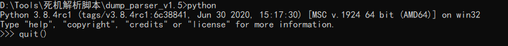
>-   运行死机文件解析脚本需要安装pycparser库，如运行时提示找不到pycparser，可使用“pip install pycparser”命令安装pycparser库。

### 通过DebugKits获取的死机信息查看<a name="ZH-CN_TOPIC_0000002466382424"></a>

-   **[last word信息查看](#ZH-CN_TOPIC_0000002499581381)**  

-   **[last dump信息查看](#ZH-CN_TOPIC_0000002466382368)**  

#### last word信息查看<a name="ZH-CN_TOPIC_0000002499581381"></a>

如“[获取last word信息](#ZH-CN_TOPIC_0000002499581357)”中描述，在发生死机故障时，会将last word信息发送到DebugKits工具上。

last word上报的内容及含义如[表1](#zh-cn_topic_0000002411047200_table32188330)所示（具体含义中括号里面的为代称）。

**表 1**  last word内容

<a name="zh-cn_topic_0000002411047200_table32188330"></a>
<table><thead align="left"><tr id="zh-cn_topic_0000002411047200_row132168232"><th class="cellrowborder" valign="top" width="29.82%" id="mcps1.2.3.1.1"><p id="zh-cn_topic_0000002411047200_p14211086312"><a name="zh-cn_topic_0000002411047200_p14211086312"></a><a name="zh-cn_topic_0000002411047200_p14211086312"></a>变量名称</p>
</th>
<th class="cellrowborder" valign="top" width="70.17999999999999%" id="mcps1.2.3.1.2"><p id="zh-cn_topic_0000002411047200_p521186311"><a name="zh-cn_topic_0000002411047200_p521186311"></a><a name="zh-cn_topic_0000002411047200_p521186311"></a>具体含义</p>
</th>
</tr>
</thead>
<tbody><tr id="zh-cn_topic_0000002411047200_row2021481336"><td class="cellrowborder" valign="top" width="29.82%" headers="mcps1.2.3.1.1 "><p id="zh-cn_topic_0000002411047200_p1721781136"><a name="zh-cn_topic_0000002411047200_p1721781136"></a><a name="zh-cn_topic_0000002411047200_p1721781136"></a>stack_limit</p>
</td>
<td class="cellrowborder" valign="top" width="70.17999999999999%" headers="mcps1.2.3.1.2 "><p id="zh-cn_topic_0000002411047200_p321981832"><a name="zh-cn_topic_0000002411047200_p321981832"></a><a name="zh-cn_topic_0000002411047200_p321981832"></a>系统栈大小。</p>
</td>
</tr>
<tr id="zh-cn_topic_0000002411047200_row1521681638"><td class="cellrowborder" valign="top" width="29.82%" headers="mcps1.2.3.1.1 "><p id="zh-cn_topic_0000002411047200_p16211080317"><a name="zh-cn_topic_0000002411047200_p16211080317"></a><a name="zh-cn_topic_0000002411047200_p16211080317"></a>fault_type</p>
</td>
<td class="cellrowborder" valign="top" width="70.17999999999999%" headers="mcps1.2.3.1.2 "><p id="zh-cn_topic_0000002411047200_p721881238"><a name="zh-cn_topic_0000002411047200_p721881238"></a><a name="zh-cn_topic_0000002411047200_p721881238"></a>错误类型（mcause）。其中NMI interrupt在A核为0x80000FFF，在BT核为0x8000000C。</p>
</td>
</tr>
<tr id="zh-cn_topic_0000002411047200_row0213819318"><td class="cellrowborder" valign="top" width="29.82%" headers="mcps1.2.3.1.1 "><p id="zh-cn_topic_0000002411047200_p421481031"><a name="zh-cn_topic_0000002411047200_p421481031"></a><a name="zh-cn_topic_0000002411047200_p421481031"></a>fault_address</p>
</td>
<td class="cellrowborder" valign="top" width="70.17999999999999%" headers="mcps1.2.3.1.2 "><p id="zh-cn_topic_0000002411047200_p1211811317"><a name="zh-cn_topic_0000002411047200_p1211811317"></a><a name="zh-cn_topic_0000002411047200_p1211811317"></a>错误地址，属性值无意义。</p>
</td>
</tr>
<tr id="zh-cn_topic_0000002411047200_row921208930"><td class="cellrowborder" valign="top" width="29.82%" headers="mcps1.2.3.1.1 "><p id="zh-cn_topic_0000002411047200_p1821288317"><a name="zh-cn_topic_0000002411047200_p1821288317"></a><a name="zh-cn_topic_0000002411047200_p1821288317"></a>fault_reason</p>
</td>
<td class="cellrowborder" valign="top" width="70.17999999999999%" headers="mcps1.2.3.1.2 "><p id="zh-cn_topic_0000002411047200_p121818339414"><a name="zh-cn_topic_0000002411047200_p121818339414"></a><a name="zh-cn_topic_0000002411047200_p121818339414"></a>错误原因，属性值无意义。</p>
</td>
</tr>
<tr id="zh-cn_topic_0000002411047200_row182112819317"><td class="cellrowborder" valign="top" width="29.82%" headers="mcps1.2.3.1.1 "><p id="zh-cn_topic_0000002411047200_p15211281633"><a name="zh-cn_topic_0000002411047200_p15211281633"></a><a name="zh-cn_topic_0000002411047200_p15211281633"></a>reg_value</p>
</td>
<td class="cellrowborder" valign="top" width="70.17999999999999%" headers="mcps1.2.3.1.2 "><p id="zh-cn_topic_0000002411047200_p16211282314"><a name="zh-cn_topic_0000002411047200_p16211282314"></a><a name="zh-cn_topic_0000002411047200_p16211282314"></a>保存寄存器值。</p>
</td>
</tr>
<tr id="zh-cn_topic_0000002411047200_row9211682313"><td class="cellrowborder" valign="top" width="29.82%" headers="mcps1.2.3.1.1 "><p id="zh-cn_topic_0000002411047200_p1922158931"><a name="zh-cn_topic_0000002411047200_p1922158931"></a><a name="zh-cn_topic_0000002411047200_p1922158931"></a>psp_value</p>
</td>
<td class="cellrowborder" valign="top" width="70.17999999999999%" headers="mcps1.2.3.1.2 "><p id="zh-cn_topic_0000002411047200_p1522198635"><a name="zh-cn_topic_0000002411047200_p1522198635"></a><a name="zh-cn_topic_0000002411047200_p1522198635"></a>栈指针（sp）。</p>
</td>
</tr>
<tr id="zh-cn_topic_0000002411047200_row22248238"><td class="cellrowborder" valign="top" width="29.82%" headers="mcps1.2.3.1.1 "><p id="zh-cn_topic_0000002411047200_p172213816319"><a name="zh-cn_topic_0000002411047200_p172213816319"></a><a name="zh-cn_topic_0000002411047200_p172213816319"></a>lr_value</p>
</td>
<td class="cellrowborder" valign="top" width="70.17999999999999%" headers="mcps1.2.3.1.2 "><p id="zh-cn_topic_0000002411047200_p1122178435"><a name="zh-cn_topic_0000002411047200_p1122178435"></a><a name="zh-cn_topic_0000002411047200_p1122178435"></a>返回地址（ra）。</p>
</td>
</tr>
<tr id="zh-cn_topic_0000002411047200_row1221681316"><td class="cellrowborder" valign="top" width="29.82%" headers="mcps1.2.3.1.1 "><p id="zh-cn_topic_0000002411047200_p15226814313"><a name="zh-cn_topic_0000002411047200_p15226814313"></a><a name="zh-cn_topic_0000002411047200_p15226814313"></a>pc_value</p>
</td>
<td class="cellrowborder" valign="top" width="70.17999999999999%" headers="mcps1.2.3.1.2 "><p id="zh-cn_topic_0000002411047200_p202208236"><a name="zh-cn_topic_0000002411047200_p202208236"></a><a name="zh-cn_topic_0000002411047200_p202208236"></a>发生错误的指令地址（mepc）。</p>
</td>
</tr>
<tr id="zh-cn_topic_0000002411047200_row1022188317"><td class="cellrowborder" valign="top" width="29.82%" headers="mcps1.2.3.1.1 "><p id="zh-cn_topic_0000002411047200_p4221181739"><a name="zh-cn_topic_0000002411047200_p4221181739"></a><a name="zh-cn_topic_0000002411047200_p4221181739"></a>psps_value</p>
</td>
<td class="cellrowborder" valign="top" width="70.17999999999999%" headers="mcps1.2.3.1.2 "><p id="zh-cn_topic_0000002411047200_p192217815312"><a name="zh-cn_topic_0000002411047200_p192217815312"></a><a name="zh-cn_topic_0000002411047200_p192217815312"></a>全局指针（gp）。</p>
</td>
</tr>
<tr id="zh-cn_topic_0000002411047200_row1822148636"><td class="cellrowborder" valign="top" width="29.82%" headers="mcps1.2.3.1.1 "><p id="zh-cn_topic_0000002411047200_p6221281433"><a name="zh-cn_topic_0000002411047200_p6221281433"></a><a name="zh-cn_topic_0000002411047200_p6221281433"></a>primask_value</p>
</td>
<td class="cellrowborder" valign="top" width="70.17999999999999%" headers="mcps1.2.3.1.2 "><p id="zh-cn_topic_0000002411047200_p15221689316"><a name="zh-cn_topic_0000002411047200_p15221689316"></a><a name="zh-cn_topic_0000002411047200_p15221689316"></a>异常状态寄存器（mstatus）。</p>
</td>
</tr>
<tr id="zh-cn_topic_0000002411047200_row322988310"><td class="cellrowborder" valign="top" width="29.82%" headers="mcps1.2.3.1.1 "><p id="zh-cn_topic_0000002411047200_p1422682030"><a name="zh-cn_topic_0000002411047200_p1422682030"></a><a name="zh-cn_topic_0000002411047200_p1422682030"></a>fault_mask_value</p>
</td>
<td class="cellrowborder" valign="top" width="70.17999999999999%" headers="mcps1.2.3.1.2 "><p id="zh-cn_topic_0000002411047200_p8221485314"><a name="zh-cn_topic_0000002411047200_p8221485314"></a><a name="zh-cn_topic_0000002411047200_p8221485314"></a>CPU访问异常地址或异常值（mtval）。</p>
</td>
</tr>
<tr id="zh-cn_topic_0000002411047200_row1522385318"><td class="cellrowborder" valign="top" width="29.82%" headers="mcps1.2.3.1.1 "><p id="zh-cn_topic_0000002411047200_p10224819314"><a name="zh-cn_topic_0000002411047200_p10224819314"></a><a name="zh-cn_topic_0000002411047200_p10224819314"></a>bserpri_value</p>
</td>
<td class="cellrowborder" valign="top" width="70.17999999999999%" headers="mcps1.2.3.1.2 "><p id="zh-cn_topic_0000002411047200_p13221181531"><a name="zh-cn_topic_0000002411047200_p13221181531"></a><a name="zh-cn_topic_0000002411047200_p13221181531"></a>自定义异常状态寄存器（ccause）。</p>
</td>
</tr>
<tr id="zh-cn_topic_0000002411047200_row12227818311"><td class="cellrowborder" valign="top" width="29.82%" headers="mcps1.2.3.1.1 "><p id="zh-cn_topic_0000002411047200_p8221781932"><a name="zh-cn_topic_0000002411047200_p8221781932"></a><a name="zh-cn_topic_0000002411047200_p8221781932"></a>control_value</p>
</td>
<td class="cellrowborder" valign="top" width="70.17999999999999%" headers="mcps1.2.3.1.2 "><p id="zh-cn_topic_0000002411047200_p6727111512519"><a name="zh-cn_topic_0000002411047200_p6727111512519"></a><a name="zh-cn_topic_0000002411047200_p6727111512519"></a>CPU访问异常地址或异常值（mtval）。</p>
</td>
</tr>
</tbody>
</table>

对于last word内容中保存的寄存器的值（reg\_value），其个数和具体含义A核和BT核有所不同。

具体含义如[表2](#zh-cn_topic_0000002411047200_table16496164717509)和[表3](#zh-cn_topic_0000002411047200_table1170451225317)所示。

**表 2**  A核last word中reg\_value成员含义

<a name="zh-cn_topic_0000002411047200_table16496164717509"></a>
<table><thead align="left"><tr id="zh-cn_topic_0000002411047200_row949644775019"><th class="cellrowborder" valign="top" width="33.96%" id="mcps1.2.3.1.1"><p id="zh-cn_topic_0000002411047200_p10496134712503"><a name="zh-cn_topic_0000002411047200_p10496134712503"></a><a name="zh-cn_topic_0000002411047200_p10496134712503"></a>成员名称</p>
</th>
<th class="cellrowborder" valign="top" width="66.03999999999999%" id="mcps1.2.3.1.2"><p id="zh-cn_topic_0000002411047200_p349620477502"><a name="zh-cn_topic_0000002411047200_p349620477502"></a><a name="zh-cn_topic_0000002411047200_p349620477502"></a>成员含义</p>
</th>
</tr>
</thead>
<tbody><tr id="zh-cn_topic_0000002411047200_row149744710505"><td class="cellrowborder" valign="top" width="33.96%" headers="mcps1.2.3.1.1 "><p id="zh-cn_topic_0000002411047200_p1249764755017"><a name="zh-cn_topic_0000002411047200_p1249764755017"></a><a name="zh-cn_topic_0000002411047200_p1249764755017"></a>reg_value[0]</p>
</td>
<td class="cellrowborder" valign="top" width="66.03999999999999%" headers="mcps1.2.3.1.2 "><p id="zh-cn_topic_0000002411047200_p949718471504"><a name="zh-cn_topic_0000002411047200_p949718471504"></a><a name="zh-cn_topic_0000002411047200_p949718471504"></a>无意义</p>
</td>
</tr>
<tr id="zh-cn_topic_0000002411047200_row11497144711501"><td class="cellrowborder" valign="top" width="33.96%" headers="mcps1.2.3.1.1 "><p id="zh-cn_topic_0000002411047200_p11393645125612"><a name="zh-cn_topic_0000002411047200_p11393645125612"></a><a name="zh-cn_topic_0000002411047200_p11393645125612"></a>reg_value[1]</p>
</td>
<td class="cellrowborder" valign="top" width="66.03999999999999%" headers="mcps1.2.3.1.2 "><p id="zh-cn_topic_0000002411047200_p184975478503"><a name="zh-cn_topic_0000002411047200_p184975478503"></a><a name="zh-cn_topic_0000002411047200_p184975478503"></a>返回地址（ra）</p>
</td>
</tr>
<tr id="zh-cn_topic_0000002411047200_row1817123814524"><td class="cellrowborder" valign="top" width="33.96%" headers="mcps1.2.3.1.1 "><p id="zh-cn_topic_0000002411047200_p7981144555618"><a name="zh-cn_topic_0000002411047200_p7981144555618"></a><a name="zh-cn_topic_0000002411047200_p7981144555618"></a>reg_value[2]</p>
</td>
<td class="cellrowborder" valign="top" width="66.03999999999999%" headers="mcps1.2.3.1.2 "><p id="zh-cn_topic_0000002411047200_p17172133812521"><a name="zh-cn_topic_0000002411047200_p17172133812521"></a><a name="zh-cn_topic_0000002411047200_p17172133812521"></a>栈指针（sp）</p>
</td>
</tr>
<tr id="zh-cn_topic_0000002411047200_row9645151920526"><td class="cellrowborder" valign="top" width="33.96%" headers="mcps1.2.3.1.1 "><p id="zh-cn_topic_0000002411047200_p761315466563"><a name="zh-cn_topic_0000002411047200_p761315466563"></a><a name="zh-cn_topic_0000002411047200_p761315466563"></a>reg_value[3]</p>
</td>
<td class="cellrowborder" valign="top" width="66.03999999999999%" headers="mcps1.2.3.1.2 "><p id="zh-cn_topic_0000002411047200_p10645019195212"><a name="zh-cn_topic_0000002411047200_p10645019195212"></a><a name="zh-cn_topic_0000002411047200_p10645019195212"></a>全局指针（gp）</p>
</td>
</tr>
<tr id="zh-cn_topic_0000002411047200_row9335436155212"><td class="cellrowborder" valign="top" width="33.96%" headers="mcps1.2.3.1.1 "><p id="zh-cn_topic_0000002411047200_p22201047145614"><a name="zh-cn_topic_0000002411047200_p22201047145614"></a><a name="zh-cn_topic_0000002411047200_p22201047145614"></a>reg_value[4]</p>
</td>
<td class="cellrowborder" valign="top" width="66.03999999999999%" headers="mcps1.2.3.1.2 "><p id="zh-cn_topic_0000002411047200_p8335436155210"><a name="zh-cn_topic_0000002411047200_p8335436155210"></a><a name="zh-cn_topic_0000002411047200_p8335436155210"></a>线程指针（tp）</p>
</td>
</tr>
<tr id="zh-cn_topic_0000002411047200_row84231634105219"><td class="cellrowborder" valign="top" width="33.96%" headers="mcps1.2.3.1.1 "><p id="zh-cn_topic_0000002411047200_p411394915566"><a name="zh-cn_topic_0000002411047200_p411394915566"></a><a name="zh-cn_topic_0000002411047200_p411394915566"></a>reg_value[5]</p>
</td>
<td class="cellrowborder" valign="top" width="66.03999999999999%" headers="mcps1.2.3.1.2 "><p id="zh-cn_topic_0000002411047200_p1642373465219"><a name="zh-cn_topic_0000002411047200_p1642373465219"></a><a name="zh-cn_topic_0000002411047200_p1642373465219"></a>临时寄存器（t0）</p>
</td>
</tr>
<tr id="zh-cn_topic_0000002411047200_row1769632105214"><td class="cellrowborder" valign="top" width="33.96%" headers="mcps1.2.3.1.1 "><p id="zh-cn_topic_0000002411047200_p782218499565"><a name="zh-cn_topic_0000002411047200_p782218499565"></a><a name="zh-cn_topic_0000002411047200_p782218499565"></a>reg_value[6]</p>
</td>
<td class="cellrowborder" valign="top" width="66.03999999999999%" headers="mcps1.2.3.1.2 "><p id="zh-cn_topic_0000002411047200_p46933295211"><a name="zh-cn_topic_0000002411047200_p46933295211"></a><a name="zh-cn_topic_0000002411047200_p46933295211"></a>临时寄存器（t1）</p>
</td>
</tr>
<tr id="zh-cn_topic_0000002411047200_row18984182945213"><td class="cellrowborder" valign="top" width="33.96%" headers="mcps1.2.3.1.1 "><p id="zh-cn_topic_0000002411047200_p15210105119566"><a name="zh-cn_topic_0000002411047200_p15210105119566"></a><a name="zh-cn_topic_0000002411047200_p15210105119566"></a>reg_value[7]</p>
</td>
<td class="cellrowborder" valign="top" width="66.03999999999999%" headers="mcps1.2.3.1.2 "><p id="zh-cn_topic_0000002411047200_p10984129145210"><a name="zh-cn_topic_0000002411047200_p10984129145210"></a><a name="zh-cn_topic_0000002411047200_p10984129145210"></a>临时寄存器（t2）</p>
</td>
</tr>
<tr id="zh-cn_topic_0000002411047200_row579252714525"><td class="cellrowborder" valign="top" width="33.96%" headers="mcps1.2.3.1.1 "><p id="zh-cn_topic_0000002411047200_p9583451135614"><a name="zh-cn_topic_0000002411047200_p9583451135614"></a><a name="zh-cn_topic_0000002411047200_p9583451135614"></a>reg_value[8]</p>
</td>
<td class="cellrowborder" valign="top" width="66.03999999999999%" headers="mcps1.2.3.1.2 "><p id="zh-cn_topic_0000002411047200_p8792027105216"><a name="zh-cn_topic_0000002411047200_p8792027105216"></a><a name="zh-cn_topic_0000002411047200_p8792027105216"></a>被调函数需要保存用的寄存器/调用栈的帧指针（s0）</p>
</td>
</tr>
<tr id="zh-cn_topic_0000002411047200_row5789132517525"><td class="cellrowborder" valign="top" width="33.96%" headers="mcps1.2.3.1.1 "><p id="zh-cn_topic_0000002411047200_p2951135105616"><a name="zh-cn_topic_0000002411047200_p2951135105616"></a><a name="zh-cn_topic_0000002411047200_p2951135105616"></a>reg_value[9]</p>
</td>
<td class="cellrowborder" valign="top" width="66.03999999999999%" headers="mcps1.2.3.1.2 "><p id="zh-cn_topic_0000002411047200_p14789525165220"><a name="zh-cn_topic_0000002411047200_p14789525165220"></a><a name="zh-cn_topic_0000002411047200_p14789525165220"></a>被调函数需要保存用的寄存器（s1）</p>
</td>
</tr>
<tr id="zh-cn_topic_0000002411047200_row20513202316522"><td class="cellrowborder" valign="top" width="33.96%" headers="mcps1.2.3.1.1 "><p id="zh-cn_topic_0000002411047200_p7352952165616"><a name="zh-cn_topic_0000002411047200_p7352952165616"></a><a name="zh-cn_topic_0000002411047200_p7352952165616"></a>reg_value[10]</p>
</td>
<td class="cellrowborder" valign="top" width="66.03999999999999%" headers="mcps1.2.3.1.2 "><p id="zh-cn_topic_0000002411047200_p05131623115216"><a name="zh-cn_topic_0000002411047200_p05131623115216"></a><a name="zh-cn_topic_0000002411047200_p05131623115216"></a>函数参数/返回值（a0）</p>
</td>
</tr>
<tr id="zh-cn_topic_0000002411047200_row20940235529"><td class="cellrowborder" valign="top" width="33.96%" headers="mcps1.2.3.1.1 "><p id="zh-cn_topic_0000002411047200_p980415265615"><a name="zh-cn_topic_0000002411047200_p980415265615"></a><a name="zh-cn_topic_0000002411047200_p980415265615"></a>reg_value[11]</p>
</td>
<td class="cellrowborder" valign="top" width="66.03999999999999%" headers="mcps1.2.3.1.2 "><p id="zh-cn_topic_0000002411047200_p1594014313523"><a name="zh-cn_topic_0000002411047200_p1594014313523"></a><a name="zh-cn_topic_0000002411047200_p1594014313523"></a>函数参数/返回值（a1）</p>
</td>
</tr>
<tr id="zh-cn_topic_0000002411047200_row7511112111521"><td class="cellrowborder" valign="top" width="33.96%" headers="mcps1.2.3.1.1 "><p id="zh-cn_topic_0000002411047200_p931116539566"><a name="zh-cn_topic_0000002411047200_p931116539566"></a><a name="zh-cn_topic_0000002411047200_p931116539566"></a>reg_value[12]</p>
</td>
<td class="cellrowborder" valign="top" width="66.03999999999999%" headers="mcps1.2.3.1.2 "><p id="zh-cn_topic_0000002411047200_p1951115213526"><a name="zh-cn_topic_0000002411047200_p1951115213526"></a><a name="zh-cn_topic_0000002411047200_p1951115213526"></a>函数参数（a2）</p>
</td>
</tr>
<tr id="zh-cn_topic_0000002411047200_row1647621795216"><td class="cellrowborder" valign="top" width="33.96%" headers="mcps1.2.3.1.1 "><p id="zh-cn_topic_0000002411047200_p18770195311567"><a name="zh-cn_topic_0000002411047200_p18770195311567"></a><a name="zh-cn_topic_0000002411047200_p18770195311567"></a>reg_value[13]</p>
</td>
<td class="cellrowborder" valign="top" width="66.03999999999999%" headers="mcps1.2.3.1.2 "><p id="zh-cn_topic_0000002411047200_p54764170525"><a name="zh-cn_topic_0000002411047200_p54764170525"></a><a name="zh-cn_topic_0000002411047200_p54764170525"></a>函数参数（a3）</p>
</td>
</tr>
<tr id="zh-cn_topic_0000002411047200_row13577111525214"><td class="cellrowborder" valign="top" width="33.96%" headers="mcps1.2.3.1.1 "><p id="zh-cn_topic_0000002411047200_p9172654145617"><a name="zh-cn_topic_0000002411047200_p9172654145617"></a><a name="zh-cn_topic_0000002411047200_p9172654145617"></a>reg_value[14]</p>
</td>
<td class="cellrowborder" valign="top" width="66.03999999999999%" headers="mcps1.2.3.1.2 "><p id="zh-cn_topic_0000002411047200_p9577815195215"><a name="zh-cn_topic_0000002411047200_p9577815195215"></a><a name="zh-cn_topic_0000002411047200_p9577815195215"></a>函数参数（a4）</p>
</td>
</tr>
<tr id="zh-cn_topic_0000002411047200_row125031113175216"><td class="cellrowborder" valign="top" width="33.96%" headers="mcps1.2.3.1.1 "><p id="zh-cn_topic_0000002411047200_p757015415617"><a name="zh-cn_topic_0000002411047200_p757015415617"></a><a name="zh-cn_topic_0000002411047200_p757015415617"></a>reg_value[15]</p>
</td>
<td class="cellrowborder" valign="top" width="66.03999999999999%" headers="mcps1.2.3.1.2 "><p id="zh-cn_topic_0000002411047200_p150351316529"><a name="zh-cn_topic_0000002411047200_p150351316529"></a><a name="zh-cn_topic_0000002411047200_p150351316529"></a>函数参数（a5）</p>
</td>
</tr>
<tr id="zh-cn_topic_0000002411047200_row1571931015211"><td class="cellrowborder" valign="top" width="33.96%" headers="mcps1.2.3.1.1 "><p id="zh-cn_topic_0000002411047200_p1210145555615"><a name="zh-cn_topic_0000002411047200_p1210145555615"></a><a name="zh-cn_topic_0000002411047200_p1210145555615"></a>reg_value[16]</p>
</td>
<td class="cellrowborder" valign="top" width="66.03999999999999%" headers="mcps1.2.3.1.2 "><p id="zh-cn_topic_0000002411047200_p1671951016529"><a name="zh-cn_topic_0000002411047200_p1671951016529"></a><a name="zh-cn_topic_0000002411047200_p1671951016529"></a>函数参数（a6）</p>
</td>
</tr>
<tr id="zh-cn_topic_0000002411047200_row19609168115213"><td class="cellrowborder" valign="top" width="33.96%" headers="mcps1.2.3.1.1 "><p id="zh-cn_topic_0000002411047200_p7430145555619"><a name="zh-cn_topic_0000002411047200_p7430145555619"></a><a name="zh-cn_topic_0000002411047200_p7430145555619"></a>reg_value[17]</p>
</td>
<td class="cellrowborder" valign="top" width="66.03999999999999%" headers="mcps1.2.3.1.2 "><p id="zh-cn_topic_0000002411047200_p126101689526"><a name="zh-cn_topic_0000002411047200_p126101689526"></a><a name="zh-cn_topic_0000002411047200_p126101689526"></a>函数参数（a7）</p>
</td>
</tr>
<tr id="zh-cn_topic_0000002411047200_row1581136125211"><td class="cellrowborder" valign="top" width="33.96%" headers="mcps1.2.3.1.1 "><p id="zh-cn_topic_0000002411047200_p13790135595614"><a name="zh-cn_topic_0000002411047200_p13790135595614"></a><a name="zh-cn_topic_0000002411047200_p13790135595614"></a>reg_value[18]</p>
</td>
<td class="cellrowborder" valign="top" width="66.03999999999999%" headers="mcps1.2.3.1.2 "><p id="zh-cn_topic_0000002411047200_p98216605211"><a name="zh-cn_topic_0000002411047200_p98216605211"></a><a name="zh-cn_topic_0000002411047200_p98216605211"></a>被调函数需要保存用的寄存器（s2）</p>
</td>
</tr>
<tr id="zh-cn_topic_0000002411047200_row2959195516512"><td class="cellrowborder" valign="top" width="33.96%" headers="mcps1.2.3.1.1 "><p id="zh-cn_topic_0000002411047200_p91609565567"><a name="zh-cn_topic_0000002411047200_p91609565567"></a><a name="zh-cn_topic_0000002411047200_p91609565567"></a>reg_value[19]</p>
</td>
<td class="cellrowborder" valign="top" width="66.03999999999999%" headers="mcps1.2.3.1.2 "><p id="zh-cn_topic_0000002411047200_p1196055518516"><a name="zh-cn_topic_0000002411047200_p1196055518516"></a><a name="zh-cn_topic_0000002411047200_p1196055518516"></a>被调函数需要保存用的寄存器（s3）</p>
</td>
</tr>
<tr id="zh-cn_topic_0000002411047200_row1793412125218"><td class="cellrowborder" valign="top" width="33.96%" headers="mcps1.2.3.1.1 "><p id="zh-cn_topic_0000002411047200_p115691956125611"><a name="zh-cn_topic_0000002411047200_p115691956125611"></a><a name="zh-cn_topic_0000002411047200_p115691956125611"></a>reg_value[20]</p>
</td>
<td class="cellrowborder" valign="top" width="66.03999999999999%" headers="mcps1.2.3.1.2 "><p id="zh-cn_topic_0000002411047200_p593415165212"><a name="zh-cn_topic_0000002411047200_p593415165212"></a><a name="zh-cn_topic_0000002411047200_p593415165212"></a>被调函数需要保存用的寄存器（s4）</p>
</td>
</tr>
<tr id="zh-cn_topic_0000002411047200_row641945355118"><td class="cellrowborder" valign="top" width="33.96%" headers="mcps1.2.3.1.1 "><p id="zh-cn_topic_0000002411047200_p4973185635616"><a name="zh-cn_topic_0000002411047200_p4973185635616"></a><a name="zh-cn_topic_0000002411047200_p4973185635616"></a>reg_value[21]</p>
</td>
<td class="cellrowborder" valign="top" width="66.03999999999999%" headers="mcps1.2.3.1.2 "><p id="zh-cn_topic_0000002411047200_p54191253205115"><a name="zh-cn_topic_0000002411047200_p54191253205115"></a><a name="zh-cn_topic_0000002411047200_p54191253205115"></a>被调函数需要保存用的寄存器（s5）</p>
</td>
</tr>
<tr id="zh-cn_topic_0000002411047200_row1179985816517"><td class="cellrowborder" valign="top" width="33.96%" headers="mcps1.2.3.1.1 "><p id="zh-cn_topic_0000002411047200_p3380135785619"><a name="zh-cn_topic_0000002411047200_p3380135785619"></a><a name="zh-cn_topic_0000002411047200_p3380135785619"></a>reg_value[22]</p>
</td>
<td class="cellrowborder" valign="top" width="66.03999999999999%" headers="mcps1.2.3.1.2 "><p id="zh-cn_topic_0000002411047200_p1280011581516"><a name="zh-cn_topic_0000002411047200_p1280011581516"></a><a name="zh-cn_topic_0000002411047200_p1280011581516"></a>被调函数需要保存用的寄存器（s6）</p>
</td>
</tr>
<tr id="zh-cn_topic_0000002411047200_row1749734712502"><td class="cellrowborder" valign="top" width="33.96%" headers="mcps1.2.3.1.1 "><p id="zh-cn_topic_0000002411047200_p27815575563"><a name="zh-cn_topic_0000002411047200_p27815575563"></a><a name="zh-cn_topic_0000002411047200_p27815575563"></a>reg_value[23]</p>
</td>
<td class="cellrowborder" valign="top" width="66.03999999999999%" headers="mcps1.2.3.1.2 "><p id="zh-cn_topic_0000002411047200_p0497204711504"><a name="zh-cn_topic_0000002411047200_p0497204711504"></a><a name="zh-cn_topic_0000002411047200_p0497204711504"></a>被调函数需要保存用的寄存器（s7）</p>
</td>
</tr>
<tr id="zh-cn_topic_0000002411047200_row1549717476501"><td class="cellrowborder" valign="top" width="33.96%" headers="mcps1.2.3.1.1 "><p id="zh-cn_topic_0000002411047200_p3162205813564"><a name="zh-cn_topic_0000002411047200_p3162205813564"></a><a name="zh-cn_topic_0000002411047200_p3162205813564"></a>reg_value[24]</p>
</td>
<td class="cellrowborder" valign="top" width="66.03999999999999%" headers="mcps1.2.3.1.2 "><p id="zh-cn_topic_0000002411047200_p849744711509"><a name="zh-cn_topic_0000002411047200_p849744711509"></a><a name="zh-cn_topic_0000002411047200_p849744711509"></a>被调函数需要保存用的寄存器（s8）</p>
</td>
</tr>
<tr id="zh-cn_topic_0000002411047200_row734435185114"><td class="cellrowborder" valign="top" width="33.96%" headers="mcps1.2.3.1.1 "><p id="zh-cn_topic_0000002411047200_p460155818560"><a name="zh-cn_topic_0000002411047200_p460155818560"></a><a name="zh-cn_topic_0000002411047200_p460155818560"></a>reg_value[25]</p>
</td>
<td class="cellrowborder" valign="top" width="66.03999999999999%" headers="mcps1.2.3.1.2 "><p id="zh-cn_topic_0000002411047200_p934415175111"><a name="zh-cn_topic_0000002411047200_p934415175111"></a><a name="zh-cn_topic_0000002411047200_p934415175111"></a>被调函数需要保存用的寄存器（s9）</p>
</td>
</tr>
<tr id="zh-cn_topic_0000002411047200_row936913487516"><td class="cellrowborder" valign="top" width="33.96%" headers="mcps1.2.3.1.1 "><p id="zh-cn_topic_0000002411047200_p4101959145618"><a name="zh-cn_topic_0000002411047200_p4101959145618"></a><a name="zh-cn_topic_0000002411047200_p4101959145618"></a>reg_value[26]</p>
</td>
<td class="cellrowborder" valign="top" width="66.03999999999999%" headers="mcps1.2.3.1.2 "><p id="zh-cn_topic_0000002411047200_p43701748165116"><a name="zh-cn_topic_0000002411047200_p43701748165116"></a><a name="zh-cn_topic_0000002411047200_p43701748165116"></a>被调函数需要保存用的寄存器（s10）</p>
</td>
</tr>
<tr id="zh-cn_topic_0000002411047200_row4497144719505"><td class="cellrowborder" valign="top" width="33.96%" headers="mcps1.2.3.1.1 "><p id="zh-cn_topic_0000002411047200_p193801059135611"><a name="zh-cn_topic_0000002411047200_p193801059135611"></a><a name="zh-cn_topic_0000002411047200_p193801059135611"></a>reg_value[27]</p>
</td>
<td class="cellrowborder" valign="top" width="66.03999999999999%" headers="mcps1.2.3.1.2 "><p id="zh-cn_topic_0000002411047200_p3497164775013"><a name="zh-cn_topic_0000002411047200_p3497164775013"></a><a name="zh-cn_topic_0000002411047200_p3497164775013"></a>被调函数需要保存用的寄存器（s11）</p>
</td>
</tr>
<tr id="zh-cn_topic_0000002411047200_row10497154735017"><td class="cellrowborder" valign="top" width="33.96%" headers="mcps1.2.3.1.1 "><p id="zh-cn_topic_0000002411047200_p15810155913568"><a name="zh-cn_topic_0000002411047200_p15810155913568"></a><a name="zh-cn_topic_0000002411047200_p15810155913568"></a>reg_value[28]</p>
</td>
<td class="cellrowborder" valign="top" width="66.03999999999999%" headers="mcps1.2.3.1.2 "><p id="zh-cn_topic_0000002411047200_p6497184775015"><a name="zh-cn_topic_0000002411047200_p6497184775015"></a><a name="zh-cn_topic_0000002411047200_p6497184775015"></a>临时寄存器（t3）</p>
</td>
</tr>
<tr id="zh-cn_topic_0000002411047200_row15701523155110"><td class="cellrowborder" valign="top" width="33.96%" headers="mcps1.2.3.1.1 "><p id="zh-cn_topic_0000002411047200_p022280165710"><a name="zh-cn_topic_0000002411047200_p022280165710"></a><a name="zh-cn_topic_0000002411047200_p022280165710"></a>reg_value[29]</p>
</td>
<td class="cellrowborder" valign="top" width="66.03999999999999%" headers="mcps1.2.3.1.2 "><p id="zh-cn_topic_0000002411047200_p12711523105120"><a name="zh-cn_topic_0000002411047200_p12711523105120"></a><a name="zh-cn_topic_0000002411047200_p12711523105120"></a>临时寄存器（t4）</p>
</td>
</tr>
<tr id="zh-cn_topic_0000002411047200_row12814184417517"><td class="cellrowborder" valign="top" width="33.96%" headers="mcps1.2.3.1.1 "><p id="zh-cn_topic_0000002411047200_p1567312017572"><a name="zh-cn_topic_0000002411047200_p1567312017572"></a><a name="zh-cn_topic_0000002411047200_p1567312017572"></a>reg_value[30]</p>
</td>
<td class="cellrowborder" valign="top" width="66.03999999999999%" headers="mcps1.2.3.1.2 "><p id="zh-cn_topic_0000002411047200_p8814144445113"><a name="zh-cn_topic_0000002411047200_p8814144445113"></a><a name="zh-cn_topic_0000002411047200_p8814144445113"></a>临时寄存器（t5）</p>
</td>
</tr>
<tr id="zh-cn_topic_0000002411047200_row114975476505"><td class="cellrowborder" valign="top" width="33.96%" headers="mcps1.2.3.1.1 "><p id="zh-cn_topic_0000002411047200_p910015116578"><a name="zh-cn_topic_0000002411047200_p910015116578"></a><a name="zh-cn_topic_0000002411047200_p910015116578"></a>reg_value[31]</p>
</td>
<td class="cellrowborder" valign="top" width="66.03999999999999%" headers="mcps1.2.3.1.2 "><p id="zh-cn_topic_0000002411047200_p154971747185019"><a name="zh-cn_topic_0000002411047200_p154971747185019"></a><a name="zh-cn_topic_0000002411047200_p154971747185019"></a>临时寄存器（t6）</p>
</td>
</tr>
</tbody>
</table>

**表 3**  BT核last word中reg\_value成员含义

<a name="zh-cn_topic_0000002411047200_table1170451225317"></a>
<table><thead align="left"><tr id="zh-cn_topic_0000002411047200_row13704151275312"><th class="cellrowborder" valign="top" width="33.96%" id="mcps1.2.3.1.1"><p id="zh-cn_topic_0000002411047200_p197044120531"><a name="zh-cn_topic_0000002411047200_p197044120531"></a><a name="zh-cn_topic_0000002411047200_p197044120531"></a>成员名称</p>
</th>
<th class="cellrowborder" valign="top" width="66.03999999999999%" id="mcps1.2.3.1.2"><p id="zh-cn_topic_0000002411047200_p3704171205315"><a name="zh-cn_topic_0000002411047200_p3704171205315"></a><a name="zh-cn_topic_0000002411047200_p3704171205315"></a>成员含义</p>
</th>
</tr>
</thead>
<tbody><tr id="zh-cn_topic_0000002411047200_row57044124535"><td class="cellrowborder" valign="top" width="33.96%" headers="mcps1.2.3.1.1 "><p id="zh-cn_topic_0000002411047200_p0704612135311"><a name="zh-cn_topic_0000002411047200_p0704612135311"></a><a name="zh-cn_topic_0000002411047200_p0704612135311"></a>reg_value[0]</p>
</td>
<td class="cellrowborder" valign="top" width="66.03999999999999%" headers="mcps1.2.3.1.2 "><p id="zh-cn_topic_0000002411047200_p1970481225312"><a name="zh-cn_topic_0000002411047200_p1970481225312"></a><a name="zh-cn_topic_0000002411047200_p1970481225312"></a>函数参数/返回值（a0）</p>
</td>
</tr>
<tr id="zh-cn_topic_0000002411047200_row16704191219537"><td class="cellrowborder" valign="top" width="33.96%" headers="mcps1.2.3.1.1 "><p id="zh-cn_topic_0000002411047200_p18704161215310"><a name="zh-cn_topic_0000002411047200_p18704161215310"></a><a name="zh-cn_topic_0000002411047200_p18704161215310"></a>reg_value[1]</p>
</td>
<td class="cellrowborder" valign="top" width="66.03999999999999%" headers="mcps1.2.3.1.2 "><p id="zh-cn_topic_0000002411047200_p670451217531"><a name="zh-cn_topic_0000002411047200_p670451217531"></a><a name="zh-cn_topic_0000002411047200_p670451217531"></a>函数参数/返回值（a1）</p>
</td>
</tr>
<tr id="zh-cn_topic_0000002411047200_row1470471217530"><td class="cellrowborder" valign="top" width="33.96%" headers="mcps1.2.3.1.1 "><p id="zh-cn_topic_0000002411047200_p170461285310"><a name="zh-cn_topic_0000002411047200_p170461285310"></a><a name="zh-cn_topic_0000002411047200_p170461285310"></a>reg_value[2]</p>
</td>
<td class="cellrowborder" valign="top" width="66.03999999999999%" headers="mcps1.2.3.1.2 "><p id="zh-cn_topic_0000002411047200_p1070471275317"><a name="zh-cn_topic_0000002411047200_p1070471275317"></a><a name="zh-cn_topic_0000002411047200_p1070471275317"></a>函数参数（a2）</p>
</td>
</tr>
<tr id="zh-cn_topic_0000002411047200_row1370418126538"><td class="cellrowborder" valign="top" width="33.96%" headers="mcps1.2.3.1.1 "><p id="zh-cn_topic_0000002411047200_p470421218537"><a name="zh-cn_topic_0000002411047200_p470421218537"></a><a name="zh-cn_topic_0000002411047200_p470421218537"></a>reg_value[3]</p>
</td>
<td class="cellrowborder" valign="top" width="66.03999999999999%" headers="mcps1.2.3.1.2 "><p id="zh-cn_topic_0000002411047200_p1970413129531"><a name="zh-cn_topic_0000002411047200_p1970413129531"></a><a name="zh-cn_topic_0000002411047200_p1970413129531"></a>函数参数（a3）</p>
</td>
</tr>
<tr id="zh-cn_topic_0000002411047200_row19704512205316"><td class="cellrowborder" valign="top" width="33.96%" headers="mcps1.2.3.1.1 "><p id="zh-cn_topic_0000002411047200_p470431275314"><a name="zh-cn_topic_0000002411047200_p470431275314"></a><a name="zh-cn_topic_0000002411047200_p470431275314"></a>reg_value[4]</p>
</td>
<td class="cellrowborder" valign="top" width="66.03999999999999%" headers="mcps1.2.3.1.2 "><p id="zh-cn_topic_0000002411047200_p8765122210251"><a name="zh-cn_topic_0000002411047200_p8765122210251"></a><a name="zh-cn_topic_0000002411047200_p8765122210251"></a>函数参数（a4）</p>
</td>
</tr>
<tr id="zh-cn_topic_0000002411047200_row1770471213536"><td class="cellrowborder" valign="top" width="33.96%" headers="mcps1.2.3.1.1 "><p id="zh-cn_topic_0000002411047200_p177047126538"><a name="zh-cn_topic_0000002411047200_p177047126538"></a><a name="zh-cn_topic_0000002411047200_p177047126538"></a>reg_value[5]</p>
</td>
<td class="cellrowborder" valign="top" width="66.03999999999999%" headers="mcps1.2.3.1.2 "><p id="zh-cn_topic_0000002411047200_p15722527132518"><a name="zh-cn_topic_0000002411047200_p15722527132518"></a><a name="zh-cn_topic_0000002411047200_p15722527132518"></a>函数参数（a5）</p>
</td>
</tr>
<tr id="zh-cn_topic_0000002411047200_row17704171215317"><td class="cellrowborder" valign="top" width="33.96%" headers="mcps1.2.3.1.1 "><p id="zh-cn_topic_0000002411047200_p1970410127537"><a name="zh-cn_topic_0000002411047200_p1970410127537"></a><a name="zh-cn_topic_0000002411047200_p1970410127537"></a>reg_value[6]</p>
</td>
<td class="cellrowborder" valign="top" width="66.03999999999999%" headers="mcps1.2.3.1.2 "><p id="zh-cn_topic_0000002411047200_p172830337251"><a name="zh-cn_topic_0000002411047200_p172830337251"></a><a name="zh-cn_topic_0000002411047200_p172830337251"></a>函数参数（a6）</p>
</td>
</tr>
<tr id="zh-cn_topic_0000002411047200_row7704101213536"><td class="cellrowborder" valign="top" width="33.96%" headers="mcps1.2.3.1.1 "><p id="zh-cn_topic_0000002411047200_p27041612195312"><a name="zh-cn_topic_0000002411047200_p27041612195312"></a><a name="zh-cn_topic_0000002411047200_p27041612195312"></a>reg_value[7]</p>
</td>
<td class="cellrowborder" valign="top" width="66.03999999999999%" headers="mcps1.2.3.1.2 "><p id="zh-cn_topic_0000002411047200_p7704612175319"><a name="zh-cn_topic_0000002411047200_p7704612175319"></a><a name="zh-cn_topic_0000002411047200_p7704612175319"></a>函数参数（a7）</p>
</td>
</tr>
<tr id="zh-cn_topic_0000002411047200_row177046127532"><td class="cellrowborder" valign="top" width="33.96%" headers="mcps1.2.3.1.1 "><p id="zh-cn_topic_0000002411047200_p1170517123531"><a name="zh-cn_topic_0000002411047200_p1170517123531"></a><a name="zh-cn_topic_0000002411047200_p1170517123531"></a>reg_value[8]</p>
</td>
<td class="cellrowborder" valign="top" width="66.03999999999999%" headers="mcps1.2.3.1.2 "><p id="zh-cn_topic_0000002411047200_p1170541285317"><a name="zh-cn_topic_0000002411047200_p1170541285317"></a><a name="zh-cn_topic_0000002411047200_p1170541285317"></a>被调函数需要保存用的寄存器/调用栈的帧指针（s0）</p>
</td>
</tr>
<tr id="zh-cn_topic_0000002411047200_row7705191255318"><td class="cellrowborder" valign="top" width="33.96%" headers="mcps1.2.3.1.1 "><p id="zh-cn_topic_0000002411047200_p370520128536"><a name="zh-cn_topic_0000002411047200_p370520128536"></a><a name="zh-cn_topic_0000002411047200_p370520128536"></a>reg_value[9]</p>
</td>
<td class="cellrowborder" valign="top" width="66.03999999999999%" headers="mcps1.2.3.1.2 "><p id="zh-cn_topic_0000002411047200_p1570541225312"><a name="zh-cn_topic_0000002411047200_p1570541225312"></a><a name="zh-cn_topic_0000002411047200_p1570541225312"></a>被调函数需要保存用的寄存器（s1）</p>
</td>
</tr>
<tr id="zh-cn_topic_0000002411047200_row4705191285316"><td class="cellrowborder" valign="top" width="33.96%" headers="mcps1.2.3.1.1 "><p id="zh-cn_topic_0000002411047200_p16705131215533"><a name="zh-cn_topic_0000002411047200_p16705131215533"></a><a name="zh-cn_topic_0000002411047200_p16705131215533"></a>reg_value[10]</p>
</td>
<td class="cellrowborder" valign="top" width="66.03999999999999%" headers="mcps1.2.3.1.2 "><p id="zh-cn_topic_0000002411047200_p19705181225314"><a name="zh-cn_topic_0000002411047200_p19705181225314"></a><a name="zh-cn_topic_0000002411047200_p19705181225314"></a>被调函数需要保存用的寄存器（s10）</p>
</td>
</tr>
<tr id="zh-cn_topic_0000002411047200_row1270571205316"><td class="cellrowborder" valign="top" width="33.96%" headers="mcps1.2.3.1.1 "><p id="zh-cn_topic_0000002411047200_p117051212135315"><a name="zh-cn_topic_0000002411047200_p117051212135315"></a><a name="zh-cn_topic_0000002411047200_p117051212135315"></a>reg_value[11]</p>
</td>
<td class="cellrowborder" valign="top" width="66.03999999999999%" headers="mcps1.2.3.1.2 "><p id="zh-cn_topic_0000002411047200_p12705121211532"><a name="zh-cn_topic_0000002411047200_p12705121211532"></a><a name="zh-cn_topic_0000002411047200_p12705121211532"></a>被调函数需要保存用的寄存器（s11）</p>
</td>
</tr>
<tr id="zh-cn_topic_0000002411047200_row1270591205320"><td class="cellrowborder" valign="top" width="33.96%" headers="mcps1.2.3.1.1 "><p id="zh-cn_topic_0000002411047200_p6705191216532"><a name="zh-cn_topic_0000002411047200_p6705191216532"></a><a name="zh-cn_topic_0000002411047200_p6705191216532"></a>reg_value[12]</p>
</td>
<td class="cellrowborder" valign="top" width="66.03999999999999%" headers="mcps1.2.3.1.2 "><p id="zh-cn_topic_0000002411047200_p14705812125319"><a name="zh-cn_topic_0000002411047200_p14705812125319"></a><a name="zh-cn_topic_0000002411047200_p14705812125319"></a>被调函数需要保存用的寄存器（s2）</p>
</td>
</tr>
</tbody>
</table>

#### last dump信息查看<a name="ZH-CN_TOPIC_0000002466382368"></a>

如“[获取last dump信息](#ZH-CN_TOPIC_0000002499581333)”中描述，当死机故障发生时，同时会将当前的内存dump到DebugKits保存下来，并可使用相关工具做进一步解析。详细使用方法请参见“[Last Dump解析](#ZH-CN_TOPIC_0000002466542072)”。

在解析生成的“memory\_result.txt”中搜索“死机”可查询到死机信息，如[图1](#zh-cn_topic_0000002411047156_fig12176152344316)所示。

**图 1**  last dump中的死机信息<a name="zh-cn_topic_0000002411047156_fig12176152344316"></a>  
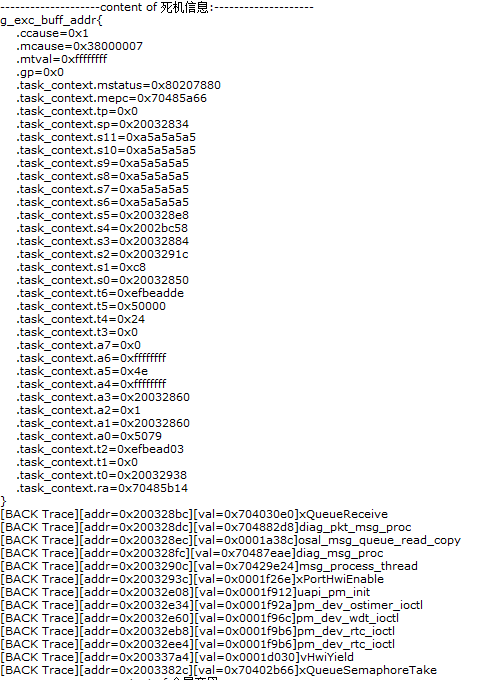

其中的内容与串口中的死机信息类似（如[图2](#zh-cn_topic_0000002411207068_fig18838131174015)所示），不同的是，last dump的死机信息中函数调用栈中的地址会自动找到对应的函数。

### 连接J-Link调试器查看信息<a name="ZH-CN_TOPIC_0000002499581349"></a>

本小节主要介绍在死机现场使用J-Link调试器导出死机信息的过程。

通过“[连接J-Link调试器导出](#ZH-CN_TOPIC_0000002466382384)”的方法连接J-Link后，可使用[表1](#zh-cn_topic_0000002411207080_table1061103533519)中的命令查看当前的状态和信息，如：寄存器、内存、flash中的数据。

**表 1**  J-Link常用命令

<a name="zh-cn_topic_0000002411207080_table1061103533519"></a>
<table><thead align="left"><tr id="zh-cn_topic_0000002411207080_row116113515356"><th class="cellrowborder" valign="top" width="26.63%" id="mcps1.2.3.1.1"><p id="zh-cn_topic_0000002411207080_p762153512353"><a name="zh-cn_topic_0000002411207080_p762153512353"></a><a name="zh-cn_topic_0000002411207080_p762153512353"></a>命令</p>
</th>
<th class="cellrowborder" valign="top" width="73.37%" id="mcps1.2.3.1.2"><p id="zh-cn_topic_0000002411207080_p186214355358"><a name="zh-cn_topic_0000002411207080_p186214355358"></a><a name="zh-cn_topic_0000002411207080_p186214355358"></a>说明</p>
</th>
</tr>
</thead>
<tbody><tr id="zh-cn_topic_0000002411207080_row7621535103515"><td class="cellrowborder" valign="top" width="26.63%" headers="mcps1.2.3.1.1 "><p id="zh-cn_topic_0000002411207080_p13621135173511"><a name="zh-cn_topic_0000002411207080_p13621135173511"></a><a name="zh-cn_topic_0000002411207080_p13621135173511"></a>con/connect</p>
</td>
<td class="cellrowborder" valign="top" width="73.37%" headers="mcps1.2.3.1.2 "><p id="zh-cn_topic_0000002411207080_p962735173518"><a name="zh-cn_topic_0000002411207080_p962735173518"></a><a name="zh-cn_topic_0000002411207080_p962735173518"></a>连接。</p>
</td>
</tr>
<tr id="zh-cn_topic_0000002411207080_row1462535133520"><td class="cellrowborder" valign="top" width="26.63%" headers="mcps1.2.3.1.1 "><p id="zh-cn_topic_0000002411207080_p96273533516"><a name="zh-cn_topic_0000002411207080_p96273533516"></a><a name="zh-cn_topic_0000002411207080_p96273533516"></a>h/halt</p>
</td>
<td class="cellrowborder" valign="top" width="73.37%" headers="mcps1.2.3.1.2 "><p id="zh-cn_topic_0000002411207080_p962183593518"><a name="zh-cn_topic_0000002411207080_p962183593518"></a><a name="zh-cn_topic_0000002411207080_p962183593518"></a>暂停，停止。</p>
</td>
</tr>
<tr id="zh-cn_topic_0000002411207080_row76216355359"><td class="cellrowborder" valign="top" width="26.63%" headers="mcps1.2.3.1.1 "><p id="zh-cn_topic_0000002411207080_p66253515351"><a name="zh-cn_topic_0000002411207080_p66253515351"></a><a name="zh-cn_topic_0000002411207080_p66253515351"></a>g/go</p>
</td>
<td class="cellrowborder" valign="top" width="73.37%" headers="mcps1.2.3.1.2 "><p id="zh-cn_topic_0000002411207080_p762735133516"><a name="zh-cn_topic_0000002411207080_p762735133516"></a><a name="zh-cn_topic_0000002411207080_p762735133516"></a>继续，运行。</p>
</td>
</tr>
<tr id="zh-cn_topic_0000002411207080_row186210355352"><td class="cellrowborder" valign="top" width="26.63%" headers="mcps1.2.3.1.1 "><p id="zh-cn_topic_0000002411207080_p1606533664"><a name="zh-cn_topic_0000002411207080_p1606533664"></a><a name="zh-cn_topic_0000002411207080_p1606533664"></a>mem32</p>
<p id="zh-cn_topic_0000002411207080_p362153519353"><a name="zh-cn_topic_0000002411207080_p362153519353"></a><a name="zh-cn_topic_0000002411207080_p362153519353"></a>mem16</p>
<p id="zh-cn_topic_0000002411207080_p1682961920116"><a name="zh-cn_topic_0000002411207080_p1682961920116"></a><a name="zh-cn_topic_0000002411207080_p1682961920116"></a>mem8</p>
</td>
<td class="cellrowborder" valign="top" width="73.37%" headers="mcps1.2.3.1.2 "><p id="zh-cn_topic_0000002411207080_p7623350357"><a name="zh-cn_topic_0000002411207080_p7623350357"></a><a name="zh-cn_topic_0000002411207080_p7623350357"></a>I/O读32bit：mem32 &lt;Addr&gt;, &lt;NumItems&gt; (hex) （Addr表示内存地址，NumItems表示从Addr开始连续读几个32bit）</p>
<p id="zh-cn_topic_0000002411207080_p13585583213"><a name="zh-cn_topic_0000002411207080_p13585583213"></a><a name="zh-cn_topic_0000002411207080_p13585583213"></a>I/O读16bit：mem16 &lt;Addr&gt;, &lt;NumItems&gt; (hex)</p>
<p id="zh-cn_topic_0000002411207080_p6973914223"><a name="zh-cn_topic_0000002411207080_p6973914223"></a><a name="zh-cn_topic_0000002411207080_p6973914223"></a>I/O读8bit：mem8 &lt;Addr&gt;, &lt;NumItems&gt; (hex)</p>
</td>
</tr>
<tr id="zh-cn_topic_0000002411207080_row106243513510"><td class="cellrowborder" valign="top" width="26.63%" headers="mcps1.2.3.1.1 "><p id="zh-cn_topic_0000002411207080_p1111715614617"><a name="zh-cn_topic_0000002411207080_p1111715614617"></a><a name="zh-cn_topic_0000002411207080_p1111715614617"></a>w4</p>
<p id="zh-cn_topic_0000002411207080_p6510013716"><a name="zh-cn_topic_0000002411207080_p6510013716"></a><a name="zh-cn_topic_0000002411207080_p6510013716"></a>w2</p>
<p id="zh-cn_topic_0000002411207080_p96217354358"><a name="zh-cn_topic_0000002411207080_p96217354358"></a><a name="zh-cn_topic_0000002411207080_p96217354358"></a>w1</p>
</td>
<td class="cellrowborder" valign="top" width="73.37%" headers="mcps1.2.3.1.2 "><p id="zh-cn_topic_0000002411207080_p988117579397"><a name="zh-cn_topic_0000002411207080_p988117579397"></a><a name="zh-cn_topic_0000002411207080_p988117579397"></a>I/O写4Byte：w4 &lt;Addr&gt;, &lt;Data&gt; (hex)</p>
<p id="zh-cn_topic_0000002411207080_p1874975115281"><a name="zh-cn_topic_0000002411207080_p1874975115281"></a><a name="zh-cn_topic_0000002411207080_p1874975115281"></a>I/O写2Byte：w2 &lt;Addr&gt;, &lt;Data&gt; (hex)</p>
<p id="zh-cn_topic_0000002411207080_p132883527285"><a name="zh-cn_topic_0000002411207080_p132883527285"></a><a name="zh-cn_topic_0000002411207080_p132883527285"></a>I/O写1Byte：w1 &lt;Addr&gt;, &lt;Data&gt; (hex)</p>
</td>
</tr>
<tr id="zh-cn_topic_0000002411207080_row14970194993820"><td class="cellrowborder" valign="top" width="26.63%" headers="mcps1.2.3.1.1 "><p id="zh-cn_topic_0000002411207080_p1197154963810"><a name="zh-cn_topic_0000002411207080_p1197154963810"></a><a name="zh-cn_topic_0000002411207080_p1197154963810"></a>readcsr</p>
</td>
<td class="cellrowborder" valign="top" width="73.37%" headers="mcps1.2.3.1.2 "><p id="zh-cn_topic_0000002411207080_p39711649103817"><a name="zh-cn_topic_0000002411207080_p39711649103817"></a><a name="zh-cn_topic_0000002411207080_p39711649103817"></a>读riscv csr寄存器：ReadCSR &lt;RegIndex&gt;</p>
</td>
</tr>
<tr id="zh-cn_topic_0000002411207080_row054423113918"><td class="cellrowborder" valign="top" width="26.63%" headers="mcps1.2.3.1.1 "><p id="zh-cn_topic_0000002411207080_p4544933392"><a name="zh-cn_topic_0000002411207080_p4544933392"></a><a name="zh-cn_topic_0000002411207080_p4544933392"></a>writecsr</p>
</td>
<td class="cellrowborder" valign="top" width="73.37%" headers="mcps1.2.3.1.2 "><p id="zh-cn_topic_0000002411207080_p15442373913"><a name="zh-cn_topic_0000002411207080_p15442373913"></a><a name="zh-cn_topic_0000002411207080_p15442373913"></a>写riscv csr寄存器：WriteCSR &lt;RegIndex&gt;,&lt;Value&gt;</p>
</td>
</tr>
</tbody>
</table>

**查询I/O信息<a name="zh-cn_topic_0000002411207080_section17435853169"></a>**

1.  查询CPU寄存器信息，如[图1](#zh-cn_topic_0000002411207080_fig17023605514)所示。

    **图 1**  查询CPU寄存器值<a name="zh-cn_topic_0000002411207080_fig17023605514"></a>  
    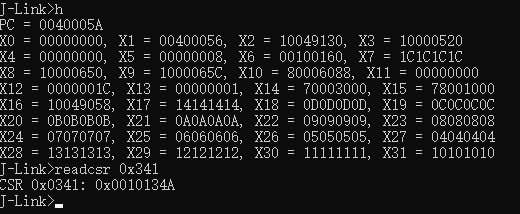

2.  查询内存信息，获取维测变量值或普通变量值。
    1.  在“\\output\\3322\\acore\\3322-xxx\\xxx.nm”中获取nm文件，在nm文件中获取想要查询的变量地址如[图2](#zh-cn_topic_0000002411207080_fig47228444013)中“g\_exception\_dump\_callback”变量的地址为0x20025950。

        **图 2**  变量地址<a name="zh-cn_topic_0000002411207080_fig47228444013"></a>  
        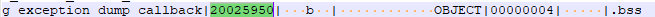

    2.  通过J-Link获取状态信息，如[图3](#zh-cn_topic_0000002411207080_fig1027883918595)所示。

        **图 3**  变量值<a name="zh-cn_topic_0000002411207080_fig1027883918595"></a>  
        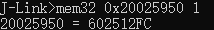

> **说明：** 
>以上地址信息仅作为演示使用，查询步骤供用户参考使用。

## 常见死机问题定位<a name="ZH-CN_TOPIC_0000002499581389"></a>

-   **[看门狗重启问题定位](#ZH-CN_TOPIC_0000002499501325)**  

-   **[CPU异常触发重启问题定位](#ZH-CN_TOPIC_0000002499501349)**  

### 看门狗重启问题定位<a name="ZH-CN_TOPIC_0000002499501325"></a>

看门狗死机导致的重启问题，大概率为代码中存在死循环（包含次数很大的循环）或某个业务一直被执行（例如灌包），使得IDLE任务无法得到调度，规定时间内未进行踢狗造成的重启。通常可以通过[表1](#zh-cn_topic_0000002411207048__table23412448246)中的信息并结合lst文件，确定具体的死机位置。

**表 1**  看门狗死机关键信息

<a name="zh-cn_topic_0000002411207048__table23412448246"></a>
<table><thead align="left"><tr id="zh-cn_topic_0000002411207048_row622mcpsimp"><th class="cellrowborder" valign="top" width="21.42%" id="mcps1.2.3.1.1"><p id="zh-cn_topic_0000002411207048_p624mcpsimp"><a name="zh-cn_topic_0000002411207048_p624mcpsimp"></a><a name="zh-cn_topic_0000002411207048_p624mcpsimp"></a>成员</p>
</th>
<th class="cellrowborder" valign="top" width="78.58000000000001%" id="mcps1.2.3.1.2"><p id="zh-cn_topic_0000002411207048_p626mcpsimp"><a name="zh-cn_topic_0000002411207048_p626mcpsimp"></a><a name="zh-cn_topic_0000002411207048_p626mcpsimp"></a>说明</p>
</th>
</tr>
</thead>
<tbody><tr id="zh-cn_topic_0000002411207048_row5260173210210"><td class="cellrowborder" valign="top" width="21.42%" headers="mcps1.2.3.1.1 "><p id="zh-cn_topic_0000002411207048_p626163242110"><a name="zh-cn_topic_0000002411207048_p626163242110"></a><a name="zh-cn_topic_0000002411207048_p626163242110"></a>type/mcause</p>
</td>
<td class="cellrowborder" valign="top" width="78.58000000000001%" headers="mcps1.2.3.1.2 "><p id="zh-cn_topic_0000002411207048_p14261193282119"><a name="zh-cn_topic_0000002411207048_p14261193282119"></a><a name="zh-cn_topic_0000002411207048_p14261193282119"></a>看门狗死机，死机类型为0xFFF。</p>
</td>
</tr>
<tr id="zh-cn_topic_0000002411207048_row628mcpsimp"><td class="cellrowborder" valign="top" width="21.42%" headers="mcps1.2.3.1.1 "><p id="zh-cn_topic_0000002411207048_p630mcpsimp"><a name="zh-cn_topic_0000002411207048_p630mcpsimp"></a><a name="zh-cn_topic_0000002411207048_p630mcpsimp"></a>mepc</p>
</td>
<td class="cellrowborder" valign="top" width="78.58000000000001%" headers="mcps1.2.3.1.2 "><p id="zh-cn_topic_0000002411207048_p632mcpsimp"><a name="zh-cn_topic_0000002411207048_p632mcpsimp"></a><a name="zh-cn_topic_0000002411207048_p632mcpsimp"></a>通过mepc确定看门狗到期时的pc。根据概率推测可知，该代码基本为死循环中会调用的代码。</p>
</td>
</tr>
<tr id="zh-cn_topic_0000002411207048_row633mcpsimp"><td class="cellrowborder" valign="top" width="21.42%" headers="mcps1.2.3.1.1 "><p id="zh-cn_topic_0000002411207048_p635mcpsimp"><a name="zh-cn_topic_0000002411207048_p635mcpsimp"></a><a name="zh-cn_topic_0000002411207048_p635mcpsimp"></a>返回地址（ra）和栈</p>
</td>
<td class="cellrowborder" valign="top" width="78.58000000000001%" headers="mcps1.2.3.1.2 "><p id="zh-cn_topic_0000002411207048_p637mcpsimp"><a name="zh-cn_topic_0000002411207048_p637mcpsimp"></a><a name="zh-cn_topic_0000002411207048_p637mcpsimp"></a>如果mepc在通用函数中，例如memcpy函数中，可以通过ra和栈内容进一步确认函数调用流程。</p>
</td>
</tr>
</tbody>
</table>

### CPU异常触发重启问题定位<a name="ZH-CN_TOPIC_0000002499501349"></a>

通过fault\_type值的含义的描述内容，可确认CPU异常触发重启具体为哪种死机问题。

**表 1**  CPU异常的fault\_type含义

<a name="zh-cn_topic_0000002444726321_table640mcpsimp"></a>
<table><thead align="left"><tr id="zh-cn_topic_0000002444726321_row645mcpsimp"><th class="cellrowborder" valign="top" width="30.72%" id="mcps1.2.3.1.1"><p id="zh-cn_topic_0000002444726321_p34162013141819"><a name="zh-cn_topic_0000002444726321_p34162013141819"></a><a name="zh-cn_topic_0000002444726321_p34162013141819"></a>fault_type错误</p>
</th>
<th class="cellrowborder" valign="top" width="69.28%" id="mcps1.2.3.1.2"><p id="zh-cn_topic_0000002444726321_p649mcpsimp"><a name="zh-cn_topic_0000002444726321_p649mcpsimp"></a><a name="zh-cn_topic_0000002444726321_p649mcpsimp"></a>说明</p>
</th>
</tr>
</thead>
<tbody><tr id="zh-cn_topic_0000002444726321_row11380187131915"><td class="cellrowborder" valign="top" width="30.72%" headers="mcps1.2.3.1.1 "><p id="zh-cn_topic_0000002444726321_p2381676194"><a name="zh-cn_topic_0000002444726321_p2381676194"></a><a name="zh-cn_topic_0000002444726321_p2381676194"></a>Instruction address misaligned</p>
</td>
<td class="cellrowborder" valign="top" width="69.28%" headers="mcps1.2.3.1.2 "><p id="zh-cn_topic_0000002444726321_p19381175191"><a name="zh-cn_topic_0000002444726321_p19381175191"></a><a name="zh-cn_topic_0000002444726321_p19381175191"></a>取址地址不对齐，riscv要求指令双字节对齐位置。</p>
</td>
</tr>
<tr id="zh-cn_topic_0000002444726321_row1324782415194"><td class="cellrowborder" valign="top" width="30.72%" headers="mcps1.2.3.1.1 "><p id="zh-cn_topic_0000002444726321_p1624752419197"><a name="zh-cn_topic_0000002444726321_p1624752419197"></a><a name="zh-cn_topic_0000002444726321_p1624752419197"></a>Instruction access fault</p>
</td>
<td class="cellrowborder" valign="top" width="69.28%" headers="mcps1.2.3.1.2 "><p id="zh-cn_topic_0000002444726321_p152471224171919"><a name="zh-cn_topic_0000002444726321_p152471224171919"></a><a name="zh-cn_topic_0000002444726321_p152471224171919"></a>取址地址异常。</p>
</td>
</tr>
<tr id="zh-cn_topic_0000002444726321_row2606112118196"><td class="cellrowborder" valign="top" width="30.72%" headers="mcps1.2.3.1.1 "><p id="zh-cn_topic_0000002444726321_p7606321161910"><a name="zh-cn_topic_0000002444726321_p7606321161910"></a><a name="zh-cn_topic_0000002444726321_p7606321161910"></a>Illegal instruction</p>
</td>
<td class="cellrowborder" valign="top" width="69.28%" headers="mcps1.2.3.1.2 "><p id="zh-cn_topic_0000002444726321_p2606192191916"><a name="zh-cn_topic_0000002444726321_p2606192191916"></a><a name="zh-cn_topic_0000002444726321_p2606192191916"></a>非法指令。</p>
</td>
</tr>
<tr id="zh-cn_topic_0000002444726321_row1683141831915"><td class="cellrowborder" valign="top" width="30.72%" headers="mcps1.2.3.1.1 "><p id="zh-cn_topic_0000002444726321_p1683131821913"><a name="zh-cn_topic_0000002444726321_p1683131821913"></a><a name="zh-cn_topic_0000002444726321_p1683131821913"></a>Load address misaligned</p>
</td>
<td class="cellrowborder" valign="top" width="69.28%" headers="mcps1.2.3.1.2 "><p id="zh-cn_topic_0000002444726321_p116831318171910"><a name="zh-cn_topic_0000002444726321_p116831318171910"></a><a name="zh-cn_topic_0000002444726321_p116831318171910"></a>取数据的目标地址不对齐。</p>
</td>
</tr>
<tr id="zh-cn_topic_0000002444726321_row09211510191"><td class="cellrowborder" valign="top" width="30.72%" headers="mcps1.2.3.1.1 "><p id="zh-cn_topic_0000002444726321_p892141531913"><a name="zh-cn_topic_0000002444726321_p892141531913"></a><a name="zh-cn_topic_0000002444726321_p892141531913"></a>Load access fault</p>
</td>
<td class="cellrowborder" valign="top" width="69.28%" headers="mcps1.2.3.1.2 "><p id="zh-cn_topic_0000002444726321_p179271513194"><a name="zh-cn_topic_0000002444726321_p179271513194"></a><a name="zh-cn_topic_0000002444726321_p179271513194"></a>取数据的目的地址是禁止进行读操作的地址。</p>
</td>
</tr>
<tr id="zh-cn_topic_0000002444726321_row16523112101913"><td class="cellrowborder" valign="top" width="30.72%" headers="mcps1.2.3.1.1 "><p id="zh-cn_topic_0000002444726321_p05238122193"><a name="zh-cn_topic_0000002444726321_p05238122193"></a><a name="zh-cn_topic_0000002444726321_p05238122193"></a>Store/AMO address misaligned</p>
</td>
<td class="cellrowborder" valign="top" width="69.28%" headers="mcps1.2.3.1.2 "><p id="zh-cn_topic_0000002444726321_p145231512131917"><a name="zh-cn_topic_0000002444726321_p145231512131917"></a><a name="zh-cn_topic_0000002444726321_p145231512131917"></a>存储数据目标地址不对齐。</p>
</td>
</tr>
<tr id="zh-cn_topic_0000002444726321_row651mcpsimp"><td class="cellrowborder" valign="top" width="30.72%" headers="mcps1.2.3.1.1 "><p id="zh-cn_topic_0000002444726321_p23463717202"><a name="zh-cn_topic_0000002444726321_p23463717202"></a><a name="zh-cn_topic_0000002444726321_p23463717202"></a>Store/AMO access fault</p>
</td>
<td class="cellrowborder" valign="top" width="69.28%" headers="mcps1.2.3.1.2 "><p id="zh-cn_topic_0000002444726321_p2804105410207"><a name="zh-cn_topic_0000002444726321_p2804105410207"></a><a name="zh-cn_topic_0000002444726321_p2804105410207"></a>存储数据的目的地址是禁止进行写操作的地址。</p>
</td>
</tr>
</tbody>
</table>

-   **[Store或Load异常](#ZH-CN_TOPIC_0000002466382352)**  

-   **[取指异常](#ZH-CN_TOPIC_0000002499581437)**  

#### Store或Load异常<a name="ZH-CN_TOPIC_0000002466382352"></a>

**表 1**  store或load异常关键信息

<a name="zh-cn_topic_0000002444726349_table183011652142212"></a>
<table><thead align="left"><tr id="zh-cn_topic_0000002444726349_row33025520220"><th class="cellrowborder" valign="top" width="18.63%" id="mcps1.2.3.1.1"><p id="zh-cn_topic_0000002444726349_p16104162815230"><a name="zh-cn_topic_0000002444726349_p16104162815230"></a><a name="zh-cn_topic_0000002444726349_p16104162815230"></a>成员</p>
</th>
<th class="cellrowborder" valign="top" width="81.37%" id="mcps1.2.3.1.2"><p id="zh-cn_topic_0000002444726349_p11302165272210"><a name="zh-cn_topic_0000002444726349_p11302165272210"></a><a name="zh-cn_topic_0000002444726349_p11302165272210"></a>说明</p>
</th>
</tr>
</thead>
<tbody><tr id="zh-cn_topic_0000002444726349_row10302175252219"><td class="cellrowborder" valign="top" width="18.63%" headers="mcps1.2.3.1.1 "><p id="zh-cn_topic_0000002444726349_p1946383218239"><a name="zh-cn_topic_0000002444726349_p1946383218239"></a><a name="zh-cn_topic_0000002444726349_p1946383218239"></a>mepc</p>
</td>
<td class="cellrowborder" valign="top" width="81.37%" headers="mcps1.2.3.1.2 "><p id="zh-cn_topic_0000002444726349_p130225252216"><a name="zh-cn_topic_0000002444726349_p130225252216"></a><a name="zh-cn_topic_0000002444726349_p130225252216"></a>通过mepc确定异常的语句。</p>
</td>
</tr>
<tr id="zh-cn_topic_0000002444726349_row3302115218221"><td class="cellrowborder" valign="top" width="18.63%" headers="mcps1.2.3.1.1 "><p id="zh-cn_topic_0000002444726349_p635mcpsimp"><a name="zh-cn_topic_0000002444726349_p635mcpsimp"></a><a name="zh-cn_topic_0000002444726349_p635mcpsimp"></a>返回地址（ra）和栈</p>
</td>
<td class="cellrowborder" valign="top" width="81.37%" headers="mcps1.2.3.1.2 "><p id="zh-cn_topic_0000002444726349_p1330213529221"><a name="zh-cn_topic_0000002444726349_p1330213529221"></a><a name="zh-cn_topic_0000002444726349_p1330213529221"></a>如果mepc在通用函数中，如memcpy中，可以通过ra和栈内容进一步确认函数调用流程。</p>
</td>
</tr>
<tr id="zh-cn_topic_0000002444726349_row113021552122212"><td class="cellrowborder" valign="top" width="18.63%" headers="mcps1.2.3.1.1 "><p id="zh-cn_topic_0000002444726349_p413113782311"><a name="zh-cn_topic_0000002444726349_p413113782311"></a><a name="zh-cn_topic_0000002444726349_p413113782311"></a>mtval</p>
</td>
<td class="cellrowborder" valign="top" width="81.37%" headers="mcps1.2.3.1.2 "><p id="zh-cn_topic_0000002444726349_p12302652182219"><a name="zh-cn_topic_0000002444726349_p12302652182219"></a><a name="zh-cn_topic_0000002444726349_p12302652182219"></a>通过mtval确认访问的的异常地址。</p>
</td>
</tr>
<tr id="zh-cn_topic_0000002444726349_row73023528223"><td class="cellrowborder" valign="top" width="18.63%" headers="mcps1.2.3.1.1 "><p id="zh-cn_topic_0000002444726349_p16302165215222"><a name="zh-cn_topic_0000002444726349_p16302165215222"></a><a name="zh-cn_topic_0000002444726349_p16302165215222"></a>寄存器值</p>
</td>
<td class="cellrowborder" valign="top" width="81.37%" headers="mcps1.2.3.1.2 "><p id="zh-cn_topic_0000002444726349_p9802596234"><a name="zh-cn_topic_0000002444726349_p9802596234"></a><a name="zh-cn_topic_0000002444726349_p9802596234"></a>如mepc指向下面语句时，可以确认a1值是否合法。</p>
<a name="zh-cn_topic_0000002444726349_ul14809599237"></a><a name="zh-cn_topic_0000002444726349_ul14809599237"></a><ul id="zh-cn_topic_0000002444726349_ul14809599237"><li>lw a0,0(a1)：将a0存储到a1指向的位置。</li><li>sw a0,0(a1)：从a1指向位置获取内容到a0。</li></ul>
</td>
</tr>
</tbody>
</table>

> **说明：** 
>-   由于存储存在异步性，存储异常时mepc指向的语句可能不是异常语句。
>-   RISCV lb、lh、lw、ld、sb、sh、sw、sd指令要求访问地址字节对齐。
>    -   lb（load byte）：对齐要求为1字节。
>    -   lh（load halfword）：对齐要求为2字节。
>    -   lw（load word）：对齐要求为4字节。
>    -   ld（load doubleword）：对齐要求为8字节。
>    -   sb（store byte）：对齐要求为1字节。
>    -   sh（store halfword）：对齐要求为2字节。
>    -   sw（store word）：对齐要求为4字节。
>    -   sd（store doubleword）：对齐要求为8字节。
>    因此，对于load和store指令，被访问的地址不满足对应数据长度的对齐要求，将会引发地址对齐异常，建议客户在定义全局变量时，使用\_\_attribute\_\_\(\(aligned\(8\)\)\)进行对齐。

#### 取指异常<a name="ZH-CN_TOPIC_0000002499581437"></a>

取指异常通常为PC跑飞造成的。首先可以确认mepc的范围是否正常，通过ra和调用栈分析可以确认代码跑飞的位置。

造成代码跑飞主要原因如下：

-   存储函数跳转地址的钩子变量被踩，导致函数跳转到非法地址。
-   栈被踩，导致函数无法正确返回上一级函数而跑飞。
-   代码段本身被踩。

# Last Dump解析<a name="ZH-CN_TOPIC_0000002466542072"></a>

-   **[概述](#ZH-CN_TOPIC_0000002499501333)**  

-   **[功能描述](#ZH-CN_TOPIC_0000002499501317)**  

## 概述<a name="ZH-CN_TOPIC_0000002499501333"></a>

Last Dump解析功能是指将死机发生时导出的内存数据的内容进行解析，将.bin文件解析为可读性较好的文本文件，为问题定位提供参考信息。

## 功能描述<a name="ZH-CN_TOPIC_0000002499501317"></a>

Last Dump解析功能主要包括两个部分：

-   第一部分主要功能是解析DWAEF文件的“.debug\_info”段，将对应的tag解析生成python格式的class文件，同时解析符号表，获取全局变量信息。此步骤当前集成在版本构建流程中。
-   第二部分主要功能是将第一步生成的文件作为输入，解析死机dump文件，生成文本信息。此步骤当前集成在DebugKits工具中。

-   **[场景说明](#ZH-CN_TOPIC_0000002499501365)**  

-   **[工作流程](#ZH-CN_TOPIC_0000002466542040)**  

-   **[异常处理](#ZH-CN_TOPIC_0000002466542032)**  

### 场景说明<a name="ZH-CN_TOPIC_0000002499501365"></a>

针对死机问题定位信息少，问题定位困难等场景，提供Last Dump解析功能，为死机问题定位提供更多的参考信息。

### 工作流程<a name="ZH-CN_TOPIC_0000002466542040"></a>

1.  死机dump文件获取，请参考“[获取last dump信息](#ZH-CN_TOPIC_0000002499581333)”。其中，DebugKits工具导出的last dump生成文件就是待解析的死机文件（Last Dump功能是否开启通过DUMP\_MEM\_SUPPORT、DUMP\_REG\_SUPPORT、SUPPORT\_DFX\_EXCEPTION这三个宏控制）。
2.  编译构建生成解析工具。上文已经介绍了解析功能的第一步集成在版本构建流程中，Last Dump解析前需要先进行版本编译构建获取parse\_tool解析工具。
    1.  获取源码，修改“/sdk/build/config/target\_config/3322/target\_config.py中target\_standard\_3322\_application\_template”下面的“gen\_parse\_tool:False”，将False改成True。
    2.  进行版本编译，编译环境需要支持python3，Last Dump解析功能所需脚本和中间文件在版本编译过程中生成，编译过程中会提示信息：Build parse tool success。
    3.  编译结果确认，在output目录“output/3322/acore/<target-name\>/”下生成“application.nm”文件、“application.llvminfo”文件以及“parse\_tool”文件夹，其中“parse\_tool”文件夹下包括如下文件。
        -   auto\_class.py：此文件在编译过程中生成，内存解析脚本需要import的python模块。
        -   auto\_struct.txt：database路径下“mss\_cmd\_db.xml”文件内结构体自动生成结果，可拷贝到Debugkits工具的database路径下，用于Debugkits工具解析日志。
        -   global.txt：此文件在编译过程中生成，内存解析时需要导入的全局变量信息。
        -   config.py：内存解析脚本配置文件。
        -   parse\_basic.py：内存解析脚本。
        -   parse\_elf.py：内存解析脚本。
        -   parse\_freertos.py：FreeRTOS系统解析脚本。
        -   parse\_liteos.py：Liteos系统解析脚本。
        -   parse\_main\_phase1.py：内存解析脚本的第一阶段入口，已集成在编译构建过程中，主要目的是生成上面的“auto\_class.py”、“auto\_struct.txt”以及“global.txt”文件。
        -   parse\_main\_liteos206\_phase2.py：Liteos206版本内存解析脚本的第二阶段入口，对应Liteos206版本的解析，在DebugKits工具界面调用，用于将全内存.bin文件解析为用户可见的文本信息。
        -   parse\_main\_liteos207\_phase2.py：Liteos207版本内存解析脚本的第二阶段入口，对应Liteos207版本的解析，在DebugKits工具界面调用，用于将全内存.bin文件解析为用户可见的文本信息。
        -   parse\_main\_liteos208\_6\_phase2.py：Liteos208版本内存解析脚本的第二阶段入口，对应Liteos208版本的解析，在DebugKits工具界面调用，用于将B核的全内存.bin文件解析为用户可见的文本信息。
        -   parse\_main\_liteos208\_8\_phase2.py：Liteos208版本内存解析脚本的第二阶段入口，对应Liteos208版本的解析，在DebugKits工具界面调用，用于将A核的全内存.bin文件解析为用户可见的文本信息。
        -   parse\_main\_freertos\_phase2.py：FreeRTOS版本内存解析脚本的第二阶段入口，对应FreeRTOS版本的解析，在DebugKits工具界面调用，用于将全内存.bin文件解析为用户可见的文本信息。
        -   parse\_print\_global\_var.py：内存解析脚本。
        -   xml\_main.py：内存解析脚本。

3.  执行Last Dump解析。在执行Last Dump解析之前，确保运行解析工具的PC上已安装python3和DebugKits工具。
    1.  在DebugKits工具的System界面选取“DumpAnalys”选项，在对应的选项上选取相应的路径；如[图1](#zh-cn_topic_0000002444726329_fig3493185615354)所示（注：也可以将编译后的parse\_tool文件夹，“application.nm”文件及last dump内存导出文件拷贝到本地PC上进行处理，工具选取对应路径即可）。

        **图 1**  DebugKits工具Dump解析界面<a name="zh-cn_topic_0000002444726329_fig3493185615354"></a>  
        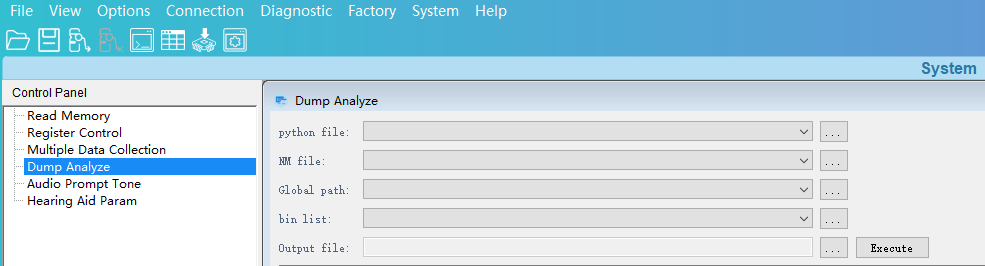

        -   python file是解析脚本的路径，需要用户选取，例如“/output/3322/acore/<target-name\>/parse\_tool/ parse\_main\_\*\*\*\*\_phase2.py”。根据用户使用的OS不同，Liteos版本使用parse\_main\_liteos208\_phase2.py，freertos版本使用parse\_main\_freertos\_phase2.py。
        -   NM file为内存解析脚本的输入文件，在版本构建时通过编译命令解析elf文件生成，路径：/output/3322/acore/<target-name\>/application.nm。
        -   Global path为内存解析时需要导入的全局变量信息，在版本构建时通过解析脚本的第一步生成，路径：/output/3322/acore/<target-name\>/parse\_tool/global.txt。
        -   bin list为待解析的内存文件路径（即通过DebugKits工具导出的内存bin文件的存储路径：例如：D:\\DebugKits\\DumpInfo\\DumpInfo\_1），只需要选取路径即可，工具会自动加载该路径下相关的.bin文件。
        -   Output file为解析结果文件存放路径，需要用户选取，例如“D:\\DebugKits\\DumpInfo\\DumpInfo\_1\\memory\_result.txt”。

    2.  单击Dump Analyze界面的“Execute”按钮，正常情况下DebugKits工具界面会显示解析结果，并且在用户选取的Output file路径下会生成“memory\_result.txt”解析结果如[图2](#zh-cn_topic_0000002444726329_fig1345171014372)所示，如果没有显示结果，则参考“[异常处理](#ZH-CN_TOPIC_0000002466542032)”的介绍进行处理。

        **图 2**  Last Dump解析结果文件<a name="zh-cn_topic_0000002444726329_fig1345171014372"></a>  
        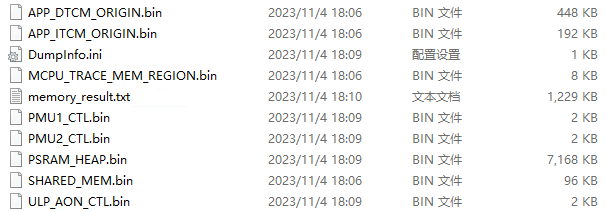

    3.  分析解析结果。

        打开“memory\_result.txt”文件可以查询到当前的中断信息、任务信息、消息队列、信号量、全局变量、死机信息、CPU\_TRACE信息等。

        **图 3**  Last Dump解析结果片段<a name="zh-cn_topic_0000002444726329_fig1299610121443"></a>  
        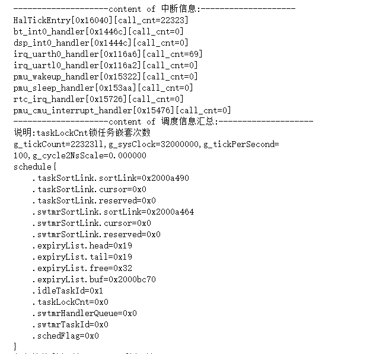

### 异常处理<a name="ZH-CN_TOPIC_0000002466542032"></a>

1.  如果执行Last Dump解析后DebugKits工具没有显示解析结果，首先需要确认“application.nm”文件、“application.info”文件、“parse\_tool”脚本及导出的“.bin”文件是否出自同一个软件版本。不同版本的输入不匹配可能会导致异常。
2.  DebugKits工具导入待解析的.bin文件时选取的是整个目录，要保证DebugKits工具配置文件“\\DebugKits\\Source-Datas\\bin\\config\\config.ini”中的配置与DumpInfo文件夹下导出文件的地址及大小一致，否则也会导致解析异常。

    可以将“config.ini”中的DumpInfo配置项与源码“middleware\\chips\\3322\\dfx\\last\_dump\_adapt.c”中的g\_mem\_dump\_info数组中的元素进行对比。如不一致，则要按照g\_mem\_dump\_info数组的定义修改“config.ini”中的DumpInfo配置项。

    例如[图1](#zh-cn_topic_0000002411047204_fig8796185811)中的“APP\_ITCM\_ORIGIN\_StartAddr”的值应该等于[图2](#zh-cn_topic_0000002411047204_fig10368236616)中的“APP\_ITCM\_ORIGIN”的值，“APP\_ITCM\_ORIGIN\_Length”的值应该等于“APP\_ITCM\_LENGTH”的值。

    **图 1**  config.ini中配置信息<a name="zh-cn_topic_0000002411047204_fig8796185811"></a>  
    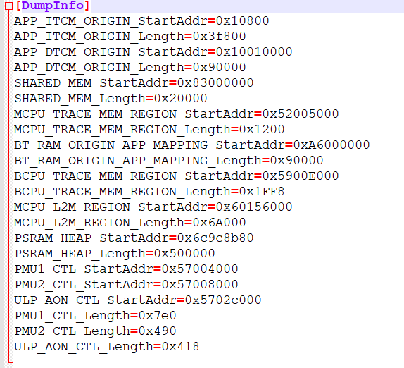

    **图 2**  g\_app\_mem\_dump\_info和g\_bt\_mem\_dump\_info数组<a name="zh-cn_topic_0000002411047204_fig10368236616"></a>  
    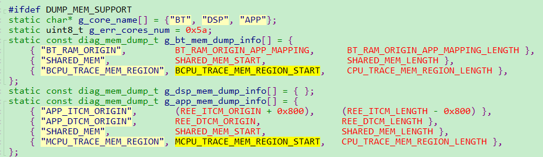

3.  上述两点都排查无误后，需要手工执行脚本进行问题定位。

    方法如下：

    1.  打开DebugKits工具安装目录下的“log.txt”，找到工具调用解析脚本的命令。[图3](#zh-cn_topic_0000002411047204_fig1279412154)中cmd后面双引号内的内容即执行Last Dump解析的命令，注意需要删除其中的转义字符“\\”。

        **图 3**  DebugKits工具调用解析脚本的命令<a name="zh-cn_topic_0000002411047204_fig1279412154"></a>  
        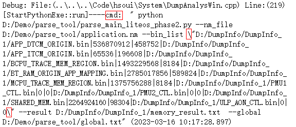

    2.  将命令拷贝到cmd窗口执行，可以看到解析脚本的执行结果。[图4](#zh-cn_topic_0000002411047204_fig15249427161813)中是正确执行的结果。如果出现错误，可以根据错误提示，进一步定位问题。

        **图 4**  Last Dump解析在命令行窗口执行结果<a name="zh-cn_topic_0000002411047204_fig15249427161813"></a>  
        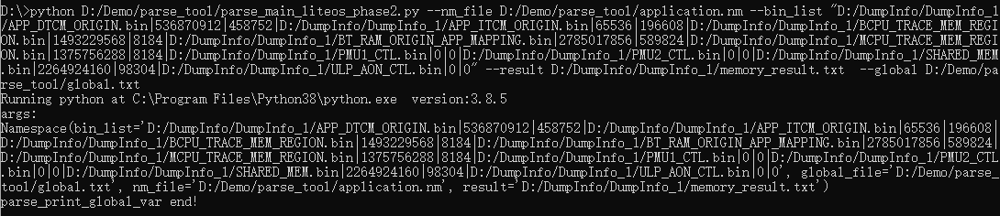

# 内存DFX功能<a name="ZH-CN_TOPIC_0000002466382464"></a>

-   **[概述](#ZH-CN_TOPIC_0000002499501297)**  

-   **[功能描述](#ZH-CN_TOPIC_0000002466541992)**  

## 概述<a name="ZH-CN_TOPIC_0000002499501297"></a>

内存DFX功能主要用于内存调优分析，主要包括系统内存占用分析、各任务内存占用分析、任务栈使用率分析以及内存泄漏检测。

## 功能描述<a name="ZH-CN_TOPIC_0000002466541992"></a>

> **须知：** 
>所有命令在执行时均会**关中断**，因此可能导致消息队列满等异常，建议尽量避免在压测场景下使用“AT^SHOWALLTSKHEAP 、AT^SHOWMEMINFO”指令，这两个指令均可以用其他指令组合后替代。

-   **[查询指定任务内存占用情况](#ZH-CN_TOPIC_0000002499581413)**  

-   **[查询当前所有任务内存占用情况](#ZH-CN_TOPIC_0000002466542016)**  

-   **[查询当前所有空闲内存信息](#ZH-CN_TOPIC_0000002499581365)**  

-   **[查询当前内存统计信息](#ZH-CN_TOPIC_0000002499581429)**  

-   **[查询内存的所有信息](#ZH-CN_TOPIC_0000002499581341)**  

-   **[查询任务信息](#ZH-CN_TOPIC_0000002466382416)**  

-   **[查询任务水线](#ZH-CN_TOPIC_0000002499501397)**  

### 查询指定任务内存占用情况<a name="ZH-CN_TOPIC_0000002499581413"></a>

1.  使用任意串口工具下发“AT^SHOWTSKHEAP=<taskId\>”命令，taskId的获取请参见“[查询任务信息](#ZH-CN_TOPIC_0000002466382416)”，以IPOP工具为例，如[图1](#zh-cn_topic_0000002411047172_fig9496188115114)所示。

    **图 1**  串口命令<a name="zh-cn_topic_0000002411047172_fig9496188115114"></a>  
    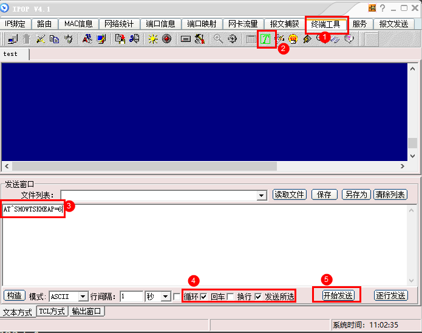

2.  命令下发后可以得到四个信息。

    ①当前任务占用内存的详细信息，size表示一个内存节点的大小，blockCount表示已分配的内存块数量，callerRA表示该内存节点申请时的下一条指令地址。

    ②当前任务占用的非slab内存总量。

    ③当前任务占用的slab内存总量。

    ④当前系统中因为内存节点申请而带来的总内存开销。

    具体内容如[图2](#zh-cn_topic_0000002411047172_fig62598117910)所示。

    **图 2**  命令执行结果<a name="zh-cn_topic_0000002411047172_fig62598117910"></a>  
    
    

### 查询当前所有任务内存占用情况<a name="ZH-CN_TOPIC_0000002466542016"></a>

1.  使用任意串口工具下发“AT^SHOWALLTSKHEAP”命令，以IPOP工具为例，如[图1](#zh-cn_topic_0000002411047168_fig316513591123)所示。

    **图 1**  串口命令<a name="zh-cn_topic_0000002411047168_fig316513591123"></a>  
    

2.  命令下发后可以得到当前系统内所有任务的四个信息。

    ①当前任务占用内存的详细信息，size表示一个内存节点的大小，blockCount表示已分配的内存块数量，callerRA表示该内存节点申请时的下一条指令地址。

    ②当前任务占用的非slab内存总量。

    ③当前任务占用的slab内存总量。

    ④当前系统中因为内存节点申请而带来的总内存开销。

    具内容如[图2](#zh-cn_topic_0000002411047168_fig158372541418)所示。

    **图 2**  命令执行结果<a name="zh-cn_topic_0000002411047168_fig158372541418"></a>  
    
    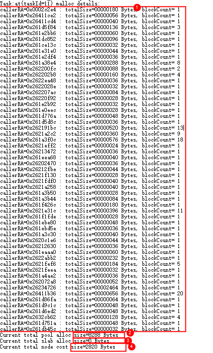

### 查询当前所有空闲内存信息<a name="ZH-CN_TOPIC_0000002499581365"></a>

1.  使用任意串口工具下发“AT^SHOWMEMFREE”命令，以IPOP工具为例，如[图1](#zh-cn_topic_0000002444726313_fig841421816177)所示。

    **图 1**  串口命令<a name="zh-cn_topic_0000002444726313_fig841421816177"></a>  
    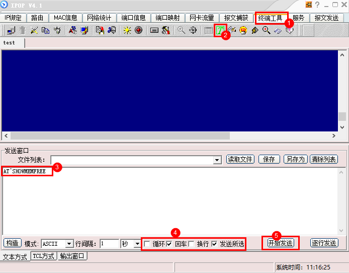

2.  命令下发后可以得到当前系统空闲内存的四个信息：

    ①size：空闲内存块的大小。

    ②from：该空闲块的起始地址。

    ③end：该空闲块的结束地址。

    ④当前总内存剩余量。

    具体内容如[图2](#zh-cn_topic_0000002444726313_fig12913739182114)所示。

    **图 2**  命令执行结果<a name="zh-cn_topic_0000002444726313_fig12913739182114"></a>  
    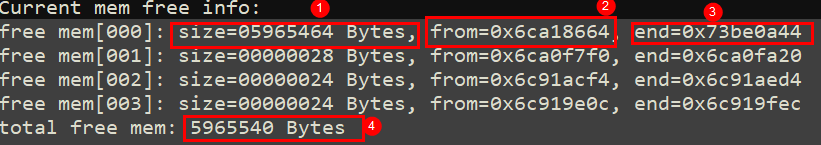

### 查询当前内存统计信息<a name="ZH-CN_TOPIC_0000002499581429"></a>

1.  使用任意串口工具下发“AT^SHOWHEAPST”命令，以IPOP工具为例，如[图1](#zh-cn_topic_0000002444726337_fig1219216282413)所示。

    **图 1**  串口命令<a name="zh-cn_topic_0000002444726337_fig1219216282413"></a>  
    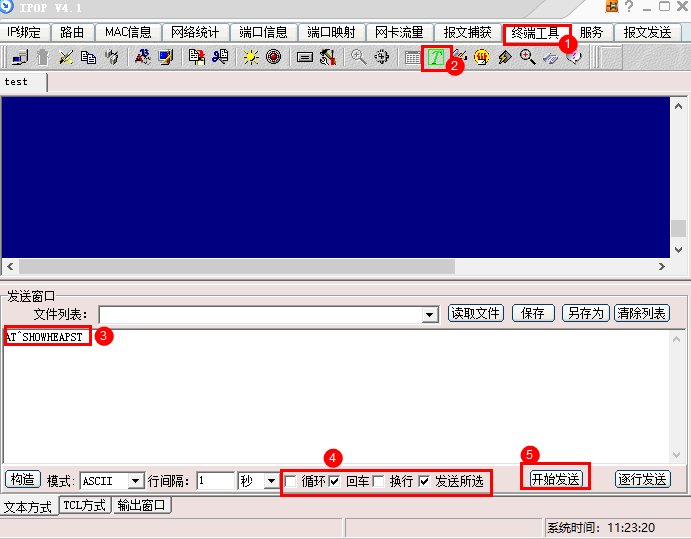

2.  命令下发后可以得到三类信息：

    ①当前内存的使用信息，total表示内存的总量，used表示当前已使用的内存量，current free表示当前剩余内存量，peak usage表示峰值内存使用量，peak free表示峰值内存剩余量。

    ②当前所有任务内存分配信息，current malloc表示截止统计时任务依旧持有的内存量，peak malloc表示截止统计时任务所持有内存的最大值。

    ③非任务所占用的内存，比如中断等。

    具体内容如[图2](#zh-cn_topic_0000002444726337_fig1409910203215)所示。

    **图 2**  命令执行结果<a name="zh-cn_topic_0000002444726337_fig1409910203215"></a>  
    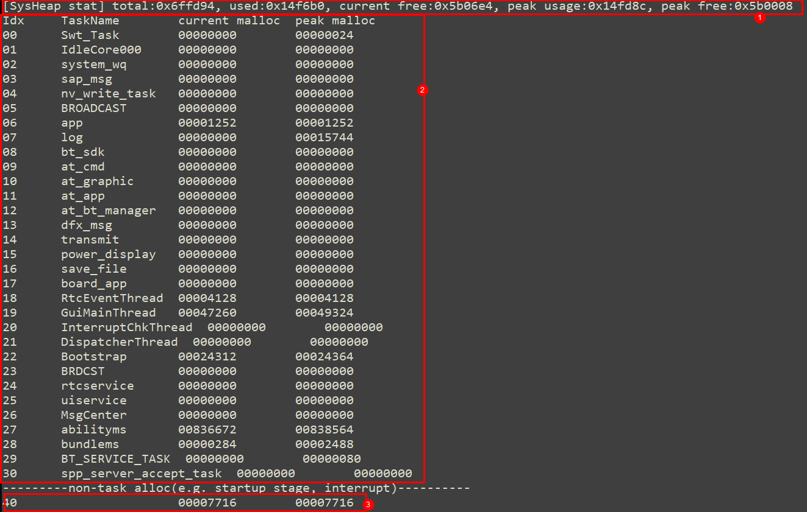

### 查询内存的所有信息<a name="ZH-CN_TOPIC_0000002499581341"></a>

1.  使用任意串口工具下发“AT^SHOWMEMINFO”命令，以IPOP工具为例，如[图1](#zh-cn_topic_0000002444646221_fig1136894583514)所示。

    **图 1**  串口命令<a name="zh-cn_topic_0000002444646221_fig1136894583514"></a>  
    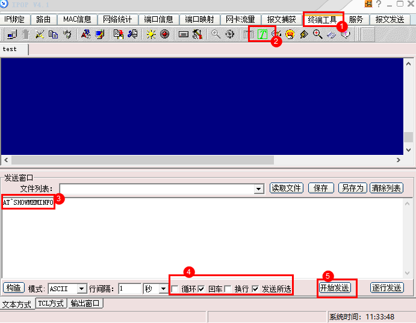

2.  该命令执行结果包含“AT^SHOWTSKWTL、AT^SHOWHEAPST、AT^SHOWALLTSKHEAP、AT^SHOWMEMFREE”四个命令的执行结果，详情请参考各命令执行结果。

### 查询任务信息<a name="ZH-CN_TOPIC_0000002466382416"></a>

1.  使用任意串口工具下发“AT^SHOWMEMINFO”命令，以IPOP工具为例，如[图1](#zh-cn_topic_0000002444726325_fig362063014010)所示。

    **图 1**  串口命令<a name="zh-cn_topic_0000002444726325_fig362063014010"></a>  
    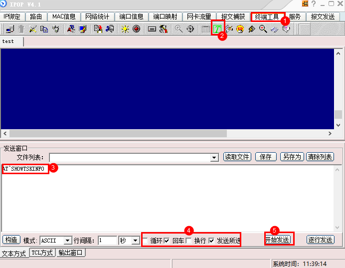

2.  命令执行结果包括所有任务的任务名及taskId，如[图2](#zh-cn_topic_0000002444726325_fig7112183404117)所示。

    **图 2**  命令执行结果<a name="zh-cn_topic_0000002444726325_fig7112183404117"></a>  
    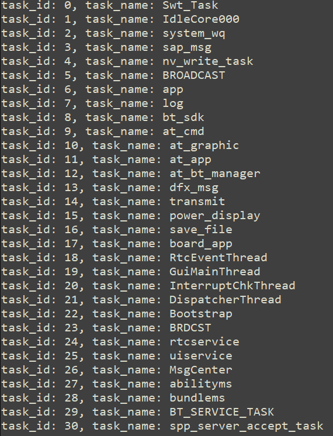

### 查询任务水线<a name="ZH-CN_TOPIC_0000002499501397"></a>

1.  使用任意串口工具下发“AT^SHOWTSKWTL”命令，以IPOP工具为例，如[图1](#zh-cn_topic_0000002444646237_fig114591214435)  所示。

    **图 1**  串口命令<a name="zh-cn_topic_0000002444646237_fig114591214435"></a>  
    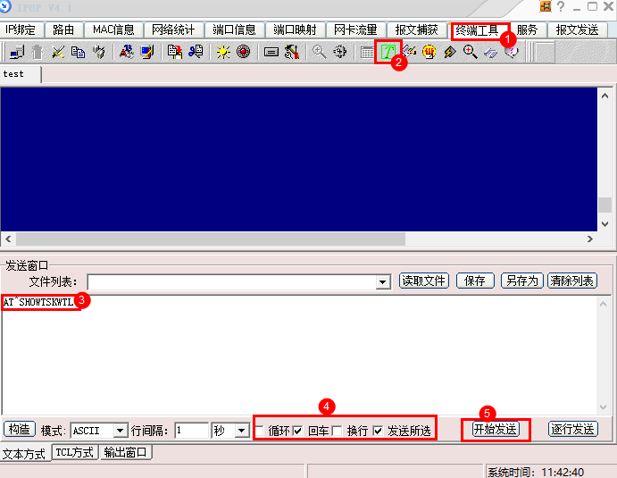

2.  命令执行结果包含所有任务的任务栈分配情况如[图2](#zh-cn_topic_0000002444646237_fig14788195491511)所示。

    参数说明如下：

    stackTop：任务栈初始化时的栈顶；

    stackLen：任务栈大小；

    peakUsage：峰值任务栈使用量；

    sp：当前任务栈栈顶；

    peakRatio：任务栈峰值使用率。

    **图 2**  命令执行结果<a name="zh-cn_topic_0000002444646237_fig14788195491511"></a>  
    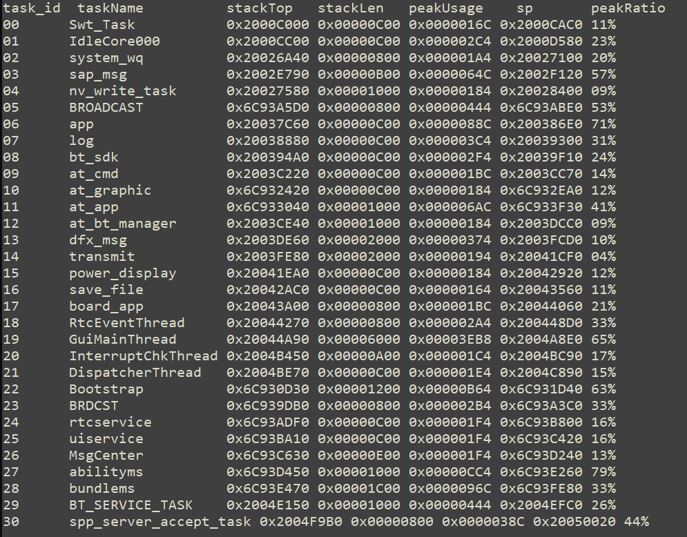

# DebugKits使用说明<a name="ZH-CN_TOPIC_0000002499581445"></a>

DIAG大部分维测功能都需要配合DebugKits工具使用，简要介绍一下DebugKits工具的使用方法。（详情请参见《DebugKits工具 使用指南》）

1.  进入工具页面，单击“Options”再选择“Change Chip”，在弹框中选择芯片类型，如[图1](#zh-cn_topic_0000002411047144_fig1792002424914)所示。

    **图 1**  选择芯片<a name="zh-cn_topic_0000002411047144_fig1792002424914"></a>  
    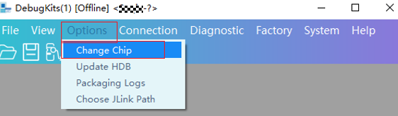

2.  单击“Connection”选择“Connect”在弹窗中选择连接方式以及对应的通道序号进行连接，如[图2](#zh-cn_topic_0000002411047144_fig12988173465017)所示。

    **图 2**  连接芯片<a name="zh-cn_topic_0000002411047144_fig12988173465017"></a>  
    
    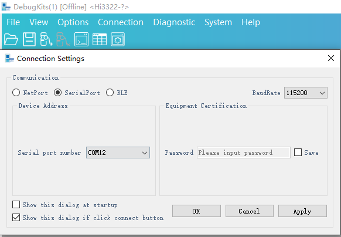

3.  更新数据库。如果是第一次连接芯片或者芯片有新版本的程序，需要更新HDB并重新连接之后，日志的打印才能正确的显示，在Option菜单下选择“Update HDB”，选择生成的database目录（output\\3322\\database\_evb）再单击“OK”即可完成配置，具体如[图3](#zh-cn_topic_0000002411047144_fig382085111518)所示。

    **图 3**  配置database<a name="zh-cn_topic_0000002411047144_fig382085111518"></a>  
    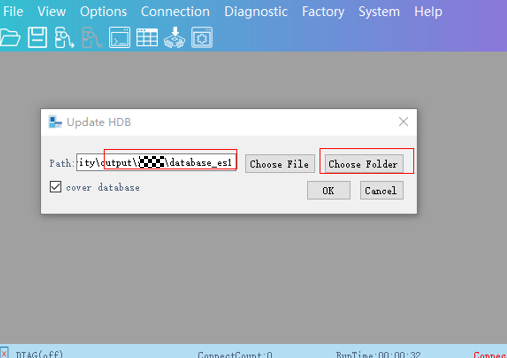

4.  消息界面。单击菜单栏或工具栏上的命令行图标，可打开消息界面查看日志。

    **图 4**  打开消息界面<a name="zh-cn_topic_0000002411047144_fig10287113085210"></a>  
    

    **图 5**  查看日志<a name="zh-cn_topic_0000002411047144_fig4281164725210"></a>  
    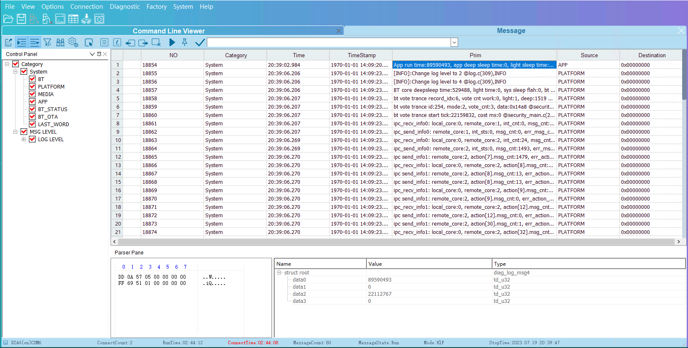

5.  命令行界面。单击菜单栏或工具栏上的命令行图标，可打开命令行界面。

    **图 6**  打开命令行界面<a name="zh-cn_topic_0000002411047144_fig17208142245318"></a>  
    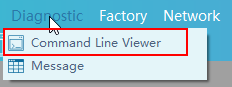

    **图 7**  命令输入<a name="zh-cn_topic_0000002411047144_fig36431241185310"></a>  
    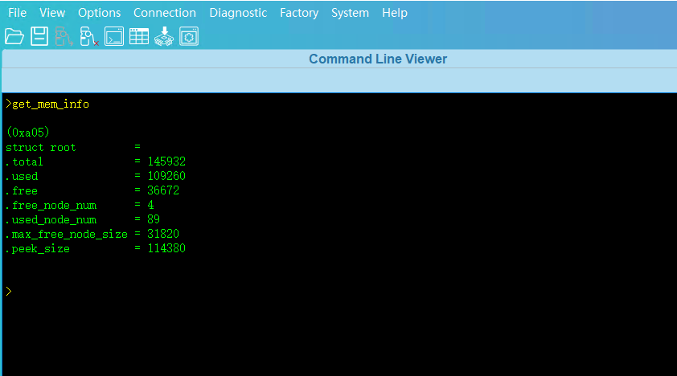

# 缩略语<a name="ZH-CN_TOPIC_0000002499501293"></a>

<a name="zh-cn_topic_0000002450510418_table17604153212250"></a>
<table><tbody><tr id="zh-cn_topic_0000002450510418_row17672132112515"><td class="nocellnorowborder" style="border:none" valign="top" width="19.060606060606062%"><p id="zh-cn_topic_0000002450510418_p7672183282520"><a name="zh-cn_topic_0000002450510418_p7672183282520"></a><a name="zh-cn_topic_0000002450510418_p7672183282520"></a><strong id="zh-cn_topic_0000002450510418_b1567283216251"><a name="zh-cn_topic_0000002450510418_b1567283216251"></a><a name="zh-cn_topic_0000002450510418_b1567283216251"></a>B</strong></p>
</td>
<td class="nocellnorowborder" style="border:none" valign="top" width="44.141414141414145%">&nbsp;&nbsp;</td>
<td class="cell-norowborder" style="border:none" valign="top" width="36.7979797979798%">&nbsp;&nbsp;</td>
</tr>
<tr id="zh-cn_topic_0000002450510418_row1367213242516"><td class="nocellnorowborder" style="border:none" valign="top" width="19.060606060606062%"><p id="zh-cn_topic_0000002450510418_p86727326259"><a name="zh-cn_topic_0000002450510418_p86727326259"></a><a name="zh-cn_topic_0000002450510418_p86727326259"></a><strong id="zh-cn_topic_0000002450510418_b13672123262512"><a name="zh-cn_topic_0000002450510418_b13672123262512"></a><a name="zh-cn_topic_0000002450510418_b13672123262512"></a>BT</strong></p>
</td>
<td class="nocellnorowborder" style="border:none" valign="top" width="44.141414141414145%"><p id="zh-cn_topic_0000002450510418_p14672103282517"><a name="zh-cn_topic_0000002450510418_p14672103282517"></a><a name="zh-cn_topic_0000002450510418_p14672103282517"></a>Bluetooth</p>
</td>
<td class="cell-norowborder" style="border:none" valign="top" width="36.7979797979798%"><p id="zh-cn_topic_0000002450510418_p1672133218251"><a name="zh-cn_topic_0000002450510418_p1672133218251"></a><a name="zh-cn_topic_0000002450510418_p1672133218251"></a>蓝牙</p>
</td>
</tr>
<tr id="zh-cn_topic_0000002450510418_row36722326252"><td class="nocellnorowborder" style="border:none" valign="top" width="19.060606060606062%">&nbsp;&nbsp;</td>
<td class="nocellnorowborder" style="border:none" valign="top" width="44.141414141414145%">&nbsp;&nbsp;</td>
<td class="cell-norowborder" style="border:none" valign="top" width="36.7979797979798%">&nbsp;&nbsp;</td>
</tr>
<tr id="zh-cn_topic_0000002450510418_row1067243272510"><td class="nocellnorowborder" style="border:none" valign="top" width="19.060606060606062%"><p id="zh-cn_topic_0000002450510418_p1667319329251"><a name="zh-cn_topic_0000002450510418_p1667319329251"></a><a name="zh-cn_topic_0000002450510418_p1667319329251"></a><strong id="zh-cn_topic_0000002450510418_b17673123242515"><a name="zh-cn_topic_0000002450510418_b17673123242515"></a><a name="zh-cn_topic_0000002450510418_b17673123242515"></a>C</strong></p>
</td>
<td class="nocellnorowborder" style="border:none" valign="top" width="44.141414141414145%">&nbsp;&nbsp;</td>
<td class="cell-norowborder" style="border:none" valign="top" width="36.7979797979798%">&nbsp;&nbsp;</td>
</tr>
<tr id="zh-cn_topic_0000002450510418_row18230165442819"><td class="nocellnorowborder" style="border:none" valign="top" width="19.060606060606062%"><p id="zh-cn_topic_0000002450510418_p6230954182815"><a name="zh-cn_topic_0000002450510418_p6230954182815"></a><a name="zh-cn_topic_0000002450510418_p6230954182815"></a><strong id="zh-cn_topic_0000002450510418_b3389406296"><a name="zh-cn_topic_0000002450510418_b3389406296"></a><a name="zh-cn_topic_0000002450510418_b3389406296"></a>CHR</strong></p>
</td>
<td class="nocellnorowborder" style="border:none" valign="top" width="44.141414141414145%"><p id="zh-cn_topic_0000002450510418_p265014485497"><a name="zh-cn_topic_0000002450510418_p265014485497"></a><a name="zh-cn_topic_0000002450510418_p265014485497"></a>Communication History Record</p>
</td>
<td class="cell-norowborder" style="border:none" valign="top" width="36.7979797979798%"><p id="zh-cn_topic_0000002450510418_p19230155414288"><a name="zh-cn_topic_0000002450510418_p19230155414288"></a><a name="zh-cn_topic_0000002450510418_p19230155414288"></a>通信历史记录</p>
</td>
</tr>
<tr id="zh-cn_topic_0000002450510418_row1367317325252"><td class="nocellnorowborder" style="border:none" valign="top" width="19.060606060606062%"><p id="zh-cn_topic_0000002450510418_p186739329258"><a name="zh-cn_topic_0000002450510418_p186739329258"></a><a name="zh-cn_topic_0000002450510418_p186739329258"></a><strong id="zh-cn_topic_0000002450510418_b12673123216259"><a name="zh-cn_topic_0000002450510418_b12673123216259"></a><a name="zh-cn_topic_0000002450510418_b12673123216259"></a>CPU</strong></p>
</td>
<td class="nocellnorowborder" style="border:none" valign="top" width="44.141414141414145%"><p id="zh-cn_topic_0000002450510418_p1067311326257"><a name="zh-cn_topic_0000002450510418_p1067311326257"></a><a name="zh-cn_topic_0000002450510418_p1067311326257"></a>Central Processing Unit</p>
</td>
<td class="cell-norowborder" style="border:none" valign="top" width="36.7979797979798%"><p id="zh-cn_topic_0000002450510418_p067333218253"><a name="zh-cn_topic_0000002450510418_p067333218253"></a><a name="zh-cn_topic_0000002450510418_p067333218253"></a>中央处理器</p>
</td>
</tr>
<tr id="zh-cn_topic_0000002450510418_row6673103252517"><td class="nocellnorowborder" style="border:none" valign="top" width="19.060606060606062%">&nbsp;&nbsp;</td>
<td class="nocellnorowborder" style="border:none" valign="top" width="44.141414141414145%">&nbsp;&nbsp;</td>
<td class="cell-norowborder" style="border:none" valign="top" width="36.7979797979798%">&nbsp;&nbsp;</td>
</tr>
<tr id="zh-cn_topic_0000002450510418_row1867319322253"><td class="nocellnorowborder" style="border:none" valign="top" width="19.060606060606062%"><p id="zh-cn_topic_0000002450510418_p156731332152519"><a name="zh-cn_topic_0000002450510418_p156731332152519"></a><a name="zh-cn_topic_0000002450510418_p156731332152519"></a><strong id="zh-cn_topic_0000002450510418_b18673432162512"><a name="zh-cn_topic_0000002450510418_b18673432162512"></a><a name="zh-cn_topic_0000002450510418_b18673432162512"></a>D</strong></p>
</td>
<td class="nocellnorowborder" style="border:none" valign="top" width="44.141414141414145%">&nbsp;&nbsp;</td>
<td class="cell-norowborder" style="border:none" valign="top" width="36.7979797979798%">&nbsp;&nbsp;</td>
</tr>
<tr id="zh-cn_topic_0000002450510418_row126731932172516"><td class="nocellnorowborder" style="border:none" valign="top" width="19.060606060606062%"><p id="zh-cn_topic_0000002450510418_p18673113292517"><a name="zh-cn_topic_0000002450510418_p18673113292517"></a><a name="zh-cn_topic_0000002450510418_p18673113292517"></a><strong id="zh-cn_topic_0000002450510418_b17673632172517"><a name="zh-cn_topic_0000002450510418_b17673632172517"></a><a name="zh-cn_topic_0000002450510418_b17673632172517"></a>DFX</strong></p>
</td>
<td class="nocellnorowborder" style="border:none" valign="top" width="44.141414141414145%"><p id="zh-cn_topic_0000002450510418_p13673143211256"><a name="zh-cn_topic_0000002450510418_p13673143211256"></a><a name="zh-cn_topic_0000002450510418_p13673143211256"></a>Design For X</p>
</td>
<td class="cell-norowborder" style="border:none" valign="top" width="36.7979797979798%"><p id="zh-cn_topic_0000002450510418_p1467313211255"><a name="zh-cn_topic_0000002450510418_p1467313211255"></a><a name="zh-cn_topic_0000002450510418_p1467313211255"></a>面向X的设计（可测试性、可制造性、可服务性等）</p>
</td>
</tr>
<tr id="zh-cn_topic_0000002450510418_row10116105012273"><td class="nocellnorowborder" style="border:none" valign="top" width="19.060606060606062%"><p id="zh-cn_topic_0000002450510418_p7117105019277"><a name="zh-cn_topic_0000002450510418_p7117105019277"></a><a name="zh-cn_topic_0000002450510418_p7117105019277"></a><strong id="zh-cn_topic_0000002450510418_b207481455122710"><a name="zh-cn_topic_0000002450510418_b207481455122710"></a><a name="zh-cn_topic_0000002450510418_b207481455122710"></a>DIAG</strong></p>
</td>
<td class="nocellnorowborder" style="border:none" valign="top" width="44.141414141414145%"><p id="zh-cn_topic_0000002450510418_p13117125019277"><a name="zh-cn_topic_0000002450510418_p13117125019277"></a><a name="zh-cn_topic_0000002450510418_p13117125019277"></a>Diagnosis</p>
</td>
<td class="cell-norowborder" style="border:none" valign="top" width="36.7979797979798%"><p id="zh-cn_topic_0000002450510418_p9117105022716"><a name="zh-cn_topic_0000002450510418_p9117105022716"></a><a name="zh-cn_topic_0000002450510418_p9117105022716"></a>诊断</p>
</td>
</tr>
<tr id="zh-cn_topic_0000002450510418_row166739320254"><td class="nocellnorowborder" style="border:none" valign="top" width="19.060606060606062%">&nbsp;&nbsp;</td>
<td class="nocellnorowborder" style="border:none" valign="top" width="44.141414141414145%">&nbsp;&nbsp;</td>
<td class="cell-norowborder" style="border:none" valign="top" width="36.7979797979798%">&nbsp;&nbsp;</td>
</tr>
<tr id="zh-cn_topic_0000002450510418_row1867393217259"><td class="nocellnorowborder" style="border:none" valign="top" width="19.060606060606062%"><p id="zh-cn_topic_0000002450510418_p1467333292512"><a name="zh-cn_topic_0000002450510418_p1467333292512"></a><a name="zh-cn_topic_0000002450510418_p1467333292512"></a><strong id="zh-cn_topic_0000002450510418_b16673183222513"><a name="zh-cn_topic_0000002450510418_b16673183222513"></a><a name="zh-cn_topic_0000002450510418_b16673183222513"></a>G</strong></p>
</td>
<td class="nocellnorowborder" style="border:none" valign="top" width="44.141414141414145%">&nbsp;&nbsp;</td>
<td class="cell-norowborder" style="border:none" valign="top" width="36.7979797979798%">&nbsp;&nbsp;</td>
</tr>
<tr id="zh-cn_topic_0000002450510418_row3673173262519"><td class="nocellnorowborder" style="border:none" valign="top" width="19.060606060606062%"><p id="zh-cn_topic_0000002450510418_p86735321252"><a name="zh-cn_topic_0000002450510418_p86735321252"></a><a name="zh-cn_topic_0000002450510418_p86735321252"></a><strong id="zh-cn_topic_0000002450510418_b1767353210254"><a name="zh-cn_topic_0000002450510418_b1767353210254"></a><a name="zh-cn_topic_0000002450510418_b1767353210254"></a>GP</strong></p>
</td>
<td class="nocellnorowborder" style="border:none" valign="top" width="44.141414141414145%"><p id="zh-cn_topic_0000002450510418_p14673103213259"><a name="zh-cn_topic_0000002450510418_p14673103213259"></a><a name="zh-cn_topic_0000002450510418_p14673103213259"></a>Global Pointer</p>
</td>
<td class="cell-norowborder" style="border:none" valign="top" width="36.7979797979798%"><p id="zh-cn_topic_0000002450510418_p13674193211253"><a name="zh-cn_topic_0000002450510418_p13674193211253"></a><a name="zh-cn_topic_0000002450510418_p13674193211253"></a>全局指针</p>
</td>
</tr>
<tr id="zh-cn_topic_0000002450510418_row1067463212515"><td class="nocellnorowborder" style="border:none" valign="top" width="19.060606060606062%">&nbsp;&nbsp;</td>
<td class="nocellnorowborder" style="border:none" valign="top" width="44.141414141414145%">&nbsp;&nbsp;</td>
<td class="cell-norowborder" style="border:none" valign="top" width="36.7979797979798%">&nbsp;&nbsp;</td>
</tr>
<tr id="zh-cn_topic_0000002450510418_row1967412324259"><td class="nocellnorowborder" style="border:none" valign="top" width="19.060606060606062%"><p id="zh-cn_topic_0000002450510418_p3674153212516"><a name="zh-cn_topic_0000002450510418_p3674153212516"></a><a name="zh-cn_topic_0000002450510418_p3674153212516"></a><strong id="zh-cn_topic_0000002450510418_b56748329256"><a name="zh-cn_topic_0000002450510418_b56748329256"></a><a name="zh-cn_topic_0000002450510418_b56748329256"></a>J</strong></p>
</td>
<td class="nocellnorowborder" style="border:none" valign="top" width="44.141414141414145%">&nbsp;&nbsp;</td>
<td class="cell-norowborder" style="border:none" valign="top" width="36.7979797979798%">&nbsp;&nbsp;</td>
</tr>
<tr id="zh-cn_topic_0000002450510418_row367403282519"><td class="nocellnorowborder" style="border:none" valign="top" width="19.060606060606062%"><p id="zh-cn_topic_0000002450510418_p1867423217251"><a name="zh-cn_topic_0000002450510418_p1867423217251"></a><a name="zh-cn_topic_0000002450510418_p1867423217251"></a><strong id="zh-cn_topic_0000002450510418_b3674163217253"><a name="zh-cn_topic_0000002450510418_b3674163217253"></a><a name="zh-cn_topic_0000002450510418_b3674163217253"></a>JTAG</strong></p>
</td>
<td class="nocellnorowborder" style="border:none" valign="top" width="44.141414141414145%"><p id="zh-cn_topic_0000002450510418_p1674173232513"><a name="zh-cn_topic_0000002450510418_p1674173232513"></a><a name="zh-cn_topic_0000002450510418_p1674173232513"></a>Joint Test Action Group</p>
</td>
<td class="cell-norowborder" style="border:none" valign="top" width="36.7979797979798%"><p id="zh-cn_topic_0000002450510418_p267453242517"><a name="zh-cn_topic_0000002450510418_p267453242517"></a><a name="zh-cn_topic_0000002450510418_p267453242517"></a>联合测试行为组织，是一种国际标准的测试协议</p>
</td>
</tr>
<tr id="zh-cn_topic_0000002450510418_row13674332122518"><td class="nocellnorowborder" style="border:none" valign="top" width="19.060606060606062%">&nbsp;&nbsp;</td>
<td class="nocellnorowborder" style="border:none" valign="top" width="44.141414141414145%">&nbsp;&nbsp;</td>
<td class="cell-norowborder" style="border:none" valign="top" width="36.7979797979798%">&nbsp;&nbsp;</td>
</tr>
<tr id="zh-cn_topic_0000002450510418_row867517325253"><td class="nocellnorowborder" style="border:none" valign="top" width="19.060606060606062%"><p id="zh-cn_topic_0000002450510418_p186751232142516"><a name="zh-cn_topic_0000002450510418_p186751232142516"></a><a name="zh-cn_topic_0000002450510418_p186751232142516"></a><strong id="zh-cn_topic_0000002450510418_b96751432192515"><a name="zh-cn_topic_0000002450510418_b96751432192515"></a><a name="zh-cn_topic_0000002450510418_b96751432192515"></a>O</strong></p>
</td>
<td class="nocellnorowborder" style="border:none" valign="top" width="44.141414141414145%">&nbsp;&nbsp;</td>
<td class="cell-norowborder" style="border:none" valign="top" width="36.7979797979798%">&nbsp;&nbsp;</td>
</tr>
<tr id="zh-cn_topic_0000002450510418_row10675133272519"><td class="nocellnorowborder" style="border:none" valign="top" width="19.060606060606062%"><p id="zh-cn_topic_0000002450510418_p116751232112517"><a name="zh-cn_topic_0000002450510418_p116751232112517"></a><a name="zh-cn_topic_0000002450510418_p116751232112517"></a><strong id="zh-cn_topic_0000002450510418_b19675193292513"><a name="zh-cn_topic_0000002450510418_b19675193292513"></a><a name="zh-cn_topic_0000002450510418_b19675193292513"></a>OS</strong></p>
</td>
<td class="nocellnorowborder" style="border:none" valign="top" width="44.141414141414145%"><p id="zh-cn_topic_0000002450510418_p96751432162515"><a name="zh-cn_topic_0000002450510418_p96751432162515"></a><a name="zh-cn_topic_0000002450510418_p96751432162515"></a>Operating System</p>
</td>
<td class="cell-norowborder" style="border:none" valign="top" width="36.7979797979798%"><p id="zh-cn_topic_0000002450510418_p13675113216251"><a name="zh-cn_topic_0000002450510418_p13675113216251"></a><a name="zh-cn_topic_0000002450510418_p13675113216251"></a>操作系统</p>
</td>
</tr>
<tr id="zh-cn_topic_0000002450510418_row19675832132512"><td class="nocellnorowborder" style="border:none" valign="top" width="19.060606060606062%">&nbsp;&nbsp;</td>
<td class="nocellnorowborder" style="border:none" valign="top" width="44.141414141414145%">&nbsp;&nbsp;</td>
<td class="cell-norowborder" style="border:none" valign="top" width="36.7979797979798%">&nbsp;&nbsp;</td>
</tr>
<tr id="zh-cn_topic_0000002450510418_row4675113232512"><td class="nocellnorowborder" style="border:none" valign="top" width="19.060606060606062%"><p id="zh-cn_topic_0000002450510418_p867583222519"><a name="zh-cn_topic_0000002450510418_p867583222519"></a><a name="zh-cn_topic_0000002450510418_p867583222519"></a><strong id="zh-cn_topic_0000002450510418_b8675153216254"><a name="zh-cn_topic_0000002450510418_b8675153216254"></a><a name="zh-cn_topic_0000002450510418_b8675153216254"></a>P</strong></p>
</td>
<td class="nocellnorowborder" style="border:none" valign="top" width="44.141414141414145%">&nbsp;&nbsp;</td>
<td class="cell-norowborder" style="border:none" valign="top" width="36.7979797979798%">&nbsp;&nbsp;</td>
</tr>
<tr id="zh-cn_topic_0000002450510418_row1967533220259"><td class="nocellnorowborder" style="border:none" valign="top" width="19.060606060606062%"><p id="zh-cn_topic_0000002450510418_p106751132142516"><a name="zh-cn_topic_0000002450510418_p106751132142516"></a><a name="zh-cn_topic_0000002450510418_p106751132142516"></a><strong id="zh-cn_topic_0000002450510418_b5675132142517"><a name="zh-cn_topic_0000002450510418_b5675132142517"></a><a name="zh-cn_topic_0000002450510418_b5675132142517"></a>PC</strong></p>
</td>
<td class="nocellnorowborder" style="border:none" valign="top" width="44.141414141414145%"><p id="zh-cn_topic_0000002450510418_p19675103213250"><a name="zh-cn_topic_0000002450510418_p19675103213250"></a><a name="zh-cn_topic_0000002450510418_p19675103213250"></a>Program counter</p>
</td>
<td class="cell-norowborder" style="border:none" valign="top" width="36.7979797979798%"><p id="zh-cn_topic_0000002450510418_p267518329257"><a name="zh-cn_topic_0000002450510418_p267518329257"></a><a name="zh-cn_topic_0000002450510418_p267518329257"></a>程序计数器</p>
</td>
</tr>
<tr id="zh-cn_topic_0000002450510418_row13675113202518"><td class="nocellnorowborder" style="border:none" valign="top" width="19.060606060606062%">&nbsp;&nbsp;</td>
<td class="nocellnorowborder" style="border:none" valign="top" width="44.141414141414145%">&nbsp;&nbsp;</td>
<td class="cell-norowborder" style="border:none" valign="top" width="36.7979797979798%">&nbsp;&nbsp;</td>
</tr>
<tr id="zh-cn_topic_0000002450510418_row116757328256"><td class="nocellnorowborder" style="border:none" valign="top" width="19.060606060606062%"><p id="zh-cn_topic_0000002450510418_p2676193217258"><a name="zh-cn_topic_0000002450510418_p2676193217258"></a><a name="zh-cn_topic_0000002450510418_p2676193217258"></a><strong id="zh-cn_topic_0000002450510418_b17676432192517"><a name="zh-cn_topic_0000002450510418_b17676432192517"></a><a name="zh-cn_topic_0000002450510418_b17676432192517"></a>R</strong></p>
</td>
<td class="nocellnorowborder" style="border:none" valign="top" width="44.141414141414145%">&nbsp;&nbsp;</td>
<td class="cell-norowborder" style="border:none" valign="top" width="36.7979797979798%">&nbsp;&nbsp;</td>
</tr>
<tr id="zh-cn_topic_0000002450510418_row2676132112515"><td class="nocellnorowborder" style="border:none" valign="top" width="19.060606060606062%"><p id="zh-cn_topic_0000002450510418_p136761532142515"><a name="zh-cn_topic_0000002450510418_p136761532142515"></a><a name="zh-cn_topic_0000002450510418_p136761532142515"></a><strong id="zh-cn_topic_0000002450510418_b12676173219256"><a name="zh-cn_topic_0000002450510418_b12676173219256"></a><a name="zh-cn_topic_0000002450510418_b12676173219256"></a>RA</strong></p>
</td>
<td class="nocellnorowborder" style="border:none" valign="top" width="44.141414141414145%"><p id="zh-cn_topic_0000002450510418_p267633262513"><a name="zh-cn_topic_0000002450510418_p267633262513"></a><a name="zh-cn_topic_0000002450510418_p267633262513"></a>Return Address</p>
</td>
<td class="cell-norowborder" style="border:none" valign="top" width="36.7979797979798%"><p id="zh-cn_topic_0000002450510418_p1567618329256"><a name="zh-cn_topic_0000002450510418_p1567618329256"></a><a name="zh-cn_topic_0000002450510418_p1567618329256"></a>返回地址</p>
</td>
</tr>
<tr id="zh-cn_topic_0000002450510418_row1167683211256"><td class="nocellnorowborder" style="border:none" valign="top" width="19.060606060606062%">&nbsp;&nbsp;</td>
<td class="nocellnorowborder" style="border:none" valign="top" width="44.141414141414145%">&nbsp;&nbsp;</td>
<td class="cell-norowborder" style="border:none" valign="top" width="36.7979797979798%">&nbsp;&nbsp;</td>
</tr>
<tr id="zh-cn_topic_0000002450510418_row067614325255"><td class="nocellnorowborder" style="border:none" valign="top" width="19.060606060606062%"><p id="zh-cn_topic_0000002450510418_p1267643210257"><a name="zh-cn_topic_0000002450510418_p1267643210257"></a><a name="zh-cn_topic_0000002450510418_p1267643210257"></a><strong id="zh-cn_topic_0000002450510418_b15676532202512"><a name="zh-cn_topic_0000002450510418_b15676532202512"></a><a name="zh-cn_topic_0000002450510418_b15676532202512"></a>S</strong></p>
</td>
<td class="nocellnorowborder" style="border:none" valign="top" width="44.141414141414145%">&nbsp;&nbsp;</td>
<td class="cell-norowborder" style="border:none" valign="top" width="36.7979797979798%">&nbsp;&nbsp;</td>
</tr>
<tr id="zh-cn_topic_0000002450510418_row267618327255"><td class="nocellnorowborder" style="border:none" valign="top" width="19.060606060606062%"><p id="zh-cn_topic_0000002450510418_p15676193232513"><a name="zh-cn_topic_0000002450510418_p15676193232513"></a><a name="zh-cn_topic_0000002450510418_p15676193232513"></a><strong id="zh-cn_topic_0000002450510418_b3676132172518"><a name="zh-cn_topic_0000002450510418_b3676132172518"></a><a name="zh-cn_topic_0000002450510418_b3676132172518"></a>SP</strong></p>
</td>
<td class="nocellnorowborder" style="border:none" valign="top" width="44.141414141414145%"><p id="zh-cn_topic_0000002450510418_p7676133292519"><a name="zh-cn_topic_0000002450510418_p7676133292519"></a><a name="zh-cn_topic_0000002450510418_p7676133292519"></a>Stack Pointer</p>
</td>
<td class="cell-norowborder" style="border:none" valign="top" width="36.7979797979798%"><p id="zh-cn_topic_0000002450510418_p4676173217254"><a name="zh-cn_topic_0000002450510418_p4676173217254"></a><a name="zh-cn_topic_0000002450510418_p4676173217254"></a>栈指针</p>
</td>
</tr>
<tr id="zh-cn_topic_0000002450510418_row1667612328251"><td class="nocellnorowborder" style="border:none" valign="top" width="19.060606060606062%">&nbsp;&nbsp;</td>
<td class="nocellnorowborder" style="border:none" valign="top" width="44.141414141414145%">&nbsp;&nbsp;</td>
<td class="cell-norowborder" style="border:none" valign="top" width="36.7979797979798%">&nbsp;&nbsp;</td>
</tr>
<tr id="zh-cn_topic_0000002450510418_row267673212516"><td class="nocellnorowborder" style="border:none" valign="top" width="19.060606060606062%"><p id="zh-cn_topic_0000002450510418_p56768320250"><a name="zh-cn_topic_0000002450510418_p56768320250"></a><a name="zh-cn_topic_0000002450510418_p56768320250"></a><strong id="zh-cn_topic_0000002450510418_b267612321257"><a name="zh-cn_topic_0000002450510418_b267612321257"></a><a name="zh-cn_topic_0000002450510418_b267612321257"></a>T</strong></p>
</td>
<td class="nocellnorowborder" style="border:none" valign="top" width="44.141414141414145%">&nbsp;&nbsp;</td>
<td class="cell-norowborder" style="border:none" valign="top" width="36.7979797979798%">&nbsp;&nbsp;</td>
</tr>
<tr id="zh-cn_topic_0000002450510418_row167663282512"><td class="nocellnorowborder" style="border:none" valign="top" width="19.060606060606062%"><p id="zh-cn_topic_0000002450510418_p667683210252"><a name="zh-cn_topic_0000002450510418_p667683210252"></a><a name="zh-cn_topic_0000002450510418_p667683210252"></a><strong id="zh-cn_topic_0000002450510418_b467633213255"><a name="zh-cn_topic_0000002450510418_b467633213255"></a><a name="zh-cn_topic_0000002450510418_b467633213255"></a>TP</strong></p>
</td>
<td class="nocellnorowborder" style="border:none" valign="top" width="44.141414141414145%"><p id="zh-cn_topic_0000002450510418_p11676103212515"><a name="zh-cn_topic_0000002450510418_p11676103212515"></a><a name="zh-cn_topic_0000002450510418_p11676103212515"></a>Thread Pointer</p>
</td>
<td class="cell-norowborder" style="border:none" valign="top" width="36.7979797979798%"><p id="zh-cn_topic_0000002450510418_p56761132172514"><a name="zh-cn_topic_0000002450510418_p56761132172514"></a><a name="zh-cn_topic_0000002450510418_p56761132172514"></a>线程指针</p>
</td>
</tr>
<tr id="zh-cn_topic_0000002450510418_row10676153232513"><td class="nocellnorowborder" style="border:none" valign="top" width="19.060606060606062%">&nbsp;&nbsp;</td>
<td class="nocellnorowborder" style="border:none" valign="top" width="44.141414141414145%">&nbsp;&nbsp;</td>
<td class="cell-norowborder" style="border:none" valign="top" width="36.7979797979798%">&nbsp;&nbsp;</td>
</tr>
<tr id="zh-cn_topic_0000002450510418_row1867723242516"><td class="nocellnorowborder" style="border:none" valign="top" width="19.060606060606062%"><p id="zh-cn_topic_0000002450510418_p176771932112512"><a name="zh-cn_topic_0000002450510418_p176771932112512"></a><a name="zh-cn_topic_0000002450510418_p176771932112512"></a><strong id="zh-cn_topic_0000002450510418_b16677532122518"><a name="zh-cn_topic_0000002450510418_b16677532122518"></a><a name="zh-cn_topic_0000002450510418_b16677532122518"></a>X</strong></p>
</td>
<td class="nocellnorowborder" style="border:none" valign="top" width="44.141414141414145%">&nbsp;&nbsp;</td>
<td class="cell-norowborder" style="border:none" valign="top" width="36.7979797979798%">&nbsp;&nbsp;</td>
</tr>
<tr id="zh-cn_topic_0000002450510418_row15677133215253"><td class="row-nocellborder" style="border:none" valign="top" width="19.060606060606062%"><p id="zh-cn_topic_0000002450510418_p167712321256"><a name="zh-cn_topic_0000002450510418_p167712321256"></a><a name="zh-cn_topic_0000002450510418_p167712321256"></a><strong id="zh-cn_topic_0000002450510418_b146778326253"><a name="zh-cn_topic_0000002450510418_b146778326253"></a><a name="zh-cn_topic_0000002450510418_b146778326253"></a>XML</strong></p>
</td>
<td class="row-nocellborder" style="border:none" valign="top" width="44.141414141414145%"><p id="zh-cn_topic_0000002450510418_p146771532162513"><a name="zh-cn_topic_0000002450510418_p146771532162513"></a><a name="zh-cn_topic_0000002450510418_p146771532162513"></a>Extensible Markup Language</p>
</td>
<td class="cellrowborder" style="border:none" valign="top" width="36.7979797979798%"><p id="zh-cn_topic_0000002450510418_p1667733213256"><a name="zh-cn_topic_0000002450510418_p1667733213256"></a><a name="zh-cn_topic_0000002450510418_p1667733213256"></a>可扩展标记语言</p>
</td>
</tr>
</tbody>
</table>

