# 前言

**概述**

本文档主要描述了DebugKits工具的使用方法。用于帮助用户快速熟悉DebugKits工具，并可以作为查询手册，明确具体特性的正确使用方法。

**读者对象**

本文档主要适用于以下工程师：

-   技术支持工程师
-   软件工程师
-   硬件工程师

**符号约定**

在本文中可能出现下列标志，它们所代表的含义如下。

<table><thead align="left"><tr id="zh-cn_topic_0000002422480844_row1530720816410"><th class="cellrowborder" valign="top" width="20.580000000000002%" id="mcps1.1.3.1.1">
<strong id="zh-cn_topic_0000002422480844_b2136615816410">符号</strong>

</th>
<th class="cellrowborder" valign="top" width="79.42%" id="mcps1.1.3.1.2">
<strong id="zh-cn_topic_0000002422480844_b5941558116410">说明</strong>

</th>
</tr>
</thead>
<tbody><tr id="zh-cn_topic_0000002422480844_row1372280416410"><td class="cellrowborder" valign="top" width="20.580000000000002%" headers="mcps1.1.3.1.1 ">

</td>
<td class="cellrowborder" valign="top" width="79.42%" headers="mcps1.1.3.1.2 ">
表示如不避免则将会导致死亡或严重伤害的具有高等级风险的危害。

</td>
</tr>
<tr id="zh-cn_topic_0000002422480844_row466863216410"><td class="cellrowborder" valign="top" width="20.580000000000002%" headers="mcps1.1.3.1.1 ">

</td>
<td class="cellrowborder" valign="top" width="79.42%" headers="mcps1.1.3.1.2 ">
表示如不避免则可能导致死亡或严重伤害的具有中等级风险的危害。

</td>
</tr>
<tr id="zh-cn_topic_0000002422480844_row123863216410"><td class="cellrowborder" valign="top" width="20.580000000000002%" headers="mcps1.1.3.1.1 ">

</td>
<td class="cellrowborder" valign="top" width="79.42%" headers="mcps1.1.3.1.2 ">
表示如不避免则可能导致轻微或中度伤害的具有低等级风险的危害。

</td>
</tr>
<tr id="zh-cn_topic_0000002422480844_row5786682116410"><td class="cellrowborder" valign="top" width="20.580000000000002%" headers="mcps1.1.3.1.1 ">

</td>
<td class="cellrowborder" valign="top" width="79.42%" headers="mcps1.1.3.1.2 ">
用于传递设备或环境安全警示信息。如不避免则可能会导致设备损坏、数据丢失、设备性能降低或其它不可预知的结果。

“须知”不涉及人身伤害。

</td>
</tr>
<tr id="zh-cn_topic_0000002422480844_row2856923116410"><td class="cellrowborder" valign="top" width="20.580000000000002%" headers="mcps1.1.3.1.1 ">

</td>
<td class="cellrowborder" valign="top" width="79.42%" headers="mcps1.1.3.1.2 ">
对正文中重点信息的补充说明。

“说明”不是安全警示信息，不涉及人身、设备及环境伤害信息。

</td>
</tr>
</tbody>
</table>

# 概述

DebugKits（以下简称DBK）软件包是支持研发调试、现场测试等多种场景的Windows应用程序。

通用功能主要包括：

-   命令行插件

    支持以命令行的方式向单板发送命令，实现对单板的查询、设置等操作。

-   消息插件

    显示单板上报的维测信息。

-   System插件

    用于支持常用维测功能。

# 安装

> **说明：** 
>-   DBK支持的操作系统版本为Win7/Win8/Win10/Win11。
>-   中文版本DBK在英文操作系统中显示乱码的解决方法：
>    1.  打开控制面板，进入时钟、语言和区域（或者是时钟和区域）的“区域和语言”项（或者是“区域”项）。
>    2.  在“区域和语言”项（或者是“区域”项）的“管理”页签更改系统区域设置，将当前系统区域设置改为“中文\(简体，中国\)”。
>    3.  设置完成后单击确定按钮，然后重启PC即可。

-   **[产品安装](#ZH-CN_TOPIC_0000002608393119)**  

## 产品安装

DBK安装程序的安装步骤如下：

1.  双击“DebugKits.exe”打开DBK安装程序。
2.  弹出DBK安装路径选择界面，如[图1](#zh-cn_topic_0000002607953877_zh-cn_topic_0000002602569251_zh-cn_topic_0000001206282628_fig18864201320498)所示，选择好安装路径后单击“Next”按钮。若安装路径选择为C盘“Program Files”需要在运行时使用管理员权限。

    **图 1**  DBK安装路径选择界面  
    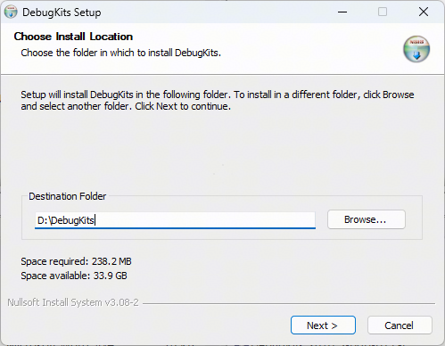

3.  弹出DBK选择产品界面，如[图2](#zh-cn_topic_0000002607953877_zh-cn_topic_0000002602569251_zh-cn_topic_0000001206282628_fig1227110548425)所示，选择对应的产品，单击“Next”按钮。

    **图 2**  DBK选择产品界面  
    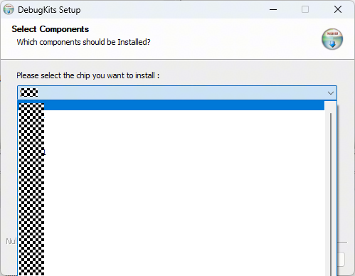

4.  弹出DBK额外任务选择界面，如[图3](#zh-cn_topic_0000002607953877_zh-cn_topic_0000002602569251_zh-cn_topic_0000001206282628_fig686471334913)所示，复选框勾选为创建桌面快捷方式，为方便后续快速打开工具，建议保持复选框勾选，单击“Next”按钮。

    **图 3**  DBK额外任务选择界面  
    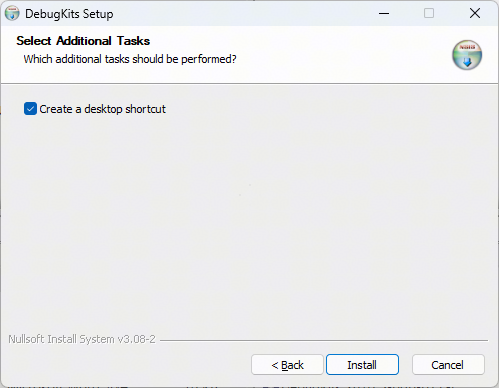

5.  弹出DBK正在安装界面，请等待约10秒钟，直至安装完成。如[图4](#zh-cn_topic_0000002607953877_zh-cn_topic_0000002602569251_zh-cn_topic_0000001206282628_fig181671847487)所示。

    **图 4**  DBK正在安装界面  
    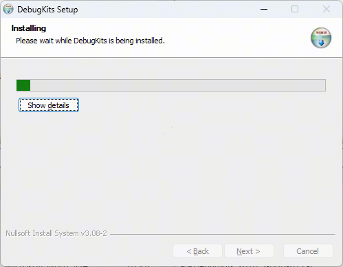

6.  弹出DBK安装完成界面，如[图5](#zh-cn_topic_0000002607953877_zh-cn_topic_0000002602569251_zh-cn_topic_0000001206282628_fig1786441312496)所示，单击“Finish”按钮退出安装。复选框选中后则默认打开DBK程序。

    **图 5**  DBK安装完成界面  
    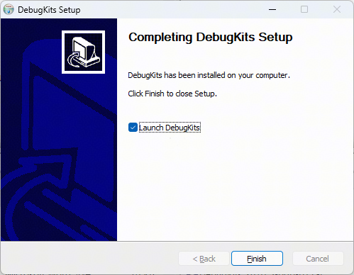

# 启动

-   **[主界面](#ZH-CN_TOPIC_0000002499581813)**  

-   **[切换芯片](#ZH-CN_TOPIC_0000002466382812)**  

-   **[更新数据库](#ZH-CN_TOPIC_0000002499501801)**  

-   **[连接设置](#ZH-CN_TOPIC_0000002466542484)**  

## 主界面

DBK主界面如[图1](#zh-cn_topic_0000002422655410_zh-cn_topic_0000001665168754_zh-cn_topic_0000001208001913_fig493827115713)所示，说明内容如[表1](#zh-cn_topic_0000002422655410_zh-cn_topic_0000001665168754_zh-cn_topic_0000001208001913_zh-cn_topic_0279615131_table18366459726)所示。

**图 1**  主界面示例  
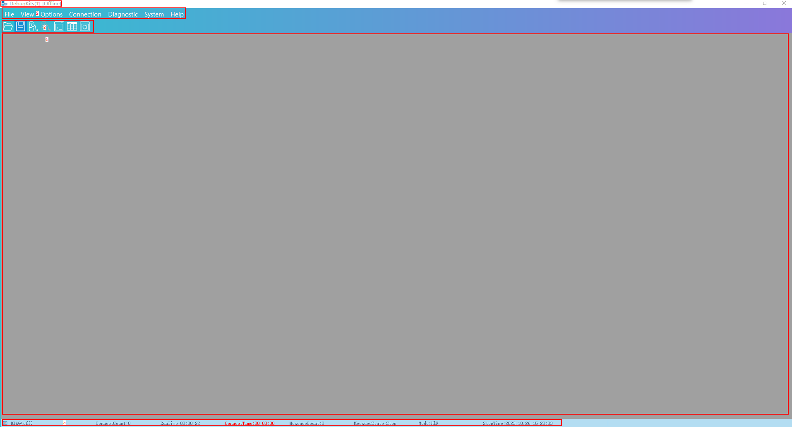

**表 1**  主界面说明

<table><thead align="left"><tr id="zh-cn_topic_0000002422655410_zh-cn_topic_0000001665168754_zh-cn_topic_0000001208001913_zh-cn_topic_0279615131_row59445735"><th class="cellrowborder" valign="top" width="15.15%" id="mcps1.2.3.1.1">
区域

</th>
<th class="cellrowborder" valign="top" width="84.85000000000001%" id="mcps1.2.3.1.2">
功能说明

</th>
</tr>
</thead>
<tbody><tr id="zh-cn_topic_0000002422655410_zh-cn_topic_0000001665168754_zh-cn_topic_0000001208001913_zh-cn_topic_0279615131_row532115"><td class="cellrowborder" valign="top" width="15.15%" headers="mcps1.2.3.1.1 ">
1

</td>
<td class="cellrowborder" valign="top" width="84.85000000000001%" headers="mcps1.2.3.1.2 ">
标题及连接状态。

</td>
</tr>
<tr id="zh-cn_topic_0000002422655410_zh-cn_topic_0000001665168754_zh-cn_topic_0000001208001913_zh-cn_topic_0279615131_row13929773"><td class="cellrowborder" valign="top" width="15.15%" headers="mcps1.2.3.1.1 ">
2

</td>
<td class="cellrowborder" valign="top" width="84.85000000000001%" headers="mcps1.2.3.1.2 ">
菜单栏。

</td>
</tr>
<tr id="zh-cn_topic_0000002422655410_zh-cn_topic_0000001665168754_zh-cn_topic_0000001208001913_zh-cn_topic_0279615131_row52974940"><td class="cellrowborder" valign="top" width="15.15%" headers="mcps1.2.3.1.1 ">
3

</td>
<td class="cellrowborder" valign="top" width="84.85000000000001%" headers="mcps1.2.3.1.2 ">
插件选择及连接控制。

</td>
</tr>
<tr id="zh-cn_topic_0000002422655410_zh-cn_topic_0000001665168754_zh-cn_topic_0000001208001913_row19945321192410"><td class="cellrowborder" valign="top" width="15.15%" headers="mcps1.2.3.1.1 ">
4

</td>
<td class="cellrowborder" valign="top" width="84.85000000000001%" headers="mcps1.2.3.1.2 ">
用户区，插件界面显示和实际操作区域。

</td>
</tr>
<tr id="zh-cn_topic_0000002422655410_zh-cn_topic_0000001665168754_zh-cn_topic_0000001208001913_row201402917249"><td class="cellrowborder" valign="top" width="15.15%" headers="mcps1.2.3.1.1 ">
5

</td>
<td class="cellrowborder" valign="top" width="84.85000000000001%" headers="mcps1.2.3.1.2 ">
状态栏。

</td>
</tr>
</tbody>
</table>

## 切换芯片

在连接单板之前，需要根据产品切换成对应芯片。操作步骤如下：

1.  在菜单栏中选择“Options”→“Change Chip”。

    **图 1**  切换芯片示意图  
    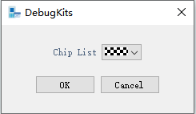

2.  选择需要的芯片名称并单击“确定”按钮。

## 更新数据库

数据库（database）是板端编译过程中产生的一系列的配置文件，在板端代码的output目录中生成，包括多个XML文件和TXT文件。

数据库的作用主要体现在两个方面：

1.  将板端到工具方向的报文结构体化或者文本化。
2.  将工具端结构体化的数据报文化。

因此在连接单板之前，需要将工具数据库更新为对应产品的数据库，以便板端运行的程序与工具端数据库一致。操作步骤如下：

1.  在菜单栏中选择“Options”→“Update HDB”，如[图1](#zh-cn_topic_0000002456054329_zh-cn_topic_0000001713128585_fig15417321132715)所示。

    **图 1**  更新数据库示意图  
    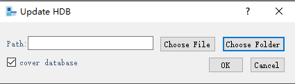

2.  选择数据库进行更新操作。
    1.  单击“Choose File”或者“Choose Folder”按钮，选择fwpkg文件或数据库文件夹。
    2.  单击“OK”按钮，更新数据库。

> **说明：** 
>-   数据库可以选择产品对应的数据库文件夹。
>-   Choose Folder可以选择名为database或database\_xxx的文件夹，一般的database文件夹会在编译后于output目录中生成，可以在output中搜索“database”关键词查找。
>-   数据库覆盖默认勾选。如果仅需要当次有效，可以通过取消勾选“覆盖数据库”选择框，不进行覆盖操作。

## 连接设置

-   **[串口连接](#ZH-CN_TOPIC_0000002466382840)**  

### 串口连接

在对单板进行操作前，DBK需要先通过串口与单板建立连接。

连接设置方法如下：

1.  打开连接设置对话框。

    在工具栏中单击“”或在菜单栏中选择“Connection”→“connect”或“Settings”。

2.  完成工具配置，并通过串口连接单板。

    **图 1**  连接设置示意图（串口）  
    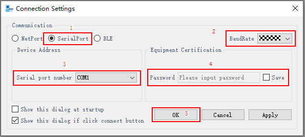

    1.  选择“SerialPort”。
    2.  使用默认波特率。
    3.  选择串口。
    4.  （可选）根据产品需要输入密码，对于部分无密码机制的产品则直接单击确定。对于有密码机制的产品，提供的软件版本默认未预置密码，因此无法建立连接。若需要设置密码，请参见产品NV/KV介绍文档中关于预置密码的信息。
    5.  单击“OK”按钮，连接单板。

> **说明：** 
>-   连接失败常见告警如下：
>    -   提示“Connection failed. 4 attempts left. Check your password or cable connection.”，一般为密码未设置、密码输入错误或连线松动等原因。设置密码请查看产品NV/KV介绍文档中关于预置密码的信息。
>    -   提示“Your PCB has been locked. 4 s remained”，一般为之前尝试过5次以上输入错误密码导致的单板锁定，请复位单板或等待锁定结束。
>    -   若无提示，同时也未显示连接成功，则需要排查：串口连线是否正确；支持睡眠机制的单板是否已进入睡眠状态。
>        睡眠唤醒方法请查看产品AT介绍文档 。
>-   连接用户名固定为“admin”，无法增删改，故此处不体现。
>-   若串口线断开重连后，则需要手动重新连接单板。
>-   左下角复选框中“show this dialog at startup”的含义是启动时自动弹出，“show this dialog if click connect button”的含义是点击connect按钮后弹出。

# 命令行插件

-   **[简介](#ZH-CN_TOPIC_0000002466542456)**  

-   **[主要功能及使用说明](#ZH-CN_TOPIC_0000002499581837)**  

## 简介

DBK命令行插件（Command Line Viewer）允许用户以命令行的方式向单板发送命令，实现对单板的查询、设置等操作。

打开命令行插件的方法：单击菜单栏或工具栏上的命令行图标即可。如[图1](#zh-cn_topic_0000002456054333_zh-cn_topic_0000001665168766_fig1978810112710)、[图2](#zh-cn_topic_0000002456054333_zh-cn_topic_0000001665168766_fig728093122617)所示。

**图 1**  打开命令行插件示例（菜单栏）  

**图 2**  打开命令行插件示例（工具栏）  

## 主要功能及使用说明

**命令行查询**

命令行输入与大部分串口工具类似，输入对应指令后回车即可，此处使用的具体命令根据产品会有差异，输入命令的首字母会出现联想列出支持的命令或者通过输入"?"或"help"得到支持的命令列表，请根据实际情况填写。

**清屏**

在命令行界面按下“Shift+Delete”组合键即可。

**设置超时时间**

如果某些命令需要比较长时间才能回复，可以设置超时时间。在命令行空白处单击右键-“Configure...”，在弹出的页面中选择“Popular”，找到“Timeout Value”，修改超时时间，单位：ms。

-   **[默认保存路径](#ZH-CN_TOPIC_0000002608553037)**  

### 默认保存路径

在命令行界面右键菜单-“Configure”-“Save”可以查看默认保存路径，如[图1](#zh-cn_topic_0000002577553984_zh-cn_topic_0000002555750224_fig6503551585)所示。

**图 1**  命令行默认保存路径  
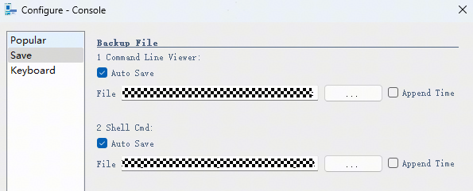

# 消息插件

-   **[简介](#ZH-CN_TOPIC_0000002466542464)**  

-   **[主要功能及使用说明](#ZH-CN_TOPIC_0000002499501789)**  

## 简介

DBK消息插件（Message）显示单板上报的维测信息，方便对单板进行调试及问题定位。

打开消息插件的方法：单击菜单栏或工具栏上的消息图标即可，如[图1](#zh-cn_topic_0000002456054337_zh-cn_topic_0000001665009050_fig1982323412711)、[图2](#zh-cn_topic_0000002456054337_zh-cn_topic_0000001665009050_fig20449192412278)所示。

**图 1**  打开消息插件示例（菜单栏）  
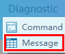

**图 2**  打开消息插件示例（工具栏）  

## 主要功能及使用说明

-   **[界面说明](#ZH-CN_TOPIC_0000002466382820)**  

-   **[菜单栏说明](#ZH-CN_TOPIC_0000002466382848)**  

-   **[工具栏说明](#ZH-CN_TOPIC_0000002466382824)**  

-   **[操作说明](#ZH-CN_TOPIC_0000002466542468)**  

### 界面说明

**图 1**  消息插件界面示例  
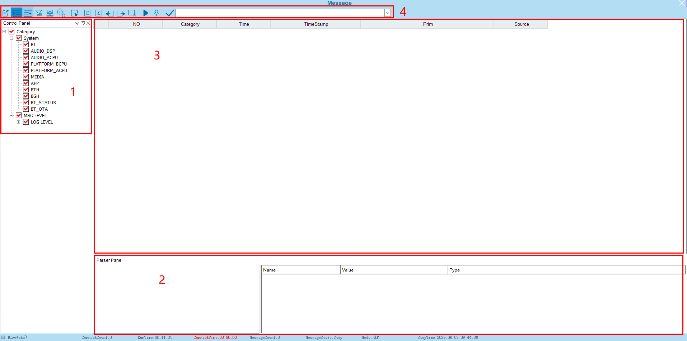

**表 1**  消息插件界面说明

<table><thead align="left"><tr id="zh-cn_topic_0000002422655422_zh-cn_topic_0000001713048609_zh-cn_topic_0000001162003414_zh-cn_topic_0279615198_row66967736"><th class="cellrowborder" valign="top" width="10.100000000000001%" id="mcps1.2.3.1.1">
标号

</th>
<th class="cellrowborder" valign="top" width="89.9%" id="mcps1.2.3.1.2">
说明

</th>
</tr>
</thead>
<tbody><tr id="zh-cn_topic_0000002422655422_zh-cn_topic_0000001713048609_zh-cn_topic_0000001162003414_zh-cn_topic_0279615198_row26729743"><td class="cellrowborder" valign="top" width="10.100000000000001%" headers="mcps1.2.3.1.1 ">
1

</td>
<td class="cellrowborder" valign="top" width="89.9%" headers="mcps1.2.3.1.2 ">
控制面板。其中：

<ul id="zh-cn_topic_0000002422655422_zh-cn_topic_0000001713048609_zh-cn_topic_0000001162003414_zh-cn_topic_0279615198_ul31259934"><li>被选中的信息将会上报。</li><li>未选中的信息不会上报。
控制面板中的模块信息各产品不同，会根据当前选择的产品自动切换。更改被选中的信息后需要点击Message工具栏图标图标下发配置。

</li></ul>
</td>
</tr>
<tr id="zh-cn_topic_0000002422655422_zh-cn_topic_0000001713048609_zh-cn_topic_0000001162003414_zh-cn_topic_0279615198_row11742498"><td class="cellrowborder" valign="top" width="10.100000000000001%" headers="mcps1.2.3.1.1 ">
2

</td>
<td class="cellrowborder" valign="top" width="89.9%" headers="mcps1.2.3.1.2 ">
解析面板。其中：

<ul id="zh-cn_topic_0000002422655422_zh-cn_topic_0000001713048609_zh-cn_topic_0000001162003414_zh-cn_topic_0279615198_ul14005657"><li>左侧：该信息的十六进制字节流。</li><li>右侧：按结构体解析的各域的值。</li></ul>
</td>
</tr>
<tr id="zh-cn_topic_0000002422655422_zh-cn_topic_0000001713048609_zh-cn_topic_0000001162003414_zh-cn_topic_0279615198_row9577344"><td class="cellrowborder" valign="top" width="10.100000000000001%" headers="mcps1.2.3.1.1 ">
3

</td>
<td class="cellrowborder" valign="top" width="89.9%" headers="mcps1.2.3.1.2 ">
维测信息表格。其中：

<ul id="zh-cn_topic_0000002422655422_zh-cn_topic_0000001713048609_zh-cn_topic_0000001162003414_ul1436062312522"><li>NO：日志编号。</li><li>Category：日志类型。</li></ul>
<ul id="zh-cn_topic_0000002422655422_zh-cn_topic_0000001713048609_zh-cn_topic_0000001162003414_zh-cn_topic_0279615198_ul6190888"><li>Time：DBK收到该信息时记录下的时间。</li><li>TimeStamp：单板上报信息附带的时间戳，描述的是单板打印这条信息的时间。</li><li>Prim：该信息的描述。</li><li>Source：日志来源模块。</li><li>Destination：日志目的模块。（默认隐藏，可通过显示）</li></ul>
</td>
</tr>
<tr id="zh-cn_topic_0000002422655422_zh-cn_topic_0000001713048609_zh-cn_topic_0000001162003414_zh-cn_topic_0279615198_row17557458"><td class="cellrowborder" valign="top" width="10.100000000000001%" headers="mcps1.2.3.1.1 ">
4

</td>
<td class="cellrowborder" valign="top" width="89.9%" headers="mcps1.2.3.1.2 ">
工具栏，功能请参见“<a href="#ZH-CN_TOPIC_0000002466382824">工具栏说明</a>”章节。

</td>
</tr>
</tbody>
</table>

### 菜单栏说明

维测信息表格界面右击可以出现菜单栏，回放日志时为[图1](#zh-cn_topic_0000002456134241_zh-cn_topic_0000001665168774_zh-cn_topic_0000001434555101_zh-cn_topic_0279615198_fig57465396)，实时日志时为[图2](#zh-cn_topic_0000002456134241_zh-cn_topic_0000001665168774_zh-cn_topic_0000001434555101_fig422435718357)所示。菜单说明如[表1](#zh-cn_topic_0000002456134241_zh-cn_topic_0000001665168774_zh-cn_topic_0000001434555101_zh-cn_topic_0279615198_table24185505)所示。

**图 1**  消息插件界面右键菜单示例1  
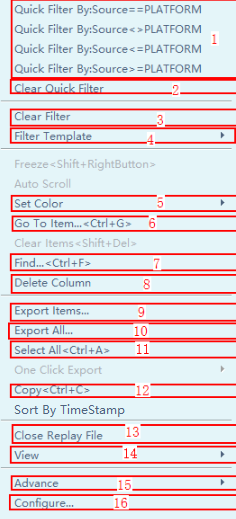

**图 2**  消息插件界面右键菜单示例2  
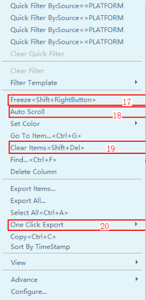

**表 1**  消息插件菜单说明

<table><thead align="left"><tr id="zh-cn_topic_0000002456134241_zh-cn_topic_0000001665168774_zh-cn_topic_0000001434555101_zh-cn_topic_0279615198_row66967736"><th class="cellrowborder" valign="top" width="10.100000000000001%" id="mcps1.2.3.1.1">
标号

</th>
<th class="cellrowborder" valign="top" width="89.9%" id="mcps1.2.3.1.2">
说明

</th>
</tr>
</thead>
<tbody><tr id="zh-cn_topic_0000002456134241_zh-cn_topic_0000001665168774_zh-cn_topic_0000001434555101_zh-cn_topic_0279615198_row26729743"><td class="cellrowborder" valign="top" width="10.100000000000001%" headers="mcps1.2.3.1.1 ">
1

</td>
<td class="cellrowborder" valign="top" width="89.9%" headers="mcps1.2.3.1.2 ">
快速过滤。功能使用请参见“<a href="#ZH-CN_TOPIC_0000002499581825">快速过滤</a>”章节。

</td>
</tr>
<tr id="zh-cn_topic_0000002456134241_zh-cn_topic_0000001665168774_zh-cn_topic_0000001434555101_zh-cn_topic_0279615198_row11742498"><td class="cellrowborder" valign="top" width="10.100000000000001%" headers="mcps1.2.3.1.1 ">
2

</td>
<td class="cellrowborder" valign="top" width="89.9%" headers="mcps1.2.3.1.2 ">
清除快速过滤。

</td>
</tr>
<tr id="zh-cn_topic_0000002456134241_zh-cn_topic_0000001665168774_zh-cn_topic_0000001434555101_zh-cn_topic_0279615198_row9577344"><td class="cellrowborder" valign="top" width="10.100000000000001%" headers="mcps1.2.3.1.1 ">
3

</td>
<td class="cellrowborder" valign="top" width="89.9%" headers="mcps1.2.3.1.2 ">
清除所有过滤。

</td>
</tr>
<tr id="zh-cn_topic_0000002456134241_zh-cn_topic_0000001665168774_zh-cn_topic_0000001434555101_zh-cn_topic_0279615198_row17557458"><td class="cellrowborder" valign="top" width="10.100000000000001%" headers="mcps1.2.3.1.1 ">
4

</td>
<td class="cellrowborder" valign="top" width="89.9%" headers="mcps1.2.3.1.2 ">
过滤模板。功能使用请参见“<a href="#ZH-CN_TOPIC_0000002466382832">过滤模板</a>”章节。

</td>
</tr>
<tr id="zh-cn_topic_0000002456134241_zh-cn_topic_0000001665168774_zh-cn_topic_0000001434555101_zh-cn_topic_0279615198_row52660921"><td class="cellrowborder" valign="top" width="10.100000000000001%" headers="mcps1.2.3.1.1 ">
5

</td>
<td class="cellrowborder" valign="top" width="89.9%" headers="mcps1.2.3.1.2 ">
颜色设置。功能使用请参见“<a href="#ZH-CN_TOPIC_0000002499501773">颜色设置</a>”章节。

</td>
</tr>
<tr id="zh-cn_topic_0000002456134241_zh-cn_topic_0000001665168774_zh-cn_topic_0000001434555101_zh-cn_topic_0279615198_row31466165"><td class="cellrowborder" valign="top" width="10.100000000000001%" headers="mcps1.2.3.1.1 ">
6

</td>
<td class="cellrowborder" valign="top" width="89.9%" headers="mcps1.2.3.1.2 ">
行跳转。快捷键为Ctrl+G。功能使用请参见“<a href="#ZH-CN_TOPIC_0000002466542448">行跳转</a>”章节。

</td>
</tr>
<tr id="zh-cn_topic_0000002456134241_zh-cn_topic_0000001665168774_zh-cn_topic_0000001434555101_row18852142017542"><td class="cellrowborder" valign="top" width="10.100000000000001%" headers="mcps1.2.3.1.1 ">
7

</td>
<td class="cellrowborder" valign="top" width="89.9%" headers="mcps1.2.3.1.2 ">
查找。快捷键为Ctrl+F。功能使用请参见“<a href="#ZH-CN_TOPIC_0000002499501733">查找日志</a>”章节。

</td>
</tr>
<tr id="zh-cn_topic_0000002456134241_zh-cn_topic_0000001665168774_zh-cn_topic_0000001434555101_row14236112495710"><td class="cellrowborder" valign="top" width="10.100000000000001%" headers="mcps1.2.3.1.1 ">
8

</td>
<td class="cellrowborder" valign="top" width="89.9%" headers="mcps1.2.3.1.2 ">
删除列。只能删除新增列。

</td>
</tr>
<tr id="zh-cn_topic_0000002456134241_zh-cn_topic_0000001665168774_zh-cn_topic_0000001434555101_row1599044212574"><td class="cellrowborder" valign="top" width="10.100000000000001%" headers="mcps1.2.3.1.1 ">
9

</td>
<td class="cellrowborder" valign="top" width="89.9%" headers="mcps1.2.3.1.2 ">
导出选中行。

</td>
</tr>
<tr id="zh-cn_topic_0000002456134241_zh-cn_topic_0000001665168774_zh-cn_topic_0000001434555101_row1430414467576"><td class="cellrowborder" valign="top" width="10.100000000000001%" headers="mcps1.2.3.1.1 ">
10

</td>
<td class="cellrowborder" valign="top" width="89.9%" headers="mcps1.2.3.1.2 ">
导出所有日志。

</td>
</tr>
<tr id="zh-cn_topic_0000002456134241_zh-cn_topic_0000001665168774_zh-cn_topic_0000001434555101_row218444915717"><td class="cellrowborder" valign="top" width="10.100000000000001%" headers="mcps1.2.3.1.1 ">
11

</td>
<td class="cellrowborder" valign="top" width="89.9%" headers="mcps1.2.3.1.2 ">
选中所有日志。快捷键为Ctrl+A。

</td>
</tr>
<tr id="zh-cn_topic_0000002456134241_zh-cn_topic_0000001665168774_zh-cn_topic_0000001434555101_row8503191017579"><td class="cellrowborder" valign="top" width="10.100000000000001%" headers="mcps1.2.3.1.1 ">
12

</td>
<td class="cellrowborder" valign="top" width="89.9%" headers="mcps1.2.3.1.2 ">
复制日志。快捷键为Ctrl+C。

</td>
</tr>
<tr id="zh-cn_topic_0000002456134241_zh-cn_topic_0000001665168774_zh-cn_topic_0000001434555101_row204914361572"><td class="cellrowborder" valign="top" width="10.100000000000001%" headers="mcps1.2.3.1.1 ">
13

</td>
<td class="cellrowborder" valign="top" width="89.9%" headers="mcps1.2.3.1.2 ">
关闭回放文件。功能使用请参见“<a href="#ZH-CN_TOPIC_0000002466382856">关闭回放文件</a>”章节。

</td>
</tr>
<tr id="zh-cn_topic_0000002456134241_zh-cn_topic_0000001665168774_zh-cn_topic_0000001434555101_row462523212576"><td class="cellrowborder" valign="top" width="10.100000000000001%" headers="mcps1.2.3.1.1 ">
14

</td>
<td class="cellrowborder" valign="top" width="89.9%" headers="mcps1.2.3.1.2 ">
视图。其中：

<ul id="zh-cn_topic_0000002456134241_zh-cn_topic_0000001665168774_zh-cn_topic_0000001434555101_zh-cn_topic_0279615198_ul14005657"><li>Tool Bar：打开/关闭工具栏。</li><li>Control Panel：打开/关闭控制台。</li><li>Parser Pane：打开/关闭解析窗口。</li></ul>
</td>
</tr>
<tr id="zh-cn_topic_0000002456134241_zh-cn_topic_0000001665168774_zh-cn_topic_0000001434555101_row6263128125716"><td class="cellrowborder" valign="top" width="10.100000000000001%" headers="mcps1.2.3.1.1 ">
15

</td>
<td class="cellrowborder" valign="top" width="89.9%" headers="mcps1.2.3.1.2 ">
高级。其中：

<ul id="zh-cn_topic_0000002456134241_zh-cn_topic_0000001665168774_zh-cn_topic_0000001434555101_ul1829234815344"><li>No Format Alignment：修改No.列的格式。</li><li>Show Enum Value：显示枚举值。</li><li>Show Prim ID：prim列显示具体数值。</li><li>Combine Replay Files：合并两个hlf文件。</li><li>Tshark Path：设置Tshark路径。</li></ul>
</td>
</tr>
<tr id="zh-cn_topic_0000002456134241_zh-cn_topic_0000001665168774_zh-cn_topic_0000001434555101_row01121817135713"><td class="cellrowborder" valign="top" width="10.100000000000001%" headers="mcps1.2.3.1.1 ">
16

</td>
<td class="cellrowborder" valign="top" width="89.9%" headers="mcps1.2.3.1.2 ">
打开配置界面，包括快捷键，颜色，自动保存策略等配置。

</td>
</tr>
<tr id="zh-cn_topic_0000002456134241_zh-cn_topic_0000001665168774_zh-cn_topic_0000001434555101_row178311146572"><td class="cellrowborder" valign="top" width="10.100000000000001%" headers="mcps1.2.3.1.1 ">
17

</td>
<td class="cellrowborder" valign="top" width="89.9%" headers="mcps1.2.3.1.2 ">
冻结窗口。暂停显示后续接收的日志，解除后重新更新日志。快捷键为Shift＋RightButton。

</td>
</tr>
<tr id="zh-cn_topic_0000002456134241_zh-cn_topic_0000001665168774_zh-cn_topic_0000001434555101_row12418513185811"><td class="cellrowborder" valign="top" width="10.100000000000001%" headers="mcps1.2.3.1.1 ">
18

</td>
<td class="cellrowborder" valign="top" width="89.9%" headers="mcps1.2.3.1.2 ">
自动滚动窗口。随着日志增加，自动滚动到最后。

</td>
</tr>
<tr id="zh-cn_topic_0000002456134241_zh-cn_topic_0000001665168774_zh-cn_topic_0000001434555101_row194081118115810"><td class="cellrowborder" valign="top" width="10.100000000000001%" headers="mcps1.2.3.1.1 ">
19

</td>
<td class="cellrowborder" valign="top" width="89.9%" headers="mcps1.2.3.1.2 ">
清空当前表格显示的日志。快捷键为Shift＋Del。

</td>
</tr>
<tr id="zh-cn_topic_0000002456134241_zh-cn_topic_0000001665168774_zh-cn_topic_0000001434555101_row97331285587"><td class="cellrowborder" valign="top" width="10.100000000000001%" headers="mcps1.2.3.1.1 ">
20

</td>
<td class="cellrowborder" valign="top" width="89.9%" headers="mcps1.2.3.1.2 ">
一键导出。目前只有一键导出json格式的功能，使用此功能时需配置Msg.xml文件。

</td>
</tr>
</tbody>
</table>

### 工具栏说明

工具栏如[图1](#zh-cn_topic_0000002456054341_zh-cn_topic_0000001665009054_zh-cn_topic_0000001434674653_fig9956164916233)所示，工具栏说明如[表1](#zh-cn_topic_0000002456054341_zh-cn_topic_0000001665009054_zh-cn_topic_0000001434674653_zh-cn_topic_0279615198_table24185505)所示。

**图 1**  工具栏示意图  

**表 1**  消息插件工具栏说明

<table><thead align="left"><tr id="zh-cn_topic_0000002456054341_zh-cn_topic_0000001665009054_zh-cn_topic_0000001434674653_zh-cn_topic_0279615198_row66967736"><th class="cellrowborder" valign="top" width="13%" id="mcps1.2.3.1.1">
标号

</th>
<th class="cellrowborder" valign="top" width="87%" id="mcps1.2.3.1.2">
说明

</th>
</tr>
</thead>
<tbody><tr id="zh-cn_topic_0000002456054341_zh-cn_topic_0000001665009054_zh-cn_topic_0000001434674653_zh-cn_topic_0279615198_row26729743"><td class="cellrowborder" valign="top" width="13%" headers="mcps1.2.3.1.1 ">
1

</td>
<td class="cellrowborder" valign="top" width="87%" headers="mcps1.2.3.1.2 ">
导出全部日志。

</td>
</tr>
<tr id="zh-cn_topic_0000002456054341_zh-cn_topic_0000001665009054_zh-cn_topic_0000001434674653_zh-cn_topic_0279615198_row11742498"><td class="cellrowborder" valign="top" width="13%" headers="mcps1.2.3.1.1 ">
2

</td>
<td class="cellrowborder" valign="top" width="87%" headers="mcps1.2.3.1.2 ">
打开/关闭Control Panel。

</td>
</tr>
<tr id="zh-cn_topic_0000002456054341_zh-cn_topic_0000001665009054_zh-cn_topic_0000001434674653_zh-cn_topic_0279615198_row9577344"><td class="cellrowborder" valign="top" width="13%" headers="mcps1.2.3.1.1 ">
3

</td>
<td class="cellrowborder" valign="top" width="87%" headers="mcps1.2.3.1.2 ">
打开/关闭Parser Pane。

</td>
</tr>
<tr id="zh-cn_topic_0000002456054341_zh-cn_topic_0000001665009054_zh-cn_topic_0000001434674653_zh-cn_topic_0279615198_row52660921"><td class="cellrowborder" valign="top" width="13%" headers="mcps1.2.3.1.1 ">
4

</td>
<td class="cellrowborder" valign="top" width="87%" headers="mcps1.2.3.1.2 ">
清除筛选模板。

</td>
</tr>
<tr id="zh-cn_topic_0000002456054341_zh-cn_topic_0000001665009054_zh-cn_topic_0000001434674653_zh-cn_topic_0279615198_row31466165"><td class="cellrowborder" valign="top" width="13%" headers="mcps1.2.3.1.1 ">
5

</td>
<td class="cellrowborder" valign="top" width="87%" headers="mcps1.2.3.1.2 ">
查找。快捷键为Ctrl+F。功能使用请参见“<a href="#ZH-CN_TOPIC_0000002499501733">查找日志</a>”章节。

</td>
</tr>
<tr id="zh-cn_topic_0000002456054341_zh-cn_topic_0000001665009054_zh-cn_topic_0000001434674653_row18852142017542"><td class="cellrowborder" valign="top" width="13%" headers="mcps1.2.3.1.1 ">
6

</td>
<td class="cellrowborder" valign="top" width="87%" headers="mcps1.2.3.1.2 ">
设置。

</td>
</tr>
<tr id="zh-cn_topic_0000002456054341_zh-cn_topic_0000001665009054_zh-cn_topic_0000001434674653_row14236112495710"><td class="cellrowborder" valign="top" width="13%" headers="mcps1.2.3.1.1 ">
7

</td>
<td class="cellrowborder" valign="top" width="87%" headers="mcps1.2.3.1.2 ">
显示/隐藏列。

</td>
</tr>
<tr id="zh-cn_topic_0000002456054341_zh-cn_topic_0000001665009054_zh-cn_topic_0000001434674653_row1599044212574"><td class="cellrowborder" valign="top" width="13%" headers="mcps1.2.3.1.1 ">
8

</td>
<td class="cellrowborder" valign="top" width="87%" headers="mcps1.2.3.1.2 ">
打开书签列表。

</td>
</tr>
<tr id="zh-cn_topic_0000002456054341_zh-cn_topic_0000001665009054_zh-cn_topic_0000001434674653_row1430414467576"><td class="cellrowborder" valign="top" width="13%" headers="mcps1.2.3.1.1 ">
9

</td>
<td class="cellrowborder" valign="top" width="87%" headers="mcps1.2.3.1.2 ">
添加新书签。

</td>
</tr>
<tr id="zh-cn_topic_0000002456054341_zh-cn_topic_0000001665009054_zh-cn_topic_0000001434674653_row218444915717"><td class="cellrowborder" valign="top" width="13%" headers="mcps1.2.3.1.1 ">
10

</td>
<td class="cellrowborder" valign="top" width="87%" headers="mcps1.2.3.1.2 ">
跳转到上一个书签位置。

</td>
</tr>
<tr id="zh-cn_topic_0000002456054341_zh-cn_topic_0000001665009054_zh-cn_topic_0000001434674653_row8503191017579"><td class="cellrowborder" valign="top" width="13%" headers="mcps1.2.3.1.1 ">
11

</td>
<td class="cellrowborder" valign="top" width="87%" headers="mcps1.2.3.1.2 ">
跳转到下一个书签位置。

</td>
</tr>
<tr id="zh-cn_topic_0000002456054341_zh-cn_topic_0000001665009054_zh-cn_topic_0000001434674653_row204914361572"><td class="cellrowborder" valign="top" width="13%" headers="mcps1.2.3.1.1 ">
12

</td>
<td class="cellrowborder" valign="top" width="87%" headers="mcps1.2.3.1.2 ">
删除书签。

</td>
</tr>
<tr id="zh-cn_topic_0000002456054341_zh-cn_topic_0000001665009054_zh-cn_topic_0000001434674653_row462523212576"><td class="cellrowborder" valign="top" width="13%" headers="mcps1.2.3.1.1 ">
13

</td>
<td class="cellrowborder" valign="top" width="87%" headers="mcps1.2.3.1.2 ">
控制面板状态改变后需要按下该按钮才能生效。功能使用请参见“<a href="#ZH-CN_TOPIC_0000002499501725">筛选上报的信息</a>”章节。

</td>
</tr>
<tr id="zh-cn_topic_0000002456054341_zh-cn_topic_0000001665009054_zh-cn_topic_0000001434674653_row6263128125716"><td class="cellrowborder" valign="top" width="13%" headers="mcps1.2.3.1.1 ">
14

</td>
<td class="cellrowborder" valign="top" width="87%" headers="mcps1.2.3.1.2 ">
冻结窗口。暂停显示后续接收的日志，解除后重新更新日志。

</td>
</tr>
<tr id="zh-cn_topic_0000002456054341_zh-cn_topic_0000001665009054_zh-cn_topic_0000001434674653_row01121817135713"><td class="cellrowborder" valign="top" width="13%" headers="mcps1.2.3.1.1 ">
15

</td>
<td class="cellrowborder" valign="top" width="87%" headers="mcps1.2.3.1.2 ">
模糊搜索栏。对勾按钮代表开始模糊搜索。功能使用请参见“<a href="#ZH-CN_TOPIC_0000002499501761">模糊搜索</a>”章节。

</td>
</tr>
</tbody>
</table>

### 操作说明

-   **[筛选上报的信息](#ZH-CN_TOPIC_0000002499501725)**  

-   **[快速过滤](#ZH-CN_TOPIC_0000002499581825)**  

-   **[模糊搜索](#ZH-CN_TOPIC_0000002499501761)**  

-   **[颜色设置](#ZH-CN_TOPIC_0000002499501773)**  

-   **[表格信息导出回放](#ZH-CN_TOPIC_0000002466542416)**  

-   **[新增表格列](#ZH-CN_TOPIC_0000002499581821)**  

-   **[自动保存](#ZH-CN_TOPIC_0000002466382828)**  

-   **[过滤模板](#ZH-CN_TOPIC_0000002466382832)**  

-   **[关闭回放文件](#ZH-CN_TOPIC_0000002466382856)**  

-   **[行跳转](#ZH-CN_TOPIC_0000002466542448)**  

-   **[查找日志](#ZH-CN_TOPIC_0000002499501733)**  

#### 筛选上报的信息

可控制单板上报信息的模块，常用于过滤某些不重要信息或仅开启重要信息上报。

操作步骤如下：

1.  在控制面板中选中需要上报的项。
2.  单击工具栏中开始按钮“”，使选中状态生效。

#### 快速过滤

操作步骤如下：

1.  在右侧表格中需要过滤的列处单击右键。
2.  在右键菜单中选择最上方4行（Quick Filter By:…）之一，即可分别过滤出该列中等于、不等于、小于等于、大于等于该行的条目。

    **图 1**  快速过滤示意图  
    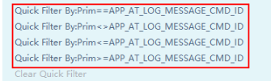

#### 模糊搜索

操作步骤如下：

1.  在表格上方输入框中输入需要搜索的关键词，若有多个关键词用‘|’分隔开。
2.  单击“”或输入回车即可在现有报文的“Prim”字段中过滤出包含关键词的报文。

    **图 1**  模糊过滤示意图  
    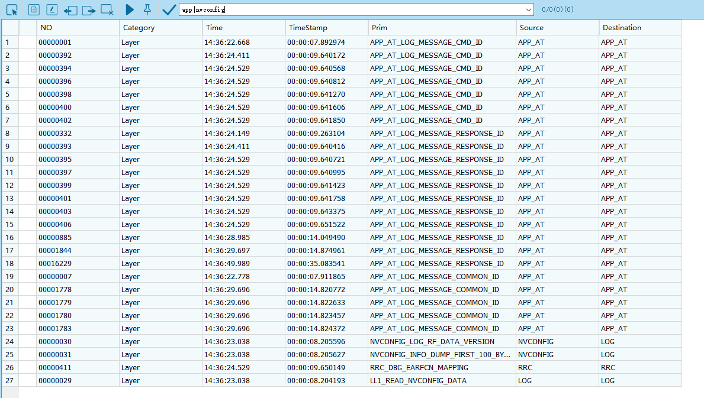

#### 颜色设置

操作步骤如下：

1.  在表格中需要设置颜色的单元格处单击右键。
2.  在右键菜单中选择“Set Color”，弹出颜色设置界面，如[图1](#zh-cn_topic_0000002422495538_zh-cn_topic_0000001713128605_zh-cn_topic_0000001162163404_fig1277146595)所示。

    **图 1**  颜色设置菜单  
    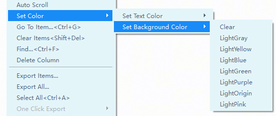

3.  在Color页面（默认）中选择“Set Text Color”或者“Set Background Color”的颜色。
4.  颜色设置效果如[图2](#zh-cn_topic_0000002422495538_zh-cn_topic_0000001713128605_zh-cn_topic_0000001162163404_fig931714194593)所示。

    **图 2**  颜色设置效果示例  
    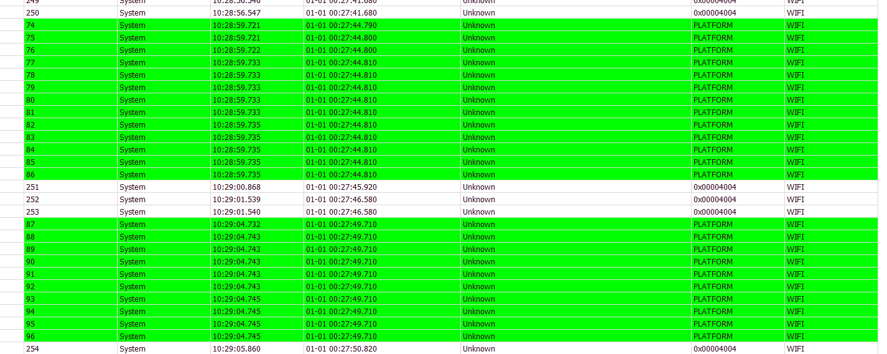

#### 表格信息导出回放

**导出**

全部导出的操作步骤如下：

1.  在表格处单击右键。
2.  在右键菜单中选择“Export All…”，弹出导出对话框，如[图1](#zh-cn_topic_0000002422655438_zh-cn_topic_0000001713048617_zh-cn_topic_0000001162481894_fig18126125120447)所示，选择需要导出的列（Columns）和导出的文件类型。

    **图 1**  文件导出对话框  
    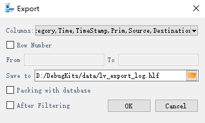

    > **说明：** 
    >-   当选择导出文件类型为 \*.txt、\*.csv格式时，可按需选择要导出的列。
    >-   当选择导出文件类型为 \*.hlf格式时，对应导出的是整个数据库，无论选择某列，导出结果均为所有列。
    >-   导出路径和导出文件名称都不能出现中文字符。

3.  单击“”，选择文件路径及文件类型（当前支持的文件类型有\*.hlf、\*.txt、\*.csv），并保存。
4.  如[图1](#zh-cn_topic_0000002422655438_zh-cn_topic_0000001713048617_zh-cn_topic_0000001162481894_fig18126125120447)所示，单击“OK”按钮，导出文件。

部分导出的操作步骤如下：

1.  在表格中用鼠标拖拽选择要导出的单元格。选择时可以不选整行，hlf文件类型导出时会以整行为单位导出，其他文件类型只导出选中单元格。
2.  在选中的范围内单击右键，在右键菜单中选择“Export Items…”，弹出路径选择框。选择保存路径及文件类型，并保存。

**回放**

> **说明：** 
>DBK工具仅支持\*.hlf、\*.bin、\*.draw、\*.asc格式文件的回放。

-   方法1：将文件直接拖拽到DBK界面中即可回放。
-   方法2：点击左上角菜单“File”→“Open”选择待回放的文件即可回放。

#### 新增表格列

新增表格列操作步骤如下：

在“Parser Pane”右侧结构体解析窗口中，如[图1](#zh-cn_topic_0000002456134249_zh-cn_topic_0000001665009062_zh-cn_topic_0000001162003416_fig2012381818516)所示，选择需要添加到列的成员，右键菜单“Add item to grid”，如[图2](#zh-cn_topic_0000002456134249_zh-cn_topic_0000001665009062_zh-cn_topic_0000001162003416_fig64971928366)所示。

**图 1**  Parser Pane示意图  
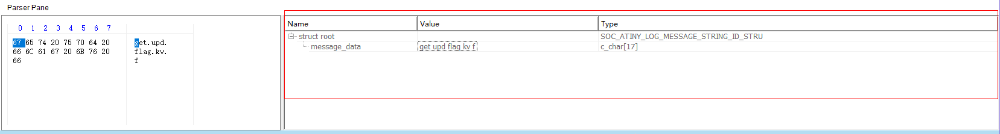

**图 2**  添加到列菜单示意图  
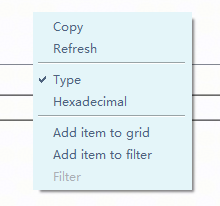

#### 自动保存

实时消息支持自动保存，操作步骤如下：

1.  单击右键，在菜单中选择“Configure...”，弹出设置界面。
2.  在设置界面中选择“Save”窗口，如[图1](#zh-cn_topic_0000002456054349_zh-cn_topic_0000001713128609_zh-cn_topic_0000001207883375_fig683475615598)所示。

    **图 1**  设置界面  
    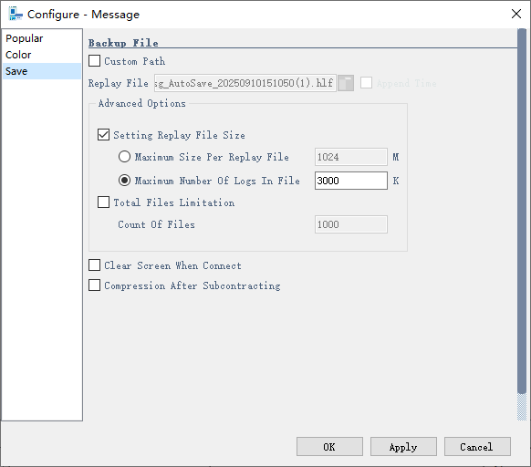

3.  （可选）勾选“Custom Path”，并选择路径。
4.  （可选）在“Advanced Options”中根据需要勾选“Setting Replay File Size”设置每个文件的大小和“Total Files Limitation”总文件个数限制。
5.  单击“OK”按钮。

#### 过滤模板

表格信息过滤支持过滤条件保存和使用，具体步骤如下：

1.  根据需求可以进行模糊搜索（具体操作请参见“[模糊搜索](#ZH-CN_TOPIC_0000002499501761)”小节），结果如[图1](#zh-cn_topic_0000002422495542_zh-cn_topic_0000001713048621_zh-cn_topic_0000001227209019_fig187555507354)所示。
2.  根据需求可以新增表格列（具体操作请参见“[新增表格列](#ZH-CN_TOPIC_0000002499581821)”小节），结果如[图1](#zh-cn_topic_0000002422495542_zh-cn_topic_0000001713048621_zh-cn_topic_0000001227209019_fig187555507354)所示。

    **图 1**  模糊过滤和新增表格列结果图  
    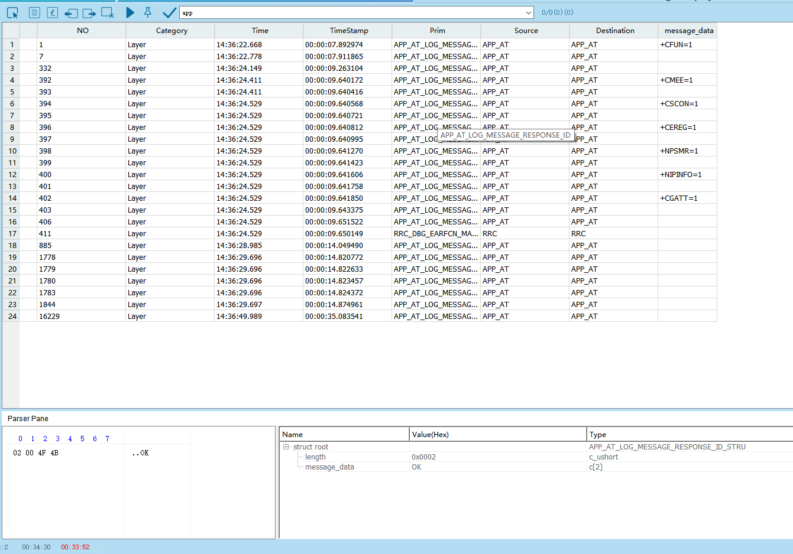

3.  单击右键，选择“Filter Template”→“Save Filter Template”，如[图2](#zh-cn_topic_0000002422495542_zh-cn_topic_0000001713048621_zh-cn_topic_0000001227209019_fig6476172143715)所示。

    **图 2**  保存过滤条件  
    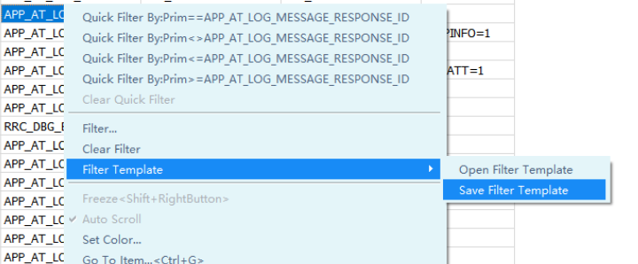

4.  输入需要保存过滤模板的名称，单击“Save”按钮，保存过滤模板，如[图3](#zh-cn_topic_0000002422495542_zh-cn_topic_0000001713048621_zh-cn_topic_0000001227209019_fig1652028203718)所示。可以重复[2](#zh-cn_topic_0000002422495542_zh-cn_topic_0000001713048621_zh-cn_topic_0000001227209019_li852478648)～[4](#zh-cn_topic_0000002422495542_zh-cn_topic_0000001713048621_zh-cn_topic_0000001227209019_li9342173415244)，通过命名区分保存多个过滤模板。

    **图 3**  过滤模板命名  
    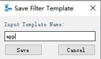

5.  单击右键，选择Filter Template → Open Filter Template，如[图4](#zh-cn_topic_0000002422495542_zh-cn_topic_0000001713048621_zh-cn_topic_0000001227209019_fig14998164713716)所示。

    **图 4**  打开过滤模板  
    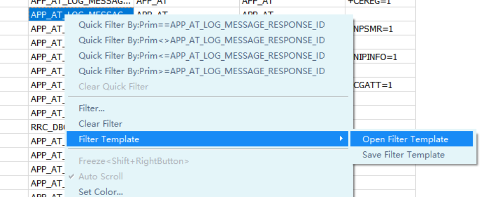

6.  然后通过之前保存到过滤模板名字选择需要的过滤模板，如[图5](#zh-cn_topic_0000002422495542_zh-cn_topic_0000001713048621_zh-cn_topic_0000001227209019_fig19948115519378)所示，单击“Apply”按钮，界面会显示过滤后的内容。

    **图 5**  选择过滤模板  
    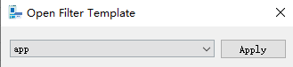

> **说明：** 
>过滤模板仅支持模糊过滤，不支持快速过滤。

#### 关闭回放文件

表格支持关闭回放的文件，具体操作步骤如下：

1.  打开本地存放的日志文件，如[图1](#zh-cn_topic_0000002422655442_zh-cn_topic_0000001665168782_zh-cn_topic_0000001434339653_fig14319411535)所示。

    **图 1**  回放文件  
    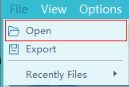

2.  右键点击表格，获取到菜单列表，并选择“Close Replay File”。

#### 行跳转

表格支持跳转到某一行，具体操作步骤如下：

1.  右键点击表格，获取到菜单列表并选择“Go To Item...”或者使用快捷键Ctrl+G。
2.  填写跳转至哪一行并点击OK，如图[图1](#zh-cn_topic_0000002456134253_zh-cn_topic_0000001665009066_zh-cn_topic_0000001384481140_fig1544913519527)所示。

    **图 1**  行跳转界面  
    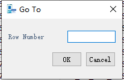

#### 查找日志

> **说明：** 
>Find功能搜索大日志量时效率较低，建议使用模糊搜索功能。

表格支持查找日志，界面如[图1](#zh-cn_topic_0000002456054357_zh-cn_topic_0000001713128613_zh-cn_topic_0000001384170644_fig218117141511)，功能介绍参考[表1](#zh-cn_topic_0000002456054357_zh-cn_topic_0000001713128613_zh-cn_topic_0000001384170644_zh-cn_topic_0279615198_table24185505)。

**图 1**  查找日志界面  
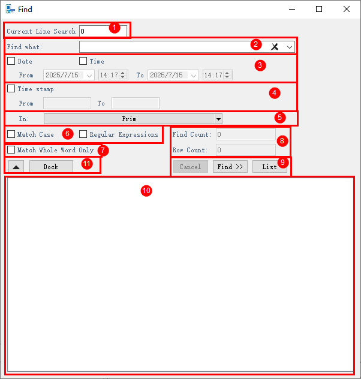

**表 1**  查找日志界面说明

<table><thead align="left"><tr id="zh-cn_topic_0000002456054357_zh-cn_topic_0000001713128613_zh-cn_topic_0000001384170644_zh-cn_topic_0279615198_row66967736"><th class="cellrowborder" valign="top" width="10.100000000000001%" id="mcps1.2.3.1.1">
标号

</th>
<th class="cellrowborder" valign="top" width="89.9%" id="mcps1.2.3.1.2">
说明

</th>
</tr>
</thead>
<tbody><tr id="zh-cn_topic_0000002456054357_zh-cn_topic_0000001713128613_zh-cn_topic_0000001384170644_zh-cn_topic_0279615198_row26729743"><td class="cellrowborder" valign="top" width="10.100000000000001%" headers="mcps1.2.3.1.1 ">
1

</td>
<td class="cellrowborder" valign="top" width="89.9%" headers="mcps1.2.3.1.2 ">
查找的起始位置，数字为当前选中行。

</td>
</tr>
<tr id="zh-cn_topic_0000002456054357_zh-cn_topic_0000001713128613_zh-cn_topic_0000001384170644_zh-cn_topic_0279615198_row11742498"><td class="cellrowborder" valign="top" width="10.100000000000001%" headers="mcps1.2.3.1.1 ">
2

</td>
<td class="cellrowborder" valign="top" width="89.9%" headers="mcps1.2.3.1.2 ">
查找的内容。

</td>
</tr>
<tr id="zh-cn_topic_0000002456054357_zh-cn_topic_0000001713128613_zh-cn_topic_0000001384170644_zh-cn_topic_0279615198_row9577344"><td class="cellrowborder" valign="top" width="10.100000000000001%" headers="mcps1.2.3.1.1 ">
3

</td>
<td class="cellrowborder" valign="top" width="89.9%" headers="mcps1.2.3.1.2 ">
时间。查找从一个时间到另一个时间的内容。

</td>
</tr>
<tr id="zh-cn_topic_0000002456054357_zh-cn_topic_0000001713128613_zh-cn_topic_0000001384170644_zh-cn_topic_0279615198_row17557458"><td class="cellrowborder" valign="top" width="10.100000000000001%" headers="mcps1.2.3.1.1 ">
4

</td>
<td class="cellrowborder" valign="top" width="89.9%" headers="mcps1.2.3.1.2 ">
时间戳。查找从一个时间戳到另一个时间戳的内容。（ms为单位）

</td>
</tr>
<tr id="zh-cn_topic_0000002456054357_zh-cn_topic_0000001713128613_zh-cn_topic_0000001384170644_zh-cn_topic_0279615198_row52660921"><td class="cellrowborder" valign="top" width="10.100000000000001%" headers="mcps1.2.3.1.1 ">
5

</td>
<td class="cellrowborder" valign="top" width="89.9%" headers="mcps1.2.3.1.2 ">
列名。查找所选列的内容。

</td>
</tr>
<tr id="zh-cn_topic_0000002456054357_zh-cn_topic_0000001713128613_zh-cn_topic_0000001384170644_zh-cn_topic_0279615198_row31466165"><td class="cellrowborder" valign="top" width="10.100000000000001%" headers="mcps1.2.3.1.1 ">
6

</td>
<td class="cellrowborder" valign="top" width="89.9%" headers="mcps1.2.3.1.2 ">
Match Case：匹配大小写。

Regular Expressions：使用正则表达式匹配。

</td>
</tr>
<tr id="zh-cn_topic_0000002456054357_zh-cn_topic_0000001713128613_zh-cn_topic_0000001384170644_row18852142017542"><td class="cellrowborder" valign="top" width="10.100000000000001%" headers="mcps1.2.3.1.1 ">
7

</td>
<td class="cellrowborder" valign="top" width="89.9%" headers="mcps1.2.3.1.2 ">
仅整个单词匹配。

</td>
</tr>
<tr id="zh-cn_topic_0000002456054357_zh-cn_topic_0000001713128613_zh-cn_topic_0000001384170644_row14236112495710"><td class="cellrowborder" valign="top" width="10.100000000000001%" headers="mcps1.2.3.1.1 ">
8

</td>
<td class="cellrowborder" valign="top" width="89.9%" headers="mcps1.2.3.1.2 "><ul id="zh-cn_topic_0000002456054357_zh-cn_topic_0000001713128613_zh-cn_topic_0000001384170644_zh-cn_topic_0279615198_ul14005657"><li>Find Count：查找到的行数。</li><li>Row Count：总行数。</li></ul>
</td>
</tr>
<tr id="zh-cn_topic_0000002456054357_zh-cn_topic_0000001713128613_zh-cn_topic_0000001384170644_row1599044212574"><td class="cellrowborder" valign="top" width="10.100000000000001%" headers="mcps1.2.3.1.1 ">
9

</td>
<td class="cellrowborder" valign="top" width="89.9%" headers="mcps1.2.3.1.2 "><ul id="zh-cn_topic_0000002456054357_zh-cn_topic_0000001713128613_zh-cn_topic_0000001384170644_ul5106117131415"><li>Cancel：停止并取消查找。</li><li>Find：开始查找。</li><li>List：显示/关闭查找列表显示区。</li></ul>
</td>
</tr>
<tr id="zh-cn_topic_0000002456054357_zh-cn_topic_0000001713128613_zh-cn_topic_0000001384170644_row1430414467576"><td class="cellrowborder" valign="top" width="10.100000000000001%" headers="mcps1.2.3.1.1 ">
10

</td>
<td class="cellrowborder" valign="top" width="89.9%" headers="mcps1.2.3.1.2 ">
查找列表显示区。

</td>
</tr>
<tr id="zh-cn_topic_0000002456054357_zh-cn_topic_0000001713128613_row11233115203113"><td class="cellrowborder" valign="top" width="10.100000000000001%" headers="mcps1.2.3.1.1 ">
11

</td>
<td class="cellrowborder" valign="top" width="89.9%" headers="mcps1.2.3.1.2 ">
：折叠3，4，5区域。

Dock：Find界面停靠到左侧。

</td>
</tr>
</tbody>
</table>

查找日志操作步骤如下：

1.  右键点击表格，获取到菜单列表并选择“Find...”或者使用快捷键Ctrl+F或者点击工具栏按钮，打开查找界面。
2.  配置查找参数。
3.  点击Find。

# System插件

-   **[简介](#ZH-CN_TOPIC_0000002499581833)**  

-   **[主要功能及使用说明](#ZH-CN_TOPIC_0000002499501765)**  

## 简介

System插件主要包含常用维测功能。

打开System插件的方法：如[图1](#zh-cn_topic_0000002422655446_zh-cn_topic_0000001665009078_fig1787083216283)、[图2](#zh-cn_topic_0000002422655446_zh-cn_topic_0000001665009078_fig1529407162817)所示，单击菜单栏或工具栏上的System图标即可。

**图 1**  打开system插件示例（菜单栏）  
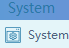

**图 2**  打开system插件示例（工具栏）  

显示信息栏的方法为：打开System插件后右键点击“Control Panel”的空白处，点击显示信息栏。如[图3](#zh-cn_topic_0000002422655446_zh-cn_topic_0000001665009078_fig12734194310518)所示。

**图 3**  打开显示信息栏  
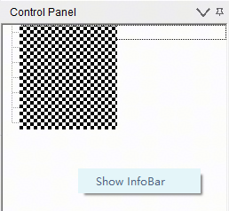

## 主要功能及使用说明

-   **[数据上传与下载](#ZH-CN_TOPIC_0000002499501793)**  

-   **[内存读取](#ZH-CN_TOPIC_0000002466542432)**  

-   **[寄存器控制](#ZH-CN_TOPIC_0000002499501797)**  

-   **[死机分析](#ZH-CN_TOPIC_0000002499581845)**  

-   **[多通道数据采集](#ZH-CN_TOPIC_0000002499501769)**  

-   **[自定义参数配置](#ZH-CN_TOPIC_0000002499581817)**  

-   **[多语言脚本调用](#ZH-CN_TOPIC_0000002499501781)**  

-   **[自定义参数转bin](#ZH-CN_TOPIC_0000002499581769)**  

-   **[RF接口测试](#ZH-CN_TOPIC_0000002466382852)**  

-   **[图形压缩对比](#ZH-CN_TOPIC_0000002466382784)**  

-   **[音频质量界面](#ZH-CN_TOPIC_0000002499581829)**  

-   **[提示音工具](#ZH-CN_TOPIC_0000002466542452)**  

-   **[打点文件解析](#ZH-CN_TOPIC_0000002466542476)**  

### 数据上传与下载

-   上传（To Board）是指将工具端的数据（通常是指文件）发送给单板。
-   下载（From Board）是指从单板获取数据传递到工具端，从单板传递的数据包括某段内存的可维可测信息或者某个路径下的文件。

-   **[导出文件和删除文件](#ZH-CN_TOPIC_0000002499501741)**  

-   **[上传文件](#ZH-CN_TOPIC_0000002466542460)**  

#### 导出文件和删除文件

导出文件用于从单板导出指定路径下的文件。

删除文件用于删除单板指定路径下的文件。

**图 1**  导出和删除文件操作界面  
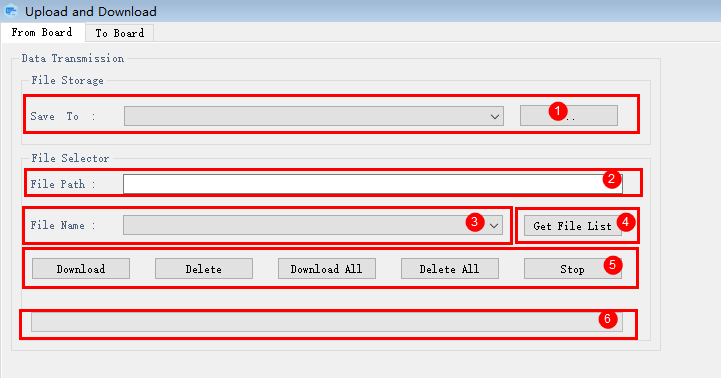

**表 1**  导出文件界面说明

<table><thead align="left"><tr id="zh-cn_topic_0000002422495550_zh-cn_topic_0000001713128633_zh-cn_topic_0000001237473377_row0393204410113"><th class="cellrowborder" valign="top" width="11.360000000000001%" id="mcps1.2.3.1.1">
标号

</th>
<th class="cellrowborder" valign="top" width="88.64%" id="mcps1.2.3.1.2">
说明

</th>
</tr>
</thead>
<tbody><tr id="zh-cn_topic_0000002422495550_zh-cn_topic_0000001713128633_zh-cn_topic_0000001237473377_row339364410112"><td class="cellrowborder" valign="top" width="11.360000000000001%" headers="mcps1.2.3.1.1 ">
1

</td>
<td class="cellrowborder" valign="top" width="88.64%" headers="mcps1.2.3.1.2 ">
导出的数据存放到工具端的文件夹。

</td>
</tr>
<tr id="zh-cn_topic_0000002422495550_zh-cn_topic_0000001713128633_zh-cn_topic_0000001237473377_row6393194411117"><td class="cellrowborder" valign="top" width="11.360000000000001%" headers="mcps1.2.3.1.1 ">
2

</td>
<td class="cellrowborder" valign="top" width="88.64%" headers="mcps1.2.3.1.2 ">
单板文件路径，可直接手动输入，先输入'/'可联想出基础路径。

</td>
</tr>
<tr id="zh-cn_topic_0000002422495550_zh-cn_topic_0000001713128633_zh-cn_topic_0000001237473377_row1639394491113"><td class="cellrowborder" valign="top" width="11.360000000000001%" headers="mcps1.2.3.1.1 ">
3

</td>
<td class="cellrowborder" valign="top" width="88.64%" headers="mcps1.2.3.1.2 ">
存放[2]对应的文件列表。

</td>
</tr>
<tr id="zh-cn_topic_0000002422495550_zh-cn_topic_0000001713128633_zh-cn_topic_0000001237473377_row93931044151116"><td class="cellrowborder" valign="top" width="11.360000000000001%" headers="mcps1.2.3.1.1 ">
4

</td>
<td class="cellrowborder" valign="top" width="88.64%" headers="mcps1.2.3.1.2 ">
获取[2]对应路径下的文件列表，显示在[4]中。

</td>
</tr>
<tr id="zh-cn_topic_0000002422495550_zh-cn_topic_0000001713128633_zh-cn_topic_0000001237473377_row139374418110"><td class="cellrowborder" valign="top" width="11.360000000000001%" headers="mcps1.2.3.1.1 ">
5

</td>
<td class="cellrowborder" valign="top" width="88.64%" headers="mcps1.2.3.1.2 ">
操作：

<ul id="zh-cn_topic_0000002422495550_zh-cn_topic_0000001713128633_zh-cn_topic_0000001237473377_ul5106117131415"><li>Download：下载[4]中选择的文件。</li><li>Delete：删除[4]中选择的文件。</li><li>Download All：下载[2]路径中所有文件。注意，批量下载只会下载文件列表中的文件，若有新文件产生应再次点击“Get file List”按钮。</li><li>Delete All：删除[2]路径中所有文件。注意，批量删除只会删除文件列表中的文件，若有新文件产生应再次点击“Get file List”按钮。</li></ul>
<ul id="zh-cn_topic_0000002422495550_zh-cn_topic_0000001713128633_zh-cn_topic_0000001237473377_ul134751821165816"><li>Stop：停止导出文件。</li></ul>
</td>
</tr>
<tr id="zh-cn_topic_0000002422495550_zh-cn_topic_0000001713128633_zh-cn_topic_0000001237473377_row146701843154417"><td class="cellrowborder" valign="top" width="11.360000000000001%" headers="mcps1.2.3.1.1 ">
6

</td>
<td class="cellrowborder" valign="top" width="88.64%" headers="mcps1.2.3.1.2 ">
进度条。

</td>
</tr>
</tbody>
</table>

-   **[导出文件](#ZH-CN_TOPIC_0000002466382836)**  

-   **[批量导出文件](#ZH-CN_TOPIC_0000002499581797)**  

-   **[删除文件](#ZH-CN_TOPIC_0000002499581841)**  

-   **[批量删除文件](#ZH-CN_TOPIC_0000002499501757)**  

##### 导出文件

导出文件操作步骤如下：

1.  在“Save To”中选择导出文件保存的路径。
2.  在“File Path”处选择路径。
3.  单击“Get File List”获取上述路径下的文件列表。
4.  在“File Name”处选择要下载的文件名字后，单击“Download”开始下载，待下方进度条更新到100%完成下载。

##### 批量导出文件

批量导出文件操作步骤如下：

1.  在“Save To”中选择导出文件保存的路径。
2.  在“File Path”处选择路径。
3.  单击“Get File List”获取上述路径下的文件列表。
4.  单击“Download All”开始下载，下方进度条每次达到100%证明导出完一个文件。

##### 删除文件

删除文件操作步骤如下：

1.  在“File Path”处选择路径。
2.  单击“Get File List”获取上述路径下的文件列表。
3.  单击“Delete”开始删除。

##### 批量删除文件

批量删除文件操作步骤如下：

1.  在“File Path”处选择路径。
2.  单击“Get File List”获取上述路径下的文件列表。
3.  单击“Delete All”开始删除。

#### 上传文件

上传文件用于向单板指定路径下上传文件。

上传文件支持文件夹上传。

**图 1**  上传文件操作界面  
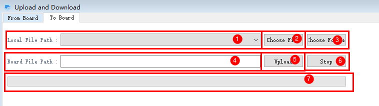

**表 1**  上传文件界面说明

<table><thead align="left"><tr id="zh-cn_topic_0000002422655458_zh-cn_topic_0000001713048657_zh-cn_topic_0000001451473085_row0393204410113"><th class="cellrowborder" valign="top" width="11.459999999999999%" id="mcps1.2.3.1.1">
标号

</th>
<th class="cellrowborder" valign="top" width="88.53999999999999%" id="mcps1.2.3.1.2">
说明

</th>
</tr>
</thead>
<tbody><tr id="zh-cn_topic_0000002422655458_zh-cn_topic_0000001713048657_zh-cn_topic_0000001451473085_row339364410112"><td class="cellrowborder" valign="top" width="11.459999999999999%" headers="mcps1.2.3.1.1 ">
1

</td>
<td class="cellrowborder" valign="top" width="88.53999999999999%" headers="mcps1.2.3.1.2 ">
待上传文件的绝对路径。

</td>
</tr>
<tr id="zh-cn_topic_0000002422655458_zh-cn_topic_0000001713048657_zh-cn_topic_0000001451473085_row6393194411117"><td class="cellrowborder" valign="top" width="11.459999999999999%" headers="mcps1.2.3.1.1 ">
2

</td>
<td class="cellrowborder" valign="top" width="88.53999999999999%" headers="mcps1.2.3.1.2 ">
选择文件，单文件上传。结果显示在[1]中。

</td>
</tr>
<tr id="zh-cn_topic_0000002422655458_zh-cn_topic_0000001713048657_zh-cn_topic_0000001451473085_row1639394491113"><td class="cellrowborder" valign="top" width="11.459999999999999%" headers="mcps1.2.3.1.1 ">
3

</td>
<td class="cellrowborder" valign="top" width="88.53999999999999%" headers="mcps1.2.3.1.2 ">
选择文件夹，文件批量上传。结果显示在[1]中

</td>
</tr>
<tr id="zh-cn_topic_0000002422655458_zh-cn_topic_0000001713048657_zh-cn_topic_0000001451473085_row93931044151116"><td class="cellrowborder" valign="top" width="11.459999999999999%" headers="mcps1.2.3.1.1 ">
4

</td>
<td class="cellrowborder" valign="top" width="88.53999999999999%" headers="mcps1.2.3.1.2 ">
填写单板路径。

 说明： 
<ul id="zh-cn_topic_0000002422655458_zh-cn_topic_0000001713048657_zh-cn_topic_0000001451473085_ul107106151794"><li>当Local File Path选择文件时，Board File Path填写精确到文件名。</li><li>当Local File Path选择文件夹时，Board File Path填写文件夹，并以'/'结尾。</li></ul>

</td>
</tr>
<tr id="zh-cn_topic_0000002422655458_zh-cn_topic_0000001713048657_zh-cn_topic_0000001451473085_row139374418110"><td class="cellrowborder" valign="top" width="11.459999999999999%" headers="mcps1.2.3.1.1 ">
5

</td>
<td class="cellrowborder" valign="top" width="88.53999999999999%" headers="mcps1.2.3.1.2 ">
开始上传文件。

</td>
</tr>
<tr id="zh-cn_topic_0000002422655458_zh-cn_topic_0000001713048657_zh-cn_topic_0000001451473085_row146701843154417"><td class="cellrowborder" valign="top" width="11.459999999999999%" headers="mcps1.2.3.1.1 ">
6

</td>
<td class="cellrowborder" valign="top" width="88.53999999999999%" headers="mcps1.2.3.1.2 ">
停止。在upload过程中可以主动停止传输。

</td>
</tr>
<tr id="zh-cn_topic_0000002422655458_zh-cn_topic_0000001713048657_zh-cn_topic_0000001451473085_row19191159135918"><td class="cellrowborder" valign="top" width="11.459999999999999%" headers="mcps1.2.3.1.1 ">
7

</td>
<td class="cellrowborder" valign="top" width="88.53999999999999%" headers="mcps1.2.3.1.2 ">
进度条。

</td>
</tr>
</tbody>
</table>

上传文件操作步骤如下：

1.  点击“Choose File”或者“Choose Folder”选择待上传文件。
2.  在“Board File Path”填写板端路径。注意，文件或者文件夹均要与“Local File Path”对应。
3.  单击“Upload”开始上传，待进度条达到100%后传输完成。

### 内存读取

内存读取功能用于将设备中一段内存保存到计算机指定文件中。

**图 1**  内存读取界面  
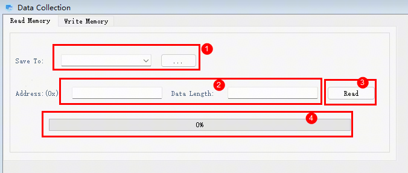

**表 1**  内存读取说明

<table><thead align="left"><tr id="zh-cn_topic_0000002456134265_zh-cn_topic_0000001665168822_zh-cn_topic_0000001178795102_zh-cn_topic_0279615208_row29866445"><th class="cellrowborder" valign="top" width="19.31%" id="mcps1.2.3.1.1">
标号

</th>
<th class="cellrowborder" valign="top" width="80.69%" id="mcps1.2.3.1.2">
说明

</th>
</tr>
</thead>
<tbody><tr id="zh-cn_topic_0000002456134265_zh-cn_topic_0000001665168822_zh-cn_topic_0000001178795102_zh-cn_topic_0279615208_row454234"><td class="cellrowborder" valign="top" width="19.31%" headers="mcps1.2.3.1.1 ">
1

</td>
<td class="cellrowborder" valign="top" width="80.69%" headers="mcps1.2.3.1.2 ">
单击“...”选择文件。

</td>
</tr>
<tr id="zh-cn_topic_0000002456134265_zh-cn_topic_0000001665168822_zh-cn_topic_0000001178795102_zh-cn_topic_0279615208_row45642530"><td class="cellrowborder" valign="top" width="19.31%" headers="mcps1.2.3.1.1 ">
2

</td>
<td class="cellrowborder" valign="top" width="80.69%" headers="mcps1.2.3.1.2 ">
设置参数。

<ul id="zh-cn_topic_0000002456134265_zh-cn_topic_0000001665168822_zh-cn_topic_0000001178795102_zh-cn_topic_0279615198_ul14005657"><li>Address：内存读取起始地址（16进制）。</li><li>Data Length：内存读取数据长度（一般为10进制，若16进制请在前面添加0x，输入数据应为4的整数倍）</li></ul>
</td>
</tr>
<tr id="zh-cn_topic_0000002456134265_zh-cn_topic_0000001665168822_zh-cn_topic_0000001178795102_row1068983935814"><td class="cellrowborder" valign="top" width="19.31%" headers="mcps1.2.3.1.1 ">
3

</td>
<td class="cellrowborder" valign="top" width="80.69%" headers="mcps1.2.3.1.2 ">
内存读取开始按钮。

</td>
</tr>
<tr id="zh-cn_topic_0000002456134265_zh-cn_topic_0000001665168822_zh-cn_topic_0000001178795102_row6914455301"><td class="cellrowborder" valign="top" width="19.31%" headers="mcps1.2.3.1.1 ">
4

</td>
<td class="cellrowborder" valign="top" width="80.69%" headers="mcps1.2.3.1.2 ">
内存导出进度条。

</td>
</tr>
</tbody>
</table>

操作步骤如下：

1.  在“Save To”中选择需要保存的路径。
2.  设定参数。

    填写“Address”、“Data Length”。

3.  单击“Read”按钮。

    设备中读取出数据保存到“Save To”填写的路径中。

### 寄存器控制

RegisterControl界面主要用于寄存器的读写。

**图 1**  寄存器读写功能主要界面  
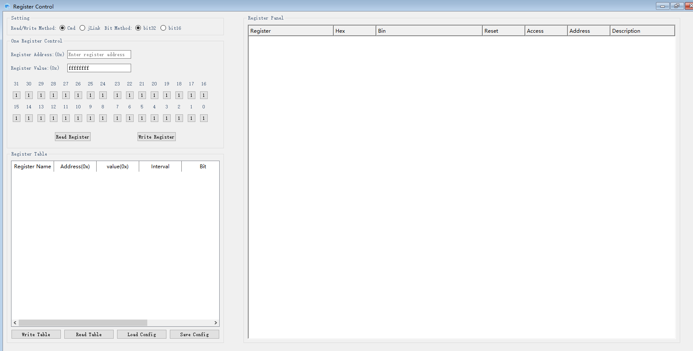

-   **[连接方式](#ZH-CN_TOPIC_0000002466382868)**  

-   **[单寄存器读写](#ZH-CN_TOPIC_0000002466542440)**  

-   **[寄存器表格](#ZH-CN_TOPIC_0000002499581785)**  

-   **[寄存器面板](#ZH-CN_TOPIC_0000002499501777)**  

#### 连接方式

设置读写方式、读写长度。如[图1](#zh-cn_topic_0000002422495562_zh-cn_topic_0000001665009102_zh-cn_topic_0000001409066533_fig47161122310)所示。参数说明如[表1](#zh-cn_topic_0000002422495562_zh-cn_topic_0000001665009102_zh-cn_topic_0000001409066533_zh-cn_topic_0279615208_toc32853064)所示。

**图 1**  寄存器读写方式选择  
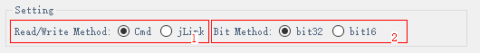

**表 1**  寄存器读写方式选择说明

<table><thead align="left"><tr id="zh-cn_topic_0000002422495562_zh-cn_topic_0000001665009102_zh-cn_topic_0000001409066533_zh-cn_topic_0279615208_row29866445"><th class="cellrowborder" valign="top" width="13.07%" id="mcps1.2.3.1.1">
标号

</th>
<th class="cellrowborder" valign="top" width="86.92999999999999%" id="mcps1.2.3.1.2">
说明

</th>
</tr>
</thead>
<tbody><tr id="zh-cn_topic_0000002422495562_zh-cn_topic_0000001665009102_zh-cn_topic_0000001409066533_zh-cn_topic_0279615208_row454234"><td class="cellrowborder" valign="top" width="13.07%" headers="mcps1.2.3.1.1 ">
1

</td>
<td class="cellrowborder" valign="top" width="86.92999999999999%" headers="mcps1.2.3.1.2 ">
读写方式。默认为Cmd方式，若选择jLink方式需要在菜单栏Options中选择jlink路径。

</td>
</tr>
<tr id="zh-cn_topic_0000002422495562_zh-cn_topic_0000001665009102_zh-cn_topic_0000001409066533_zh-cn_topic_0279615208_row45642530"><td class="cellrowborder" valign="top" width="13.07%" headers="mcps1.2.3.1.1 ">
2

</td>
<td class="cellrowborder" valign="top" width="86.92999999999999%" headers="mcps1.2.3.1.2 ">
读写长度。默认为32位读写。

</td>
</tr>
</tbody>
</table>

#### 单寄存器读写

**图 1**  单个寄存器读写  
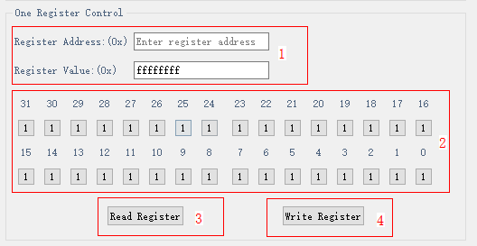

**表 1**  寄存器界面说明

<table><thead align="left"><tr id="zh-cn_topic_0000002422655466_zh-cn_topic_0000001713128653_zh-cn_topic_0000001408946741_zh-cn_topic_0279615208_row29866445"><th class="cellrowborder" valign="top" width="13.07%" id="mcps1.2.3.1.1">
标号

</th>
<th class="cellrowborder" valign="top" width="86.92999999999999%" id="mcps1.2.3.1.2">
说明

</th>
</tr>
</thead>
<tbody><tr id="zh-cn_topic_0000002422655466_zh-cn_topic_0000001713128653_zh-cn_topic_0000001408946741_zh-cn_topic_0279615208_row45642530"><td class="cellrowborder" valign="top" width="13.07%" headers="mcps1.2.3.1.1 ">
1

</td>
<td class="cellrowborder" valign="top" width="86.92999999999999%" headers="mcps1.2.3.1.2 ">
寄存器地址和值。

</td>
</tr>
<tr id="zh-cn_topic_0000002422655466_zh-cn_topic_0000001713128653_zh-cn_topic_0000001408946741_row139646576421"><td class="cellrowborder" valign="top" width="13.07%" headers="mcps1.2.3.1.1 ">
2

</td>
<td class="cellrowborder" valign="top" width="86.92999999999999%" headers="mcps1.2.3.1.2 ">
寄存器值以二进制方式显示。

</td>
</tr>
<tr id="zh-cn_topic_0000002422655466_zh-cn_topic_0000001713128653_zh-cn_topic_0000001408946741_row1482132153810"><td class="cellrowborder" valign="top" width="13.07%" headers="mcps1.2.3.1.1 ">
3

</td>
<td class="cellrowborder" valign="top" width="86.92999999999999%" headers="mcps1.2.3.1.2 ">
读寄存器按钮。

</td>
</tr>
<tr id="zh-cn_topic_0000002422655466_zh-cn_topic_0000001713128653_zh-cn_topic_0000001408946741_row0583171014382"><td class="cellrowborder" valign="top" width="13.07%" headers="mcps1.2.3.1.1 ">
4

</td>
<td class="cellrowborder" valign="top" width="86.92999999999999%" headers="mcps1.2.3.1.2 ">
写寄存器按钮。

</td>
</tr>
</tbody>
</table>

单个寄存器读写功能的步骤如下：

1.  输入寄存器地址和值，如果是读寄存器可不输入值。
2.  点击读寄存器或写寄存器查看结果。

#### 寄存器表格

**图 1**  寄存器列表界面  
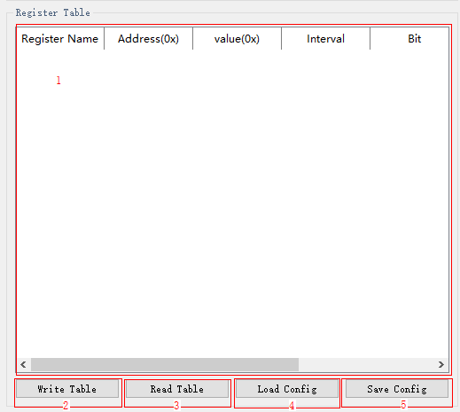

**表 1**  寄存器界面说明

<table><thead align="left"><tr id="zh-cn_topic_0000002456134269_zh-cn_topic_0000001713048673_zh-cn_topic_0000001359506500_zh-cn_topic_0279615208_row29866445"><th class="cellrowborder" valign="top" width="13.07%" id="mcps1.2.3.1.1">
标号

</th>
<th class="cellrowborder" valign="top" width="86.92999999999999%" id="mcps1.2.3.1.2">
说明

</th>
</tr>
</thead>
<tbody><tr id="zh-cn_topic_0000002456134269_zh-cn_topic_0000001713048673_zh-cn_topic_0000001359506500_zh-cn_topic_0279615208_row45642530"><td class="cellrowborder" valign="top" width="13.07%" headers="mcps1.2.3.1.1 ">
1

</td>
<td class="cellrowborder" valign="top" width="86.92999999999999%" headers="mcps1.2.3.1.2 ">
寄存器表格。

</td>
</tr>
<tr id="zh-cn_topic_0000002456134269_zh-cn_topic_0000001713048673_zh-cn_topic_0000001359506500_row139646576421"><td class="cellrowborder" valign="top" width="13.07%" headers="mcps1.2.3.1.1 ">
2

</td>
<td class="cellrowborder" valign="top" width="86.92999999999999%" headers="mcps1.2.3.1.2 ">
写寄存器表格。

</td>
</tr>
<tr id="zh-cn_topic_0000002456134269_zh-cn_topic_0000001713048673_zh-cn_topic_0000001359506500_row1482132153810"><td class="cellrowborder" valign="top" width="13.07%" headers="mcps1.2.3.1.1 ">
3

</td>
<td class="cellrowborder" valign="top" width="86.92999999999999%" headers="mcps1.2.3.1.2 ">
读寄存器表格。

</td>
</tr>
<tr id="zh-cn_topic_0000002456134269_zh-cn_topic_0000001713048673_zh-cn_topic_0000001359506500_row0583171014382"><td class="cellrowborder" valign="top" width="13.07%" headers="mcps1.2.3.1.1 ">
4

</td>
<td class="cellrowborder" valign="top" width="86.92999999999999%" headers="mcps1.2.3.1.2 ">
加载寄存器表格。

</td>
</tr>
<tr id="zh-cn_topic_0000002456134269_zh-cn_topic_0000001713048673_zh-cn_topic_0000001359506500_row121968516461"><td class="cellrowborder" valign="top" width="13.07%" headers="mcps1.2.3.1.1 ">
5

</td>
<td class="cellrowborder" valign="top" width="86.92999999999999%" headers="mcps1.2.3.1.2 ">
保存寄存器表格。

</td>
</tr>
</tbody>
</table>

**图 2**  表头界面  
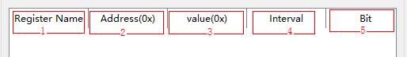

**图 3**  表头界面补充  
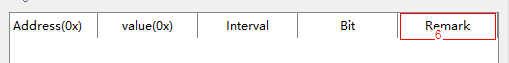

**表 2**  表头界面说明

<table><thead align="left"><tr id="zh-cn_topic_0000002456134269_zh-cn_topic_0000001713048673_zh-cn_topic_0000001359506500_row136828611554"><th class="cellrowborder" valign="top" width="13.07%" id="mcps1.2.3.1.1">
标号

</th>
<th class="cellrowborder" valign="top" width="86.92999999999999%" id="mcps1.2.3.1.2">
说明

</th>
</tr>
</thead>
<tbody><tr id="zh-cn_topic_0000002456134269_zh-cn_topic_0000001713048673_zh-cn_topic_0000001359506500_row116821611554"><td class="cellrowborder" valign="top" width="13.07%" headers="mcps1.2.3.1.1 ">
1

</td>
<td class="cellrowborder" valign="top" width="86.92999999999999%" headers="mcps1.2.3.1.2 ">
寄存器名字。

</td>
</tr>
<tr id="zh-cn_topic_0000002456134269_zh-cn_topic_0000001713048673_zh-cn_topic_0000001359506500_row136834619551"><td class="cellrowborder" valign="top" width="13.07%" headers="mcps1.2.3.1.1 ">
2

</td>
<td class="cellrowborder" valign="top" width="86.92999999999999%" headers="mcps1.2.3.1.2 ">
寄存器地址。

</td>
</tr>
<tr id="zh-cn_topic_0000002456134269_zh-cn_topic_0000001713048673_zh-cn_topic_0000001359506500_row17683561553"><td class="cellrowborder" valign="top" width="13.07%" headers="mcps1.2.3.1.1 ">
3

</td>
<td class="cellrowborder" valign="top" width="86.92999999999999%" headers="mcps1.2.3.1.2 ">
寄存器值。

</td>
</tr>
<tr id="zh-cn_topic_0000002456134269_zh-cn_topic_0000001713048673_zh-cn_topic_0000001359506500_row176831612559"><td class="cellrowborder" valign="top" width="13.07%" headers="mcps1.2.3.1.1 ">
4

</td>
<td class="cellrowborder" valign="top" width="86.92999999999999%" headers="mcps1.2.3.1.2 ">
读写寄存器间隔时间。

</td>
</tr>
<tr id="zh-cn_topic_0000002456134269_zh-cn_topic_0000001713048673_zh-cn_topic_0000001359506500_row107376422585"><td class="cellrowborder" valign="top" width="13.07%" headers="mcps1.2.3.1.1 ">
5

</td>
<td class="cellrowborder" valign="top" width="86.92999999999999%" headers="mcps1.2.3.1.2 ">
读写长度。支持32位和16位长度读写。

</td>
</tr>
<tr id="zh-cn_topic_0000002456134269_zh-cn_topic_0000001713048673_zh-cn_topic_0000001359506500_row196835665511"><td class="cellrowborder" valign="top" width="13.07%" headers="mcps1.2.3.1.1 ">
5

</td>
<td class="cellrowborder" valign="top" width="86.92999999999999%" headers="mcps1.2.3.1.2 ">
备注。

</td>
</tr>
</tbody>
</table>

**图 4**  右键菜单功能  

**表 3**  菜单界面说明

<table><thead align="left"><tr id="zh-cn_topic_0000002456134269_zh-cn_topic_0000001713048673_zh-cn_topic_0000001359506500_row19061358194914"><th class="cellrowborder" valign="top" width="13.07%" id="mcps1.2.3.1.1">
功能

</th>
<th class="cellrowborder" valign="top" width="86.92999999999999%" id="mcps1.2.3.1.2">
说明

</th>
</tr>
</thead>
<tbody><tr id="zh-cn_topic_0000002456134269_zh-cn_topic_0000001713048673_zh-cn_topic_0000001359506500_row1190645854913"><td class="cellrowborder" valign="top" width="13.07%" headers="mcps1.2.3.1.1 ">
Add Register

</td>
<td class="cellrowborder" valign="top" width="86.92999999999999%" headers="mcps1.2.3.1.2 ">
在当前选中行上方添加一行。

</td>
</tr>
<tr id="zh-cn_topic_0000002456134269_zh-cn_topic_0000001713048673_zh-cn_topic_0000001359506500_row490635834919"><td class="cellrowborder" valign="top" width="13.07%" headers="mcps1.2.3.1.1 ">
Delete Register

</td>
<td class="cellrowborder" valign="top" width="86.92999999999999%" headers="mcps1.2.3.1.2 ">
删除当前行。

</td>
</tr>
<tr id="zh-cn_topic_0000002456134269_zh-cn_topic_0000001713048673_zh-cn_topic_0000001359506500_row1590625894914"><td class="cellrowborder" valign="top" width="13.07%" headers="mcps1.2.3.1.1 ">
Clear Table

</td>
<td class="cellrowborder" valign="top" width="86.92999999999999%" headers="mcps1.2.3.1.2 ">
清空表格。

</td>
</tr>
</tbody>
</table>

寄存器表格读写功能的步骤如下：

1.  右键Add Register逐个添加寄存器或点击Load Config读取Excel表格添加寄存器。
2.  点击Write Table或Read Table读写寄存器。

    注：读寄存器时Address列和Interval列不能为空；写寄存器时Address列、Value列和Interval列不能为空。

3.  点击Save Config保存表格到Excel文件中。

#### 寄存器面板

**图 1**  寄存器面板界面  
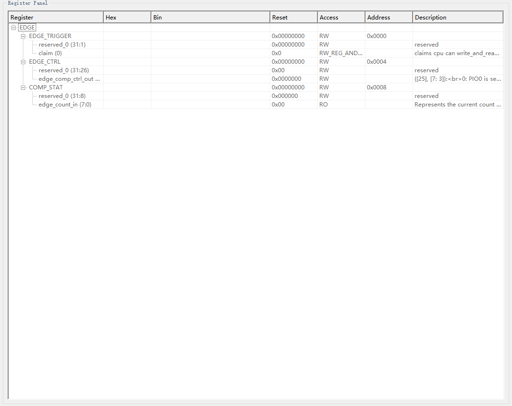

**图 2**  寄存器面板表头界面  

**表 1**  表头界面说明

<table><thead align="left"><tr id="zh-cn_topic_0000002456054373_zh-cn_topic_0000001665168838_zh-cn_topic_0000001408786821_row136828611554"><th class="cellrowborder" valign="top" width="13.07%" id="mcps1.2.3.1.1">
标号

</th>
<th class="cellrowborder" valign="top" width="86.92999999999999%" id="mcps1.2.3.1.2">
说明

</th>
</tr>
</thead>
<tbody><tr id="zh-cn_topic_0000002456054373_zh-cn_topic_0000001665168838_zh-cn_topic_0000001408786821_row116821611554"><td class="cellrowborder" valign="top" width="13.07%" headers="mcps1.2.3.1.1 ">
1

</td>
<td class="cellrowborder" valign="top" width="86.92999999999999%" headers="mcps1.2.3.1.2 ">
寄存器名字。

</td>
</tr>
<tr id="zh-cn_topic_0000002456054373_zh-cn_topic_0000001665168838_zh-cn_topic_0000001408786821_row136834619551"><td class="cellrowborder" valign="top" width="13.07%" headers="mcps1.2.3.1.1 ">
2

</td>
<td class="cellrowborder" valign="top" width="86.92999999999999%" headers="mcps1.2.3.1.2 ">
寄存器值（十六进制）。

</td>
</tr>
<tr id="zh-cn_topic_0000002456054373_zh-cn_topic_0000001665168838_zh-cn_topic_0000001408786821_row17683561553"><td class="cellrowborder" valign="top" width="13.07%" headers="mcps1.2.3.1.1 ">
3

</td>
<td class="cellrowborder" valign="top" width="86.92999999999999%" headers="mcps1.2.3.1.2 ">
寄存器值（二进制）。

</td>
</tr>
<tr id="zh-cn_topic_0000002456054373_zh-cn_topic_0000001665168838_zh-cn_topic_0000001408786821_row176831612559"><td class="cellrowborder" valign="top" width="13.07%" headers="mcps1.2.3.1.1 ">
4

</td>
<td class="cellrowborder" valign="top" width="86.92999999999999%" headers="mcps1.2.3.1.2 ">
寄存器初始值。

</td>
</tr>
<tr id="zh-cn_topic_0000002456054373_zh-cn_topic_0000001665168838_zh-cn_topic_0000001408786821_row196835665511"><td class="cellrowborder" valign="top" width="13.07%" headers="mcps1.2.3.1.1 ">
5

</td>
<td class="cellrowborder" valign="top" width="86.92999999999999%" headers="mcps1.2.3.1.2 ">
寄存器访问权限。

</td>
</tr>
<tr id="zh-cn_topic_0000002456054373_zh-cn_topic_0000001665168838_zh-cn_topic_0000001408786821_row9628857191011"><td class="cellrowborder" valign="top" width="13.07%" headers="mcps1.2.3.1.1 ">
6

</td>
<td class="cellrowborder" valign="top" width="86.92999999999999%" headers="mcps1.2.3.1.2 ">
寄存器地址。

</td>
</tr>
<tr id="zh-cn_topic_0000002456054373_zh-cn_topic_0000001665168838_zh-cn_topic_0000001408786821_row9283181121111"><td class="cellrowborder" valign="top" width="13.07%" headers="mcps1.2.3.1.1 ">
7

</td>
<td class="cellrowborder" valign="top" width="86.92999999999999%" headers="mcps1.2.3.1.2 ">
说明。

</td>
</tr>
</tbody>
</table>

**图 3**  右键菜单功能  

**表 2**  菜单界面说明

<table><thead align="left"><tr id="zh-cn_topic_0000002456054373_zh-cn_topic_0000001665168838_zh-cn_topic_0000001408786821_row19061358194914"><th class="cellrowborder" valign="top" width="13.07%" id="mcps1.2.3.1.1">
功能

</th>
<th class="cellrowborder" valign="top" width="86.92999999999999%" id="mcps1.2.3.1.2">
说明

</th>
</tr>
</thead>
<tbody><tr id="zh-cn_topic_0000002456054373_zh-cn_topic_0000001665168838_zh-cn_topic_0000001408786821_row1190645854913"><td class="cellrowborder" valign="top" width="13.07%" headers="mcps1.2.3.1.1 ">
Link

</td>
<td class="cellrowborder" valign="top" width="86.92999999999999%" headers="mcps1.2.3.1.2 ">
选中Link时，当前寄存器和左面单个寄存器界面联动。

</td>
</tr>
<tr id="zh-cn_topic_0000002456054373_zh-cn_topic_0000001665168838_zh-cn_topic_0000001408786821_row490635834919"><td class="cellrowborder" valign="top" width="13.07%" headers="mcps1.2.3.1.1 ">
Unlink

</td>
<td class="cellrowborder" valign="top" width="86.92999999999999%" headers="mcps1.2.3.1.2 ">
取消联动。

</td>
</tr>
</tbody>
</table>

寄存器表格读写功能的步骤如下：

1.  双击寄存器名字，读取寄存器的值。
2.  修改父节点的值，子节点的值会根据所占位数改变；修改子节点的值，父节点的值也会改变。
3.  右键选择Link，当前寄存器或其父节点会和左面单个寄存器界面联动，选择Unlink取消联动。

### 死机分析

DumpAnalys功能用于解析死机信息。

> **说明：** 
>此功能需要python3.8及以上版本环境。

**图 1**  DumpAnalys界面  
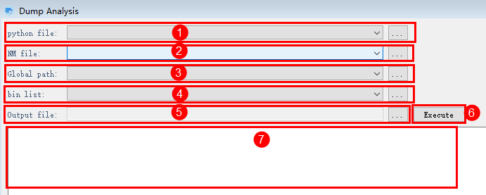

**表 1**  DumpAnalys界面区域说明

<table><thead align="left"><tr id="zh-cn_topic_0000002422495566_zh-cn_topic_0000001713128665_zh-cn_topic_0000001447725041_row1926835114287"><th class="cellrowborder" valign="top" width="13.87%" id="mcps1.2.3.1.1">
标号

</th>
<th class="cellrowborder" valign="top" width="86.13%" id="mcps1.2.3.1.2">
说明

</th>
</tr>
</thead>
<tbody><tr id="zh-cn_topic_0000002422495566_zh-cn_topic_0000001713128665_zh-cn_topic_0000001447725041_row1126865111283"><td class="cellrowborder" valign="top" width="13.87%" headers="mcps1.2.3.1.1 ">
1

</td>
<td class="cellrowborder" valign="top" width="86.13%" headers="mcps1.2.3.1.2 ">
名为“parse_main_xxxx_phase2.py”的解析脚本路径，一般来自单板版本发布包。其中“xxxx”表示操作系统名称，包含liteos207和freertos，需要根据使用的固件包对应的操作系统选择对应的脚本。

</td>
</tr>
<tr id="zh-cn_topic_0000002422495566_zh-cn_topic_0000001713128665_zh-cn_topic_0000001447725041_row626895116286"><td class="cellrowborder" valign="top" width="13.87%" headers="mcps1.2.3.1.1 ">
2

</td>
<td class="cellrowborder" valign="top" width="86.13%" headers="mcps1.2.3.1.2 ">
NM文件路径。

</td>
</tr>
<tr id="zh-cn_topic_0000002422495566_zh-cn_topic_0000001713128665_zh-cn_topic_0000001447725041_row6564162611361"><td class="cellrowborder" valign="top" width="13.87%" headers="mcps1.2.3.1.1 ">
3

</td>
<td class="cellrowborder" valign="top" width="86.13%" headers="mcps1.2.3.1.2 ">
Global文件路径。

</td>
</tr>
<tr id="zh-cn_topic_0000002422495566_zh-cn_topic_0000001713128665_zh-cn_topic_0000001447725041_row1431272918374"><td class="cellrowborder" valign="top" width="13.87%" headers="mcps1.2.3.1.1 ">
4

</td>
<td class="cellrowborder" valign="top" width="86.13%" headers="mcps1.2.3.1.2 ">
死机信息文件路径。

</td>
</tr>
<tr id="zh-cn_topic_0000002422495566_zh-cn_topic_0000001713128665_row92541019185417"><td class="cellrowborder" valign="top" width="13.87%" headers="mcps1.2.3.1.1 ">
5

</td>
<td class="cellrowborder" valign="top" width="86.13%" headers="mcps1.2.3.1.2 ">
输出文件路径。

</td>
</tr>
<tr id="zh-cn_topic_0000002422495566_zh-cn_topic_0000001713128665_zh-cn_topic_0000001447725041_row62981517164020"><td class="cellrowborder" valign="top" width="13.87%" headers="mcps1.2.3.1.1 ">
6

</td>
<td class="cellrowborder" valign="top" width="86.13%" headers="mcps1.2.3.1.2 ">
解析按钮。

</td>
</tr>
<tr id="zh-cn_topic_0000002422495566_zh-cn_topic_0000001713128665_zh-cn_topic_0000001447725041_row1829516123714"><td class="cellrowborder" valign="top" width="13.87%" headers="mcps1.2.3.1.1 ">
7

</td>
<td class="cellrowborder" valign="top" width="86.13%" headers="mcps1.2.3.1.2 ">
解析结果展示区。

</td>
</tr>
</tbody>
</table>

死机信息解析功能的步骤如下：

1.  分别选择解析脚本“parse\_main\_xxxx\_phase2.py”、NM文件、Global文件、死机信息文件夹路径、输出文件路径。
2.  点击“Execute”按钮，分析结果展示在白框中。例如

    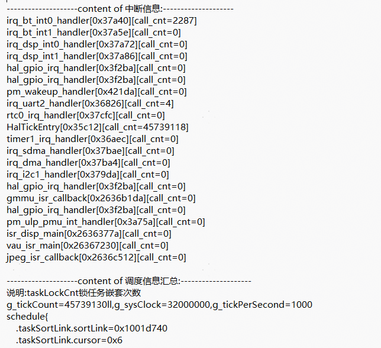

### 多通道数据采集

多通道数据采集界面主要用来持续接收单板业务上传的数据，并将数据保存。

-   **[蓝牙数据采集](#ZH-CN_TOPIC_0000002499501805)**  

#### 蓝牙数据采集

蓝牙数据采集界面如[图1](#zh-cn_topic_0000002456134273_zh-cn_topic_0000001718143957_zh-cn_topic_0000001411144749_fig6430197314)所示。

**图 1**  蓝牙数据采集主界面  
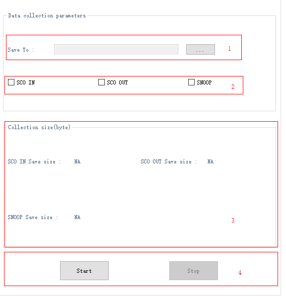

**表 1**  蓝牙数据采集界面说明

<table><thead align="left"><tr id="zh-cn_topic_0000002456134273_zh-cn_topic_0000001718143957_zh-cn_topic_0000001411144749_row136828611554"><th class="cellrowborder" valign="top" width="13.07%" id="mcps1.2.3.1.1">
标号

</th>
<th class="cellrowborder" valign="top" width="86.92999999999999%" id="mcps1.2.3.1.2">
说明

</th>
</tr>
</thead>
<tbody><tr id="zh-cn_topic_0000002456134273_zh-cn_topic_0000001718143957_zh-cn_topic_0000001411144749_row116821611554"><td class="cellrowborder" valign="top" width="13.07%" headers="mcps1.2.3.1.1 ">
1

</td>
<td class="cellrowborder" valign="top" width="86.92999999999999%" headers="mcps1.2.3.1.2 ">
保存路径选择区。

</td>
</tr>
<tr id="zh-cn_topic_0000002456134273_zh-cn_topic_0000001718143957_zh-cn_topic_0000001411144749_row136834619551"><td class="cellrowborder" valign="top" width="13.07%" headers="mcps1.2.3.1.1 ">
2

</td>
<td class="cellrowborder" valign="top" width="86.92999999999999%" headers="mcps1.2.3.1.2 ">
多通道选择区，用来选择需要数据采集的通道。

</td>
</tr>
<tr id="zh-cn_topic_0000002456134273_zh-cn_topic_0000001718143957_zh-cn_topic_0000001411144749_row17683561553"><td class="cellrowborder" valign="top" width="13.07%" headers="mcps1.2.3.1.1 ">
3

</td>
<td class="cellrowborder" valign="top" width="86.92999999999999%" headers="mcps1.2.3.1.2 ">
Collection Size：数据保存大小展示区。

</td>
</tr>
<tr id="zh-cn_topic_0000002456134273_zh-cn_topic_0000001718143957_zh-cn_topic_0000001411144749_row35998104119"><td class="cellrowborder" valign="top" width="13.07%" headers="mcps1.2.3.1.1 ">
4

</td>
<td class="cellrowborder" valign="top" width="86.92999999999999%" headers="mcps1.2.3.1.2 ">
任务开始和结束选择区。

</td>
</tr>
</tbody>
</table>

蓝牙数据采集的步骤如下：

1.  在保存路径选择区点击“...”按钮，在弹出的框中选择要保存的路径。
2.  在多通道选择区选择一个或多个需要数据采集的通道。
3.  点击任务开始和结束区的“Start”按钮，开始采集任务，会在Collection Size中显示采集出的数据大小。
4.  最后点击“Stop”按钮结束数据采集，将会在要保存的路径下生成对应个数的bin文件。

### 自定义参数配置

PQUI界面是自定义参数配置界面，可将界面中存在的参数下发到单板。

**图 1**  PQUI主界面  

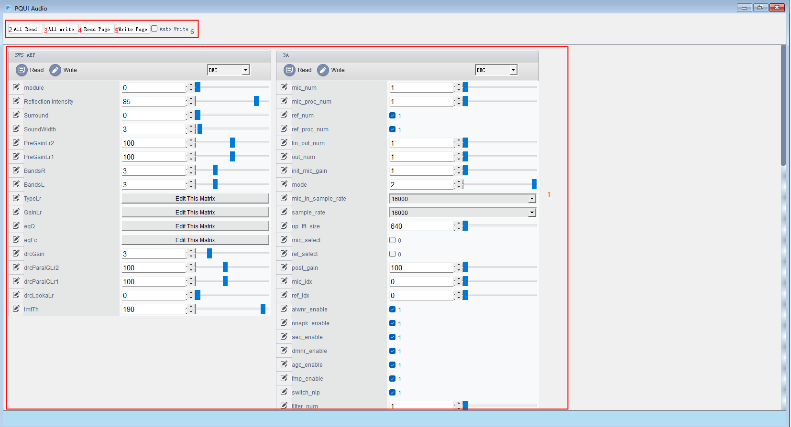

**表 1**  PQUI界面说明

<table><thead align="left"><tr id="zh-cn_topic_0000002456054377_zh-cn_topic_0000001713128645_zh-cn_topic_0000001239734721_zh-cn_topic_0279615208_row29866445"><th class="cellrowborder" valign="top" width="13.07%" id="mcps1.2.3.1.1">
标号

</th>
<th class="cellrowborder" valign="top" width="86.92999999999999%" id="mcps1.2.3.1.2">
说明

</th>
</tr>
</thead>
<tbody><tr id="zh-cn_topic_0000002456054377_zh-cn_topic_0000001713128645_zh-cn_topic_0000001239734721_zh-cn_topic_0279615208_row454234"><td class="cellrowborder" valign="top" width="13.07%" headers="mcps1.2.3.1.1 ">
1

</td>
<td class="cellrowborder" valign="top" width="86.92999999999999%" headers="mcps1.2.3.1.2 ">
参数区：配置需要下发的参数即回显单板数据。单击参数区Write或者Read，对单个结构体进行写入或者读取操作。

</td>
</tr>
<tr id="zh-cn_topic_0000002456054377_zh-cn_topic_0000001713128645_zh-cn_topic_0000001239734721_zh-cn_topic_0279615208_row45642530"><td class="cellrowborder" valign="top" width="13.07%" headers="mcps1.2.3.1.1 ">
2

</td>
<td class="cellrowborder" valign="top" width="86.92999999999999%" headers="mcps1.2.3.1.2 ">
All Read按钮：读取全部参数在单板中的数据值并显示在对应参数区。

</td>
</tr>
<tr id="zh-cn_topic_0000002456054377_zh-cn_topic_0000001713128645_zh-cn_topic_0000001239734721_row1068983935814"><td class="cellrowborder" valign="top" width="13.07%" headers="mcps1.2.3.1.1 ">
3

</td>
<td class="cellrowborder" valign="top" width="86.92999999999999%" headers="mcps1.2.3.1.2 ">
All Write按钮：向单板中写入全部参数区设置的数据。

</td>
</tr>
<tr id="zh-cn_topic_0000002456054377_zh-cn_topic_0000001713128645_zh-cn_topic_0000001239734721_row482383262514"><td class="cellrowborder" valign="top" width="13.07%" headers="mcps1.2.3.1.1 ">
4

</td>
<td class="cellrowborder" valign="top" width="86.92999999999999%" headers="mcps1.2.3.1.2 ">
Read Page按钮：读取当前页面参数在单板中的数据值并显示在对应参数区。

</td>
</tr>
<tr id="zh-cn_topic_0000002456054377_zh-cn_topic_0000001713128645_zh-cn_topic_0000001239734721_row2060583181218"><td class="cellrowborder" valign="top" width="13.07%" headers="mcps1.2.3.1.1 ">
5

</td>
<td class="cellrowborder" valign="top" width="86.92999999999999%" headers="mcps1.2.3.1.2 ">
Write Page按钮：向单板中写入当前页参数区设置的数据。

</td>
</tr>
<tr id="zh-cn_topic_0000002456054377_zh-cn_topic_0000001713128645_zh-cn_topic_0000001239734721_row2040165117142"><td class="cellrowborder" valign="top" width="13.07%" headers="mcps1.2.3.1.1 ">
6

</td>
<td class="cellrowborder" valign="top" width="86.92999999999999%" headers="mcps1.2.3.1.2 ">
Auto Write：选择是否每次修改都向单板发送一次此时当前参数区结构体的数据。

</td>
</tr>
</tbody>
</table>

界面修改参数后向板端read或write的操作步骤如下：

1.  修改对应界面中某些项的值。
2.  单击group的“Write”，单独下发当前group的值。

    单击“Write Page”按钮，下发当前界面所有group的值。

    单击“All Write”按钮，下发全部group的值。

    单击group的“Read”，读取单板中当前group的值。

    单击“Read Page”按钮，读取单板中当前界面所有group的值。

    单击“All Read”按钮，读取单板中全部group的值。

### 多语言脚本调用

多语言脚本调用界面用于将xml信息转换为.lang文件，单板将使用lang文件作为资源支持不同语言字符展示。

> **说明：** 
>此功能需要python3.8及以上版本环境。

**图 1**  多语言脚本调用界面  
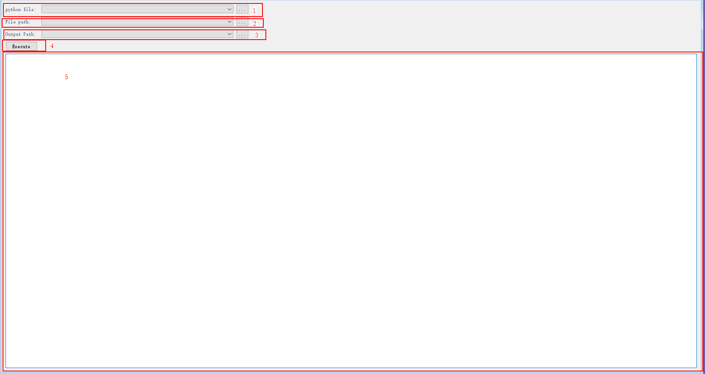

**表 1**  多语言脚本调用界面说明

<table><thead align="left"><tr id="zh-cn_topic_0000002422495570_zh-cn_topic_0000001713048689_zh-cn_topic_0000001506912113_row23991732151617"><th class="cellrowborder" valign="top" width="16.580000000000002%" id="mcps1.2.3.1.1">
标号

</th>
<th class="cellrowborder" valign="top" width="83.42%" id="mcps1.2.3.1.2">
说明

</th>
</tr>
</thead>
<tbody><tr id="zh-cn_topic_0000002422495570_zh-cn_topic_0000001713048689_zh-cn_topic_0000001506912113_row15399153291618"><td class="cellrowborder" valign="top" width="16.580000000000002%" headers="mcps1.2.3.1.1 ">
1

</td>
<td class="cellrowborder" valign="top" width="83.42%" headers="mcps1.2.3.1.2 ">
名为“language_trans.py”的python脚本，一般来自单板版本发布包。

</td>
</tr>
<tr id="zh-cn_topic_0000002422495570_zh-cn_topic_0000001713048689_zh-cn_topic_0000001506912113_row439913218165"><td class="cellrowborder" valign="top" width="16.580000000000002%" headers="mcps1.2.3.1.1 ">
2

</td>
<td class="cellrowborder" valign="top" width="83.42%" headers="mcps1.2.3.1.2 ">
调用文件路径。

</td>
</tr>
<tr id="zh-cn_topic_0000002422495570_zh-cn_topic_0000001713048689_zh-cn_topic_0000001506912113_row19399163251615"><td class="cellrowborder" valign="top" width="16.580000000000002%" headers="mcps1.2.3.1.1 ">
3

</td>
<td class="cellrowborder" valign="top" width="83.42%" headers="mcps1.2.3.1.2 ">
输出路径。

</td>
</tr>
<tr id="zh-cn_topic_0000002422495570_zh-cn_topic_0000001713048689_zh-cn_topic_0000001506912113_row1339983218161"><td class="cellrowborder" valign="top" width="16.580000000000002%" headers="mcps1.2.3.1.1 ">
4

</td>
<td class="cellrowborder" valign="top" width="83.42%" headers="mcps1.2.3.1.2 ">
调用按钮。

</td>
</tr>
<tr id="zh-cn_topic_0000002422495570_zh-cn_topic_0000001713048689_zh-cn_topic_0000001506912113_row239903218165"><td class="cellrowborder" valign="top" width="16.580000000000002%" headers="mcps1.2.3.1.1 ">
5

</td>
<td class="cellrowborder" valign="top" width="83.42%" headers="mcps1.2.3.1.2 ">
调用结果。

</td>
</tr>
</tbody>
</table>

多语言脚本调用步骤如下：

1.  分别选择“language\_trans.py”脚本、转换文件路径和输出路径。
2.  点击“Execute”按钮，调用结果展示在白框中。

### 自定义参数转bin

自定义参数转bin用于设置参数并将其写入到bin文件中。界面如[图1](#zh-cn_topic_0000002422655474_zh-cn_topic_0000001713048685_zh-cn_topic_0000001424704660_fig395161991915)所示

**图 1**  自定义参数转bin界面  

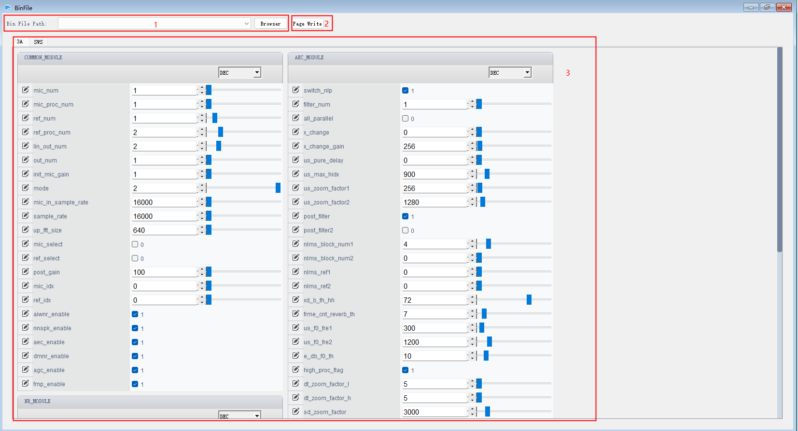

**表 1**  自定义参数转bin界面说明

<table><thead align="left"><tr id="zh-cn_topic_0000002422655474_zh-cn_topic_0000001713048685_zh-cn_topic_0000001424704660_row1926835114287"><th class="cellrowborder" valign="top" width="6.45%" id="mcps1.2.3.1.1">
标号

</th>
<th class="cellrowborder" valign="top" width="93.55%" id="mcps1.2.3.1.2">
说明

</th>
</tr>
</thead>
<tbody><tr id="zh-cn_topic_0000002422655474_zh-cn_topic_0000001713048685_zh-cn_topic_0000001424704660_row1126865111283"><td class="cellrowborder" valign="top" width="6.45%" headers="mcps1.2.3.1.1 ">
1

</td>
<td class="cellrowborder" valign="top" width="93.55%" headers="mcps1.2.3.1.2 ">
文件选择。

</td>
</tr>
<tr id="zh-cn_topic_0000002422655474_zh-cn_topic_0000001713048685_zh-cn_topic_0000001424704660_row626895116286"><td class="cellrowborder" valign="top" width="6.45%" headers="mcps1.2.3.1.1 ">
2

</td>
<td class="cellrowborder" valign="top" width="93.55%" headers="mcps1.2.3.1.2 ">
Page Write：整页写入bin文件

</td>
</tr>
<tr id="zh-cn_topic_0000002422655474_zh-cn_topic_0000001713048685_zh-cn_topic_0000001424704660_row6564162611361"><td class="cellrowborder" valign="top" width="6.45%" headers="mcps1.2.3.1.1 ">
3

</td>
<td class="cellrowborder" valign="top" width="93.55%" headers="mcps1.2.3.1.2 ">
参数设置信息页。

</td>
</tr>
</tbody>
</table>

-   **[选择文件并读取](#ZH-CN_TOPIC_0000002466382864)**  

-   **[写入bin文件](#ZH-CN_TOPIC_0000002499581801)**  

#### 选择文件并读取

选择文件并读取步骤如下：

1.  点击“Browser”选择文件。并显示出选择文件界面。如[图1](#zh-cn_topic_0000002456134277_zh-cn_topic_0000001665168854_zh-cn_topic_0000001424388380_fig641824911422)所示

    **图 1**  选择文件界面  
    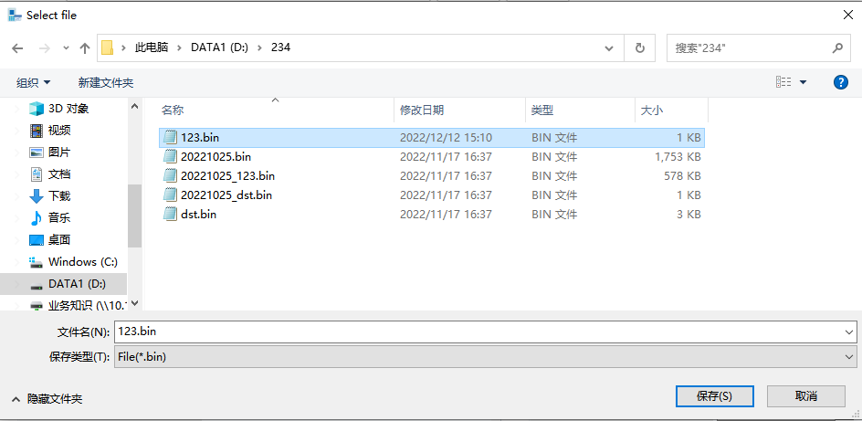

2.  选择一个bin文件。将bin文件数据显示在界面中。

#### 写入bin文件

写入bin文件步骤如下：

1.  点击“Browser”选择文件。
2.  在参数设置信息页设置参数。
3.  点击“Page Write”将设置的参数写入选择的文件。

### RF接口测试

RF接口测试界面主要根据界面上的参数拼接命令通过串口下发到单板。

**图 1**  RF接口测试主界面  

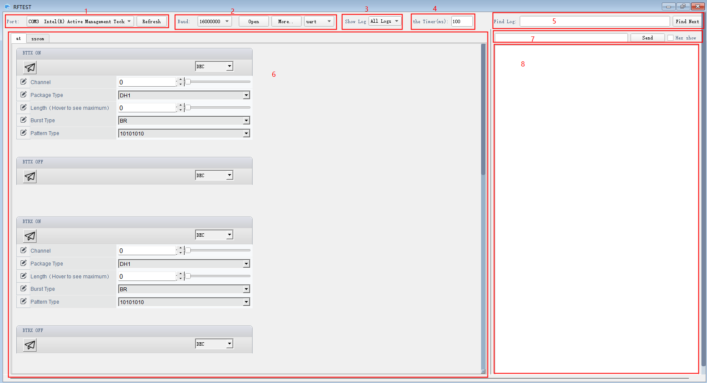

**表 1**  RF接口测试界面说明

<table><thead align="left"><tr id="zh-cn_topic_0000002422495574_zh-cn_topic_0000001713128669_zh-cn_topic_0000001474467993_row23991732151617"><th class="cellrowborder" valign="top" width="16.580000000000002%" id="mcps1.2.3.1.1">
标号

</th>
<th class="cellrowborder" valign="top" width="83.42%" id="mcps1.2.3.1.2">
说明

</th>
</tr>
</thead>
<tbody><tr id="zh-cn_topic_0000002422495574_zh-cn_topic_0000001713128669_zh-cn_topic_0000001474467993_row15399153291618"><td class="cellrowborder" valign="top" width="16.580000000000002%" headers="mcps1.2.3.1.1 ">
1

</td>
<td class="cellrowborder" valign="top" width="83.42%" headers="mcps1.2.3.1.2 ">
配置收发数据的端口号。

</td>
</tr>
<tr id="zh-cn_topic_0000002422495574_zh-cn_topic_0000001713128669_zh-cn_topic_0000001474467993_row439913218165"><td class="cellrowborder" valign="top" width="16.580000000000002%" headers="mcps1.2.3.1.1 ">
2

</td>
<td class="cellrowborder" valign="top" width="83.42%" headers="mcps1.2.3.1.2 ">
配置收发命令的波特率等串口常用的参数。

</td>
</tr>
<tr id="zh-cn_topic_0000002422495574_zh-cn_topic_0000001713128669_zh-cn_topic_0000001474467993_row19399163251615"><td class="cellrowborder" valign="top" width="16.580000000000002%" headers="mcps1.2.3.1.1 ">
3

</td>
<td class="cellrowborder" valign="top" width="83.42%" headers="mcps1.2.3.1.2 ">
选择收发命令展示区显示内容。

</td>
</tr>
<tr id="zh-cn_topic_0000002422495574_zh-cn_topic_0000001713128669_row245119192812"><td class="cellrowborder" valign="top" width="16.580000000000002%" headers="mcps1.2.3.1.1 ">
4

</td>
<td class="cellrowborder" valign="top" width="83.42%" headers="mcps1.2.3.1.2 ">
当命令是由多条组成时，设置命令发送的间隔。

</td>
</tr>
<tr id="zh-cn_topic_0000002422495574_zh-cn_topic_0000001713128669_row3750613132815"><td class="cellrowborder" valign="top" width="16.580000000000002%" headers="mcps1.2.3.1.1 ">
5

</td>
<td class="cellrowborder" valign="top" width="83.42%" headers="mcps1.2.3.1.2 ">
字符串搜索框。

</td>
</tr>
<tr id="zh-cn_topic_0000002422495574_zh-cn_topic_0000001713128669_zh-cn_topic_0000001474467993_row1339983218161"><td class="cellrowborder" valign="top" width="16.580000000000002%" headers="mcps1.2.3.1.1 ">
6

</td>
<td class="cellrowborder" valign="top" width="83.42%" headers="mcps1.2.3.1.2 ">
收发命令展示区。绿色字符为串口接收数据，黑色字符为串口发送数据。

</td>
</tr>
<tr id="zh-cn_topic_0000002422495574_zh-cn_topic_0000001713128669_zh-cn_topic_0000001474467993_row239903218165"><td class="cellrowborder" valign="top" width="16.580000000000002%" headers="mcps1.2.3.1.1 ">
7

</td>
<td class="cellrowborder" valign="top" width="83.42%" headers="mcps1.2.3.1.2 ">
配置需要收发命令的参数。

</td>
</tr>
<tr id="zh-cn_topic_0000002422495574_zh-cn_topic_0000001713128669_row19621131620116"><td class="cellrowborder" valign="top" width="16.580000000000002%" headers="mcps1.2.3.1.1 ">
8

</td>
<td class="cellrowborder" valign="top" width="83.42%" headers="mcps1.2.3.1.2 ">
字符串搜索框。

</td>
</tr>
</tbody>
</table>

### 图形压缩对比

PictureCompress界面主要是对图片的压缩和对比。

**图 1**  PictureCompress主界面  

**表 1**  界面说明

<table><thead align="left"><tr id="zh-cn_topic_0000002422655478_zh-cn_topic_0000001665009098_zh-cn_topic_0000001249728618_zh-cn_topic_0279615208_row29866445"><th class="cellrowborder" valign="top" width="13.07%" id="mcps1.2.3.1.1">
标号

</th>
<th class="cellrowborder" valign="top" width="86.92999999999999%" id="mcps1.2.3.1.2">
说明

</th>
</tr>
</thead>
<tbody><tr id="zh-cn_topic_0000002422655478_zh-cn_topic_0000001665009098_zh-cn_topic_0000001249728618_zh-cn_topic_0279615208_row454234"><td class="cellrowborder" valign="top" width="13.07%" headers="mcps1.2.3.1.1 ">
1

</td>
<td class="cellrowborder" valign="top" width="86.92999999999999%" headers="mcps1.2.3.1.2 ">
待压缩图片路径，压缩算法选择按钮和设置按钮。

</td>
</tr>
<tr id="zh-cn_topic_0000002422655478_zh-cn_topic_0000001665009098_zh-cn_topic_0000001249728618_zh-cn_topic_0279615208_row45642530"><td class="cellrowborder" valign="top" width="13.07%" headers="mcps1.2.3.1.1 ">
2

</td>
<td class="cellrowborder" valign="top" width="86.92999999999999%" headers="mcps1.2.3.1.2 ">
压缩文件保存路径，开始压缩按钮。

</td>
</tr>
<tr id="zh-cn_topic_0000002422655478_zh-cn_topic_0000001665009098_zh-cn_topic_0000001249728618_row139646576421"><td class="cellrowborder" valign="top" width="13.07%" headers="mcps1.2.3.1.1 ">
3

</td>
<td class="cellrowborder" valign="top" width="86.92999999999999%" headers="mcps1.2.3.1.2 ">
输入图片展示区。

</td>
</tr>
<tr id="zh-cn_topic_0000002422655478_zh-cn_topic_0000001665009098_zh-cn_topic_0000001249728618_row1482132153810"><td class="cellrowborder" valign="top" width="13.07%" headers="mcps1.2.3.1.1 ">
4

</td>
<td class="cellrowborder" valign="top" width="86.92999999999999%" headers="mcps1.2.3.1.2 ">
压缩结果图片展示区。

</td>
</tr>
<tr id="zh-cn_topic_0000002422655478_zh-cn_topic_0000001665009098_zh-cn_topic_0000001249728618_row0583171014382"><td class="cellrowborder" valign="top" width="13.07%" headers="mcps1.2.3.1.1 ">
5

</td>
<td class="cellrowborder" valign="top" width="86.92999999999999%" headers="mcps1.2.3.1.2 ">
对比参数设置区。

</td>
</tr>
<tr id="zh-cn_topic_0000002422655478_zh-cn_topic_0000001665009098_zh-cn_topic_0000001249728618_row33529469408"><td class="cellrowborder" valign="top" width="13.07%" headers="mcps1.2.3.1.1 ">
6

</td>
<td class="cellrowborder" valign="top" width="86.92999999999999%" headers="mcps1.2.3.1.2 ">
对比效果展示区。

</td>
</tr>
</tbody>
</table>

-   **[压缩功能-CS](#ZH-CN_TOPIC_0000002466542472)**  

-   **[压缩功能-FB](#ZH-CN_TOPIC_0000002499581805)**  

-   **[对比功能](#ZH-CN_TOPIC_0000002499501749)**  

#### 压缩功能-CS

将png、jpg、bmp图片按照不同的压缩方式压缩为bin文件并保存。

**图 1**  压缩功能主要界面  

**表 1**  压缩界面说明

<table><thead align="left"><tr id="zh-cn_topic_0000002456134281_zh-cn_topic_0000001713128649_zh-cn_topic_0000001249568898_zh-cn_topic_0279615208_row29866445"><th class="cellrowborder" valign="top" width="13.07%" id="mcps1.2.3.1.1">
标号

</th>
<th class="cellrowborder" valign="top" width="86.92999999999999%" id="mcps1.2.3.1.2">
说明

</th>
</tr>
</thead>
<tbody><tr id="zh-cn_topic_0000002456134281_zh-cn_topic_0000001713128649_zh-cn_topic_0000001249568898_zh-cn_topic_0279615208_row454234"><td class="cellrowborder" valign="top" width="13.07%" headers="mcps1.2.3.1.1 ">
1

</td>
<td class="cellrowborder" valign="top" width="86.92999999999999%" headers="mcps1.2.3.1.2 ">
待压缩图片的文件夹路径。

</td>
</tr>
<tr id="zh-cn_topic_0000002456134281_zh-cn_topic_0000001713128649_zh-cn_topic_0000001249568898_zh-cn_topic_0279615208_row45642530"><td class="cellrowborder" valign="top" width="13.07%" headers="mcps1.2.3.1.1 ">
2

</td>
<td class="cellrowborder" valign="top" width="86.92999999999999%" headers="mcps1.2.3.1.2 ">
压缩完成的二进制和头文件的输出文件夹路径。

</td>
</tr>
<tr id="zh-cn_topic_0000002456134281_zh-cn_topic_0000001713128649_row7715326315"><td class="cellrowborder" valign="top" width="13.07%" headers="mcps1.2.3.1.1 ">
3

</td>
<td class="cellrowborder" valign="top" width="86.92999999999999%" headers="mcps1.2.3.1.2 ">
压缩算法选择按钮。

</td>
</tr>
<tr id="zh-cn_topic_0000002456134281_zh-cn_topic_0000001713128649_zh-cn_topic_0000001249568898_row139646576421"><td class="cellrowborder" valign="top" width="13.07%" headers="mcps1.2.3.1.1 ">
4

</td>
<td class="cellrowborder" valign="top" width="86.92999999999999%" headers="mcps1.2.3.1.2 ">
压缩开始按钮。

</td>
</tr>
<tr id="zh-cn_topic_0000002456134281_zh-cn_topic_0000001713128649_zh-cn_topic_0000001249568898_row1482132153810"><td class="cellrowborder" valign="top" width="13.07%" headers="mcps1.2.3.1.1 ">
5

</td>
<td class="cellrowborder" valign="top" width="86.92999999999999%" headers="mcps1.2.3.1.2 ">
配置压缩参数。

</td>
</tr>
</tbody>
</table>

CS算法图片压缩功能的步骤如下：

1.  点击图片路径选择按钮“...” 选择需要压缩的图片的路径。
2.  点击“Setting”按钮，显示如下所示界面，配置压缩的条件。

    **图 2**  压缩参数选择  
    

3.  点击“Compress”按钮，开始进行压缩。
4.  点击右上角Pre或者Next选择合适的结果，点击OK确定结果。
5.  重复[4](#zh-cn_topic_0000002456134281_zh-cn_topic_0000001713128649_li10173126153414)直到流程结束。

> **说明：** 
>-   输入文件支持ARBG888、RGB888、RGB565三种格式，输出文件和输入文件的格式相同。输入文件的像素大小应小于1280×800。
>-   参数说明
>    -   TileWidth：压缩单元宽度，4--4x4；6--6x4；8--8x4；16--16x4，也叫压缩倍率。在ARGB8888格式时分别对应4倍压缩，6倍压缩，8倍压缩，16倍压缩，在RGB888时分别对应3倍压缩，4.5倍压缩，6倍压缩，12倍压缩，在RGB565时分别对应2倍压缩，3倍压缩，4倍压缩，8倍压缩。
>    -   ModeAlpha：压缩模式：0-- 非压缩；1-- 压缩。
>    -   ModeRGB：压缩模式：0--非压缩；1-- 压缩。
>    -   Autocmpmode：压缩模式：1--自动压缩模式，对压缩文件进行4倍、6倍、8倍、16倍压缩；0--手动压缩模式，按照固定配置参数进行压缩。若选择自动压缩模式，每完成一个图片压缩，会生成四个备选压缩结果，同时将四个压缩结果在区域4中预览，通过观察或者对比功能选择合适的结果，确定结果时保留选择的图片。
>    -   IsPackage：压缩流程中是否额外生成打包bin文件。
>    -   FullPreview：1--查看每张图的压缩结果，每完成一张图片压缩并选择合适的结果后开始下一张的压缩流程，直到所有的图片压缩完成；0--不查看压缩结果。
>-   压缩倍率是与裸数据大小进行对比，而非与源文件大小对比，例如466×466的RGBA图片，无压缩大小为848k，6倍压缩时为142k，16倍压缩时大约为54k。
>-   压缩操作为有损压缩，压缩倍率越大，图损越大。

#### 压缩功能-FB

将png、jpg、bmp图片按照不同的压缩方式压缩为bin文件并保存。

**图 1**  压缩功能主要界面  

**表 1**  压缩界面说明

<table><thead align="left"><tr id="zh-cn_topic_0000002422495582_zh-cn_topic_0000002380811560_zh-cn_topic_0000001249568898_zh-cn_topic_0279615208_row29866445"><th class="cellrowborder" valign="top" width="13.07%" id="mcps1.2.3.1.1">
标号

</th>
<th class="cellrowborder" valign="top" width="86.92999999999999%" id="mcps1.2.3.1.2">
说明

</th>
</tr>
</thead>
<tbody><tr id="zh-cn_topic_0000002422495582_zh-cn_topic_0000002380811560_zh-cn_topic_0000001249568898_zh-cn_topic_0279615208_row454234"><td class="cellrowborder" valign="top" width="13.07%" headers="mcps1.2.3.1.1 ">
1

</td>
<td class="cellrowborder" valign="top" width="86.92999999999999%" headers="mcps1.2.3.1.2 ">
待压缩图片的文件夹路径。

</td>
</tr>
<tr id="zh-cn_topic_0000002422495582_zh-cn_topic_0000002380811560_zh-cn_topic_0000001249568898_zh-cn_topic_0279615208_row45642530"><td class="cellrowborder" valign="top" width="13.07%" headers="mcps1.2.3.1.1 ">
2

</td>
<td class="cellrowborder" valign="top" width="86.92999999999999%" headers="mcps1.2.3.1.2 ">
压缩完成的二进制和头文件的输出文件夹路径。

</td>
</tr>
<tr id="zh-cn_topic_0000002422495582_zh-cn_topic_0000002380811560_row7715326315"><td class="cellrowborder" valign="top" width="13.07%" headers="mcps1.2.3.1.1 ">
3

</td>
<td class="cellrowborder" valign="top" width="86.92999999999999%" headers="mcps1.2.3.1.2 ">
压缩算法选择按钮。

</td>
</tr>
<tr id="zh-cn_topic_0000002422495582_zh-cn_topic_0000002380811560_zh-cn_topic_0000001249568898_row139646576421"><td class="cellrowborder" valign="top" width="13.07%" headers="mcps1.2.3.1.1 ">
4

</td>
<td class="cellrowborder" valign="top" width="86.92999999999999%" headers="mcps1.2.3.1.2 ">
压缩开始按钮。

</td>
</tr>
<tr id="zh-cn_topic_0000002422495582_zh-cn_topic_0000002380811560_zh-cn_topic_0000001249568898_row1482132153810"><td class="cellrowborder" valign="top" width="13.07%" headers="mcps1.2.3.1.1 ">
5

</td>
<td class="cellrowborder" valign="top" width="86.92999999999999%" headers="mcps1.2.3.1.2 ">
配置压缩参数。

</td>
</tr>
</tbody>
</table>

FB算法图片压缩功能的步骤如下：

1.  点击图片路径选择按钮“...” 选择需要压缩的图片的路径。
2.  点击“Setting”按钮，显示如下所示界面，配置压缩的条件。

    **图 2**  压缩参数选择  
    

3.  点击“Compress”按钮，开始进行压缩。
4.  点击右上角Pre或者Next选择合适的结果，点击OK确定结果。
5.  重复[4](#zh-cn_topic_0000002422495582_zh-cn_topic_0000002380811560_zh-cn_topic_0000001249568898_li684024916523)直到流程结束。

> **说明：** 
>-   输入文件支持ARBG888、RGB888、RGB565三种格式，输出文件和输入文件的格式相同。输入文件的像素大小应小于1280×800。
>-   参数说明
>    -   FullPreview：1--查看每张图的压缩结果，每完成一张图片压缩并选择合适的结果后开始下一张的压缩流程，直到所有的图片压缩完成；0--不查看压缩结果。
>    -   Compress Ratio：压缩倍率选择：2--2倍压缩，3--3倍压缩

#### 对比功能

**图 1**  对比效果图  

**表 1**  对比界面说明

<table><thead align="left"><tr id="zh-cn_topic_0000002422655482_zh-cn_topic_0000001713048669_zh-cn_topic_0000001296087345_zh-cn_topic_0279615208_row29866445"><th class="cellrowborder" valign="top" width="13.07%" id="mcps1.2.3.1.1">
标号

</th>
<th class="cellrowborder" valign="top" width="86.92999999999999%" id="mcps1.2.3.1.2">
说明

</th>
</tr>
</thead>
<tbody><tr id="zh-cn_topic_0000002422655482_zh-cn_topic_0000001713048669_zh-cn_topic_0000001296087345_zh-cn_topic_0279615208_row454234"><td class="cellrowborder" valign="top" width="13.07%" headers="mcps1.2.3.1.1 ">
1

</td>
<td class="cellrowborder" valign="top" width="86.92999999999999%" headers="mcps1.2.3.1.2 ">
像素差值容忍度。

</td>
</tr>
<tr id="zh-cn_topic_0000002422655482_zh-cn_topic_0000001713048669_zh-cn_topic_0000001296087345_zh-cn_topic_0279615208_row45642530"><td class="cellrowborder" valign="top" width="13.07%" headers="mcps1.2.3.1.1 ">
2

</td>
<td class="cellrowborder" valign="top" width="86.92999999999999%" headers="mcps1.2.3.1.2 ">
两张图片小范围像素级对比显示。

</td>
</tr>
<tr id="zh-cn_topic_0000002422655482_zh-cn_topic_0000001713048669_zh-cn_topic_0000001296087345_row139646576421"><td class="cellrowborder" valign="top" width="13.07%" headers="mcps1.2.3.1.1 ">
3

</td>
<td class="cellrowborder" valign="top" width="86.92999999999999%" headers="mcps1.2.3.1.2 ">
两张图片整体对比展示。

</td>
</tr>
</tbody>
</table>

图片对比功能的步骤如下：

1.  点击右键打开菜单，点击“compare”按钮开始对比。
2.  将鼠标放置在图片上，按住Ctrl同时滚动鼠标滚轮，调整整体效果的图片大小。
3.  拖动容差滑块，调整选取颜色时所设置的选取范围。

> **说明：** 
>两张图片不同的地方会显示为红色，拖动容差后，在容差范围内的色块会显示为深蓝色。

### 音频质量界面

音频质量界面用于设置音频音效相关的参数，并将其下发到单板、写入bin文件或保存到NV。

-   **[3A参数界面](#ZH-CN_TOPIC_0000002499581765)**  

#### 3A参数界面

3A参数界面用于设置音频相关的参数，并将其下发到单板。注意需让设备先进入蓝牙通话业务。

**图 1**  3A参数界面  

**表 1**  3A参数下发界面说明

<table><thead align="left"><tr id="zh-cn_topic_0000002456054393_zh-cn_topic_0000001778653077_zh-cn_topic_0000001630796581_row25478015236"><th class="cellrowborder" valign="top" width="18.17%" id="mcps1.2.3.1.1">
标号

</th>
<th class="cellrowborder" valign="top" width="81.83%" id="mcps1.2.3.1.2">
说明

</th>
</tr>
</thead>
<tbody><tr id="zh-cn_topic_0000002456054393_zh-cn_topic_0000001778653077_zh-cn_topic_0000001630796581_row854720092317"><td class="cellrowborder" valign="top" width="18.17%" headers="mcps1.2.3.1.1 ">
1

</td>
<td class="cellrowborder" valign="top" width="81.83%" headers="mcps1.2.3.1.2 ">
bin文件路径。

</td>
</tr>
<tr id="zh-cn_topic_0000002456054393_zh-cn_topic_0000001778653077_zh-cn_topic_0000001630796581_row105478010237"><td class="cellrowborder" valign="top" width="18.17%" headers="mcps1.2.3.1.1 ">
2

</td>
<td class="cellrowborder" valign="top" width="81.83%" headers="mcps1.2.3.1.2 ">
选择bin文件。

</td>
</tr>
<tr id="zh-cn_topic_0000002456054393_zh-cn_topic_0000001778653077_zh-cn_topic_0000001630796581_row125472082316"><td class="cellrowborder" valign="top" width="18.17%" headers="mcps1.2.3.1.1 ">
3

</td>
<td class="cellrowborder" valign="top" width="81.83%" headers="mcps1.2.3.1.2 ">
导出到bin文件中。

</td>
</tr>
<tr id="zh-cn_topic_0000002456054393_zh-cn_topic_0000001778653077_zh-cn_topic_0000001630796581_row155477014237"><td class="cellrowborder" valign="top" width="18.17%" headers="mcps1.2.3.1.1 ">
4

</td>
<td class="cellrowborder" valign="top" width="81.83%" headers="mcps1.2.3.1.2 ">
保存到NV。

</td>
</tr>
<tr id="zh-cn_topic_0000002456054393_zh-cn_topic_0000001778653077_row52772417114"><td class="cellrowborder" valign="top" width="18.17%" headers="mcps1.2.3.1.1 ">
5

</td>
<td class="cellrowborder" valign="top" width="81.83%" headers="mcps1.2.3.1.2 ">
显示二进制数据。

</td>
</tr>
<tr id="zh-cn_topic_0000002456054393_zh-cn_topic_0000001778653077_row1685729173611"><td class="cellrowborder" valign="top" width="18.17%" headers="mcps1.2.3.1.1 ">
6

</td>
<td class="cellrowborder" valign="top" width="81.83%" headers="mcps1.2.3.1.2 ">
参数页。

</td>
</tr>
<tr id="zh-cn_topic_0000002456054393_zh-cn_topic_0000001778653077_row185112910367"><td class="cellrowborder" valign="top" width="18.17%" headers="mcps1.2.3.1.1 ">
7

</td>
<td class="cellrowborder" valign="top" width="81.83%" headers="mcps1.2.3.1.2 ">
读写参数。

</td>
</tr>
</tbody>
</table>

选择Bin文件并读取的步骤：

1.  点击“Browser”选择文件，并显示出选择文件界面。如[图2](#zh-cn_topic_0000002456054393_zh-cn_topic_0000001778653077_zh-cn_topic_0000001580973000_fig183273113715)所示。

    **图 2**  选择bin文件界面  
    

2.  选择一个bin文件。将bin文件数据显示在界面中。

写入Bin文件的步骤：

1.  点击“Browser”选择文件。
2.  点击“Export”把参数导出到bin文件。

保存数据到NV的步骤：

1.  在参数页设置参数。
2.  点击“Save”按钮把参数保存到NV。

显示二进制数据的步骤：

1.  在参数页设置参数。
2.  点击“Binary”按钮显示3A算法的二进制数据。

### 提示音工具

提示音工具用于将.wav文件转换为.sbc文件。

**图 1**  提示音工具界面  

**表 1**  提示音工具界面说明

<table><thead align="left"><tr id="zh-cn_topic_0000002422495586_zh-cn_topic_0000001665168858_zh-cn_topic_0000001610622677_row23991732151617"><th class="cellrowborder" valign="top" width="16.580000000000002%" id="mcps1.2.3.1.1">
标号

</th>
<th class="cellrowborder" valign="top" width="83.42%" id="mcps1.2.3.1.2">
说明

</th>
</tr>
</thead>
<tbody><tr id="zh-cn_topic_0000002422495586_zh-cn_topic_0000001665168858_zh-cn_topic_0000001610622677_row15399153291618"><td class="cellrowborder" valign="top" width="16.580000000000002%" headers="mcps1.2.3.1.1 ">
1

</td>
<td class="cellrowborder" valign="top" width="83.42%" headers="mcps1.2.3.1.2 ">
输入文件路径。

</td>
</tr>
<tr id="zh-cn_topic_0000002422495586_zh-cn_topic_0000001665168858_zh-cn_topic_0000001610622677_row439913218165"><td class="cellrowborder" valign="top" width="16.580000000000002%" headers="mcps1.2.3.1.1 ">
2

</td>
<td class="cellrowborder" valign="top" width="83.42%" headers="mcps1.2.3.1.2 ">
输出路径。

</td>
</tr>
<tr id="zh-cn_topic_0000002422495586_zh-cn_topic_0000001665168858_zh-cn_topic_0000001610622677_row19399163251615"><td class="cellrowborder" valign="top" width="16.580000000000002%" headers="mcps1.2.3.1.1 ">
3

</td>
<td class="cellrowborder" valign="top" width="83.42%" headers="mcps1.2.3.1.2 ">
解析按钮。

</td>
</tr>
<tr id="zh-cn_topic_0000002422495586_zh-cn_topic_0000001665168858_zh-cn_topic_0000001610622677_row1339983218161"><td class="cellrowborder" valign="top" width="16.580000000000002%" headers="mcps1.2.3.1.1 ">
4

</td>
<td class="cellrowborder" valign="top" width="83.42%" headers="mcps1.2.3.1.2 ">
解析结果。

</td>
</tr>
</tbody>
</table>

多语言脚本调用步骤如下：

1.  分别选择输入路径和输出路径（输出路径为空时默认存到输入路径下）。
2.  点击“Parse”按钮，结果和输出路径展示在白框中。

> **说明：** 
>提示音输入的wav文件需要采样率固定为16k，位宽16bit，声道数1声道。

### 打点文件解析

打点文件解析界面是用来解析打点文件，切换设置了打点文件解析界面配置的芯片，点击system插件，会出现展示该界面的选项Mark File，点击该选项后，右侧会出现打点文件解析界面。

**图 1**  打点文件解析界面  

使用步骤：点击Browser，打开打点文件的以bin.idx为后缀的文件路径，例如“log\_file\_chr.bin.idx”，即可在下方看到解析后的文件内容。

# FAQ

-   **[命令无响应或提示超时](#ZH-CN_TOPIC_0000002466382792)**  

## 命令无响应或提示超时

**问题描述**

连接成功，但是所有命令无响应或者提示超时。

**解决办法**

1.  排查连接的串口是否确认为Debugkits使用的串口而非其他业务占用的串口。
2.  排查串口连接方式正常，无连接松动或少接线。
3.  排查设备运行状态，确保处于正常运行状态，而非低功耗状态，睡眠状态或死机。

