# 前言<a name="ZH-CN_TOPIC_0000002522134832"></a>

**概述<a name="zh-cn_topic_0000002516890344_section4537382116410"></a>**

本文档主要介绍产测工具的使用方法。

**读者对象<a name="zh-cn_topic_0000002516890344_section4378592816410"></a>**

本文档主要适用于以下工程师：

-   技术支持工程师
-   软件工程师
-   硬件工程师

**符号约定<a name="zh-cn_topic_0000002516890344_section133020216410"></a>**

在本文中可能出现下列标志，它们所代表的含义如下。

<a name="zh-cn_topic_0000002516890344_table2622507016410"></a>
<table><thead align="left"><tr id="zh-cn_topic_0000002516890344_row1530720816410"><th class="cellrowborder" valign="top" width="20.580000000000002%" id="mcps1.1.3.1.1"><p id="zh-cn_topic_0000002516890344_p6450074116410"><a name="zh-cn_topic_0000002516890344_p6450074116410"></a><a name="zh-cn_topic_0000002516890344_p6450074116410"></a><strong id="zh-cn_topic_0000002516890344_b2136615816410"><a name="zh-cn_topic_0000002516890344_b2136615816410"></a><a name="zh-cn_topic_0000002516890344_b2136615816410"></a>符号</strong></p>
</th>
<th class="cellrowborder" valign="top" width="79.42%" id="mcps1.1.3.1.2"><p id="zh-cn_topic_0000002516890344_p5435366816410"><a name="zh-cn_topic_0000002516890344_p5435366816410"></a><a name="zh-cn_topic_0000002516890344_p5435366816410"></a><strong id="zh-cn_topic_0000002516890344_b5941558116410"><a name="zh-cn_topic_0000002516890344_b5941558116410"></a><a name="zh-cn_topic_0000002516890344_b5941558116410"></a>说明</strong></p>
</th>
</tr>
</thead>
<tbody><tr id="zh-cn_topic_0000002516890344_row1372280416410"><td class="cellrowborder" valign="top" width="20.580000000000002%" headers="mcps1.1.3.1.1 "><p id="zh-cn_topic_0000002516890344_p3734547016410"><a name="zh-cn_topic_0000002516890344_p3734547016410"></a><a name="zh-cn_topic_0000002516890344_p3734547016410"></a><a name="zh-cn_topic_0000002516890344_image2670064316410"></a><a name="zh-cn_topic_0000002516890344_image2670064316410"></a><span></span></p>
</td>
<td class="cellrowborder" valign="top" width="79.42%" headers="mcps1.1.3.1.2 "><p id="zh-cn_topic_0000002516890344_p1757432116410"><a name="zh-cn_topic_0000002516890344_p1757432116410"></a><a name="zh-cn_topic_0000002516890344_p1757432116410"></a>表示如不避免则将会导致死亡或严重伤害的具有高等级风险的危害。</p>
</td>
</tr>
<tr id="zh-cn_topic_0000002516890344_row466863216410"><td class="cellrowborder" valign="top" width="20.580000000000002%" headers="mcps1.1.3.1.1 "><p id="zh-cn_topic_0000002516890344_p1432579516410"><a name="zh-cn_topic_0000002516890344_p1432579516410"></a><a name="zh-cn_topic_0000002516890344_p1432579516410"></a><a name="zh-cn_topic_0000002516890344_image4895582316410"></a><a name="zh-cn_topic_0000002516890344_image4895582316410"></a><span></span></p>
</td>
<td class="cellrowborder" valign="top" width="79.42%" headers="mcps1.1.3.1.2 "><p id="zh-cn_topic_0000002516890344_p959197916410"><a name="zh-cn_topic_0000002516890344_p959197916410"></a><a name="zh-cn_topic_0000002516890344_p959197916410"></a>表示如不避免则可能导致死亡或严重伤害的具有中等级风险的危害。</p>
</td>
</tr>
<tr id="zh-cn_topic_0000002516890344_row123863216410"><td class="cellrowborder" valign="top" width="20.580000000000002%" headers="mcps1.1.3.1.1 "><p id="zh-cn_topic_0000002516890344_p1232579516410"><a name="zh-cn_topic_0000002516890344_p1232579516410"></a><a name="zh-cn_topic_0000002516890344_p1232579516410"></a><a name="zh-cn_topic_0000002516890344_image1235582316410"></a><a name="zh-cn_topic_0000002516890344_image1235582316410"></a><span></span></p>
</td>
<td class="cellrowborder" valign="top" width="79.42%" headers="mcps1.1.3.1.2 "><p id="zh-cn_topic_0000002516890344_p123197916410"><a name="zh-cn_topic_0000002516890344_p123197916410"></a><a name="zh-cn_topic_0000002516890344_p123197916410"></a>表示如不避免则可能导致轻微或中度伤害的具有低等级风险的危害。</p>
</td>
</tr>
<tr id="zh-cn_topic_0000002516890344_row5786682116410"><td class="cellrowborder" valign="top" width="20.580000000000002%" headers="mcps1.1.3.1.1 "><p id="zh-cn_topic_0000002516890344_p2204984716410"><a name="zh-cn_topic_0000002516890344_p2204984716410"></a><a name="zh-cn_topic_0000002516890344_p2204984716410"></a><a name="zh-cn_topic_0000002516890344_image4504446716410"></a><a name="zh-cn_topic_0000002516890344_image4504446716410"></a><span></span></p>
</td>
<td class="cellrowborder" valign="top" width="79.42%" headers="mcps1.1.3.1.2 "><p id="zh-cn_topic_0000002516890344_p4388861916410"><a name="zh-cn_topic_0000002516890344_p4388861916410"></a><a name="zh-cn_topic_0000002516890344_p4388861916410"></a>用于传递设备或环境安全警示信息。如不避免则可能会导致设备损坏、数据丢失、设备性能降低或其它不可预知的结果。</p>
<p id="zh-cn_topic_0000002516890344_p1238861916410"><a name="zh-cn_topic_0000002516890344_p1238861916410"></a><a name="zh-cn_topic_0000002516890344_p1238861916410"></a>“须知”不涉及人身伤害。</p>
</td>
</tr>
<tr id="zh-cn_topic_0000002516890344_row2856923116410"><td class="cellrowborder" valign="top" width="20.580000000000002%" headers="mcps1.1.3.1.1 "><p id="zh-cn_topic_0000002516890344_p5555360116410"><a name="zh-cn_topic_0000002516890344_p5555360116410"></a><a name="zh-cn_topic_0000002516890344_p5555360116410"></a><a name="zh-cn_topic_0000002516890344_image799324016410"></a><a name="zh-cn_topic_0000002516890344_image799324016410"></a><span></span></p>
</td>
<td class="cellrowborder" valign="top" width="79.42%" headers="mcps1.1.3.1.2 "><p id="zh-cn_topic_0000002516890344_p4612588116410"><a name="zh-cn_topic_0000002516890344_p4612588116410"></a><a name="zh-cn_topic_0000002516890344_p4612588116410"></a>对正文中重点信息的补充说明。</p>
<p id="zh-cn_topic_0000002516890344_p1232588116410"><a name="zh-cn_topic_0000002516890344_p1232588116410"></a><a name="zh-cn_topic_0000002516890344_p1232588116410"></a>“说明”不是安全警示信息，不涉及人身、设备及环境伤害信息。</p>
</td>
</tr>
</tbody>
</table>

# 产品安装<a name="ZH-CN_TOPIC_0000002553254787"></a>

产测工具安装程序的安装步骤如下：

1.  打开产测工具安装程序“ProductionLine.exe”。
2.  弹出产测工具安装路径选择界面，如[图1](#zh-cn_topic_0000002516891604_zh-cn_topic_0000002421992336_fig183951846738)所示，选择好安装路径后单击“Next”按钮。若安装路径选择为C盘“Program Files”需要在运行时使用管理员权限。

    **图 1**  产测工具安装界面<a name="zh-cn_topic_0000002516891604_zh-cn_topic_0000002421992336_fig183951846738"></a>  
    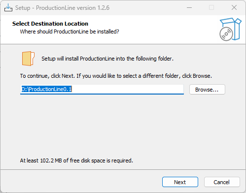

3.  弹出产测工具选择协议界面，如[图2](#zh-cn_topic_0000002516891604_zh-cn_topic_0000002421992336_fig310025311224)所示，选择对应的产品，单击“Next”按钮。

    **图 2**  产测工具选择协议界面<a name="zh-cn_topic_0000002516891604_zh-cn_topic_0000002421992336_fig310025311224"></a>  
    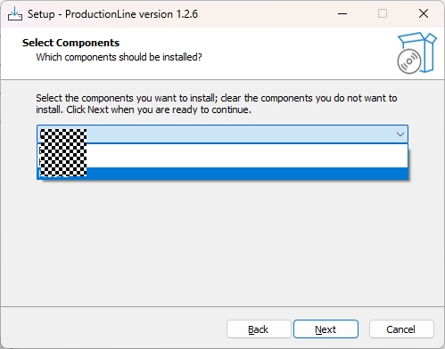

4.  弹出产测工具额外任务选择界面，如[图3](#zh-cn_topic_0000002516891604_zh-cn_topic_0000002421992336_fig7113204711510)所示，单击“Next”按钮。

    **图 3**  产测工具额外任务选择界面<a name="zh-cn_topic_0000002516891604_zh-cn_topic_0000002421992336_fig7113204711510"></a>  
    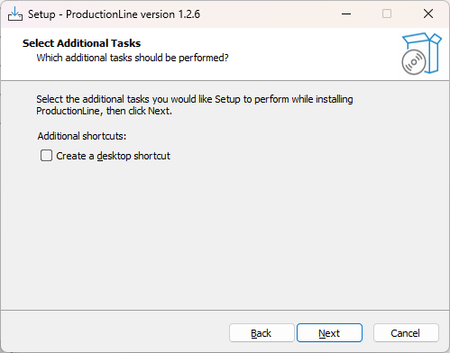

5.  弹出产测工具准备安装界面，单击“Install”按钮。如[图4](#zh-cn_topic_0000002516891604_zh-cn_topic_0000002421992336_fig172411526477)所示。

    **图 4**  产测工具准备安装界面<a name="zh-cn_topic_0000002516891604_zh-cn_topic_0000002421992336_fig172411526477"></a>  
    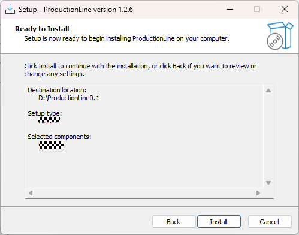

6.  弹出产测工具正在安装界面，请等待，直至安装完成。
7.  弹出产测工具安装完成界面，如[图5](#zh-cn_topic_0000002516891604_zh-cn_topic_0000002421992336_fig1786441312496)所示，单击“Finish”按钮退出安装。

    **图 5**  产测工具安装完成界面<a name="zh-cn_topic_0000002516891604_zh-cn_topic_0000002421992336_fig1786441312496"></a>  
    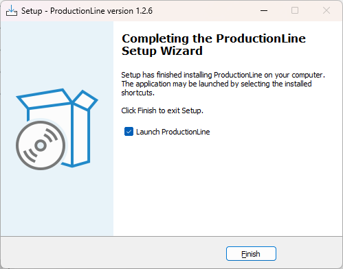

# 环境搭建<a name="ZH-CN_TOPIC_0000002553254783"></a>

1.  下载Python-64\(3.11.4\)安装包，双击python-3.11.4-amd64.exe安装工具，勾选“Add python.exe to PATH”选项，选择“Customize installation”，如[图1](#zh-cn_topic_0000002516731690_zh-cn_topic_0000002488776821_fig1050510344412)所示。

    **图 1**  Python安装界面1<a name="zh-cn_topic_0000002516731690_zh-cn_topic_0000002488776821_fig1050510344412"></a>  
    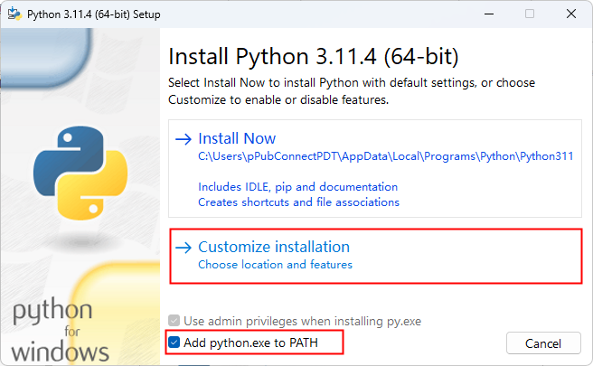

2.  其他项均按默认选中即可，单击“Next”按钮。

    **图 2**  Python安装界面2<a name="zh-cn_topic_0000002516731690_zh-cn_topic_0000002488776821_fig2819173011131"></a>  
    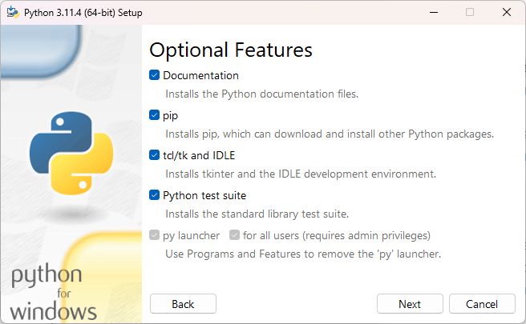

3.  <a name="zh-cn_topic_0000002516731690_zh-cn_topic_0000002488776821_li9719184344915"></a>如[图3](#zh-cn_topic_0000002516731690_zh-cn_topic_0000002488776821_fig147741042181317)所示，勾选安装选项，单击“Browse”选择安装路径，并单击“Install”按钮进行安装。

    **图 3**  Python安装界面3<a name="zh-cn_topic_0000002516731690_zh-cn_topic_0000002488776821_fig147741042181317"></a>  
    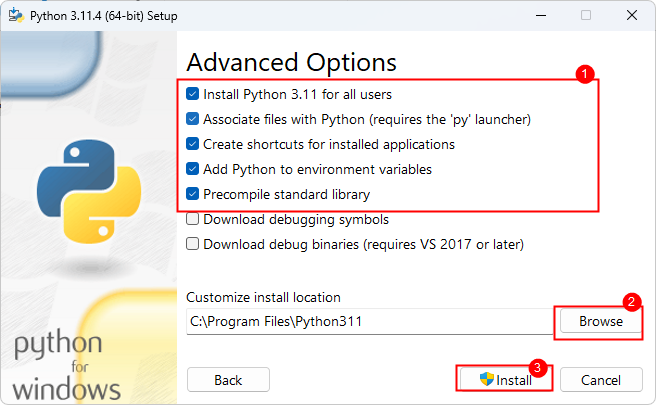

4.  如[图4](#zh-cn_topic_0000002516731690_zh-cn_topic_0000002488776821_fig16862736165315)所示，安装完成。

    **图 4**  Python安装界面4<a name="zh-cn_topic_0000002516731690_zh-cn_topic_0000002488776821_fig16862736165315"></a>  
    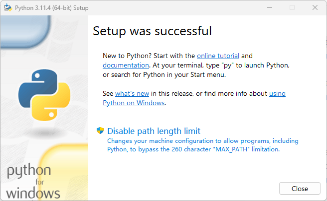

5.  点击Close关闭。
6.  在windows上搜索环境变量，点击“编辑系统环境变量”，如[图5](#zh-cn_topic_0000002516731690_zh-cn_topic_0000002488776821_fig1617135113493)所示。

    **图 5**  环境变量入口<a name="zh-cn_topic_0000002516731690_zh-cn_topic_0000002488776821_fig1617135113493"></a>  
    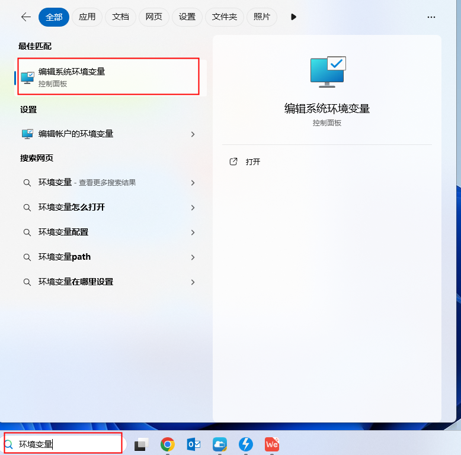

7.  弹出系统属性窗口，点击“环境变量”进入环境变量配置界面。如[图6](#zh-cn_topic_0000002516731690_zh-cn_topic_0000002488776821_fig167867352531)所示。

    **图 6**  系统属性界面<a name="zh-cn_topic_0000002516731690_zh-cn_topic_0000002488776821_fig167867352531"></a>  
    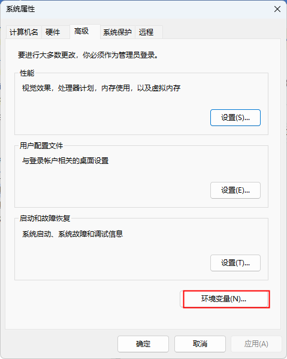

8.  进入到环境变量配置界面，双击点开PATH。如[图7](#zh-cn_topic_0000002516731690_zh-cn_topic_0000002488776821_fig15369311188)所示。

    **图 7**  环境变量界面<a name="zh-cn_topic_0000002516731690_zh-cn_topic_0000002488776821_fig15369311188"></a>  
    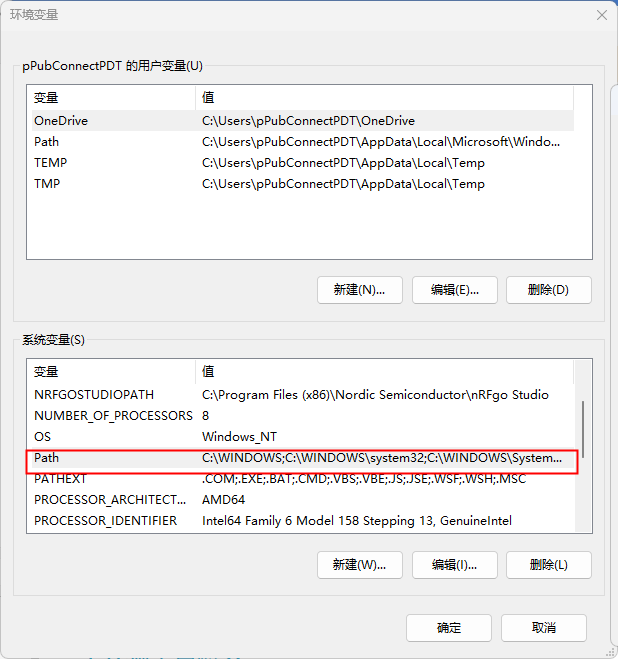

9.  检查Path中是否存在Python安装路径（[3](#zh-cn_topic_0000002516731690_zh-cn_topic_0000002488776821_li9719184344915)中设置的路径），例如默认安装路径：

    C:\\Program Files\\Python311\\Scripts\\

    C:\\Program Files\\Python311\\

    如[图8](#zh-cn_topic_0000002516731690_zh-cn_topic_0000002488776821_fig39766171420)所示。

    **图 8**  环境变量展示<a name="zh-cn_topic_0000002516731690_zh-cn_topic_0000002488776821_fig39766171420"></a>  
    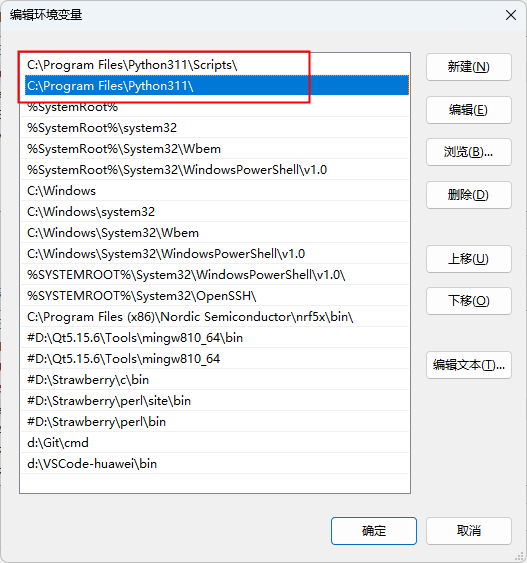

    没有则手动添加其路径。如[图9](#zh-cn_topic_0000002516731690_zh-cn_topic_0000002488776821_fig13805131032016)所示。配置之后点击每一层“确定”才可生效，如[图10](#zh-cn_topic_0000002516731690_zh-cn_topic_0000002488776821_fig567735562213)所示。

    **图 9**  配置环境变量<a name="zh-cn_topic_0000002516731690_zh-cn_topic_0000002488776821_fig13805131032016"></a>  
    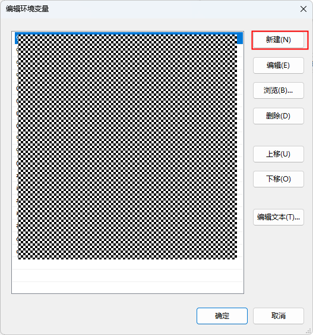

    **图 10**  三个界面确定点击<a name="zh-cn_topic_0000002516731690_zh-cn_topic_0000002488776821_fig567735562213"></a>  
    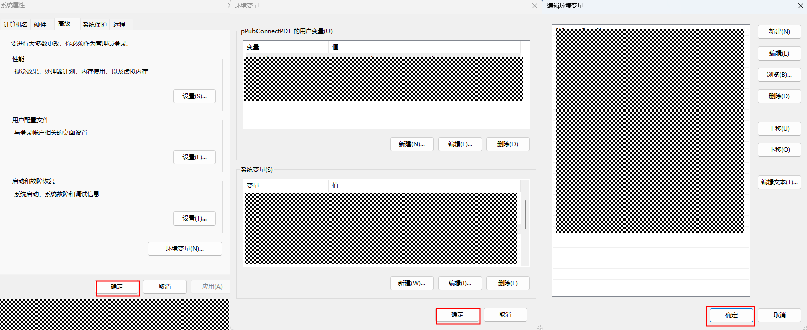

10. 使用pip安装所需要的库pyserial、fasteners、configparser、psutil、portalocker。

    安装命令：pip install pyserial fasteners configparser psutil portalocker

# 产测工具简介<a name="ZH-CN_TOPIC_0000002522134826"></a>

-   **[功能说明](#ZH-CN_TOPIC_0000002553414739)**  

-   **[应用场景](#ZH-CN_TOPIC_0000002522134828)**  

-   **[界面说明](#ZH-CN_TOPIC_0000002522294826)**  

## 功能说明<a name="ZH-CN_TOPIC_0000002553414739"></a>

产测工具是产线上使用进行测试的工具，使用本工具集成调用Python脚本。

## 应用场景<a name="ZH-CN_TOPIC_0000002522134828"></a>

产线测试。

## 界面说明<a name="ZH-CN_TOPIC_0000002522294826"></a>

-   **[选择Chip](#ZH-CN_TOPIC_0000002553414745)**  

-   **[产测工具](#ZH-CN_TOPIC_0000002553414741)**  

-   **[执行界面设置](#ZH-CN_TOPIC_0000002522134830)**  

### 选择Chip<a name="ZH-CN_TOPIC_0000002553414745"></a>

通过“Option”-“Change chip”打开芯片选择框，用于选择与单板匹配的芯片类型，部分芯片还可选择需要的烧写方式，界面如[图1](#zh-cn_topic_0000002548411497_zh-cn_topic_0000002455671037_fig131614316534)所示。

**图 1**  选择Chip界面示意图<a name="zh-cn_topic_0000002548411497_zh-cn_topic_0000002455671037_fig131614316534"></a>  
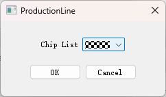

**表 1**  选择Chip界面说明

<a name="zh-cn_topic_0000002548411497_zh-cn_topic_0000002455671037_table1923619111210"></a>
<table><thead align="left"><tr id="zh-cn_topic_0000002548411497_zh-cn_topic_0000002455671037_row8232019141213"><th class="cellrowborder" valign="top" width="13.66%" id="mcps1.2.3.1.1"><p id="zh-cn_topic_0000002548411497_zh-cn_topic_0000002455671037_p12351913126"><a name="zh-cn_topic_0000002548411497_zh-cn_topic_0000002455671037_p12351913126"></a><a name="zh-cn_topic_0000002548411497_zh-cn_topic_0000002455671037_p12351913126"></a>区域</p>
</th>
<th class="cellrowborder" valign="top" width="86.33999999999999%" id="mcps1.2.3.1.2"><p id="zh-cn_topic_0000002548411497_zh-cn_topic_0000002455671037_p9232199124"><a name="zh-cn_topic_0000002548411497_zh-cn_topic_0000002455671037_p9232199124"></a><a name="zh-cn_topic_0000002548411497_zh-cn_topic_0000002455671037_p9232199124"></a>说明</p>
</th>
</tr>
</thead>
<tbody><tr id="zh-cn_topic_0000002548411497_zh-cn_topic_0000002455671037_row1623119111212"><td class="cellrowborder" valign="top" width="13.66%" headers="mcps1.2.3.1.1 "><p id="zh-cn_topic_0000002548411497_zh-cn_topic_0000002455671037_p1723219201211"><a name="zh-cn_topic_0000002548411497_zh-cn_topic_0000002455671037_p1723219201211"></a><a name="zh-cn_topic_0000002548411497_zh-cn_topic_0000002455671037_p1723219201211"></a>1</p>
</td>
<td class="cellrowborder" valign="top" width="86.33999999999999%" headers="mcps1.2.3.1.2 "><a name="zh-cn_topic_0000002548411497_zh-cn_topic_0000002455671037_ul15231719181215"></a><a name="zh-cn_topic_0000002548411497_zh-cn_topic_0000002455671037_ul15231719181215"></a><ul id="zh-cn_topic_0000002548411497_zh-cn_topic_0000002455671037_ul15231719181215"><li>Chip List：可选芯片列表。</li></ul>
</td>
</tr>
<tr id="zh-cn_topic_0000002548411497_zh-cn_topic_0000002455671037_row3237195120"><td class="cellrowborder" valign="top" width="13.66%" headers="mcps1.2.3.1.1 "><p id="zh-cn_topic_0000002548411497_zh-cn_topic_0000002455671037_p2023219131213"><a name="zh-cn_topic_0000002548411497_zh-cn_topic_0000002455671037_p2023219131213"></a><a name="zh-cn_topic_0000002548411497_zh-cn_topic_0000002455671037_p2023219131213"></a>2</p>
</td>
<td class="cellrowborder" valign="top" width="86.33999999999999%" headers="mcps1.2.3.1.2 "><a name="zh-cn_topic_0000002548411497_zh-cn_topic_0000002455671037_ul1231919191217"></a><a name="zh-cn_topic_0000002548411497_zh-cn_topic_0000002455671037_ul1231919191217"></a><ul id="zh-cn_topic_0000002548411497_zh-cn_topic_0000002455671037_ul1231919191217"><li>OK：确定选择按钮。</li><li>Cancel：取消选择按钮。</li></ul>
</td>
</tr>
</tbody>
</table>

### 产测工具<a name="ZH-CN_TOPIC_0000002553414741"></a>

-   **[参数配置](#ZH-CN_TOPIC_0000002522294832)**  

-   **[操作界面](#ZH-CN_TOPIC_0000002522294828)**  

#### 参数配置<a name="ZH-CN_TOPIC_0000002522294832"></a>

参数配置将提供的配置文件内容展示、修改，之后执行脚本时使用其参数。配置界面如[图1](#zh-cn_topic_0000002516891608_zh-cn_topic_0000002455998933_fig15962221106)所示。

**图 1**  产测工具参数配置界面<a name="zh-cn_topic_0000002516891608_zh-cn_topic_0000002455998933_fig15962221106"></a>  
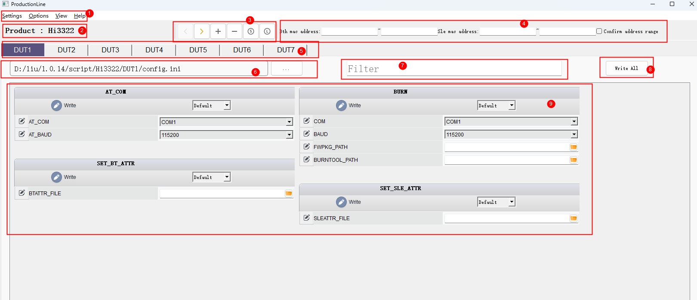

**表 1**  产测工具参数配置界面说明

<a name="zh-cn_topic_0000002516891608_zh-cn_topic_0000002455998933_zh-cn_topic_0281207084_table1435556181"></a>
<table><thead align="left"><tr id="zh-cn_topic_0000002516891608_zh-cn_topic_0000002455998933_zh-cn_topic_0281207084_row1835656183"><th class="cellrowborder" valign="top" width="12.72%" id="mcps1.2.3.1.1"><p id="zh-cn_topic_0000002516891608_zh-cn_topic_0000002455998933_zh-cn_topic_0281207084_p115311511086"><a name="zh-cn_topic_0000002516891608_zh-cn_topic_0000002455998933_zh-cn_topic_0281207084_p115311511086"></a><a name="zh-cn_topic_0000002516891608_zh-cn_topic_0000002455998933_zh-cn_topic_0281207084_p115311511086"></a>区域</p>
</th>
<th class="cellrowborder" valign="top" width="87.28%" id="mcps1.2.3.1.2"><p id="zh-cn_topic_0000002516891608_zh-cn_topic_0000002455998933_zh-cn_topic_0281207084_p5531145116817"><a name="zh-cn_topic_0000002516891608_zh-cn_topic_0000002455998933_zh-cn_topic_0281207084_p5531145116817"></a><a name="zh-cn_topic_0000002516891608_zh-cn_topic_0000002455998933_zh-cn_topic_0281207084_p5531145116817"></a>说明</p>
</th>
</tr>
</thead>
<tbody><tr id="zh-cn_topic_0000002516891608_zh-cn_topic_0000002455998933_zh-cn_topic_0281207084_row1778202182511"><td class="cellrowborder" valign="top" width="12.72%" headers="mcps1.2.3.1.1 "><p id="zh-cn_topic_0000002516891608_zh-cn_topic_0000002455998933_zh-cn_topic_0281207084_p1978218222513"><a name="zh-cn_topic_0000002516891608_zh-cn_topic_0000002455998933_zh-cn_topic_0281207084_p1978218222513"></a><a name="zh-cn_topic_0000002516891608_zh-cn_topic_0000002455998933_zh-cn_topic_0281207084_p1978218222513"></a>1</p>
</td>
<td class="cellrowborder" valign="top" width="87.28%" headers="mcps1.2.3.1.2 "><a name="zh-cn_topic_0000002516891608_zh-cn_topic_0000002455998933_ul17638837191312"></a><a name="zh-cn_topic_0000002516891608_zh-cn_topic_0000002455998933_ul17638837191312"></a><ul id="zh-cn_topic_0000002516891608_zh-cn_topic_0000002455998933_ul17638837191312"><li>Settings<a name="zh-cn_topic_0000002516891608_zh-cn_topic_0000002455998933_ul82280479588"></a><a name="zh-cn_topic_0000002516891608_zh-cn_topic_0000002455998933_ul82280479588"></a><ul id="zh-cn_topic_0000002516891608_zh-cn_topic_0000002455998933_ul82280479588"><li>Exec Settings：执行界面设置。</li></ul>
</li><li>Options<a name="zh-cn_topic_0000002516891608_zh-cn_topic_0000002455998933_ul1727484701913"></a><a name="zh-cn_topic_0000002516891608_zh-cn_topic_0000002455998933_ul1727484701913"></a><ul id="zh-cn_topic_0000002516891608_zh-cn_topic_0000002455998933_ul1727484701913"><li>Change Chip：切换芯片。</li></ul>
</li><li>View<a name="zh-cn_topic_0000002516891608_zh-cn_topic_0000002455998933_ul11182942122514"></a><a name="zh-cn_topic_0000002516891608_zh-cn_topic_0000002455998933_ul11182942122514"></a><ul id="zh-cn_topic_0000002516891608_zh-cn_topic_0000002455998933_ul11182942122514"><li>Param View：参数配置界面。</li><li>Exec View：操作界面。</li></ul>
</li><li>Help<a name="zh-cn_topic_0000002516891608_zh-cn_topic_0000002455998933_ul95938443261"></a><a name="zh-cn_topic_0000002516891608_zh-cn_topic_0000002455998933_ul95938443261"></a><ul id="zh-cn_topic_0000002516891608_zh-cn_topic_0000002455998933_ul95938443261"><li>About：查询版本信息。</li></ul>
</li></ul>
</td>
</tr>
<tr id="zh-cn_topic_0000002516891608_zh-cn_topic_0000002455998933_zh-cn_topic_0281207084_row1235619611820"><td class="cellrowborder" valign="top" width="12.72%" headers="mcps1.2.3.1.1 "><p id="zh-cn_topic_0000002516891608_zh-cn_topic_0000002455998933_zh-cn_topic_0281207084_p195316518818"><a name="zh-cn_topic_0000002516891608_zh-cn_topic_0000002455998933_zh-cn_topic_0281207084_p195316518818"></a><a name="zh-cn_topic_0000002516891608_zh-cn_topic_0000002455998933_zh-cn_topic_0281207084_p195316518818"></a>2</p>
</td>
<td class="cellrowborder" valign="top" width="87.28%" headers="mcps1.2.3.1.2 "><a name="zh-cn_topic_0000002516891608_zh-cn_topic_0000002455998933_zh-cn_topic_0281207084_ul05676417267"></a><a name="zh-cn_topic_0000002516891608_zh-cn_topic_0000002455998933_zh-cn_topic_0281207084_ul05676417267"></a><ul id="zh-cn_topic_0000002516891608_zh-cn_topic_0000002455998933_zh-cn_topic_0281207084_ul05676417267"><li>Product：显示芯片型号。</li></ul>
</td>
</tr>
<tr id="zh-cn_topic_0000002516891608_zh-cn_topic_0000002455998933_zh-cn_topic_0281207084_row735616614819"><td class="cellrowborder" valign="top" width="12.72%" headers="mcps1.2.3.1.1 "><p id="zh-cn_topic_0000002516891608_zh-cn_topic_0000002455998933_zh-cn_topic_0281207084_p15531251083"><a name="zh-cn_topic_0000002516891608_zh-cn_topic_0000002455998933_zh-cn_topic_0281207084_p15531251083"></a><a name="zh-cn_topic_0000002516891608_zh-cn_topic_0000002455998933_zh-cn_topic_0281207084_p15531251083"></a>3</p>
</td>
<td class="cellrowborder" valign="top" width="87.28%" headers="mcps1.2.3.1.2 "><a name="zh-cn_topic_0000002516891608_zh-cn_topic_0000002455998933_ul20135184173814"></a><a name="zh-cn_topic_0000002516891608_zh-cn_topic_0000002455998933_ul20135184173814"></a><ul id="zh-cn_topic_0000002516891608_zh-cn_topic_0000002455998933_ul20135184173814"><li>“&lt;”：DUT页焦点左移一页。</li><li>“&gt;”：DUT页焦点右移一页。</li><li>“+”：添加一个新的DUT页。</li><li>“-” ：删除当前选中的DUT页。</li><li>Save DUTs ：保存当前所有DUT页信息到文件中。</li><li>Load DUTs ：从文件中加载所有DUT页信息。</li></ul>
</td>
</tr>
<tr id="zh-cn_topic_0000002516891608_zh-cn_topic_0000002455998933_row16532159115618"><td class="cellrowborder" valign="top" width="12.72%" headers="mcps1.2.3.1.1 "><p id="zh-cn_topic_0000002516891608_zh-cn_topic_0000002455998933_p1153395915618"><a name="zh-cn_topic_0000002516891608_zh-cn_topic_0000002455998933_p1153395915618"></a><a name="zh-cn_topic_0000002516891608_zh-cn_topic_0000002455998933_p1153395915618"></a>4</p>
</td>
<td class="cellrowborder" valign="top" width="87.28%" headers="mcps1.2.3.1.2 "><p id="zh-cn_topic_0000002516891608_zh-cn_topic_0000002455998933_p1353335910561"><a name="zh-cn_topic_0000002516891608_zh-cn_topic_0000002455998933_p1353335910561"></a><a name="zh-cn_topic_0000002516891608_zh-cn_topic_0000002455998933_p1353335910561"></a>设置蓝牙和星闪区间地址，勾选“Confirm address range”后生效。</p>
</td>
</tr>
<tr id="zh-cn_topic_0000002516891608_zh-cn_topic_0000002455998933_row7993754201618"><td class="cellrowborder" valign="top" width="12.72%" headers="mcps1.2.3.1.1 "><p id="zh-cn_topic_0000002516891608_zh-cn_topic_0000002455998933_p17993185418160"><a name="zh-cn_topic_0000002516891608_zh-cn_topic_0000002455998933_p17993185418160"></a><a name="zh-cn_topic_0000002516891608_zh-cn_topic_0000002455998933_p17993185418160"></a>5</p>
</td>
<td class="cellrowborder" valign="top" width="87.28%" headers="mcps1.2.3.1.2 "><p id="zh-cn_topic_0000002516891608_zh-cn_topic_0000002455998933_p1799395471615"><a name="zh-cn_topic_0000002516891608_zh-cn_topic_0000002455998933_p1799395471615"></a><a name="zh-cn_topic_0000002516891608_zh-cn_topic_0000002455998933_p1799395471615"></a>DUT页：配置每一款器件的配置信息。</p>
</td>
</tr>
<tr id="zh-cn_topic_0000002516891608_zh-cn_topic_0000002455998933_row78064422442"><td class="cellrowborder" valign="top" width="12.72%" headers="mcps1.2.3.1.1 "><p id="zh-cn_topic_0000002516891608_zh-cn_topic_0000002455998933_p1480612428448"><a name="zh-cn_topic_0000002516891608_zh-cn_topic_0000002455998933_p1480612428448"></a><a name="zh-cn_topic_0000002516891608_zh-cn_topic_0000002455998933_p1480612428448"></a>6</p>
</td>
<td class="cellrowborder" valign="top" width="87.28%" headers="mcps1.2.3.1.2 "><p id="zh-cn_topic_0000002516891608_zh-cn_topic_0000002455998933_p14806342174417"><a name="zh-cn_topic_0000002516891608_zh-cn_topic_0000002455998933_p14806342174417"></a><a name="zh-cn_topic_0000002516891608_zh-cn_topic_0000002455998933_p14806342174417"></a>选择读取ini文件，加载ini文件内容，并显示在界面上。</p>
</td>
</tr>
<tr id="zh-cn_topic_0000002516891608_zh-cn_topic_0000002455998933_row15370193815463"><td class="cellrowborder" valign="top" width="12.72%" headers="mcps1.2.3.1.1 "><p id="zh-cn_topic_0000002516891608_zh-cn_topic_0000002455998933_p93703388467"><a name="zh-cn_topic_0000002516891608_zh-cn_topic_0000002455998933_p93703388467"></a><a name="zh-cn_topic_0000002516891608_zh-cn_topic_0000002455998933_p93703388467"></a>7</p>
</td>
<td class="cellrowborder" valign="top" width="87.28%" headers="mcps1.2.3.1.2 "><p id="zh-cn_topic_0000002516891608_zh-cn_topic_0000002455998933_p1637015386465"><a name="zh-cn_topic_0000002516891608_zh-cn_topic_0000002455998933_p1637015386465"></a><a name="zh-cn_topic_0000002516891608_zh-cn_topic_0000002455998933_p1637015386465"></a>快捷筛选配置内容。</p>
</td>
</tr>
<tr id="zh-cn_topic_0000002516891608_zh-cn_topic_0000002455998933_row16986191955816"><td class="cellrowborder" valign="top" width="12.72%" headers="mcps1.2.3.1.1 "><p id="zh-cn_topic_0000002516891608_zh-cn_topic_0000002455998933_p9986119205817"><a name="zh-cn_topic_0000002516891608_zh-cn_topic_0000002455998933_p9986119205817"></a><a name="zh-cn_topic_0000002516891608_zh-cn_topic_0000002455998933_p9986119205817"></a>8</p>
</td>
<td class="cellrowborder" valign="top" width="87.28%" headers="mcps1.2.3.1.2 "><p id="zh-cn_topic_0000002516891608_zh-cn_topic_0000002455998933_p1898612196585"><a name="zh-cn_topic_0000002516891608_zh-cn_topic_0000002455998933_p1898612196585"></a><a name="zh-cn_topic_0000002516891608_zh-cn_topic_0000002455998933_p1898612196585"></a>所有界面配置项全写。</p>
</td>
</tr>
<tr id="zh-cn_topic_0000002516891608_zh-cn_topic_0000002455998933_row515134174715"><td class="cellrowborder" valign="top" width="12.72%" headers="mcps1.2.3.1.1 "><p id="zh-cn_topic_0000002516891608_zh-cn_topic_0000002455998933_p141518411473"><a name="zh-cn_topic_0000002516891608_zh-cn_topic_0000002455998933_p141518411473"></a><a name="zh-cn_topic_0000002516891608_zh-cn_topic_0000002455998933_p141518411473"></a>9</p>
</td>
<td class="cellrowborder" valign="top" width="87.28%" headers="mcps1.2.3.1.2 "><p id="zh-cn_topic_0000002516891608_zh-cn_topic_0000002455998933_p161634134719"><a name="zh-cn_topic_0000002516891608_zh-cn_topic_0000002455998933_p161634134719"></a><a name="zh-cn_topic_0000002516891608_zh-cn_topic_0000002455998933_p161634134719"></a>配置项内容。</p>
</td>
</tr>
</tbody>
</table>

#### 操作界面<a name="ZH-CN_TOPIC_0000002522294828"></a>

执行脚本文件的界面。

**图 1**  操作执行界面<a name="zh-cn_topic_0000002516731694_zh-cn_topic_0000002455918821_fig1467575631014"></a>  
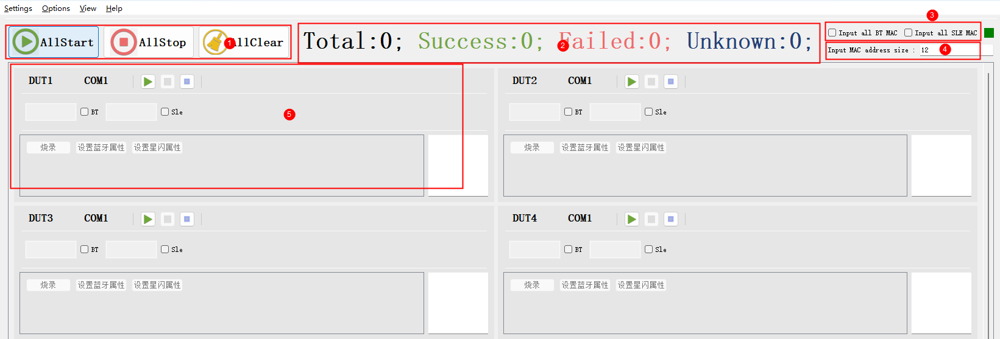

**表 1**  操作执行界面说明

<a name="zh-cn_topic_0000002516731694_zh-cn_topic_0000002455918821_zh-cn_topic_0281207084_table1435556181"></a>
<table><thead align="left"><tr id="zh-cn_topic_0000002516731694_zh-cn_topic_0000002455918821_zh-cn_topic_0281207084_row1835656183"><th class="cellrowborder" valign="top" width="17.77%" id="mcps1.2.3.1.1"><p id="zh-cn_topic_0000002516731694_zh-cn_topic_0000002455918821_zh-cn_topic_0281207084_p115311511086"><a name="zh-cn_topic_0000002516731694_zh-cn_topic_0000002455918821_zh-cn_topic_0281207084_p115311511086"></a><a name="zh-cn_topic_0000002516731694_zh-cn_topic_0000002455918821_zh-cn_topic_0281207084_p115311511086"></a>区域</p>
</th>
<th class="cellrowborder" valign="top" width="82.23%" id="mcps1.2.3.1.2"><p id="zh-cn_topic_0000002516731694_zh-cn_topic_0000002455918821_zh-cn_topic_0281207084_p5531145116817"><a name="zh-cn_topic_0000002516731694_zh-cn_topic_0000002455918821_zh-cn_topic_0281207084_p5531145116817"></a><a name="zh-cn_topic_0000002516731694_zh-cn_topic_0000002455918821_zh-cn_topic_0281207084_p5531145116817"></a>说明</p>
</th>
</tr>
</thead>
<tbody><tr id="zh-cn_topic_0000002516731694_zh-cn_topic_0000002455918821_zh-cn_topic_0281207084_row1778202182511"><td class="cellrowborder" valign="top" width="17.77%" headers="mcps1.2.3.1.1 "><p id="zh-cn_topic_0000002516731694_zh-cn_topic_0000002455918821_zh-cn_topic_0281207084_p1978218222513"><a name="zh-cn_topic_0000002516731694_zh-cn_topic_0000002455918821_zh-cn_topic_0281207084_p1978218222513"></a><a name="zh-cn_topic_0000002516731694_zh-cn_topic_0000002455918821_zh-cn_topic_0281207084_p1978218222513"></a>1</p>
</td>
<td class="cellrowborder" valign="top" width="82.23%" headers="mcps1.2.3.1.2 "><a name="zh-cn_topic_0000002516731694_zh-cn_topic_0000002455918821_ul17638837191312"></a><a name="zh-cn_topic_0000002516731694_zh-cn_topic_0000002455918821_ul17638837191312"></a><ul id="zh-cn_topic_0000002516731694_zh-cn_topic_0000002455918821_ul17638837191312"><li>All start： 所有DUT启动执行。</li><li>All stop：所有DUT停止执行。</li><li>All clear：所有DUT的日志清除。</li></ul>
</td>
</tr>
<tr id="zh-cn_topic_0000002516731694_zh-cn_topic_0000002455918821_zh-cn_topic_0281207084_row1235619611820"><td class="cellrowborder" valign="top" width="17.77%" headers="mcps1.2.3.1.1 "><p id="zh-cn_topic_0000002516731694_zh-cn_topic_0000002455918821_zh-cn_topic_0281207084_p195316518818"><a name="zh-cn_topic_0000002516731694_zh-cn_topic_0000002455918821_zh-cn_topic_0281207084_p195316518818"></a><a name="zh-cn_topic_0000002516731694_zh-cn_topic_0000002455918821_zh-cn_topic_0281207084_p195316518818"></a>2</p>
</td>
<td class="cellrowborder" valign="top" width="82.23%" headers="mcps1.2.3.1.2 "><a name="zh-cn_topic_0000002516731694_zh-cn_topic_0000002455918821_zh-cn_topic_0281207084_ul05676417267"></a><a name="zh-cn_topic_0000002516731694_zh-cn_topic_0000002455918821_zh-cn_topic_0281207084_ul05676417267"></a><ul id="zh-cn_topic_0000002516731694_zh-cn_topic_0000002455918821_zh-cn_topic_0281207084_ul05676417267"><li>Total： 执行的用例数量。</li><li>Success：成功的用例数。</li><li>Failed：失败的用例数。</li><li>Unknow:  不知道成功还是失败的用例数。</li></ul>
</td>
</tr>
<tr id="zh-cn_topic_0000002516731694_zh-cn_topic_0000002455918821_row1686442813"><td class="cellrowborder" valign="top" width="17.77%" headers="mcps1.2.3.1.1 "><p id="zh-cn_topic_0000002516731694_zh-cn_topic_0000002455918821_p9864229115"><a name="zh-cn_topic_0000002516731694_zh-cn_topic_0000002455918821_p9864229115"></a><a name="zh-cn_topic_0000002516731694_zh-cn_topic_0000002455918821_p9864229115"></a>3</p>
</td>
<td class="cellrowborder" valign="top" width="82.23%" headers="mcps1.2.3.1.2 "><a name="zh-cn_topic_0000002516731694_zh-cn_topic_0000002455918821_ul1992402411118"></a><a name="zh-cn_topic_0000002516731694_zh-cn_topic_0000002455918821_ul1992402411118"></a><ul id="zh-cn_topic_0000002516731694_zh-cn_topic_0000002455918821_ul1992402411118"><li>Input all BT MAC：所有输入BT MAC地址框使能。</li><li>Input all SLE MAC：所有输入SLE MAC地址框使能。</li></ul>
</td>
</tr>
<tr id="zh-cn_topic_0000002516731694_zh-cn_topic_0000002455918821_row11955538013"><td class="cellrowborder" valign="top" width="17.77%" headers="mcps1.2.3.1.1 "><p id="zh-cn_topic_0000002516731694_zh-cn_topic_0000002455918821_p19954535017"><a name="zh-cn_topic_0000002516731694_zh-cn_topic_0000002455918821_p19954535017"></a><a name="zh-cn_topic_0000002516731694_zh-cn_topic_0000002455918821_p19954535017"></a>4</p>
</td>
<td class="cellrowborder" valign="top" width="82.23%" headers="mcps1.2.3.1.2 "><p id="zh-cn_topic_0000002516731694_zh-cn_topic_0000002455918821_p18951538014"><a name="zh-cn_topic_0000002516731694_zh-cn_topic_0000002455918821_p18951538014"></a><a name="zh-cn_topic_0000002516731694_zh-cn_topic_0000002455918821_p18951538014"></a>Input MAC address size：每一个地址框输入长度为12字符，超过12字符自动跳转到下一个。</p>
</td>
</tr>
<tr id="zh-cn_topic_0000002516731694_zh-cn_topic_0000002455918821_zh-cn_topic_0281207084_row735616614819"><td class="cellrowborder" valign="top" width="17.77%" headers="mcps1.2.3.1.1 "><p id="zh-cn_topic_0000002516731694_zh-cn_topic_0000002455918821_zh-cn_topic_0281207084_p15531251083"><a name="zh-cn_topic_0000002516731694_zh-cn_topic_0000002455918821_zh-cn_topic_0281207084_p15531251083"></a><a name="zh-cn_topic_0000002516731694_zh-cn_topic_0000002455918821_zh-cn_topic_0281207084_p15531251083"></a>5</p>
</td>
<td class="cellrowborder" valign="top" width="82.23%" headers="mcps1.2.3.1.2 "><p id="zh-cn_topic_0000002516731694_zh-cn_topic_0000002455918821_p31241731102418"><a name="zh-cn_topic_0000002516731694_zh-cn_topic_0000002455918821_p31241731102418"></a><a name="zh-cn_topic_0000002516731694_zh-cn_topic_0000002455918821_p31241731102418"></a>单独执行脚本控制台。</p>
</td>
</tr>
</tbody>
</table>

每一个DUT界面如[图2](#zh-cn_topic_0000002516731694_zh-cn_topic_0000002455918821_fig74219622910)所示。

**图 2**  DUT控制台界面<a name="zh-cn_topic_0000002516731694_zh-cn_topic_0000002455918821_fig74219622910"></a>  
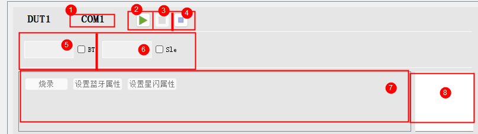

**表 2**  DUT控制台界面说明

<a name="zh-cn_topic_0000002516731694_zh-cn_topic_0000002455918821_table07851524162911"></a>
<table><thead align="left"><tr id="zh-cn_topic_0000002516731694_zh-cn_topic_0000002455918821_row278562418298"><th class="cellrowborder" valign="top" width="17.77%" id="mcps1.2.3.1.1"><p id="zh-cn_topic_0000002516731694_zh-cn_topic_0000002455918821_p17785172442914"><a name="zh-cn_topic_0000002516731694_zh-cn_topic_0000002455918821_p17785172442914"></a><a name="zh-cn_topic_0000002516731694_zh-cn_topic_0000002455918821_p17785172442914"></a>区域</p>
</th>
<th class="cellrowborder" valign="top" width="82.23%" id="mcps1.2.3.1.2"><p id="zh-cn_topic_0000002516731694_zh-cn_topic_0000002455918821_p1785142482919"><a name="zh-cn_topic_0000002516731694_zh-cn_topic_0000002455918821_p1785142482919"></a><a name="zh-cn_topic_0000002516731694_zh-cn_topic_0000002455918821_p1785142482919"></a>说明</p>
</th>
</tr>
</thead>
<tbody><tr id="zh-cn_topic_0000002516731694_zh-cn_topic_0000002455918821_row2075233717251"><td class="cellrowborder" valign="top" width="17.77%" headers="mcps1.2.3.1.1 "><p id="zh-cn_topic_0000002516731694_zh-cn_topic_0000002455918821_p975263762510"><a name="zh-cn_topic_0000002516731694_zh-cn_topic_0000002455918821_p975263762510"></a><a name="zh-cn_topic_0000002516731694_zh-cn_topic_0000002455918821_p975263762510"></a>1</p>
</td>
<td class="cellrowborder" valign="top" width="82.23%" headers="mcps1.2.3.1.2 "><p id="zh-cn_topic_0000002516731694_zh-cn_topic_0000002455918821_p1575213720257"><a name="zh-cn_topic_0000002516731694_zh-cn_topic_0000002455918821_p1575213720257"></a><a name="zh-cn_topic_0000002516731694_zh-cn_topic_0000002455918821_p1575213720257"></a>当前执行用例设备号。</p>
</td>
</tr>
<tr id="zh-cn_topic_0000002516731694_zh-cn_topic_0000002455918821_row1678502411295"><td class="cellrowborder" valign="top" width="17.77%" headers="mcps1.2.3.1.1 "><p id="zh-cn_topic_0000002516731694_zh-cn_topic_0000002455918821_p1578542452917"><a name="zh-cn_topic_0000002516731694_zh-cn_topic_0000002455918821_p1578542452917"></a><a name="zh-cn_topic_0000002516731694_zh-cn_topic_0000002455918821_p1578542452917"></a>2</p>
</td>
<td class="cellrowborder" valign="top" width="82.23%" headers="mcps1.2.3.1.2 "><p id="zh-cn_topic_0000002516731694_zh-cn_topic_0000002455918821_p16873205219297"><a name="zh-cn_topic_0000002516731694_zh-cn_topic_0000002455918821_p16873205219297"></a><a name="zh-cn_topic_0000002516731694_zh-cn_topic_0000002455918821_p16873205219297"></a>开始执行用例。</p>
</td>
</tr>
<tr id="zh-cn_topic_0000002516731694_zh-cn_topic_0000002455918821_row14786132492918"><td class="cellrowborder" valign="top" width="17.77%" headers="mcps1.2.3.1.1 "><p id="zh-cn_topic_0000002516731694_zh-cn_topic_0000002455918821_p17786524172911"><a name="zh-cn_topic_0000002516731694_zh-cn_topic_0000002455918821_p17786524172911"></a><a name="zh-cn_topic_0000002516731694_zh-cn_topic_0000002455918821_p17786524172911"></a>3</p>
</td>
<td class="cellrowborder" valign="top" width="82.23%" headers="mcps1.2.3.1.2 "><p id="zh-cn_topic_0000002516731694_zh-cn_topic_0000002455918821_p174911033135214"><a name="zh-cn_topic_0000002516731694_zh-cn_topic_0000002455918821_p174911033135214"></a><a name="zh-cn_topic_0000002516731694_zh-cn_topic_0000002455918821_p174911033135214"></a>停止执行用例。</p>
</td>
</tr>
<tr id="zh-cn_topic_0000002516731694_zh-cn_topic_0000002455918821_row5786112442919"><td class="cellrowborder" valign="top" width="17.77%" headers="mcps1.2.3.1.1 "><p id="zh-cn_topic_0000002516731694_zh-cn_topic_0000002455918821_p12786112492914"><a name="zh-cn_topic_0000002516731694_zh-cn_topic_0000002455918821_p12786112492914"></a><a name="zh-cn_topic_0000002516731694_zh-cn_topic_0000002455918821_p12786112492914"></a>4</p>
</td>
<td class="cellrowborder" valign="top" width="82.23%" headers="mcps1.2.3.1.2 "><p id="zh-cn_topic_0000002516731694_zh-cn_topic_0000002455918821_p97862240292"><a name="zh-cn_topic_0000002516731694_zh-cn_topic_0000002455918821_p97862240292"></a><a name="zh-cn_topic_0000002516731694_zh-cn_topic_0000002455918821_p97862240292"></a>使用PC文件编辑器打开日志。</p>
</td>
</tr>
<tr id="zh-cn_topic_0000002516731694_zh-cn_topic_0000002455918821_row43191946262"><td class="cellrowborder" valign="top" width="17.77%" headers="mcps1.2.3.1.1 "><p id="zh-cn_topic_0000002516731694_zh-cn_topic_0000002455918821_p5319346267"><a name="zh-cn_topic_0000002516731694_zh-cn_topic_0000002455918821_p5319346267"></a><a name="zh-cn_topic_0000002516731694_zh-cn_topic_0000002455918821_p5319346267"></a>5</p>
</td>
<td class="cellrowborder" valign="top" width="82.23%" headers="mcps1.2.3.1.2 "><p id="zh-cn_topic_0000002516731694_zh-cn_topic_0000002455918821_p163191146264"><a name="zh-cn_topic_0000002516731694_zh-cn_topic_0000002455918821_p163191146264"></a><a name="zh-cn_topic_0000002516731694_zh-cn_topic_0000002455918821_p163191146264"></a>蓝牙输入地址（可用于扫码枪输入，键盘输入及修改），勾选后启用。扫码枪获得的地址长度不得小于12字符。</p>
</td>
</tr>
<tr id="zh-cn_topic_0000002516731694_zh-cn_topic_0000002455918821_row13330442761"><td class="cellrowborder" valign="top" width="17.77%" headers="mcps1.2.3.1.1 "><p id="zh-cn_topic_0000002516731694_zh-cn_topic_0000002455918821_p143305421263"><a name="zh-cn_topic_0000002516731694_zh-cn_topic_0000002455918821_p143305421263"></a><a name="zh-cn_topic_0000002516731694_zh-cn_topic_0000002455918821_p143305421263"></a>6</p>
</td>
<td class="cellrowborder" valign="top" width="82.23%" headers="mcps1.2.3.1.2 "><p id="zh-cn_topic_0000002516731694_zh-cn_topic_0000002455918821_p5330194219611"><a name="zh-cn_topic_0000002516731694_zh-cn_topic_0000002455918821_p5330194219611"></a><a name="zh-cn_topic_0000002516731694_zh-cn_topic_0000002455918821_p5330194219611"></a>星闪输入地址（可用于扫码枪输入，键盘输入及修改），勾选后启用。扫码枪获得的地址长度不得小于12字符。</p>
</td>
</tr>
<tr id="zh-cn_topic_0000002516731694_zh-cn_topic_0000002455918821_row879520325532"><td class="cellrowborder" valign="top" width="17.77%" headers="mcps1.2.3.1.1 "><p id="zh-cn_topic_0000002516731694_zh-cn_topic_0000002455918821_p1279517325533"><a name="zh-cn_topic_0000002516731694_zh-cn_topic_0000002455918821_p1279517325533"></a><a name="zh-cn_topic_0000002516731694_zh-cn_topic_0000002455918821_p1279517325533"></a>7</p>
</td>
<td class="cellrowborder" valign="top" width="82.23%" headers="mcps1.2.3.1.2 "><p id="zh-cn_topic_0000002516731694_zh-cn_topic_0000002455918821_p479520326534"><a name="zh-cn_topic_0000002516731694_zh-cn_topic_0000002455918821_p479520326534"></a><a name="zh-cn_topic_0000002516731694_zh-cn_topic_0000002455918821_p479520326534"></a>跟踪一次执行哪些用例。</p>
</td>
</tr>
<tr id="zh-cn_topic_0000002516731694_zh-cn_topic_0000002455918821_row557615811532"><td class="cellrowborder" valign="top" width="17.77%" headers="mcps1.2.3.1.1 "><p id="zh-cn_topic_0000002516731694_zh-cn_topic_0000002455918821_p340412428524"><a name="zh-cn_topic_0000002516731694_zh-cn_topic_0000002455918821_p340412428524"></a><a name="zh-cn_topic_0000002516731694_zh-cn_topic_0000002455918821_p340412428524"></a>8</p>
</td>
<td class="cellrowborder" valign="top" width="82.23%" headers="mcps1.2.3.1.2 "><p id="zh-cn_topic_0000002516731694_zh-cn_topic_0000002455918821_p195777341476"><a name="zh-cn_topic_0000002516731694_zh-cn_topic_0000002455918821_p195777341476"></a><a name="zh-cn_topic_0000002516731694_zh-cn_topic_0000002455918821_p195777341476"></a>状态显示。</p>
<a name="zh-cn_topic_0000002516731694_zh-cn_topic_0000002455918821_ul918515260816"></a><a name="zh-cn_topic_0000002516731694_zh-cn_topic_0000002455918821_ul918515260816"></a><ul id="zh-cn_topic_0000002516731694_zh-cn_topic_0000002455918821_ul918515260816"><li>Doing：用例正在执行中。</li><li>Wait reset：等待单板重启。</li><li>Success：用例全部执行成功。</li><li>Fail：用例执行失败。</li></ul>
</td>
</tr>
</tbody>
</table>

### 执行界面设置<a name="ZH-CN_TOPIC_0000002522134830"></a>

可以设置执行界面每行显示几个DUT执行。

**图 1**  设置每行显示数量<a name="zh-cn_topic_0000002548411499_zh-cn_topic_0000002507359596_fig103212039174918"></a>  
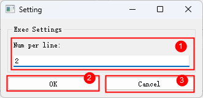

**表 1**  设置每行显示数量界面说明

<a name="zh-cn_topic_0000002548411499_zh-cn_topic_0000002507359596_zh-cn_topic_0281207084_table1435556181"></a>
<table><thead align="left"><tr id="zh-cn_topic_0000002548411499_zh-cn_topic_0000002507359596_zh-cn_topic_0281207084_row1835656183"><th class="cellrowborder" valign="top" width="17.77%" id="mcps1.2.3.1.1"><p id="zh-cn_topic_0000002548411499_zh-cn_topic_0000002507359596_zh-cn_topic_0281207084_p115311511086"><a name="zh-cn_topic_0000002548411499_zh-cn_topic_0000002507359596_zh-cn_topic_0281207084_p115311511086"></a><a name="zh-cn_topic_0000002548411499_zh-cn_topic_0000002507359596_zh-cn_topic_0281207084_p115311511086"></a>区域</p>
</th>
<th class="cellrowborder" valign="top" width="82.23%" id="mcps1.2.3.1.2"><p id="zh-cn_topic_0000002548411499_zh-cn_topic_0000002507359596_zh-cn_topic_0281207084_p5531145116817"><a name="zh-cn_topic_0000002548411499_zh-cn_topic_0000002507359596_zh-cn_topic_0281207084_p5531145116817"></a><a name="zh-cn_topic_0000002548411499_zh-cn_topic_0000002507359596_zh-cn_topic_0281207084_p5531145116817"></a>说明</p>
</th>
</tr>
</thead>
<tbody><tr id="zh-cn_topic_0000002548411499_zh-cn_topic_0000002507359596_zh-cn_topic_0281207084_row1778202182511"><td class="cellrowborder" valign="top" width="17.77%" headers="mcps1.2.3.1.1 "><p id="zh-cn_topic_0000002548411499_zh-cn_topic_0000002507359596_zh-cn_topic_0281207084_p1978218222513"><a name="zh-cn_topic_0000002548411499_zh-cn_topic_0000002507359596_zh-cn_topic_0281207084_p1978218222513"></a><a name="zh-cn_topic_0000002548411499_zh-cn_topic_0000002507359596_zh-cn_topic_0281207084_p1978218222513"></a>1</p>
</td>
<td class="cellrowborder" valign="top" width="82.23%" headers="mcps1.2.3.1.2 "><p id="zh-cn_topic_0000002548411499_zh-cn_topic_0000002507359596_p467020813513"><a name="zh-cn_topic_0000002548411499_zh-cn_topic_0000002507359596_p467020813513"></a><a name="zh-cn_topic_0000002548411499_zh-cn_topic_0000002507359596_p467020813513"></a>Num per line：设置执行界面每行显示数量。</p>
</td>
</tr>
<tr id="zh-cn_topic_0000002548411499_zh-cn_topic_0000002507359596_zh-cn_topic_0281207084_row1235619611820"><td class="cellrowborder" valign="top" width="17.77%" headers="mcps1.2.3.1.1 "><p id="zh-cn_topic_0000002548411499_zh-cn_topic_0000002507359596_zh-cn_topic_0281207084_p195316518818"><a name="zh-cn_topic_0000002548411499_zh-cn_topic_0000002507359596_zh-cn_topic_0281207084_p195316518818"></a><a name="zh-cn_topic_0000002548411499_zh-cn_topic_0000002507359596_zh-cn_topic_0281207084_p195316518818"></a>2</p>
</td>
<td class="cellrowborder" valign="top" width="82.23%" headers="mcps1.2.3.1.2 "><p id="zh-cn_topic_0000002548411499_zh-cn_topic_0000002507359596_p15464291857"><a name="zh-cn_topic_0000002548411499_zh-cn_topic_0000002507359596_p15464291857"></a><a name="zh-cn_topic_0000002548411499_zh-cn_topic_0000002507359596_p15464291857"></a>OK：应用设置。</p>
</td>
</tr>
<tr id="zh-cn_topic_0000002548411499_zh-cn_topic_0000002507359596_row1686442813"><td class="cellrowborder" valign="top" width="17.77%" headers="mcps1.2.3.1.1 "><p id="zh-cn_topic_0000002548411499_zh-cn_topic_0000002507359596_p9864229115"><a name="zh-cn_topic_0000002548411499_zh-cn_topic_0000002507359596_p9864229115"></a><a name="zh-cn_topic_0000002548411499_zh-cn_topic_0000002507359596_p9864229115"></a>3</p>
</td>
<td class="cellrowborder" valign="top" width="82.23%" headers="mcps1.2.3.1.2 "><p id="zh-cn_topic_0000002548411499_zh-cn_topic_0000002507359596_p199951293520"><a name="zh-cn_topic_0000002548411499_zh-cn_topic_0000002507359596_p199951293520"></a><a name="zh-cn_topic_0000002548411499_zh-cn_topic_0000002507359596_p199951293520"></a>Cancel：取消设置修改。</p>
</td>
</tr>
</tbody>
</table>

# 操作指南<a name="ZH-CN_TOPIC_0000002522294830"></a>

-   **[产测窗口设置](#ZH-CN_TOPIC_0000002522134824)**  

-   **[参数修改](#ZH-CN_TOPIC_0000002522134822)**  

-   **[产测执行用例](#ZH-CN_TOPIC_0000002553414743)**  

-   **[MAC地址使用优先级](#ZH-CN_TOPIC_0000002553254793)**  

## 产测窗口设置<a name="ZH-CN_TOPIC_0000002522134824"></a>

1.  选择参数配置界面。如[图1](#zh-cn_topic_0000002516891612_zh-cn_topic_0000002468389653_fig112251222102812)所示。

    **图 1**  Param View选择<a name="zh-cn_topic_0000002516891612_zh-cn_topic_0000002468389653_fig112251222102812"></a>  
    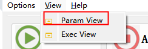

2.  执行如[图2](#zh-cn_topic_0000002516891612_zh-cn_topic_0000002468389653_fig4740121481)所示的操作。从左到右分别是“切换到当前界面的左侧界面”、“切换到当前界面的右侧界面”、“增加产测窗口”、“删除当前产测窗口”、“保存当前产测窗口信息（数量，选择配置文件的路径）”、“加载产测窗口信息”。将界面调整到预期的个数，例如8个，就点击加号直到有8个DUT。

    **图 2**  DUT操作面板<a name="zh-cn_topic_0000002516891612_zh-cn_topic_0000002468389653_fig4740121481"></a>  
    

## 参数修改<a name="ZH-CN_TOPIC_0000002522134822"></a>

参数修改会将修改的内容写入到所选的配置文件中。界面操作步骤如下：

1.  选择参数配置界面。如[图1](#zh-cn_topic_0000002516731700_zh-cn_topic_0000002466609025_fig112251222102812)所示。

    **图 1**  Param View选择<a name="zh-cn_topic_0000002516731700_zh-cn_topic_0000002466609025_fig112251222102812"></a>  
    
    

2.  （可选）使用地址区间时，设置地址区间，并点击“Comfirm address range”确认使用。如[图2](#zh-cn_topic_0000002516731700_zh-cn_topic_0000002466609025_fig380417181917)所示。

    **图 2**  设置地址区间示意图<a name="zh-cn_topic_0000002516731700_zh-cn_topic_0000002466609025_fig380417181917"></a>  
    

3.  通过[2](#zh-cn_topic_0000002516891612_zh-cn_topic_0000002468389653_li3742102113816)增加界面后有一个默认的配置文件，如[图3](#zh-cn_topic_0000002516731700_zh-cn_topic_0000002466609025_fig134838610144)所示。

    **图 3**  配置文件展示和选择<a name="zh-cn_topic_0000002516731700_zh-cn_topic_0000002466609025_fig134838610144"></a>  
    

4.  修改执行用例所需要的内容，配置所有DUT的AT\_COM和Burn-COM和其中一个DUT的所有内容，在配置好全部内容的页面点击“Write All”按钮，如[图4](#zh-cn_topic_0000002516731700_zh-cn_topic_0000002466609025_fig1439821182115)所示，将除AT\_COM和Burn-COM外的配置同步到每一个DUT中。

    **图 4**  Write All按钮<a name="zh-cn_topic_0000002516731700_zh-cn_topic_0000002466609025_fig1439821182115"></a>  
    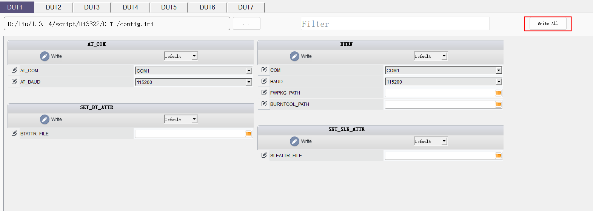

## 产测执行用例<a name="ZH-CN_TOPIC_0000002553414743"></a>

1.  切换到Exec View。如[图1](#zh-cn_topic_0000002548411505_zh-cn_topic_0000002455711169_fig856011171318)所示。

    **图 1**  Exec View选择<a name="zh-cn_topic_0000002548411505_zh-cn_topic_0000002455711169_fig856011171318"></a>  
    
    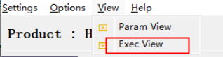

2.  （可选）所需要通过扫码枪输入的蓝牙、星闪地址，将其勾选并使用。如[图2](#zh-cn_topic_0000002548411505_zh-cn_topic_0000002455711169_fig10449134261510)所示。

    **图 2**  扫码枪配置地址<a name="zh-cn_topic_0000002548411505_zh-cn_topic_0000002455711169_fig10449134261510"></a>  
    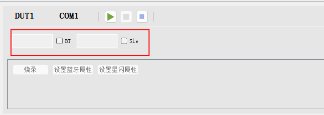

3.  点击“AllStart”执行全部DUT用例。也可以通过执行点击每一个DUT的按钮进行特定的操作。如[图3](#zh-cn_topic_0000002548411505_zh-cn_topic_0000002455711169_fig12302183283916)所示。

    **图 3**  DUT按钮<a name="zh-cn_topic_0000002548411505_zh-cn_topic_0000002455711169_fig12302183283916"></a>  
    

4.  执行用例成功时用例标识会变成绿色，失败时会变成红色，正在执行中时会变为黄色。

    **图 4**  用例标识<a name="zh-cn_topic_0000002548411505_zh-cn_topic_0000002455711169_fig8892530203113"></a>  
    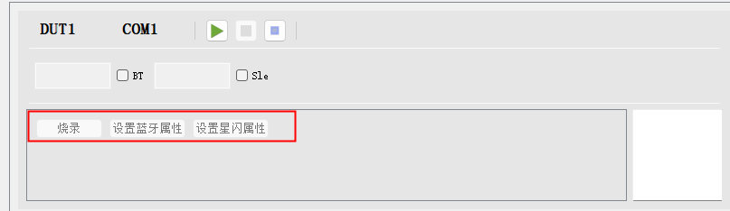

## MAC地址使用优先级<a name="ZH-CN_TOPIC_0000002553254793"></a>

MAC地址分配及使用优先级依次为扫码枪设置、区间段设置、文件设置。

先检测[2](#zh-cn_topic_0000002548411505_zh-cn_topic_0000002455711169_li1845115427156)扫码枪输入是否启用，若在“script\\Hi3322\\DUTX\\temp\\”目录下存在“CurrentSerailNumber.txt”和“CurrentSleNumber.txt”文件，则扫码枪输入已启用，反之未启用。其中DUTX的X为界面的DUT数。

其次检测[2](#zh-cn_topic_0000002516731700_zh-cn_topic_0000002466609025_li1280507121911)区间段MAC地址是否启用，若在“app.exe”同目录下存在“btAddressFile.txt”和“sleAddressFile.txt”文件，则MAC地址已启用，反之未启用。

最后检测[图1](#zh-cn_topic_0000002548531503_zh-cn_topic_0000002512274068_fig1540210263518)的两个红框中的文件是否选择。

三种方式有一种即可，同时存在多种按照优选级来使用地址。

**图 1**  配置MAC地址文件<a name="zh-cn_topic_0000002548531503_zh-cn_topic_0000002512274068_fig1540210263518"></a>  
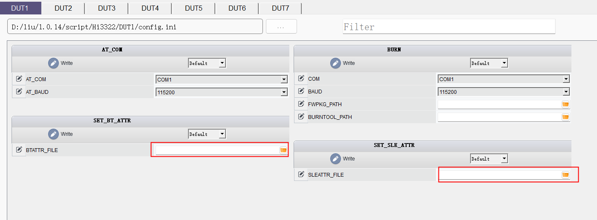

# 二次开发<a name="ZH-CN_TOPIC_0000002553254791"></a>

-   **[新增可配置参数](#ZH-CN_TOPIC_0000002553254785)**  

-   **[添加Write all同步项](#ZH-CN_TOPIC_0000002537659368)**  

-   **[新增执行用例配置](#ZH-CN_TOPIC_0000002553414747)**  

-   **[特殊日志打印](#ZH-CN_TOPIC_0000002553254789)**  

-   **[NV项读写](#ZH-CN_TOPIC_0000002568499163)**  

## 新增可配置参数<a name="ZH-CN_TOPIC_0000002553254785"></a>

可通过配置“<工具安装路径\>\\share\\config\\<chip\>.xml”来决定界面可配参数，参数配置后可以写入到“config.ini”文件中（具体步骤请参考“[参数修改](#ZH-CN_TOPIC_0000002466609025)”），修改之后需要重启工具生效。

xml添加参数例如：

```
<STRUCT ID="Burn" ALIAS="BURN" GROUP_TYPE="TC_COM_PARAM" OUTPUT_TYPE="INI">
    <MEMBER ID="CONNECT_TYPE" TYPE="CONNECTION_TYPE_ENUM" ACCESS="H" FORMAT="32.0"/>
    <MEMBER ID="COM" TYPE="OSAL_COM" COMMENT="烧写镜像使用的串口号" ACCESS="RW" FORMAT="32.0"/>
    <MEMBER ID="BAUD" TYPE="BURN_BAUD" ACCESS="RW" COMMENT="烧写镜像使用的波特率"/>
    <MEMBER ID="SERIAL_BYTE_SIZE" TYPE="OSAL_CHAR" ACCESS="H" FORMAT="32.0"/>
    <MEMBER ID="SERIAL_PARITY" TYPE="OSAL_CHAR" ACCESS="H" FORMAT="32.0"/>
    <MEMBER ID="SERIAL_PARITY_STOP_BITS" TYPE="OSAL_CHAR" ACCESS="H" FORMAT="32.0"/>
    <MEMBER ID="START_DELAY" TYPE="OSAL_CHAR" ACCESS="H" FORMAT="32.0"/>
    <MEMBER ID="FWPKG_PATH" TYPE="OSAL_FILE" ACCESS="RW" FORMAT="32.0"/>
    <MEMBER ID="BURNTOOL_PATH" TYPE="OSAL_FILE" ACCESS="RW" FORMAT="32.0"/>
</STRUCT>
```

XML的参数类型如[表1](#zh-cn_topic_0000002516731702_zh-cn_topic_0000002449859422_table07851524162911)所示。

**表 1**  xml参数类型表

<a name="zh-cn_topic_0000002516731702_zh-cn_topic_0000002449859422_table07851524162911"></a>
<table><thead align="left"><tr id="zh-cn_topic_0000002516731702_zh-cn_topic_0000002449859422_row278562418298"><th class="cellrowborder" valign="top" width="17.77%" id="mcps1.2.3.1.1"><p id="zh-cn_topic_0000002516731702_zh-cn_topic_0000002449859422_p17785172442914"><a name="zh-cn_topic_0000002516731702_zh-cn_topic_0000002449859422_p17785172442914"></a><a name="zh-cn_topic_0000002516731702_zh-cn_topic_0000002449859422_p17785172442914"></a>参数</p>
</th>
<th class="cellrowborder" valign="top" width="82.23%" id="mcps1.2.3.1.2"><p id="zh-cn_topic_0000002516731702_zh-cn_topic_0000002449859422_p1785142482919"><a name="zh-cn_topic_0000002516731702_zh-cn_topic_0000002449859422_p1785142482919"></a><a name="zh-cn_topic_0000002516731702_zh-cn_topic_0000002449859422_p1785142482919"></a>说明</p>
</th>
</tr>
</thead>
<tbody><tr id="zh-cn_topic_0000002516731702_zh-cn_topic_0000002449859422_row1678502411295"><td class="cellrowborder" valign="top" width="17.77%" headers="mcps1.2.3.1.1 "><p id="zh-cn_topic_0000002516731702_zh-cn_topic_0000002449859422_p1578542452917"><a name="zh-cn_topic_0000002516731702_zh-cn_topic_0000002449859422_p1578542452917"></a><a name="zh-cn_topic_0000002516731702_zh-cn_topic_0000002449859422_p1578542452917"></a>ID</p>
</td>
<td class="cellrowborder" valign="top" width="82.23%" headers="mcps1.2.3.1.2 "><p id="zh-cn_topic_0000002516731702_zh-cn_topic_0000002449859422_p246574251417"><a name="zh-cn_topic_0000002516731702_zh-cn_topic_0000002449859422_p246574251417"></a><a name="zh-cn_topic_0000002516731702_zh-cn_topic_0000002449859422_p246574251417"></a>名称。</p>
</td>
</tr>
<tr id="zh-cn_topic_0000002516731702_zh-cn_topic_0000002449859422_row14786132492918"><td class="cellrowborder" valign="top" width="17.77%" headers="mcps1.2.3.1.1 "><p id="zh-cn_topic_0000002516731702_zh-cn_topic_0000002449859422_p17786524172911"><a name="zh-cn_topic_0000002516731702_zh-cn_topic_0000002449859422_p17786524172911"></a><a name="zh-cn_topic_0000002516731702_zh-cn_topic_0000002449859422_p17786524172911"></a>TYPE</p>
</td>
<td class="cellrowborder" valign="top" width="82.23%" headers="mcps1.2.3.1.2 "><div class="p" id="zh-cn_topic_0000002516731702_zh-cn_topic_0000002449859422_p73785435142"><a name="zh-cn_topic_0000002516731702_zh-cn_topic_0000002449859422_p73785435142"></a><a name="zh-cn_topic_0000002516731702_zh-cn_topic_0000002449859422_p73785435142"></a>数据类型：<a name="zh-cn_topic_0000002516731702_zh-cn_topic_0000002449859422_ul089812337304"></a><a name="zh-cn_topic_0000002516731702_zh-cn_topic_0000002449859422_ul089812337304"></a><ul id="zh-cn_topic_0000002516731702_zh-cn_topic_0000002449859422_ul089812337304"><li>OSAL_CHAR，字符串类型。</li><li>OSAL_FILE，文件选择类型。</li><li>OSAL_COM，串口选择类型。</li><li>其他，自定义ENUM，显示在界面中为下拉列表。</li></ul>
</div>
</td>
</tr>
<tr id="zh-cn_topic_0000002516731702_zh-cn_topic_0000002449859422_row5786112442919"><td class="cellrowborder" valign="top" width="17.77%" headers="mcps1.2.3.1.1 "><p id="zh-cn_topic_0000002516731702_zh-cn_topic_0000002449859422_p12786112492914"><a name="zh-cn_topic_0000002516731702_zh-cn_topic_0000002449859422_p12786112492914"></a><a name="zh-cn_topic_0000002516731702_zh-cn_topic_0000002449859422_p12786112492914"></a>ACCESS</p>
</td>
<td class="cellrowborder" valign="top" width="82.23%" headers="mcps1.2.3.1.2 "><div class="p" id="zh-cn_topic_0000002516731702_zh-cn_topic_0000002449859422_p1835364415140"><a name="zh-cn_topic_0000002516731702_zh-cn_topic_0000002449859422_p1835364415140"></a><a name="zh-cn_topic_0000002516731702_zh-cn_topic_0000002449859422_p1835364415140"></a>权限：<a name="zh-cn_topic_0000002516731702_zh-cn_topic_0000002449859422_ul156938211507"></a><a name="zh-cn_topic_0000002516731702_zh-cn_topic_0000002449859422_ul156938211507"></a><ul id="zh-cn_topic_0000002516731702_zh-cn_topic_0000002449859422_ul156938211507"><li>R：读</li><li>W：写</li><li>H：隐藏</li></ul>
</div>
</td>
</tr>
<tr id="zh-cn_topic_0000002516731702_zh-cn_topic_0000002449859422_row151491248151919"><td class="cellrowborder" valign="top" width="17.77%" headers="mcps1.2.3.1.1 "><p id="zh-cn_topic_0000002516731702_zh-cn_topic_0000002449859422_p7149134815196"><a name="zh-cn_topic_0000002516731702_zh-cn_topic_0000002449859422_p7149134815196"></a><a name="zh-cn_topic_0000002516731702_zh-cn_topic_0000002449859422_p7149134815196"></a>COMMENT</p>
</td>
<td class="cellrowborder" valign="top" width="82.23%" headers="mcps1.2.3.1.2 "><p id="zh-cn_topic_0000002516731702_zh-cn_topic_0000002449859422_p114919485196"><a name="zh-cn_topic_0000002516731702_zh-cn_topic_0000002449859422_p114919485196"></a><a name="zh-cn_topic_0000002516731702_zh-cn_topic_0000002449859422_p114919485196"></a>tips，鼠标悬停会显示。</p>
</td>
</tr>
</tbody>
</table>

新增STRUCT时需要将其ID加入到FUNCTION的CONTENT中。FUNCTION配置如下：

```
<FUNCTIONS>
    <FUNCTION ID="PRODUCT_LINE_TEST" TYPE="REG_API_MPI" OUTPUT_TYPE="BIN">
        <CONTENTS>
            <CONTENT>ATCom</CONTENT>
            <CONTENT>Burn</CONTENT>
            <CONTENT>SetBtAttr</CONTENT>
            <CONTENT>SetSleAttr</CONTENT>
            <CONTENT>BtCali</CONTENT>
            <CONTENT>ADCCail</CONTENT>
        </CONTENTS>
        <PARAMETERS/>
    </FUNCTION>
</FUNCTIONS>
```

其中MEMBER标签中的ID为参数名，在ini中应有相同的名字的配置及对应的值，TYPE为参数类型（RW为可读可写，H为隐藏），ACCESS为读写权限。

对应的ini文件中的配置例如：

```
[ATCom]
AT_CONNECT_TYPE=0
AT_COM=COM16
AT_BAUD=115200
AT_SERIAL_BYTE_SIZE=8
AT_SERIAL_PARITY=N
AT_SERIAL_PARITY_STOP_BITS=1
```

等号前面对应的xml中的ID，后面代表着对应的值，后续脚本通过读取这种ini来获取需要的值。

## 添加Write all同步项<a name="ZH-CN_TOPIC_0000002537659368"></a>

新增配置项须点击“Write all”同步每一个界面，可在“<工具安装路径\>\\share\\config\\config\_<chip\>\\config.ini”中添加需要同步的配置项。添加内容为在“[参数修改](#ZH-CN_TOPIC_0000002522134822)”选中的“config.ini”的配置键值，使用“,”隔开。如下所示：

```
[sync]
CONFIG="Burn/BAUD,Burn/FWPKG_PATH,Burn/BURNTOOL_PATH,SetBtAttr/BTATTR_FILE,SetSleAttr/SLEATTR_FILE,BtCali/CALI_GOLDEN_COM,ADCCail/CHANNEL,ADCCail/VOLTAGE"
```

## 新增执行用例配置<a name="ZH-CN_TOPIC_0000002553414747"></a>

“[参数修改](#ZH-CN_TOPIC_0000002522134822)”中选择的“config.ini”文件中需要带有执行用例的信息。新增则在其中添加。如下所示，例如“Burn.py”代表着执行烧录时的脚本，“烧录”代表着这条用例的名称，“0”代表着执行此用例失败后是否继续往下进行。

```
[Testcase]
Burn.py=烧录:0
SetBtAttr.py=设置蓝牙属性:0
SetBtCali.py=频偏校准:0
```

> **须知：** 
>脚本文件需要和“[参数修改](#ZH-CN_TOPIC_0000002522134822)”选中的“config.ini”在同一目录下。
>新写的脚本需要包含“<用例名\> start”，“<用例名\> Success”，“<用例名\> Failed”的打印，才能统计用例成功或者失败的次数和颜色标识，具体特殊打印请参考“[特殊日志打印](#ZH-CN_TOPIC_0000002553254789)”。
>当新增用例时，用例名称不能重复。

## 特殊日志打印<a name="ZH-CN_TOPIC_0000002553254789"></a>

**表 1**  特殊日志打印

<a name="zh-cn_topic_0000002548531505_zh-cn_topic_0000002498549094_table07851524162911"></a>
<table><thead align="left"><tr id="zh-cn_topic_0000002548531505_zh-cn_topic_0000002498549094_row278562418298"><th class="cellrowborder" valign="top" width="27.42%" id="mcps1.2.3.1.1"><p id="zh-cn_topic_0000002548531505_zh-cn_topic_0000002498549094_p17785172442914"><a name="zh-cn_topic_0000002548531505_zh-cn_topic_0000002498549094_p17785172442914"></a><a name="zh-cn_topic_0000002548531505_zh-cn_topic_0000002498549094_p17785172442914"></a>打印内容</p>
</th>
<th class="cellrowborder" valign="top" width="72.58%" id="mcps1.2.3.1.2"><p id="zh-cn_topic_0000002548531505_zh-cn_topic_0000002498549094_p1785142482919"><a name="zh-cn_topic_0000002548531505_zh-cn_topic_0000002498549094_p1785142482919"></a><a name="zh-cn_topic_0000002548531505_zh-cn_topic_0000002498549094_p1785142482919"></a>说明</p>
</th>
</tr>
</thead>
<tbody><tr id="zh-cn_topic_0000002548531505_zh-cn_topic_0000002498549094_row1678502411295"><td class="cellrowborder" valign="top" width="27.42%" headers="mcps1.2.3.1.1 "><p id="zh-cn_topic_0000002548531505_zh-cn_topic_0000002498549094_p1578542452917"><a name="zh-cn_topic_0000002548531505_zh-cn_topic_0000002498549094_p1578542452917"></a><a name="zh-cn_topic_0000002548531505_zh-cn_topic_0000002498549094_p1578542452917"></a>&lt;用例名&gt; start</p>
</td>
<td class="cellrowborder" valign="top" width="72.58%" headers="mcps1.2.3.1.2 "><p id="zh-cn_topic_0000002548531505_zh-cn_topic_0000002498549094_p246574251417"><a name="zh-cn_topic_0000002548531505_zh-cn_topic_0000002498549094_p246574251417"></a><a name="zh-cn_topic_0000002548531505_zh-cn_topic_0000002498549094_p246574251417"></a>用例执行开始。</p>
</td>
</tr>
<tr id="zh-cn_topic_0000002548531505_zh-cn_topic_0000002498549094_row14786132492918"><td class="cellrowborder" valign="top" width="27.42%" headers="mcps1.2.3.1.1 "><p id="zh-cn_topic_0000002548531505_zh-cn_topic_0000002498549094_p17786524172911"><a name="zh-cn_topic_0000002548531505_zh-cn_topic_0000002498549094_p17786524172911"></a><a name="zh-cn_topic_0000002548531505_zh-cn_topic_0000002498549094_p17786524172911"></a>&lt;用例名&gt; Success</p>
</td>
<td class="cellrowborder" valign="top" width="72.58%" headers="mcps1.2.3.1.2 "><p id="zh-cn_topic_0000002548531505_zh-cn_topic_0000002498549094_p20135104010"><a name="zh-cn_topic_0000002548531505_zh-cn_topic_0000002498549094_p20135104010"></a><a name="zh-cn_topic_0000002548531505_zh-cn_topic_0000002498549094_p20135104010"></a>用例执行成功。</p>
</td>
</tr>
<tr id="zh-cn_topic_0000002548531505_zh-cn_topic_0000002498549094_row5786112442919"><td class="cellrowborder" valign="top" width="27.42%" headers="mcps1.2.3.1.1 "><p id="zh-cn_topic_0000002548531505_zh-cn_topic_0000002498549094_p2571102194717"><a name="zh-cn_topic_0000002548531505_zh-cn_topic_0000002498549094_p2571102194717"></a><a name="zh-cn_topic_0000002548531505_zh-cn_topic_0000002498549094_p2571102194717"></a>&lt;用例名&gt; Failed</p>
</td>
<td class="cellrowborder" valign="top" width="72.58%" headers="mcps1.2.3.1.2 "><p id="zh-cn_topic_0000002548531505_zh-cn_topic_0000002498549094_p1398419134115"><a name="zh-cn_topic_0000002548531505_zh-cn_topic_0000002498549094_p1398419134115"></a><a name="zh-cn_topic_0000002548531505_zh-cn_topic_0000002498549094_p1398419134115"></a>用例执行失败。</p>
</td>
</tr>
<tr id="zh-cn_topic_0000002548531505_zh-cn_topic_0000002498549094_row151491248151919"><td class="cellrowborder" valign="top" width="27.42%" headers="mcps1.2.3.1.1 "><p id="zh-cn_topic_0000002548531505_zh-cn_topic_0000002498549094_p16579103118414"><a name="zh-cn_topic_0000002548531505_zh-cn_topic_0000002498549094_p16579103118414"></a><a name="zh-cn_topic_0000002548531505_zh-cn_topic_0000002498549094_p16579103118414"></a>FileName:&lt;命名&gt;</p>
</td>
<td class="cellrowborder" valign="top" width="72.58%" headers="mcps1.2.3.1.2 "><p id="zh-cn_topic_0000002548531505_zh-cn_topic_0000002498549094_p9771194719413"><a name="zh-cn_topic_0000002548531505_zh-cn_topic_0000002498549094_p9771194719413"></a><a name="zh-cn_topic_0000002548531505_zh-cn_topic_0000002498549094_p9771194719413"></a>日志文件命名添加。</p>
</td>
</tr>
<tr id="zh-cn_topic_0000002548531505_zh-cn_topic_0000002498549094_row12758231421"><td class="cellrowborder" valign="top" width="27.42%" headers="mcps1.2.3.1.1 "><p id="zh-cn_topic_0000002548531505_zh-cn_topic_0000002498549094_p127517236421"><a name="zh-cn_topic_0000002548531505_zh-cn_topic_0000002498549094_p127517236421"></a><a name="zh-cn_topic_0000002548531505_zh-cn_topic_0000002498549094_p127517236421"></a>Integrate:&lt;关键信息&gt;</p>
</td>
<td class="cellrowborder" valign="top" width="72.58%" headers="mcps1.2.3.1.2 "><p id="zh-cn_topic_0000002548531505_zh-cn_topic_0000002498549094_p1475102384212"><a name="zh-cn_topic_0000002548531505_zh-cn_topic_0000002498549094_p1475102384212"></a><a name="zh-cn_topic_0000002548531505_zh-cn_topic_0000002498549094_p1475102384212"></a>显示在日志最后的关键信息。</p>
</td>
</tr>
<tr id="zh-cn_topic_0000002548531505_zh-cn_topic_0000002498549094_row15269423510"><td class="cellrowborder" valign="top" width="27.42%" headers="mcps1.2.3.1.1 "><p id="zh-cn_topic_0000002548531505_zh-cn_topic_0000002498549094_p152664216511"><a name="zh-cn_topic_0000002548531505_zh-cn_topic_0000002498549094_p152664216511"></a><a name="zh-cn_topic_0000002548531505_zh-cn_topic_0000002498549094_p152664216511"></a><span id="zh-cn_topic_0000002548531505_zh-cn_topic_0000002498549094_ph148835135117"><a name="zh-cn_topic_0000002548531505_zh-cn_topic_0000002498549094_ph148835135117"></a><a name="zh-cn_topic_0000002548531505_zh-cn_topic_0000002498549094_ph148835135117"></a>LOG</span><span id="zh-cn_topic_0000002548531505_zh-cn_topic_0000002498549094_ph834815945114"><a name="zh-cn_topic_0000002548531505_zh-cn_topic_0000002498549094_ph834815945114"></a><a name="zh-cn_topic_0000002548531505_zh-cn_topic_0000002498549094_ph834815945114"></a>&lt;关键信息&gt;</span></p>
</td>
<td class="cellrowborder" valign="top" width="72.58%" headers="mcps1.2.3.1.2 "><p id="zh-cn_topic_0000002548531505_zh-cn_topic_0000002498549094_p126134218513"><a name="zh-cn_topic_0000002548531505_zh-cn_topic_0000002498549094_p126134218513"></a><a name="zh-cn_topic_0000002548531505_zh-cn_topic_0000002498549094_p126134218513"></a><span id="zh-cn_topic_0000002548531505_zh-cn_topic_0000002498549094_ph8781934523"><a name="zh-cn_topic_0000002548531505_zh-cn_topic_0000002498549094_ph8781934523"></a><a name="zh-cn_topic_0000002548531505_zh-cn_topic_0000002498549094_ph8781934523"></a>显示在右侧结果框中的关键信息</span></p>
</td>
</tr>
</tbody>
</table>

## NV项读写<a name="ZH-CN_TOPIC_0000002568499163"></a>

1.  打开安装目录下“./script/\{产品名\}/DUT1”。
2.  将“config \_nv.ini”文件名改为“config.ini”。
3.  <a name="zh-cn_topic_0000002537658690_zh-cn_topic_0000002526987604_li126167173010"></a>在上述文件中添加读写的AT命令（GET， SET）。如下：

    ```
    [xxx]
    GET_COMMAND="AT^xxx"
    SET_COMMAND="AT^xxx"
    START_DELAY=0
    EXPECT=OK
    TIMEOUT=2
    ```

4.  读取NV实现，打开“NVInfoRead.py”，复制如下代码写入到主函数中。（参考[3](#zh-cn_topic_0000002537658690_zh-cn_topic_0000002526987604_li126167173010)的代码块，get\_nv第一个参数是“\[\]”中的内容；第二个参数为读取NV的AT命令等号前的内容，一般为“GET\_COMMAND“；第三个参数为单板回复内容所匹配的固定字符串，取到NV信息写入到“output.txt”中准备写回单板中）。

    ```
    ret = get_nv("xxx", "GET_COMMAND", 'xxx')
        if ret == False:
            print("xxx Failed!")
            exit(0)
    ```

5.  写入NV实现，打开“NVInfoWrite.py”，复制如下代码写入到主函数中。（参考[3](#zh-cn_topic_0000002537658690_zh-cn_topic_0000002526987604_li126167173010)的代码块，get\_nv第一个参数是“\[\]”中的内容；第二个参数为读取NV的AT命令等号前的内容，一般为“GET\_COMMAND“；第三个参数为查找“output.txt”中的字符串；第四个参数为正则匹配设置需要的内容）。

    ```
    ret = set_nv("SetBtAttr", "GET_COMMAND", '^btaddr', r'([0-9A-Fa-f]{12})')
    if ret == False:
        print("写入NV信息 Failed!")
        exit(0)
    ```

