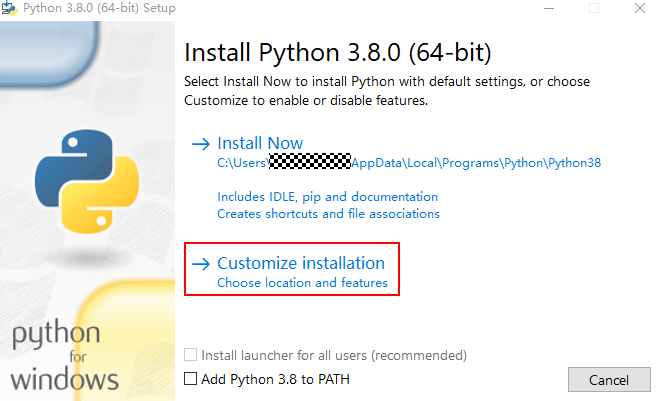
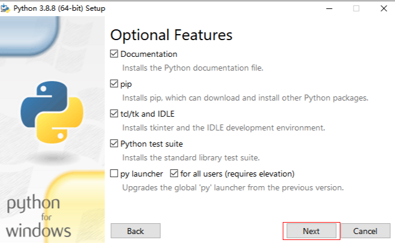
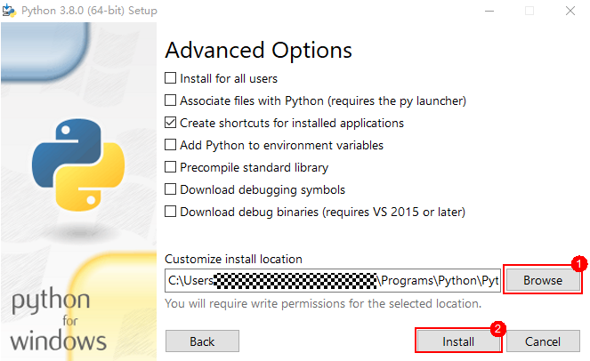
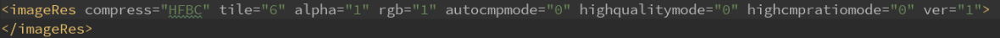
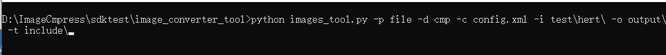
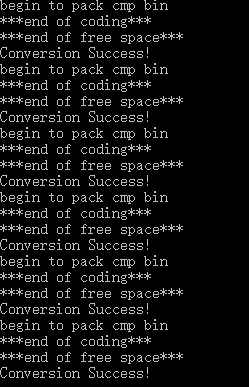
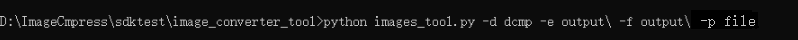
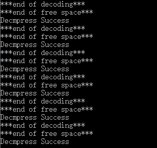
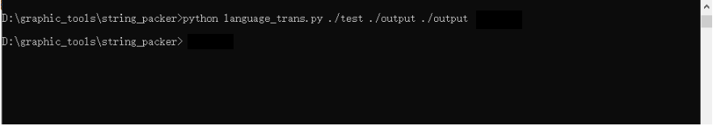
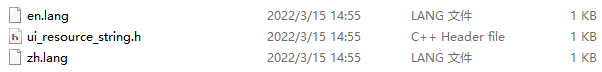

# 前言<a name="ZH-CN_TOPIC_0000002466382012"></a>

**概述<a name="zh-cn_topic_0000002415831868_section4537382116410"></a>**

本文档介绍图形工具的使用方法，用于帮助用户快速了解本工具并对可执行文件进行自定义编辑。

**读者对象<a name="zh-cn_topic_0000002415831868_section4378592816410"></a>**

本文档主要适用于以下工程师：

-   技术支持工程师
-   软件开发工程师

**符号约定<a name="zh-cn_topic_0000002415831868_section133020216410"></a>**

在本文中可能出现下列标志，它们所代表的含义如下。

<a name="zh-cn_topic_0000002415831868_table2622507016410"></a>
<table><thead align="left"><tr id="zh-cn_topic_0000002415831868_row1530720816410"><th class="cellrowborder" valign="top" width="20.580000000000002%" id="mcps1.1.3.1.1"><p id="zh-cn_topic_0000002415831868_p6450074116410"><a name="zh-cn_topic_0000002415831868_p6450074116410"></a><a name="zh-cn_topic_0000002415831868_p6450074116410"></a><strong id="zh-cn_topic_0000002415831868_b2136615816410"><a name="zh-cn_topic_0000002415831868_b2136615816410"></a><a name="zh-cn_topic_0000002415831868_b2136615816410"></a>符号</strong></p>
</th>
<th class="cellrowborder" valign="top" width="79.42%" id="mcps1.1.3.1.2"><p id="zh-cn_topic_0000002415831868_p5435366816410"><a name="zh-cn_topic_0000002415831868_p5435366816410"></a><a name="zh-cn_topic_0000002415831868_p5435366816410"></a><strong id="zh-cn_topic_0000002415831868_b5941558116410"><a name="zh-cn_topic_0000002415831868_b5941558116410"></a><a name="zh-cn_topic_0000002415831868_b5941558116410"></a>说明</strong></p>
</th>
</tr>
</thead>
<tbody><tr id="zh-cn_topic_0000002415831868_row1372280416410"><td class="cellrowborder" valign="top" width="20.580000000000002%" headers="mcps1.1.3.1.1 "><p id="zh-cn_topic_0000002415831868_p3734547016410"><a name="zh-cn_topic_0000002415831868_p3734547016410"></a><a name="zh-cn_topic_0000002415831868_p3734547016410"></a><a name="zh-cn_topic_0000002415831868_image2670064316410"></a><a name="zh-cn_topic_0000002415831868_image2670064316410"></a><span></span></p>
</td>
<td class="cellrowborder" valign="top" width="79.42%" headers="mcps1.1.3.1.2 "><p id="zh-cn_topic_0000002415831868_p1757432116410"><a name="zh-cn_topic_0000002415831868_p1757432116410"></a><a name="zh-cn_topic_0000002415831868_p1757432116410"></a>表示如不避免则将会导致死亡或严重伤害的具有高等级风险的危害。</p>
</td>
</tr>
<tr id="zh-cn_topic_0000002415831868_row466863216410"><td class="cellrowborder" valign="top" width="20.580000000000002%" headers="mcps1.1.3.1.1 "><p id="zh-cn_topic_0000002415831868_p1432579516410"><a name="zh-cn_topic_0000002415831868_p1432579516410"></a><a name="zh-cn_topic_0000002415831868_p1432579516410"></a><a name="zh-cn_topic_0000002415831868_image4895582316410"></a><a name="zh-cn_topic_0000002415831868_image4895582316410"></a><span></span></p>
</td>
<td class="cellrowborder" valign="top" width="79.42%" headers="mcps1.1.3.1.2 "><p id="zh-cn_topic_0000002415831868_p959197916410"><a name="zh-cn_topic_0000002415831868_p959197916410"></a><a name="zh-cn_topic_0000002415831868_p959197916410"></a>表示如不避免则可能导致死亡或严重伤害的具有中等级风险的危害。</p>
</td>
</tr>
<tr id="zh-cn_topic_0000002415831868_row123863216410"><td class="cellrowborder" valign="top" width="20.580000000000002%" headers="mcps1.1.3.1.1 "><p id="zh-cn_topic_0000002415831868_p1232579516410"><a name="zh-cn_topic_0000002415831868_p1232579516410"></a><a name="zh-cn_topic_0000002415831868_p1232579516410"></a><a name="zh-cn_topic_0000002415831868_image1235582316410"></a><a name="zh-cn_topic_0000002415831868_image1235582316410"></a><span></span></p>
</td>
<td class="cellrowborder" valign="top" width="79.42%" headers="mcps1.1.3.1.2 "><p id="zh-cn_topic_0000002415831868_p123197916410"><a name="zh-cn_topic_0000002415831868_p123197916410"></a><a name="zh-cn_topic_0000002415831868_p123197916410"></a>表示如不避免则可能导致轻微或中度伤害的具有低等级风险的危害。</p>
</td>
</tr>
<tr id="zh-cn_topic_0000002415831868_row5786682116410"><td class="cellrowborder" valign="top" width="20.580000000000002%" headers="mcps1.1.3.1.1 "><p id="zh-cn_topic_0000002415831868_p2204984716410"><a name="zh-cn_topic_0000002415831868_p2204984716410"></a><a name="zh-cn_topic_0000002415831868_p2204984716410"></a><a name="zh-cn_topic_0000002415831868_image4504446716410"></a><a name="zh-cn_topic_0000002415831868_image4504446716410"></a><span></span></p>
</td>
<td class="cellrowborder" valign="top" width="79.42%" headers="mcps1.1.3.1.2 "><p id="zh-cn_topic_0000002415831868_p4388861916410"><a name="zh-cn_topic_0000002415831868_p4388861916410"></a><a name="zh-cn_topic_0000002415831868_p4388861916410"></a>用于传递设备或环境安全警示信息。如不避免则可能会导致设备损坏、数据丢失、设备性能降低或其它不可预知的结果。</p>
<p id="zh-cn_topic_0000002415831868_p1238861916410"><a name="zh-cn_topic_0000002415831868_p1238861916410"></a><a name="zh-cn_topic_0000002415831868_p1238861916410"></a>“须知”不涉及人身伤害。</p>
</td>
</tr>
<tr id="zh-cn_topic_0000002415831868_row2856923116410"><td class="cellrowborder" valign="top" width="20.580000000000002%" headers="mcps1.1.3.1.1 "><p id="zh-cn_topic_0000002415831868_p5555360116410"><a name="zh-cn_topic_0000002415831868_p5555360116410"></a><a name="zh-cn_topic_0000002415831868_p5555360116410"></a><a name="zh-cn_topic_0000002415831868_image799324016410"></a><a name="zh-cn_topic_0000002415831868_image799324016410"></a><span></span></p>
</td>
<td class="cellrowborder" valign="top" width="79.42%" headers="mcps1.1.3.1.2 "><p id="zh-cn_topic_0000002415831868_p4612588116410"><a name="zh-cn_topic_0000002415831868_p4612588116410"></a><a name="zh-cn_topic_0000002415831868_p4612588116410"></a>对正文中重点信息的补充说明。</p>
<p id="zh-cn_topic_0000002415831868_p1232588116410"><a name="zh-cn_topic_0000002415831868_p1232588116410"></a><a name="zh-cn_topic_0000002415831868_p1232588116410"></a>“说明”不是安全警示信息，不涉及人身、设备及环境伤害信息。</p>
</td>
</tr>
</tbody>
</table>

# 工具详情<a name="ZH-CN_TOPIC_0000002499500961"></a>

-   **[图片压缩打包工具](#ZH-CN_TOPIC_0000002466382032)**  

-   **[多语言字符串转换工具](#ZH-CN_TOPIC_0000002466382048)**  

-   **[离线表盘xml转换工具](#ZH-CN_TOPIC_0000002499581033)**  

-   **[获取视频第一帧工具](#ZH-CN_TOPIC_0000002466382008)**  

-   **[Lottie工具](#ZH-CN_TOPIC_0000002499500969)**  

-   **[多媒体工具](#ZH-CN_TOPIC_0000002577932510)**  

## 图片压缩打包工具<a name="ZH-CN_TOPIC_0000002466382032"></a>

通过调用图片压缩打包工具将图片压缩为单板可识别的bin文件。

-   **[环境配置](#ZH-CN_TOPIC_0000002499581021)**  

-   **[参数说明](#ZH-CN_TOPIC_0000002499501005)**  

-   **[实例](#ZH-CN_TOPIC_0000002466541640)**  

-   **[压缩库说明](#ZH-CN_TOPIC_0000002499500989)**  

### 环境配置<a name="ZH-CN_TOPIC_0000002499581021"></a>

**Python 3.8.0 for Windows：**

1.  下载[python-3.8.0](https://www.python.org/ftp/python/3.8.0/python-3.8.0-amd64.exe)安装包，双击“python-3.8.0-amd64.exe”安装工具，选择“Customize installation”，如[图1](#zh-cn_topic_0000002449470833_zh-cn_topic_0000001192216030_fig1050510344412)所示。

    **图 1**  Python安装界面1<a name="zh-cn_topic_0000002449470833_zh-cn_topic_0000001192216030_fig1050510344412"></a>  
    

2.  其他项均按默认选中即可，单击“Next”按钮。

    **图 2**  Python安装界面2<a name="zh-cn_topic_0000002449470833_fig658219178349"></a>  
    

3.  如[图3](#zh-cn_topic_0000002449470833_fig1689032993415)所示，单击“Browse”选择安装路径，并单击“Install”按钮进行安装。

    **图 3**  Python安装界面3<a name="zh-cn_topic_0000002449470833_fig1689032993415"></a>  
    

> **须知：** 
>图片打包工具在源码包“\\tools\\image\_converter\_tool”路径下。

> **说明：** 
>Python3.8安装成功后需要安装以下必要模块：
>-   opencv模块：pip install opencv-python
>-   numpy模块：pip install --user numpy scipy matplotlib
>-   Pillow模块：pip install Pillow
>-   matplotlib模块：pip install matplotlib
>注意：因安装环境或版本不同可能导致缺少的模块有所差异，请根据实际缺少模块安装。

### 参数说明<a name="ZH-CN_TOPIC_0000002499501005"></a>

-   图片资源打包工具的功能：依据xml文件配置的压缩算法以及像素格式信息，将指定目录下的每一个子目录都打包成一个资源文件并且生成资源索引文件“ImageResources.cpp”；或者将指定目录下的每一个图片文件都打包成一个资源文件。
-   命令格式：python images\_tool.py -p \[dir|file\] -d \[cmp|dcmp\] -c <Config XML\> -i <Input Dir\> -o <Output Dir\> -t <Output Head Dir\> -e <Input Dcmp Dir\> -f <Output Image Dir\>
-   说明：

    -   -p：指定打包方式，分别为dir、file两种打包方式。
        -   dir：将图片进行打包后，再以子文件夹为单位将其包含的已打包过的图片在一起打包。
        -   file：以每个图片为单位进行打包。

    -   -d：指定压缩、解压模式，分别为cmp、dcmp两种模式。
        -   cmp：压缩模式。
        -   dcmp：解压模式。

    -   -c：配置文件，指定打包的压缩算法、像素格式以及非压缩情形下的字节对齐值。
        -   压缩算法可选：NONE|HFBC|HFBC\_ABYPASS。
        -   像素格式可选：RGB565|RGB888|ARGB8888。

    -   -i：指定待处理图片的根目录，图片目录下的图片可以为“.jpg、.png、.bmp”格式。
    -   -o：指定输出的文件夹。

        > **须知：** 
        >如果输出文件夹和输入文件夹不一致，会先删除输出文件夹再创建。

    -   -t：指定头文件“ui\_resource\_image.h”生成的目录，仅在dir打包方式下生效。
    -   -e：指定需要解压的文件的路径，文件类型为“.bin”。
    -   -f：指定解压后图片输出的路径。
    -   -rotate：buffer预旋转角度。0：0；1：90；2：180；3：270。

    > **须知：** 
    >-   子文件夹名以及文件名必须为数字以及字母的组合。
    >-   路径支持绝对路径，也支持相对路径。

**表 1**  XML配置文件参数说明

<a name="zh-cn_topic_0000002415991688_zh-cn_topic_0000001237496003_table17410134363619"></a>
<table><thead align="left"><tr id="zh-cn_topic_0000002415991688_zh-cn_topic_0000001237496003_row5462154323611"><th class="cellrowborder" valign="top" width="17.098290170982903%" id="mcps1.2.4.1.1"><p id="zh-cn_topic_0000002415991688_zh-cn_topic_0000001237496003_p2462243173613"><a name="zh-cn_topic_0000002415991688_zh-cn_topic_0000001237496003_p2462243173613"></a><a name="zh-cn_topic_0000002415991688_zh-cn_topic_0000001237496003_p2462243173613"></a>标签</p>
</th>
<th class="cellrowborder" valign="top" width="17.91820817918208%" id="mcps1.2.4.1.2"><p id="zh-cn_topic_0000002415991688_zh-cn_topic_0000001237496003_p946219437363"><a name="zh-cn_topic_0000002415991688_zh-cn_topic_0000001237496003_p946219437363"></a><a name="zh-cn_topic_0000002415991688_zh-cn_topic_0000001237496003_p946219437363"></a>属性</p>
</th>
<th class="cellrowborder" valign="top" width="64.98350164983502%" id="mcps1.2.4.1.3"><p id="zh-cn_topic_0000002415991688_zh-cn_topic_0000001237496003_p24626430369"><a name="zh-cn_topic_0000002415991688_zh-cn_topic_0000001237496003_p24626430369"></a><a name="zh-cn_topic_0000002415991688_zh-cn_topic_0000001237496003_p24626430369"></a>说明</p>
</th>
</tr>
</thead>
<tbody><tr id="zh-cn_topic_0000002415991688_zh-cn_topic_0000001237496003_row93171112816"><td class="cellrowborder" rowspan="3" valign="top" width="17.098290170982903%" headers="mcps1.2.4.1.1 "><p id="zh-cn_topic_0000002415991688_zh-cn_topic_0000001237496003_p109151457172717"><a name="zh-cn_topic_0000002415991688_zh-cn_topic_0000001237496003_p109151457172717"></a><a name="zh-cn_topic_0000002415991688_zh-cn_topic_0000001237496003_p109151457172717"></a>imageRes</p>
</td>
<td class="cellrowborder" valign="top" width="17.91820817918208%" headers="mcps1.2.4.1.2 "><p id="zh-cn_topic_0000002415991688_zh-cn_topic_0000001237496003_p10915175716277"><a name="zh-cn_topic_0000002415991688_zh-cn_topic_0000001237496003_p10915175716277"></a><a name="zh-cn_topic_0000002415991688_zh-cn_topic_0000001237496003_p10915175716277"></a>-</p>
</td>
<td class="cellrowborder" valign="top" width="64.98350164983502%" headers="mcps1.2.4.1.3 "><p id="zh-cn_topic_0000002415991688_zh-cn_topic_0000001237496003_p59151157152713"><a name="zh-cn_topic_0000002415991688_zh-cn_topic_0000001237496003_p59151157152713"></a><a name="zh-cn_topic_0000002415991688_zh-cn_topic_0000001237496003_p59151157152713"></a>imageRes为根标签。</p>
</td>
</tr>
<tr id="zh-cn_topic_0000002415991688_zh-cn_topic_0000001237496003_row2371132812"><td class="cellrowborder" valign="top" headers="mcps1.2.4.1.1 "><p id="zh-cn_topic_0000002415991688_zh-cn_topic_0000001237496003_p39151157162719"><a name="zh-cn_topic_0000002415991688_zh-cn_topic_0000001237496003_p39151157162719"></a><a name="zh-cn_topic_0000002415991688_zh-cn_topic_0000001237496003_p39151157162719"></a>compress</p>
</td>
<td class="cellrowborder" valign="top" headers="mcps1.2.4.1.2 "><p id="zh-cn_topic_0000002415991688_zh-cn_topic_0000001237496003_p19151157182719"><a name="zh-cn_topic_0000002415991688_zh-cn_topic_0000001237496003_p19151157182719"></a><a name="zh-cn_topic_0000002415991688_zh-cn_topic_0000001237496003_p19151157182719"></a>指定默认打包方式，取值可为：NONE|HFBC|HFBC_ABYPASS。</p>
</td>
</tr>
<tr id="zh-cn_topic_0000002415991688_zh-cn_topic_0000001237496003_row33215285"><td class="cellrowborder" valign="top" headers="mcps1.2.4.1.1 "><p id="zh-cn_topic_0000002415991688_zh-cn_topic_0000001237496003_p191505712714"><a name="zh-cn_topic_0000002415991688_zh-cn_topic_0000001237496003_p191505712714"></a><a name="zh-cn_topic_0000002415991688_zh-cn_topic_0000001237496003_p191505712714"></a>format</p>
</td>
<td class="cellrowborder" valign="top" headers="mcps1.2.4.1.2 "><p id="zh-cn_topic_0000002415991688_zh-cn_topic_0000001237496003_p11915155719272"><a name="zh-cn_topic_0000002415991688_zh-cn_topic_0000001237496003_p11915155719272"></a><a name="zh-cn_topic_0000002415991688_zh-cn_topic_0000001237496003_p11915155719272"></a>指定默认像素格式，取值可为：RGB565|RGB888|ARGB8888。</p>
</td>
</tr>
<tr id="zh-cn_topic_0000002415991688_zh-cn_topic_0000001237496003_row922118289"><td class="cellrowborder" rowspan="4" valign="top" width="17.098290170982903%" headers="mcps1.2.4.1.1 "><p id="zh-cn_topic_0000002415991688_zh-cn_topic_0000001237496003_p1791525719272"><a name="zh-cn_topic_0000002415991688_zh-cn_topic_0000001237496003_p1791525719272"></a><a name="zh-cn_topic_0000002415991688_zh-cn_topic_0000001237496003_p1791525719272"></a>imageDir</p>
</td>
<td class="cellrowborder" valign="top" width="17.91820817918208%" headers="mcps1.2.4.1.2 "><p id="zh-cn_topic_0000002415991688_zh-cn_topic_0000001237496003_p18915185718275"><a name="zh-cn_topic_0000002415991688_zh-cn_topic_0000001237496003_p18915185718275"></a><a name="zh-cn_topic_0000002415991688_zh-cn_topic_0000001237496003_p18915185718275"></a>-</p>
</td>
<td class="cellrowborder" valign="top" width="64.98350164983502%" headers="mcps1.2.4.1.3 "><p id="zh-cn_topic_0000002415991688_zh-cn_topic_0000001237496003_p09151157122719"><a name="zh-cn_topic_0000002415991688_zh-cn_topic_0000001237496003_p09151157122719"></a><a name="zh-cn_topic_0000002415991688_zh-cn_topic_0000001237496003_p09151157122719"></a>imageRes的子标签，用于标识存放图片的文件夹。</p>
</td>
</tr>
<tr id="zh-cn_topic_0000002415991688_zh-cn_topic_0000001237496003_row19181192814"><td class="cellrowborder" valign="top" headers="mcps1.2.4.1.1 "><p id="zh-cn_topic_0000002415991688_zh-cn_topic_0000001237496003_p591525712710"><a name="zh-cn_topic_0000002415991688_zh-cn_topic_0000001237496003_p591525712710"></a><a name="zh-cn_topic_0000002415991688_zh-cn_topic_0000001237496003_p591525712710"></a>name</p>
</td>
<td class="cellrowborder" valign="top" headers="mcps1.2.4.1.2 "><p id="zh-cn_topic_0000002415991688_zh-cn_topic_0000001237496003_p16915557122719"><a name="zh-cn_topic_0000002415991688_zh-cn_topic_0000001237496003_p16915557122719"></a><a name="zh-cn_topic_0000002415991688_zh-cn_topic_0000001237496003_p16915557122719"></a>文件夹名，可以指定为APP的名字，或者场景名，不与APP强绑定。</p>
</td>
</tr>
<tr id="zh-cn_topic_0000002415991688_zh-cn_topic_0000001237496003_row151514285"><td class="cellrowborder" valign="top" headers="mcps1.2.4.1.1 "><p id="zh-cn_topic_0000002415991688_zh-cn_topic_0000001237496003_p1991515702714"><a name="zh-cn_topic_0000002415991688_zh-cn_topic_0000001237496003_p1991515702714"></a><a name="zh-cn_topic_0000002415991688_zh-cn_topic_0000001237496003_p1991515702714"></a>compress</p>
</td>
<td class="cellrowborder" valign="top" headers="mcps1.2.4.1.2 "><p id="zh-cn_topic_0000002415991688_zh-cn_topic_0000001237496003_p119151557112720"><a name="zh-cn_topic_0000002415991688_zh-cn_topic_0000001237496003_p119151557112720"></a><a name="zh-cn_topic_0000002415991688_zh-cn_topic_0000001237496003_p119151557112720"></a>指定该文件夹下的图片文件的默认打包方式，优先级高于imageRes指定的compress属性值。</p>
</td>
</tr>
<tr id="zh-cn_topic_0000002415991688_zh-cn_topic_0000001237496003_row312016280"><td class="cellrowborder" valign="top" headers="mcps1.2.4.1.1 "><p id="zh-cn_topic_0000002415991688_zh-cn_topic_0000001237496003_p1291505742711"><a name="zh-cn_topic_0000002415991688_zh-cn_topic_0000001237496003_p1291505742711"></a><a name="zh-cn_topic_0000002415991688_zh-cn_topic_0000001237496003_p1291505742711"></a>format</p>
</td>
<td class="cellrowborder" valign="top" headers="mcps1.2.4.1.2 "><p id="zh-cn_topic_0000002415991688_zh-cn_topic_0000001237496003_p20915185718275"><a name="zh-cn_topic_0000002415991688_zh-cn_topic_0000001237496003_p20915185718275"></a><a name="zh-cn_topic_0000002415991688_zh-cn_topic_0000001237496003_p20915185718275"></a>指定该文件夹下的图片文件的默认像素格式，优先级高于imageRes指定的format属性值。</p>
</td>
</tr>
<tr id="zh-cn_topic_0000002415991688_zh-cn_topic_0000001237496003_row150151122810"><td class="cellrowborder" rowspan="4" valign="top" width="17.098290170982903%" headers="mcps1.2.4.1.1 "><p id="zh-cn_topic_0000002415991688_zh-cn_topic_0000001237496003_p8915857162719"><a name="zh-cn_topic_0000002415991688_zh-cn_topic_0000001237496003_p8915857162719"></a><a name="zh-cn_topic_0000002415991688_zh-cn_topic_0000001237496003_p8915857162719"></a>imageFile</p>
</td>
<td class="cellrowborder" valign="top" width="17.91820817918208%" headers="mcps1.2.4.1.2 "><p id="zh-cn_topic_0000002415991688_zh-cn_topic_0000001237496003_p59154575273"><a name="zh-cn_topic_0000002415991688_zh-cn_topic_0000001237496003_p59154575273"></a><a name="zh-cn_topic_0000002415991688_zh-cn_topic_0000001237496003_p59154575273"></a>-</p>
</td>
<td class="cellrowborder" valign="top" width="64.98350164983502%" headers="mcps1.2.4.1.3 "><p id="zh-cn_topic_0000002415991688_zh-cn_topic_0000001237496003_p091515571274"><a name="zh-cn_topic_0000002415991688_zh-cn_topic_0000001237496003_p091515571274"></a><a name="zh-cn_topic_0000002415991688_zh-cn_topic_0000001237496003_p091515571274"></a>imageDir的子标签，用于标识具体某一个文件。</p>
</td>
</tr>
<tr id="zh-cn_topic_0000002415991688_zh-cn_topic_0000001237496003_row7999807289"><td class="cellrowborder" valign="top" headers="mcps1.2.4.1.1 "><p id="zh-cn_topic_0000002415991688_zh-cn_topic_0000001237496003_p1591665718271"><a name="zh-cn_topic_0000002415991688_zh-cn_topic_0000001237496003_p1591665718271"></a><a name="zh-cn_topic_0000002415991688_zh-cn_topic_0000001237496003_p1591665718271"></a>name</p>
</td>
<td class="cellrowborder" valign="top" headers="mcps1.2.4.1.2 "><p id="zh-cn_topic_0000002415991688_zh-cn_topic_0000001237496003_p891635719271"><a name="zh-cn_topic_0000002415991688_zh-cn_topic_0000001237496003_p891635719271"></a><a name="zh-cn_topic_0000002415991688_zh-cn_topic_0000001237496003_p891635719271"></a>文件名。</p>
</td>
</tr>
<tr id="zh-cn_topic_0000002415991688_zh-cn_topic_0000001237496003_row599917082812"><td class="cellrowborder" valign="top" headers="mcps1.2.4.1.1 "><p id="zh-cn_topic_0000002415991688_zh-cn_topic_0000001237496003_p791625720271"><a name="zh-cn_topic_0000002415991688_zh-cn_topic_0000001237496003_p791625720271"></a><a name="zh-cn_topic_0000002415991688_zh-cn_topic_0000001237496003_p791625720271"></a>compress</p>
</td>
<td class="cellrowborder" valign="top" headers="mcps1.2.4.1.2 "><p id="zh-cn_topic_0000002415991688_zh-cn_topic_0000001237496003_p109165576278"><a name="zh-cn_topic_0000002415991688_zh-cn_topic_0000001237496003_p109165576278"></a><a name="zh-cn_topic_0000002415991688_zh-cn_topic_0000001237496003_p109165576278"></a>指定特定图片文件的打包方式，优先级高于imageDir指定的compress属性值。</p>
</td>
</tr>
<tr id="zh-cn_topic_0000002415991688_zh-cn_topic_0000001237496003_row699915082813"><td class="cellrowborder" valign="top" headers="mcps1.2.4.1.1 "><p id="zh-cn_topic_0000002415991688_zh-cn_topic_0000001237496003_p1491617575273"><a name="zh-cn_topic_0000002415991688_zh-cn_topic_0000001237496003_p1491617575273"></a><a name="zh-cn_topic_0000002415991688_zh-cn_topic_0000001237496003_p1491617575273"></a>format</p>
</td>
<td class="cellrowborder" valign="top" headers="mcps1.2.4.1.2 "><p id="zh-cn_topic_0000002415991688_zh-cn_topic_0000001237496003_p189161657142716"><a name="zh-cn_topic_0000002415991688_zh-cn_topic_0000001237496003_p189161657142716"></a><a name="zh-cn_topic_0000002415991688_zh-cn_topic_0000001237496003_p189161657142716"></a>指定特定图片文件的像素格式，优先级高于imageDir指定的format属性值。</p>
</td>
</tr>
</tbody>
</table>

XML文件其他参数说明：

-   tile：压缩单元宽度。4--4x4；6--6x4；8--8x4；16--16x4，也叫压缩倍率在ARGB8888格式时分别对应4倍压缩，6倍压缩，8倍压缩，16倍压缩；在RGB888时分别对应3倍压缩，4.5倍压缩，6倍压缩，12倍压缩；在RGB565时分别对应2倍压缩，3倍压缩，4倍压缩，8倍压缩。
-   alpha：压缩模式。0：非压缩；1：压缩。
-   rgb：压缩模式。0：非压缩；1：压缩。
-   align：宽度对齐。固定填写16。
-   autocmpmode：压缩模式。
    -   0：手动压缩模式，按照配置文件的配置参数进行压缩。

-   ver：压缩场景：固定填写1。
-   dirid：生成的“ui\_resource\_image.h”文件中枚举值的路径ID，默认为0，有效范围为0～0xFFF，可不填写。该文件中的枚举值由三位路径ID和五位图片ID拼接而成。

> **须知：** 
>-   alpha和rgb同时为0是非压缩模式请注意适配。
>-   当rgb压缩模式为0时，alpha的压缩模式不能设置为1。
>-   输入图片的像素大小应小于1280×800。
>-   压缩倍率是与裸数据大小进行对比，而非与源文件大小对比，例如466×466的RGBA图片，无压缩大小为848KB，6倍压缩时为142KB，16倍压缩时大约为54KB。
>-   压缩操作为有损压缩，压缩倍率越大，图损越大。
>-   当compress模式选择为NONE时，由于是纯裸数据无法通过脚本的解压命令还原成原图。

### 实例<a name="ZH-CN_TOPIC_0000002466541640"></a>

**压缩模式<a name="zh-cn_topic_0000002415831876_section416015311587"></a>**

压缩模式如下：进入到“images\_tool.py”文件的保存路径下，并在该路径下运行cmd，在cmd命令行中输入命令“python images\_tool.py -p file -d cmp -c config.xml -i test\\hert\\ -o output\\ -t include\\”。如[图2](#zh-cn_topic_0000002415831876_fig191606317587)所示。

> **说明：** 
>上述命令中，“-o”后面的输入参数对应.bin文件生成的路径，“-t”后面的输入参数对应头文件生成的路径。即：
>-   .bin文件生成路径：graphic\_tools\\image\_converter\_tool\\output
>-   头文件生成路径：graphic\_tools\\image\_converter\_tool\\include

**图 1**  压缩的配置文件xml<a name="zh-cn_topic_0000002415831876_fig15528205110182"></a>  


**图 2**  输入命令<a name="zh-cn_topic_0000002415831876_fig191606317587"></a>  


单击回车后，运行结果如[图3](#zh-cn_topic_0000002415831876_fig21600311589)所示。

**图 3**  运行结果<a name="zh-cn_topic_0000002415831876_fig21600311589"></a>  


当命令行界面显示“Conversion Success”时，说明该命令已运行完成，进入对应路径下，可查看到生成的.bin文件与头文件（仅在“-p”参数为dir时会生成头文件）。如[图4](#zh-cn_topic_0000002415831876_fig1416013317587)、[图5](#zh-cn_topic_0000002415831876_fig1160538583)所示。

**图 4**  生成的bin文件<a name="zh-cn_topic_0000002415831876_fig1416013317587"></a>  


**图 5**  生成的头文件<a name="zh-cn_topic_0000002415831876_fig1160538583"></a>  


**解压模式<a name="zh-cn_topic_0000002415831876_section1125818539588"></a>**

解压模式如下：进入到“images\_tool.py”文件的保存路径下，并在该路径下运行cmd，在cmd命令行中输入命令“python images\_tool.py -d dcmp -e output\\ -f output -p file”。如[图6](#zh-cn_topic_0000002415831876_fig172581253115812)所示。

> **说明：** 
>上述命令中，“-p”后面的输入参数为压缩步骤中填写的参数，若压缩时填写file则解压时也需要填写file，“-e”后面的输入参数对应.bin文件的路径（需要解压的文件路径），“-f”后面的输入参数对应解压图片生成的路径。即：
>-   .bin文件路径：graphic\_tools\\image\_converter\_tool\\output
>-   图片生成路径：graphic\_tools\\image\_converter\_tool\\output

**图 6**  输入命令<a name="zh-cn_topic_0000002415831876_fig172581253115812"></a>  


单击回车后，运行结果如[图7](#zh-cn_topic_0000002415831876_fig725819536587)所示。

**图 7**  运行结果<a name="zh-cn_topic_0000002415831876_fig725819536587"></a>  


当命令行界面显示“Decmpress Success”时，说明该命令已运行完成，进入对应路径下，可查看到生成的图片。如[图8](#zh-cn_topic_0000002415831876_fig132581053145812)所示。

**图 8**  生成的图片<a name="zh-cn_topic_0000002415831876_fig132581053145812"></a>  


### 压缩库说明<a name="ZH-CN_TOPIC_0000002499500989"></a>

图形压缩功能提供了安卓、IOS、Windows的图形压缩库和demo，路径为“tools.zip”中的“tools/CompressDemo”。在该文件夹下分别有三个文件夹，其中安卓平台为AndroidDemo，Windows平台为WindowsDemo，IOS平台为IOSDemo，使用指导见各平台目录下的“readme.txt。

## 多语言字符串转换工具<a name="ZH-CN_TOPIC_0000002466382048"></a>

多语言字符串转换工具用于将xml信息转换为.lang文件，单板将使用lang文件作为资源支持不同语言字符展示。

-   **[环境搭建](#ZH-CN_TOPIC_0000002466541680)**  

-   **[参数说明](#ZH-CN_TOPIC_0000002466541632)**  

-   **[实例](#ZH-CN_TOPIC_0000002499580997)**  

### 环境搭建<a name="ZH-CN_TOPIC_0000002466541680"></a>

**Python 3.8.0 for Windows：**

下载  [python-3.8.0](https://www.python.org/ftp/python/3.8.0/python-3.8.0-amd64.exe)安装包，具体安装步骤可参见“[环境配置](#ZH-CN_TOPIC_0000002499581021)”小节。

> **须知：** 
>图片打包工具在源码包在“tools\\string\_packer”路径下。

### 参数说明<a name="ZH-CN_TOPIC_0000002466541632"></a>

-   多语言字符串转换工具的功能：拥有多个语言配置的文件需要生成兼容的多语言二进制文件和头文件。
-   命令格式：language\_trans.py <Xmlpath\> <LangPath\> <HeadPath\>
-   参数说明：
    -   XmlPath：xml输出路径。
    -   LangPath：Language文件bin输出路径。
    -   HeadPath：头文件输出路径。

### 实例<a name="ZH-CN_TOPIC_0000002499580997"></a>

进入到“language\_trans.py”保存路径下，并在该路径下运行cmd，在cmd命令行中输入以下命令，如[图1](#zh-cn_topic_0000002415991684_fig485415321333)所示。

```
python language_trans.py test\ output\ include\
```

> **说明：** 
>文件输出路径对应的是第二个和第三个输入参数的路径，上述示例命令中两个输入参数相同，因此输出文件会生成在同一路径下。
>其中：
>-   第二个参数对应路径为.lang文件输出路径。
>-   第三个参数对应路径为.h文件输出路径。

**图 1**  运行命令<a name="zh-cn_topic_0000002415991684_fig485415321333"></a>  


运行完成后，进入自定义路径下，可查看到已生成的文件，如[图2](#zh-cn_topic_0000002415991684_fig7118151123316)所示。

**图 2**  经脚本转换后的输出文件<a name="zh-cn_topic_0000002415991684_fig7118151123316"></a>  


## 离线表盘xml转换工具<a name="ZH-CN_TOPIC_0000002499581033"></a>

具体详请参考《UIKit 开发指南》的“AOD离线表盘”章节。

## 获取视频第一帧工具<a name="ZH-CN_TOPIC_0000002466382008"></a>

视频在未加载前，首帧为黑帧，需要用户手动设置一张起始预览图，该工具提供提取视频首帧并将其转换为BMP格式图片的能力。工具所在路径：tools\\convert\_2\_bmp。

-   **[参数说明](#ZH-CN_TOPIC_0000002466541660)**  

-   **[注意事项](#ZH-CN_TOPIC_0000002466541648)**  

-   **[实例](#ZH-CN_TOPIC_0000002499581005)**  

### 参数说明<a name="ZH-CN_TOPIC_0000002466541660"></a>

命令格式：python convert\_2\_bmp.py \[-h\] -f FILE -s ?x? \[-o OUT\]

参数说明如下：

-   -h（--help）：显示工具支持参数。
-   -f：需要提取的视频文件路径。
-   -s ?x?：-size \[宽\]x\[高\]，指定视频帧的宽高，需要与视频资源一致。
-   -o OUT：图片生成路径。

### 注意事项<a name="ZH-CN_TOPIC_0000002466541648"></a>

1.  请使用python 3.7及以上版本。

    **Python 3.8.0 for Windows：**

    下载  [python-3.8.0](https://www.python.org/ftp/python/3.8.0/python-3.8.0-amd64.exe)安装包，具体安装步骤可参见“[环境配置](#ZH-CN_TOPIC_0000002499581021)”小节。

2.  工具脚本在指定目录生成一个.bmp文件，请使用该文件作为视频浏览帧。不要使用中间生成文件。
3.  调整视频大小可借助ffmpeg工具。 例："ffmpeg -i video.mp4 -vf crop=454:454 -b:v 4228k -vcodec mjpeg out.mp4"。
4.  输出只支持YUV420，输入支持YUV420和YUV444。

### 实例<a name="ZH-CN_TOPIC_0000002499581005"></a>

实例命令如下：

Windows：python .\\convert\_2\_bmp.py -f .\\test.mp4 -s 466x466 -o .\\output

Linux：python ./convert\_2\_bmp.py -f ./test.mp4 -s 466x466 -o ./output

## Lottie工具<a name="ZH-CN_TOPIC_0000002499500969"></a>

用于将符合Lottie标准的json文件转化为bin文件。

-   Linux命令行示例如下
    -   单文件处理

        ./flatbufferstool input.json output\_flatbuffer.bin

    -   按路径处理

        ./flatbufferstool input output

-   Windows命令行示例如下
    -   单文件处理

        flatbufferstool.exe input.json output\_flatbuffer.bin

    -   按路径处理

        flatbufferstool.exe input output

## 多媒体工具<a name="ZH-CN_TOPIC_0000002577932510"></a>

**环境配置<a name="zh-cn_topic_0000002571750917_section28742019184520"></a>**

前置条件：安装python，并添加到环境变量。

**下载ffmpeg<a name="zh-cn_topic_0000002571750917_section8365041194516"></a>**

-   Liunx：apt-get instasll ffmpeg
-   Windows：https://www.videohelp.com/download/ffmpeg-4.2.2-win64-static.zip

配置环境变量：编辑系统环境变量-\>环境变量-\>Path-\>将解压后的bin绝对路径添加到环境变量里面。

**下载ffmpeg-python、numpy<a name="zh-cn_topic_0000002571750917_section524148194516"></a>**

-   Ubuntu：

    ```
    pip3 install ffmpeg-python
    pip3 install numpy
    pip3 install opencv-python
    pip3 install pillow
    ```

-   Windows：

    ```
    pip install ffmpeg-python
    pip install numpy
    pip install opencv-python
    pip install pillow
    ```

**使用方式<a name="zh-cn_topic_0000002571750917_section14315134614"></a>**

```
usage: main.py [-h] [-o OUTPUT] (--frame | --rotate) [-s SIZE] [-a {0,1,2,3}] [-r {1,2}] input_path
options:
  -h, --help            show this help message and exit
  --frame               获取视频首帧
  --rotate              顺时针方向旋转视频
公共参数:
  input_path            输入文件路径
  -o OUTPUT, --output OUTPUT
                        输出文件路径
取帧参数:
  仅在使用--frame时有效
  -s SIZE, --size SIZE  提取帧宽*高 (格式: WxH)
旋转参数:
  仅在使用--rotate时有效
  -a {0,1,2,3}, --angle {0,1,2,3}
                        旋转角度, 入参为90为倍数。90:1, 180:2, 270:3
  -r {1,2}, --refs {1,2}
                        参考帧数量
```

该工具目前支持两种功能：

-   预旋转视频

    在视频不满足显示条件时，参考帧会按照配置的数量，将视频转换为H264的视频。旋转角度的值以90的倍数进行调整。例：python main.py --rotate -a 1 --refs 2 .\\input -o .\\output

-   提取视频

    如果首帧的宽高与视频不匹配，将转换失败。如果不知道视频帧宽高，可以使用如下命令，例：python main.py --frame -s 0\*0 .\\input -o .\\output

